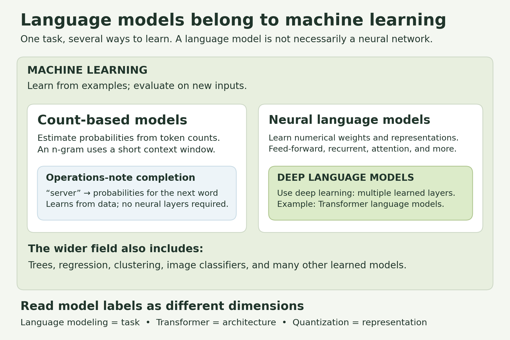

# Machine Learning Super Lab

**Understand it. Run it. Prove it.** A local website for learning machine learning through explanations, visual algorithms, executable Python experiments, and evidence-based assessments.

The course contains **58 lessons**, **16 reference chapters**, **87 Mermaid diagram instances**, and illustrated model-family guides. Start with a tiny model, learn how training works, build models from scratch, compare pretrained approaches, and test complete retrieval and synthetic-data pipelines.

> **New to the concepts? Start with [Tiny AI — AI for Curious Minds](https://from-number-boxes-to-tiny-ai.ericazelic.chatgpt.site).** This illustrated introduction is the prerequisite learning path before the more technical engineering exercises here. Return when you are comfortable discussing inputs, predictions, weights, and learning from errors; the Super Lab explains the implementation details as you go.

[Windows setup](#windows--powershell-or-command-prompt) · [macOS setup](#macos--apple-silicon) · [Linux setup](#linux--ubuntu-2404-example) · [First experiment](#run-your-first-experiment) · [Learning paths](#what-you-will-build) · [More projects](#more-learning-and-projects)



## What you will build

Every lesson is marked **Concept** or **Runnable implementation lab**. A runnable label means executable code is included; the scope label distinguishes a mechanism demonstration, pretrained inference, adaptation, or training from scratch. Tiny models and fictional datasets teach the engineering process; their scores are not production benchmarks.

| Path | Examples | Evidence you produce |
|---|---|---|
| Foundations | Regression, trees, ensembles, nearest neighbors, kernel methods, clustering, dimensionality reduction | Baselines, evaluation metrics, saved artifacts, new-input predictions |
| Neural and generative models | Dense, convolutional and graph neural networks; autoencoders; variational and adversarial generation | Loss curves, tensor shapes, reconstructions, controlled comparisons |
| Language models | Statistical models, tiny Transformer, expert routing, state-space and hybrid mechanisms | Token predictions, causal checks, measured training and inference |
| Pretrained versus scratch | Reuse, fine-tuning, frozen encoders, and a three-branch transfer experiment | Outcomes with matched downstream examples and explicit earlier training cost |
| Build and retrieve | Deep classifier, recurrent language model, masked encoder, encoder–decoder, retrieval-augmented generation | Train → evaluate → save → reload → predict; retrieval and citation audits |
| Synthetic data | Generate, audit, corrupt labels, narrow coverage, and vary volume | Dataset cards, plots, seed-only/generated-only/mixed comparisons |
| Modern language engineering | Attention and caches, block components, sparse experts, tuning, preferences, policy learning, evaluation, and streaming | Controlled comparisons, reload checks, failure analysis, and measured latency |
| Decision systems | A small reinforcement-learning environment | Action values, reward measurements, and comparison with a random policy |

The **language model atlas** explains that language models are part of machine learning. The atlas is a representative map, not an exhaustive list of every possible architecture. Larger project plans are clearly labeled Concept.

## What runs where

Your browser displays the lessons, editor, and results. A Python server on **your computer** runs the exercises and saves their outputs. This is a real Python workbench, not an isolated operating-system emulator.

- The server and the first editor example need only Python's standard library.
- Model exercises need the pinned dependencies installed once in a project virtual environment.
- Many foundation and synthetic-data labs need no model download. Pretrained exercises download their selected checkpoint on first use.
- The starting language model is SmolLM2 with 135 million parameters. Core teaching exercises use a **central processing unit (CPU)**; a **graphics processing unit (GPU)** and a paid cloud account are optional.
- No Git, Node.js, Git Bash, Docker, or application programming interface key is required for the normal download-and-run path.
- The website binds to localhost by default. Keep it local: workbench code runs with your operating-system account's permissions.

The Python backend is required. Opening `public/index.html` directly or enabling GitHub Pages will not run the Python exercises.

## Get the files

On the repository page, choose **Code → Download ZIP**, extract the entire archive, and open the extracted folder containing `server.py` and `start-lab.cmd`. Do not run from inside the compressed archive. Your folder may be named `machine-learning-super-lab-main`; use its actual location in the examples below.

If Git is already installed, cloning is an alternative:

```text
git clone https://github.com/zelicerica/machine-learning-super-lab.git
cd machine-learning-super-lab
```

Use **64-bit Python 3.12** for this pinned teaching environment. Later 3.12 patch releases are suitable; another minor version has not been validated here. Prefer a current supported 3.12 package from your platform's package manager. Package installation and model downloads require internet access. Allow several gigabytes of free disk space for dependencies, caches, and experiments; requirements vary by selected model. A computer with 8 gigabytes of memory is a reasonable starting target for the tiny exercises, not a guarantee for every optional model.

## Windows — PowerShell or Command Prompt

### 1. Install Python

Run this from **PowerShell or Command Prompt**:

```powershell
winget install --exact --id Python.Python.3.12 --source winget --scope user
```

Close the terminal application and open it again after installation. If `winget` is unavailable, follow [Microsoft's Python setup guide](https://learn.microsoft.com/en-us/windows/python/beginners) or use the [official Python downloads](https://www.python.org/downloads/windows/). Python 3.12.10 was the final 3.12 release with the traditional full maintenance installers; later 3.12 security releases exist. Do not interpret that installer version as the latest security patch.

### 2. Launch the website

In File Explorer, double-click **`start-lab.cmd`** and keep its window open. It finds common Python installations and an existing project environment, so a missing `py` launcher does not prevent startup.

Or, from **PowerShell** in the extracted project folder:

```powershell
.\start-lab.cmd
```

Or, from **Command Prompt** in that folder:

```bat
start-lab.cmd
```

Open **http://localhost:8765** if the browser does not open automatically. Continue with [Run your first experiment](#run-your-first-experiment).

### Missing `py`, Microsoft Store alias, or custom installation

`py` is a separate launcher. The `python` command may point to a Microsoft Store shortcut rather than your installed interpreter. Use the actual executable directly.

**PowerShell** — the ampersand executes the path stored in the variable:

```powershell
$python312 = "$env:LOCALAPPDATA\Programs\Python\Python312\python.exe"
Test-Path $python312
& $python312 --version
& $python312 .\server.py
```

Continue only if `Test-Path` prints `True` and the version is 3.12.x. A system-wide installation may be under `C:\Program Files\Python312\python.exe`; use the actual path. Setting `$python312` does not create a command named `python312`.

**Command Prompt:**

```bat
"%LOCALAPPDATA%\Programs\Python\Python312\python.exe" --version
"%LOCALAPPDATA%\Programs\Python\Python312\python.exe" server.py
```

### Optional manual dependency installation

The website can install these packages for you. To do it manually, in **PowerShell** after setting `$python312` above:

```powershell
& $python312 -m venv .venv
& .\.venv\Scripts\python.exe -m pip install torch==2.6.0 --index-url https://download.pytorch.org/whl/cpu
& .\.venv\Scripts\python.exe -m pip install -r .\lab\requirements.txt -r .\lab\requirements-foundations.txt
& .\.venv\Scripts\python.exe .\lab\lab.py doctor
& .\.venv\Scripts\python.exe .\server.py
```

The equivalent **Command Prompt** commands:

```bat
"%LOCALAPPDATA%\Programs\Python\Python312\python.exe" -m venv .venv
.venv\Scripts\python.exe -m pip install torch==2.6.0 --index-url https://download.pytorch.org/whl/cpu
.venv\Scripts\python.exe -m pip install -r lab\requirements.txt -r lab\requirements-foundations.txt
.venv\Scripts\python.exe lab\lab.py doctor
.venv\Scripts\python.exe server.py
```

No PowerShell activation script or execution-policy change is needed. See [WINDOWS-SETUP.md](WINDOWS-SETUP.md) for upgrades and custom environments.

## macOS — Apple silicon

These instructions target an Apple silicon Mac using a native `arm64` Python. Check **Apple menu → About This Mac** for the chip, or run `uname -m` in Terminal. If an Apple silicon Mac reports `x86_64`, use a native Terminal and Python rather than running through Rosetta.

### 1. Install Python 3.12

If you already use [Homebrew](https://brew.sh), run:

```bash
brew install python@3.12
python3.12 --version
```

If Homebrew is not installed, follow its official installation instructions first, or use the [official Python macOS installation guidance](https://docs.python.org/3.12/using/mac.html). Do not replace Apple's system Python. With Homebrew, `python3.12` is the versioned executable; an unrelated `python3` may refer to another version.

### 2. Launch

In Terminal, change into the extracted folder, using its actual path:

```bash
cd ~/Downloads/machine-learning-super-lab-main
bash start-lab.sh
```

Open **http://localhost:8765** and continue with the first experiment below. Using `bash start-lab.sh` works even if extraction did not preserve executable permissions.

### Optional manual dependency installation

From the project folder:

```bash
python3.12 -m venv .venv
.venv/bin/python -m pip install torch==2.6.0
.venv/bin/python -m pip install -r lab/requirements.txt -r lab/requirements-foundations.txt
.venv/bin/python lab/lab.py doctor
.venv/bin/python server.py
```

The macOS PyTorch command deliberately uses the normal package index, not the Linux/Windows CPU index. The default exercises remain on the CPU. Metal Performance Shaders acceleration is not a verified course configuration, and NVIDIA CUDA availability is expected to be false on a Mac.

**Intel Mac limitation:** the pinned PyTorch 2.6.0 environment does not have official macOS Intel wheels. The standard-library website and first workbench example can still run, but the full neural-model environment needs a compatible Linux/Windows machine or a separately validated environment. Do not silently downgrade PyTorch and assume the remaining pinned dependencies still work. See the [official Intel macOS build deprecation](https://dev-discuss.pytorch.org/t/pytorch-macos-x86-builds-deprecation-starting-january-2024/1690).

## Linux — Ubuntu 24.04 example

The tested model runtime uses 64-bit Linux with Python 3.12 and CPU PyTorch. The following package commands are specifically for **Ubuntu 24.04**, which supplies Python 3.12:

```bash
sudo apt update
sudo apt install python3.12 python3.12-venv
python3.12 --version
```

On another distribution, install Python 3.12 and its virtual-environment support with that distribution's supported packages or a trusted Python version manager. Do not assume every `apt`, `dnf`, or `pacman` repository contains the same version. Keep the system Python intact.

Change into the extracted project folder and launch:

```bash
cd ~/Downloads/machine-learning-super-lab-main
bash start-lab.sh
```

Open **http://localhost:8765**. For a manual environment setup:

```bash
python3.12 -m venv .venv
.venv/bin/python -m pip install torch==2.6.0 --index-url https://download.pytorch.org/whl/cpu
.venv/bin/python -m pip install -r lab/requirements.txt -r lab/requirements-foundations.txt
.venv/bin/python lab/lab.py doctor
.venv/bin/python server.py
```

Run the server and package installation as your regular user. `sudo` is only used above for the operating-system package manager. If your machine has no graphical desktop, `python3.12 server.py --no-browser` starts the service without trying to open a browser. Keep access private; the [Vast.ai guide](course/Vast-ai-Lab.md) explains a private tunnel for a remote host.

## Run your first experiment

1. Open **Lesson 1 → Practice → Install local packages**, unless you already completed a manual installation. Wait for `SUCCEEDED` in the website's terminal. Fresh setup installs the course CPU environment; on an existing cloud/GPU environment, use **Add foundation packages** instead of replacing its PyTorch build.
2. Run the diagnostic. A false `cuda_available` result is normal for the default CPU path; CUDA refers to NVIDIA's GPU computing platform.
3. Try **Python workbench → A first learning loop**. This example also works before package installation.
4. Select **Foundations → Linear regression** for an approachable complete build, or **Language models → Run your first model** for the first pretrained checkpoint download.
5. Predict the result before running. Inspect actual metrics and plots in **Experiment results**, then load a saved example, change an input, and predict without retraining where that interface is provided.
6. Complete the comprehension check and write evidence notes. A completed lesson is your record of practice, not a professional certification.

For a direct synthetic-data run, keep the working directory at `lab`, where the course commands expect to run:

```powershell
# Windows PowerShell, starting in the website folder
Push-Location .\lab
& ..\.venv\Scripts\python.exe .\synthetic_data.py --output outputs\my-first-synthetic-run
Pop-Location
```

```bash
# macOS / Linux, starting in the website folder
cd lab
../.venv/bin/python synthetic_data.py --output outputs/my-first-synthetic-run
cd ..
```

Use a fresh output name for each experiment. Stop the website with **Control+C** in its launcher terminal. Use the website's **Stop run** button to cancel an experiment; an interrupted run can leave partial output.

## Learning order and companion guides

1. [Tiny AI — AI for Curious Minds](https://from-number-boxes-to-tiny-ai.ericazelic.chatgpt.site): approachable prerequisite concepts.
2. **Foundations:** how models learn, how to choose a baseline, and classical model builds.
3. **Language models:** inference, evaluation, adapter training, random-weight training, and architecture mechanisms.
4. **Build and retrieve:** deeper neural builds, pretrained-versus-scratch comparisons, retrieval-augmented generation, and synthetic data.
5. **Modern language engineering:** attention → architecture → adaptation → preferences and rewards → evaluation → serving. Start with Lesson 43; dependencies and optional research extensions are labeled.
6. **Capstone:** justify your design using measurements, limitations, and a saved reproducible artifact.

| Guide | Contents |
|---|---|
| [Language model workbook](course/SML-Lab-Zero-to-Hero.md) | Concepts, atlas, algorithms, and original language-model labs |
| [Foundation builds](course/Expanded-Foundations.md) | 18 end-to-end builds and two concept lessons |
| [Training and retrieval workbook](course/Building-Models-and-Retrieval.md) | Pretraining decisions, deep learning, neural builds, retrieval, and synthetic data |
| [Synthetic data](course/Synthetic-Data.md) | Generation methods, quality checks, risks, and runnable comparisons |
| [Modern language engineering](course/Modern-Language-Engineering.md) | 16 progressive lessons connecting architecture, post-training, evaluation, and serving |
| [Landmark research](course/Research-Landmarks.md) | A research timeline with primary papers, explanations, and lesson links |
| [Modern terminology](course/Modern-Glossary.md) | Every acronym on the Stanford overview, organized by engineering decision |
| [Optional QLoRA extension](course/QLoRA-and-Cloud.md) | Real NormalFloat4 adaptation, hardware prerequisites, and a cloud cost worksheet |
| [Additional build plans](course/Concept-Build-Plans.md) | Clearly labeled Concept projects |
| [Vast.ai guide](course/Vast-ai-Lab.md) | Optional rental, hardware verification, private connection, cost, backup, and cleanup |
| [Verification](VERIFICATION.md) | What was actually run and what remains untested |

The website is the best place to follow workbook links such as `#lesson/...` and `#ref/...`; those are application routes rather than GitHub page anchors. Markdown files remain useful for reading and exporting.

## Updates and your saved work

Close the server and back up the project before updating. For a downloaded archive, extract the new version separately, then merge source files into your existing project. Preserve `.venv`, `lab/outputs`, `lab/inputs`, and `runs`. If you edited course source, keep your changes before replacing files. For a Git checkout, review local changes before pulling updates.

This expansion preserves all existing lesson identifiers. It adds Lessons 43–58 and the **Modern language engineering** overview filter. Open **Landmark research** in the sidebar for the new references page. No new package family is required for the core CPU track beyond the existing course environment. The optional GPU QLoRA extension has separate dependencies and is explicitly unvalidated on GPU hardware.

Progress, evidence notes, and editor drafts are stored in your browser profile for the exact website address. Continue using `http://localhost:8765`; a different port, browser profile, or `127.0.0.1` address has separate browser storage. Export notes and terminal logs for portable backups. Trained artifacts and reports remain in the project folder.

An existing environment can be reused through `SML_LAB_PYTHON`. Set it in the same terminal that launches the server. PowerShell: `$env:SML_LAB_PYTHON = "C:\actual\environment\Scripts\python.exe"`; macOS/Linux: `export SML_LAB_PYTHON="/actual/environment/bin/python"`. Use the actual executable, not a guessed path.

## Troubleshooting

| Symptom | Next step |
|---|---|
| `py` missing or `python` opens the Microsoft Store | Use `start-lab.cmd` or the direct executable in the Windows section |
| `python3.12` not found | Install Python 3.12, reopen Terminal, and check the versioned command; see your platform section |
| `No module named venv` / `ensurepip` failure on Linux | Install your distribution's Python 3.12 virtual-environment package |
| `No matching distribution` on macOS | Check Apple silicon versus Intel and native Python architecture; see the Intel limitation |
| Missing machine-learning package | Install in the same `.venv` used by the website; run the diagnostic again |
| Port 8765 in use | Check for another running lab. Stop it, or run the server with `--port 8766` and use that port |
| Model download fails | Save the complete error; check connectivity, disk space, and the pinned checkpoint. Cached files must be complete for offline use |
| Slow generation or out of memory | Start with the small default checkpoint and shorter output. Use cloud hardware only after measuring a need |
| Failed or interrupted run | Read the terminal's actual error, retain its log, and use a new output directory for the next attempt |

For a useful bug report include your operating system and architecture, Python version, lesson number, exact command, diagnostic output, and full error text. Remove credentials and private data before sharing.

## More learning and projects

- **[Tiny AI — AI for Curious Minds](https://from-number-boxes-to-tiny-ai.ericazelic.chatgpt.site):** the recommended prerequisite introduction.
- **[ML Engineer Success](https://ml-engineer-success.ericazelic.chatgpt.site):** a companion learning workspace for useful, reliable artificial-intelligence products and engineering workflows.
- **[Erica Zelic — Security Engineering & Research](https://erica-zelic-security.ericazelic.chatgpt.site):** professional work and security research.
- **[Little World](https://github.com/zelicerica/little-world):** another public project to explore after the model-building foundations.

## Repository map and verification

`server.py` runs the local web server and jobs. `public/` contains the interface and bundled renderer. `course/` contains lessons and illustrations. `lab/` contains executable model code and data. `tests/` and `lab/tests/` cover the runner and model contracts. `lab/reference-results/` contains clearly labeled measured teaching runs, separate from your own results.

From an environment with the course packages, developer checks are:

```text
python -m unittest discover -s tests -v
python -m unittest discover -s lab/tests -v
python build_course.py
```

Use `.venv\Scripts\python.exe` on Windows or `.venv/bin/python` on macOS/Linux in place of `python` when the shell does not already select the correct environment. Optional JavaScript syntax check: `node --check public/app.js`. Node.js is not required to run the course.

The previous release passed 39 automated checks and browser training/reload checks on Linux. Windows and macOS installation instructions are documented, but full native model runs on those systems were not executed in that verification. See [VERIFICATION.md](VERIFICATION.md) for the latest exact record. Pinned dependencies aid reproducibility and are not a claim to be the newest available versions.

The repository excludes virtual environments, downloaded checkpoints, learner datasets and outputs, logs, credentials, and browser progress. Bundled third-party notices are retained. No project-wide open-source license has been selected; public visibility alone is not a blanket reuse license. Dependencies, downloaded models, and datasets retain their own licenses and usage conditions.

Installation references: [Python on Windows](https://docs.python.org/3.12/using/windows.html), [Python on macOS](https://docs.python.org/3.12/using/mac.html), [Homebrew Python 3.12](https://formulae.brew.sh/formula/python@3.12), [Ubuntu Python 3.12 virtual environments](https://packages.ubuntu.com/noble/python3.12-venv), and [PyTorch 2.6.0 installation commands](https://docs.pytorch.org/get-started/previous-versions/).
