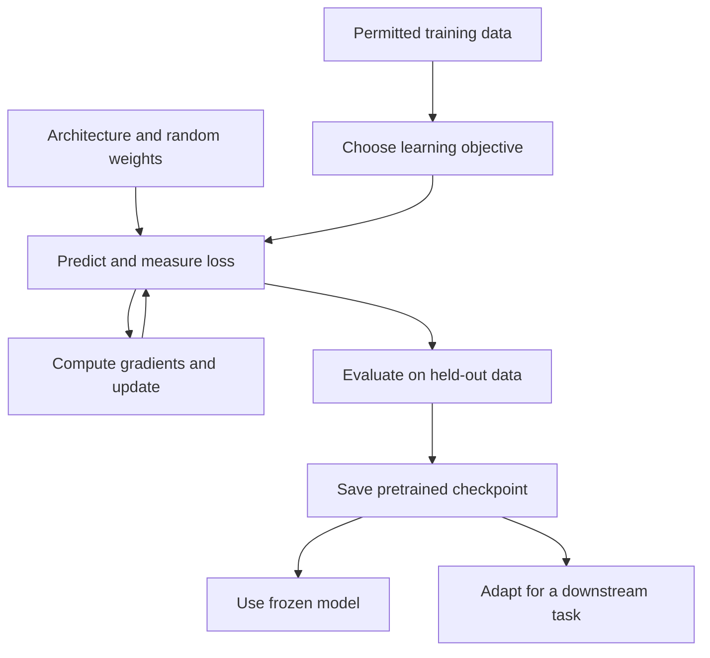
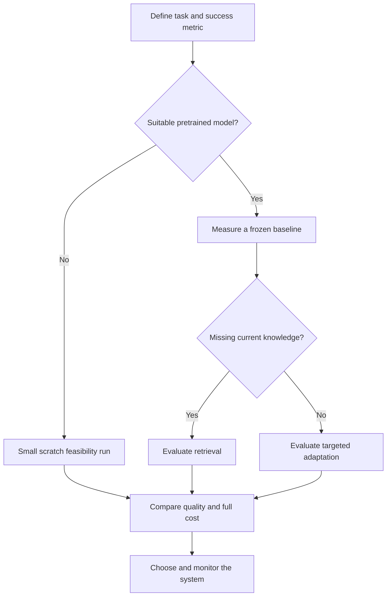
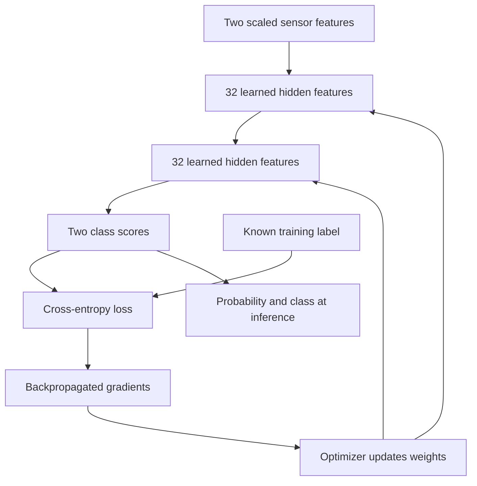
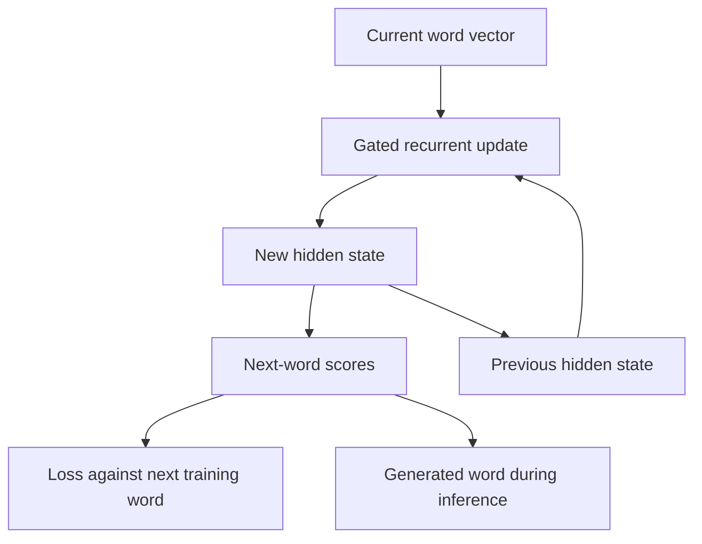
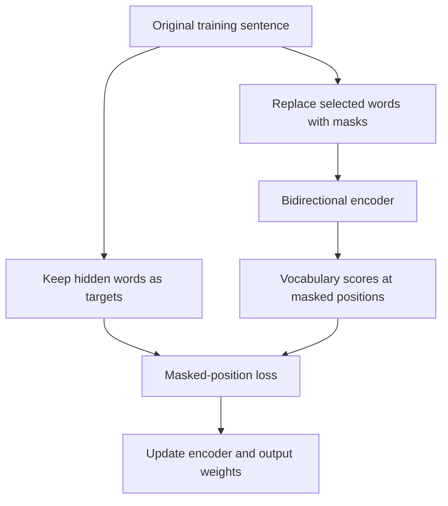
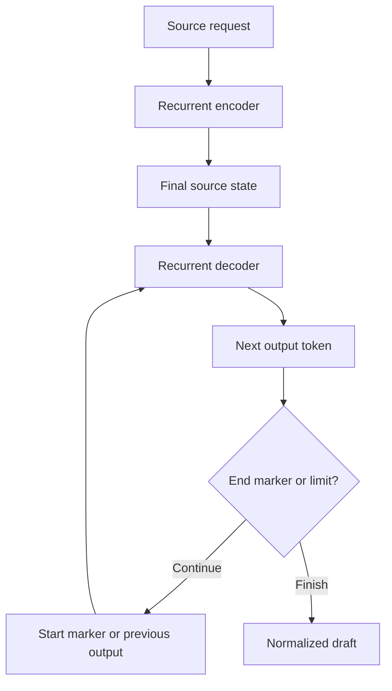
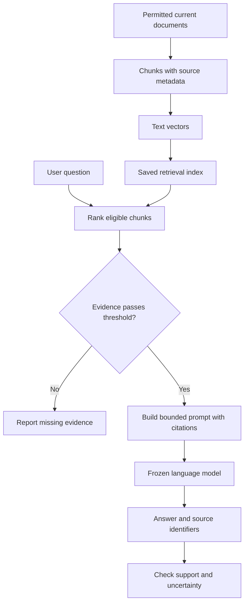
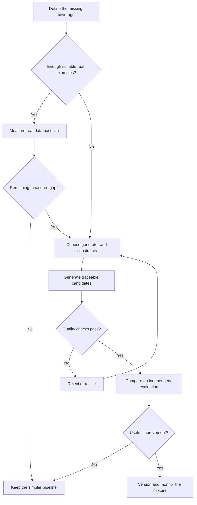
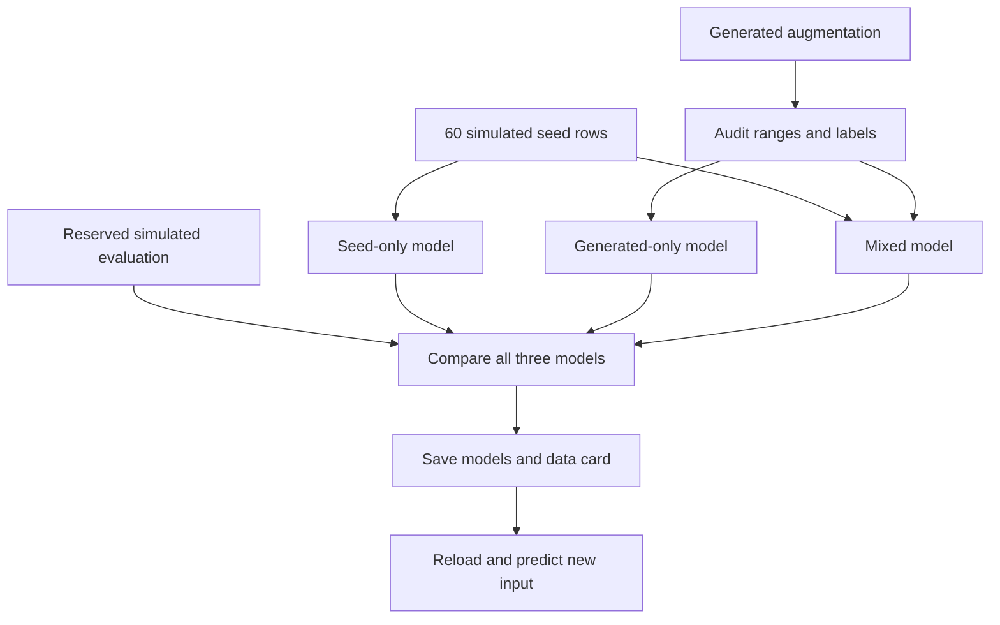

# Building Models and Retrieval Systems

Machine Learning Super Lab • Expanded November 14, 2026

# Pretrained models versus building from scratch

**Concept — Choose what to reuse, what to learn, and how to prove the choice.** Then exercise the decision in [Compare pretraining with a fresh start](#lesson/transfer-compare). This chapter applies to image, language, and other neural models. The [deep learning workshop](#lesson/deep-network) explains the numerical learning loop.

## What a pretrained model actually contains

An **architecture** is the computation you design: layers, connections, dimensions, and information flow. **Parameters** are the numbers learned during training, such as a matrix of weights. A **checkpoint** saves learned parameter values and enough configuration to restore them. A **pretrained model** already has learned parameters before your current use or training stage. It may have been trained by someone else, or by you in an earlier experiment.

For text, you usually also need the exact tokenizer, vocabulary, special-token definitions, and prompt format. Loading weights with a different tokenizer can change what every token identifier means. A useful package therefore includes more than a large weight file.

Think of an architecture as a worksheet with adjustable numbers. Random initialization fills the worksheet with small random values; pretraining adjusts those values using examples. Downloading a checkpoint gives you an already adjusted worksheet. It does not give you a reliable database of every original training document.

**Base and pretrained are not synonyms.** In this language-model context, a base checkpoint usually precedes instruction or preference post-training. An instruction-tuned assistant is also pretrained when you receive it. Pretraining need not use the next-token objective: masked-token prediction, image classification, reconstruction, and other objectives can supply an initial representation.

## Five different engineering choices

| Choice | Starting point | What changes? | Real-world example | Included exercise |
|---|---|---|---|---|
| Pretrained inference | Existing learned weights | Input, activations, and output; weights remain fixed | Run a local drafting assistant | Run your first model |
| Retrieval-augmented generation | Existing generator plus a document collection | Retrieved context and index; ordinary answering does not update generator weights | Answer questions from current operations notes | Retrieval pipeline workshop |
| Fine-tuning | Existing learned weights | Selected original weights or added adapters | Learn a support-triage output format | Teach with a small adapter; transfer comparison |
| Continued pretraining | Existing learned weights | Selected parameters learn from additional domain data | Adapt language representations to a specialized vocabulary | Concept design activity; not a separate production training implementation |
| Training from scratch | New architecture instance with random weights | Trainable parameters learn their initial useful behavior | Build a tiny recurrent word predictor or investigate a new architecture | Deep, recurrent, masked encoder, encoder–decoder, and original causal-model builds |

“From scratch” in these labs means **no pretrained model weights**. We still use PyTorch for tensor mathematics, automatic differentiation, and standard layers. Implementing matrix multiplication, a graphics-processor kernel, or an entire numerical library is a separate engineering exercise. The counted language model is trained from text counts rather than random neural weights.

## How pretraining creates a reusable model



1. Define a useful prediction task and a baseline. A language model may predict a following word; an image model may predict a category.
2. Obtain permitted data, remove sensitive material, and separate training, validation, and test groups before preprocessing. Near-duplicate documents or photos of the same subject can leak information across naive random splits.
3. Choose the representation. For language, define tokenization and fit a vocabulary using the permitted training split. For numerical data, fit scaling only on training examples.
4. Define the architecture and initialize its trainable values. Random does not mean arbitrary magnitude: initialization is chosen to keep computations well behaved.
5. Run a forward pass, measure a loss, calculate gradients, and take an optimizer step. Repeat with training examples.
6. Use validation to choose settings. After selection, evaluate on untouched test examples that did not drive those choices.
7. Save the model, configuration, preprocessing, revision, settings, and metrics. Reconstruct it in a new model instance and verify a prediction.
8. Reuse the checkpoint directly or adapt it for another objective. The first stage is now pretraining relative to the second.

A network starts without useful learned task knowledge, not without structure. Architecture and training data encode choices made by its engineers. A tiny training run demonstrates this process but does not produce the breadth of a general assistant.

## Understand the training target

For next-token prediction, the text supplies its own targets. With “please restart amber,” the input “please restart” has the next-word target “amber.” This is **self-supervised learning**: targets are constructed from the data rather than manually supplied for each prediction. For masked-token prediction, hide a word and predict the original. For supervised intent classification, supply a category such as “restart.”

If the correct token receives probability 0.1, its negative natural logarithm is approximately 2.303. If the probability rises to 0.8, the loss becomes approximately 0.223. A lower loss means better probability assignment under that objective. It does not establish factual accuracy or correct tool execution.

## Choose a route using evidence



Use a pretrained baseline when the checkpoint supports your inputs, output needs, license, and hardware. Consider adaptation when representative failures show a behavior or domain gap. Consider retrieval when answers must refer to a changing document collection. Consider scratch training for teaching, architecture research, unusual input representations, or a justified task/data/compute requirement. Retrieval and adaptation can also be combined.

**Cost comparison:** count pretraining, adaptation, data work, evaluation, serving, and maintenance separately. In the included transfer experiment, the pretrained branch gets 300 extra learning updates before both branches receive the same downstream examples and 80 adaptation updates. It would be misleading to call that equal total training compute. A frozen encoder still performs forward computation and occupies memory.

Start on the central processing unit. Every new build in this release is deliberately tiny and was executed locally. No Vast.ai rental is required. For an expanded experiment, first measure memory and elapsed time, then follow the existing [Vast.ai procedure](#lesson/cloud), set a spending limit, save artifacts, and inspect remaining billable resources. Do not infer a production foundation-model budget from these tiny runs.

## Start-to-finish assessment: an operations assistant

Define the problem as mapping a permitted operations request to a small category set. Write the success criterion before choosing a model: category accuracy, unsupported-input behavior, and inference latency. Describe the input text contract, label definitions, training data rights, and document/group split. Compare a simple baseline, random initialization, pretrained fine-tuning, and a frozen representation. Preserve exactly the same downstream training examples and evaluation set across the neural branches.

Save and reload the selected model with its vocabulary and category order. Submit predictions for new requests and for out-of-domain text. Deploy the prototype only through the local input interface. Production would need broader data, authorization outside the model, calibration, drift monitoring, failure handling, and a versioned rollback artifact. A predicted action must not automatically become an executed operation.

**Evidence to submit:** your decision table, data/split contract, measured branch results, full compute accounting, one failure, saved-model prediction, and a reason to revisit the choice later. A lower score after pretraining is a valid finding. Do not tune away inconvenient results without reporting the changed conditions.

**Explanation checks:** Can you pretrain your own model? Yes. Does fine-tuning create a model with no prior training? No. Does retrieval train the generator during ordinary answering? No. Is deep learning limited to language models? No; the course's image, graph, and reconstruction networks also use neural representations.

## Primary reading

- [PyTorch transfer learning tutorial](https://docs.pytorch.org/tutorials/beginner/transfer_learning_tutorial.html): fine-tuning and frozen feature extraction.
- [Bidirectional Encoder Representations from Transformers](https://arxiv.org/abs/1810.04805): masked-language pretraining and downstream adaptation.
- [Automatic differentiation with PyTorch](https://docs.pytorch.org/tutorials/beginner/basics/autogradqs_tutorial.html): gradients and parameter updates.


# Deep learning: from a number to a trained network

**Runnable implementation lab — Train a small multilayer perceptron from random weights, inspect gradients, compare it with a linear classifier, save it, and predict new inputs.** Deep learning education also appears in the earlier dense, convolutional, graph, autoencoder, and language-model lessons. This workshop connects their common learning mechanics.

## What makes learning deep?

Machine learning includes trees, regression, counting models, and neural networks. A neural network composes learned transformations. Deep learning uses multiple learned representation layers. It is not synonymous with a language model, a chatbot, or a large parameter count.

For a real-world analogy, consider equipment monitoring: two sensor readings might form a curved boundary between normal and abnormal behavior. A linear classifier draws one straight separation. A hidden network can learn intermediate features that create a more flexible boundary. Our runnable data are two synthetic interlocking curves, not measurements from actual machinery. The experiment tests representation learning, not industrial fault detection.

| Component | Meaning | In this lab |
|---|---|---|
| Tensor | An array of numbers with dimensions | A batch of 24 examples has shape 24 by 2 |
| Weight | A learned numerical coefficient | A matrix maps two inputs to 32 hidden features |
| Bias | A learned offset | Shifts a layer's transformation |
| Activation | A nonlinear function applied within the network | Rectified linear unit keeps positive values and replaces negatives with zero |
| Logit | An unnormalized class score | Two output scores per example |
| Softmax | Converts class scores into a normalized distribution | Used when displaying probabilities |
| Loss | A chosen numerical training objective | Cross-entropy penalizes low probability on the correct class |
| Gradient | Local rate of change of loss with a parameter | Calculated by automatic differentiation |
| Optimizer | Rule for changing parameters from gradients | Adaptive moment estimation in the implementation |
| Batch | Examples processed together for an update | At most 24 sampled training examples |
| Generalization | Performance on examples not used to fit the model | Measured on a held-out split |

Without nonlinear activations, consecutive linear layers collapse into another linear transformation. Merely stacking linear matrices does not create the curved decision boundary we want. More layers also do not guarantee better results; optimization, data, regularization, and task difficulty matter.

## Architecture and learning flow



The two-hidden-layer network has 1,218 trainable parameters. Count them: the first layer has 2 × 32 weights plus 32 biases; the second has 32 × 32 plus 32; the output has 32 × 2 plus 2. The zero-hidden-layer comparison has only a direct mapping from two inputs to two scores. This is a comparison of practical model choices, not a parameter-matched architecture study.

## Work through one gradient by hand

Let a one-weight model predict `prediction = weight × 2`, with target 6. Start with weight 1. The prediction is 2 and squared error is `(2 − 6)² = 16`. The derivative with respect to the weight is `2 × (2 × weight − 6) × 2`, which is −16 at weight 1.

Using a learning rate of 0.1 for this one illustrative update gives `new_weight = 1 − 0.1 × (−16) = 2.6`. The prediction becomes 5.2 and squared error becomes 0.64. The negative gradient meant increasing this weight would locally reduce loss.

The program compares the hand derivative with PyTorch's automatic derivative and a finite-difference estimate obtained by slightly perturbing the weight. Finite differences are an independent numerical check; they are expensive for large networks and sensitive to perturbation size. The training network itself uses cross-entropy and adaptive moment estimation, so the hand example explains a local principle rather than predicting its exact learning curve.

## Build from start to finish

1. Define the prototype: classify two numerical inputs into two synthetic categories and beat a training-majority baseline on validation.
2. Create 600 synthetic examples with a recorded seed. Split 60 percent for training, 20 percent for validation, and 20 percent for a reserved final test. Preserve class proportions.
3. Fit the feature scaler on training inputs only. Save its means and scales. A deployment prediction must use the same transformation.
4. Construct the zero-hidden-layer baseline or a two-hidden-layer network with new random weights. Do not load a checkpoint.
5. Predict training labels, compute cross-entropy, clear old gradients, backpropagate, clip the gradient norm to 1, and update parameters. Repeat for the specified number of optimizer steps.
6. Inspect training loss, gradient norms, parameter count, and held-out accuracy. A step samples a batch; 300 steps does not mean 300 complete dataset passes.
7. Select settings using validation. Use `--split test` only after selection; repeated inspection makes that test part of your selection process.
8. Save weights, architecture, scaling values, example input, split indices, plot, and report. Rebuild the network, load its saved weights, and verify identical outputs on a probe.
9. In Practice, load the saved example, change a sensor value, and choose Predict new input. This performs inference without retraining.
10. Keep the prototype local. For real equipment, collect representative time-separated measurements, investigate false negatives, define a human escalation process, monitor drift, and retain a previous model for rollback. Synthetic accuracy does not justify an operational alarm decision.

## Run the experiment

Use the website's Practice buttons; they supply a fresh output folder automatically. These are the equivalent commands inside the guided terminal, where `python` uses your configured project environment:

```text
python neural_builds.py deep --depth 2 --steps 300 --output outputs/deep-two-NEW
python neural_builds.py deep --depth 0 --steps 300 --output outputs/deep-linear-NEW
```

For **PowerShell**, start in the extracted website folder. If its environment is `.venv`, use its executable explicitly. Substitute your existing configured executable if you reused the older installation:

```powershell
Set-Location .\lab
& ..\.venv\Scripts\python.exe .\neural_builds.py deep --depth 2 --steps 300 --output outputs\deep-two-NEW
```

For **Command Prompt**, from the same extracted website folder:

```bat
cd lab
..\.venv\Scripts\python.exe neural_builds.py deep --depth 2 --steps 300 --output outputs\deep-two-NEW
```

Install the foundation packages through the website if prompted. Do not recreate a working environment. Use a new output name each time; the program intentionally refuses to overwrite experiment evidence. These commands require no Git Bash and no cloud rental.

## Change, predict, measure

Before running the linear comparison, predict which model can represent a curved boundary. Compare actual validation accuracy, parameter count, training loss, and gradient norms. Then repeat with another seed. Explain why one seed is insufficient for a universal claim.

Try `--lr 0.03` in a fresh run. Does a larger learning rate help, oscillate, or destabilize this particular training process? State the observation rather than assuming it must fail. Inspect the numerical gradient check: values should be close to −16, with a very small finite-difference error. In the saved model interface, input must remain an array of rows, each with exactly two finite numbers.

**Assessment evidence:** a hand-worked derivative, tensor-shape trace, baseline comparison, plot, at least one changed setting, untouched-test plan, reload prediction, and explanation of why two linear layers without nonlinearities are still linear.

## Failure diagnosis and next builds

If loss is nonfinite, check numerical inputs and learning rate. If training improves but validation worsens, investigate overfitting or distribution shift. If predictions change after reload, inspect architecture, preprocessing, evaluation mode, and saved weights. If hidden gradients remain zero, inspect activation behavior and whether parameters were frozen. A converged training loss does not prove the task is solved.

Continue with the [recurrent language model](#lesson/scratch-recurrent), [masked-token encoder](#lesson/scratch-encoder), and [encoder–decoder](#lesson/scratch-sequence). Convolutional and graph lessons use the same learning loop with different information-sharing structures. All new builds fit on a central processing unit; use [Vast.ai](#lesson/cloud) only for a measured larger experiment.

Sources: [PyTorch learning workflow](https://docs.pytorch.org/tutorials/beginner/basics/intro.html) and [automatic differentiation](https://docs.pytorch.org/tutorials/beginner/basics/autogradqs_tutorial.html). The data, exercises, architecture size, and evaluation choices here are this lab's teaching design.


# Build neural models from random weights

These are small executable teaching models. They use PyTorch layers but no downloaded model weights. They are not replicas of a vendor foundation model. Each run writes its data split, weights, configuration, training plot, measured report, example input, and a verified prediction after reload.

## Recurrent language model from scratch

**Runnable implementation lab — Next-word prediction with a gated recurrent unit.** Real-world use case: a compact offline completer for a restricted operations vocabulary. The included corpus is synthetic; a production completer would require permitted representative text and an audit for memorized sensitive content.

### Concept and algorithm

A recurrent neural network keeps a numerical state and updates it for each input token. A **gated recurrent unit** uses learned gates to control how old information and candidate updates combine. The state is a compressed representation, not a literal transcript. Unlike full attention, this model does not reread every earlier token directly.

1. Map each word to a token identifier and then a learned vector.
2. Pass the current vector and previous hidden state through the gated recurrent update.
3. Project the new state into scores for every vocabulary entry.
4. During training, compare each position with the actual next token; ignore padded targets.
5. Backpropagate through the sequence and update trainable weights.
6. During generation, append the predicted word and continue until an end marker or length limit.



### Build from start to finish

Define success as lower held-out next-word loss than a uniform vocabulary predictor, plus inspectable completions and acceptable local latency. Create operations requests with actions, fictional service names, regions, and three paraphrase templates. Split complete action/service/region combinations before vocabulary fitting: 56 groups train, 20 validate, and 20 remain for final test. Paraphrases of the same combination stay together. The task tests novel combinations of familiar words, not unseen language or domains.

Fit the vocabulary only on training text. Reserve padding, start, end, unknown, and mask entries; the shared mask entry is unused by this causal model. Initialize the embedding, one recurrent layer, and output projection randomly. Train using cross-entropy on shifted token targets. Record loss before and after, perplexity, and the uniform baseline. Save the vocabulary and group split with the weights; reconstruct the architecture and verify identical outputs after reload.

In Practice, load a prefix such as `please restart amber`, change the service, and predict without retraining. The result is a text suggestion, not an executed command. Preserve the vocabulary, tokenization, output limit, and model version in a local prototype. Before real deployment, evaluate uncommon vocabulary, unsupported requests, sensitive completions, and distribution shift. Monitor failure rates and keep the previous artifact for rollback. No rented compute is required for this build.

```text
python neural_builds.py recurrent --steps 300 --output outputs/recurrent-NEW
python neural_builds.py recurrent --steps 100 --output outputs/recurrent-short-NEW
```

**Assessment:** predict the effect of fewer updates, compare measured perplexity and completions, identify an unknown token, and explain why training targets must be shifted. Perplexity from this word tokenizer cannot be directly ranked against the original byte-level Transformer. The saved prefix must contain at most ten words.

## Masked-token encoder from scratch

**Runnable implementation lab — Bidirectional masked-language pretraining.** Real-world use case: learn language representations for an eventual request classifier. This is a tiny masked-token encoder, not a faithful reimplementation of Bidirectional Encoder Representations from Transformers.

### Concept and algorithm

A bidirectional encoder can combine context on both sides of a position. It therefore cannot see the correct word at the position it is being asked to predict. We replace selected words with a literal `[MASK]` token and compute loss only at those positions.



### Build from start to finish

Define success as lower masked-token loss than a uniform predictor on held-out groups, and inspect candidate probabilities rather than only a top answer. Use the same synthetic operations corpus and grouped split as the recurrent build. Fit vocabulary on training rows. The randomly initialized network has token and position embeddings, two bidirectional Transformer layers, and a vocabulary head. Its attention can use later words; padding positions are excluded as attention keys.

For each training batch, hide at least one ordinary token per sentence and retain the original as its target. Train with cross-entropy only where targets exist. Evaluation uses a fixed mask pattern so different checkpoints face the same questions. Save weights, vocabulary, positional limits, split, and evaluation report; reconstruct and check predictions. Use the local saved-model interface with exactly one `[MASK]` token, such as `please restart amber in [MASK]`.

Some masks are intrinsically ambiguous. Without additional context, “please [MASK] amber in east” could contain several actions. A distribution over plausible alternatives is more informative than asserting there is one logically determined answer. Masked-token accuracy is not downstream intent-classification accuracy; the next transfer experiment measures the latter separately.

For deployment, expose only the supported fill-mask or adapted classification contract. This encoder is not a chat generator. Broader representations need larger permitted corpora, careful split design, unknown-word handling, evaluation across domains, drift monitoring, and rollback artifacts. The small build runs locally; no Vast.ai instance is required.

```text
python neural_builds.py encoder --steps 300 --output outputs/encoder-NEW
python neural_builds.py encoder --steps 100 --output outputs/encoder-short-NEW
```

**Assessment:** hide a word, state which surrounding positions the encoder may use, inspect its five leading candidates, and explain why leaving the original target visible would invalidate the exercise. Submit the loss comparison, probabilities, save/reload evidence, and one ambiguous case.

## Encoder–decoder model from scratch

**Runnable implementation lab — Normalize a request into a short output sequence.** Real-world use case: convert a constrained human request into a machine-readable draft. Example: `please backup cedar in south` becomes `backup cedar south`. The output is never executed. A deterministic parser is a sensible real-world baseline for such a narrow grammar; neural modeling here teaches sequence-to-sequence mechanics.

### Concept and algorithm

The encoder reads the source sequence into a state. The decoder generates a separate target sequence using that state and earlier output tokens. This implementation uses gated recurrent units for both components and deliberately omits attention. Encoder–decoder describes information flow; it does not require Transformers.



During training, **teacher forcing** supplies the actual preceding target word. The decoder predicts the following target word. During inference it must consume its own predictions. A low teacher-forced loss can coexist with poor generated sequences because earlier mistakes affect later generation.

### Build from start to finish

Define success as exact match of the generated draft to the target on held-out action/service/region combinations. Use permitted synthetic pairs, keep paraphrase groups together, and fit vocabulary on training rows. Store source and target tokenization, beginning/end markers, padding policy, and allowed output actions.

Initialize both recurrent networks, embeddings, and output projection randomly. Encode only the real source length, so padding does not become part of the final state. Train on shifted target sequences with padded targets ignored. Report teacher-forced loss and, separately, free-running generated exact match. The included copy-the-source baseline is intentionally weak; add a grammar parser before judging whether a neural model is useful for a real product.

Save and reconstruct the model, verify identical generated output on reload, and enter a new source in Practice. Examine every incorrect output. Keep this draft generator local; production requires syntax validation, independent authorization, rejection of unsupported requests, a human confirmation policy where needed, monitoring, and rollback. The teaching model neither validates operational safety nor executes actions. Start locally; measure a genuinely larger workload before considering Vast.ai.

```text
python neural_builds.py seq2seq --steps 400 --output outputs/sequence-NEW
python neural_builds.py seq2seq --steps 100 --output outputs/sequence-short-NEW
```

**Assessment:** trace one source and target with start/end markers; identify the shifted training pairs; compare short and longer runs; show a generated error; explain why teacher-forced loss cannot replace free-running evaluation. Submit the data contract, baseline, report, reload output, and deployment boundary.

## Compare pretraining with a fresh start

**Runnable implementation lab — An actual controlled transfer-learning comparison.** Real-world use case: choose how to train a classifier when only a few labeled requests are available. This build pretrains its own tiny encoder and then reuses it; no external pretrained checkpoint is required.

### Three branches, one downstream task

| Branch | Initial representation | What trains during classification? |
|---|---|---|
| Scratch | Fresh random encoder | Encoder and new classification head |
| Pretrained fine-tune | Encoder after masked-token pretraining | Encoder and the same initialized classification head |
| Pretrained frozen | The same pretrained encoder | Only the classification head |

The new head maps a pooled sentence representation to four action categories. Pooling here averages nonpadding token representations. This is a teaching representation choice, not a claim that averaging any encoder gives strong general-purpose embeddings.

### Build from start to finish

Define success as held-out intent accuracy relative to a training-majority baseline, while recording data and total compute. Generate and group-split the same fictional requests. Fit vocabulary on training rows only. Keep evaluation groups out of both pretraining and downstream fitting. Pretrain a randomly initialized masked encoder on training text without using action labels, then save that checkpoint.

Take four labeled training examples per class by default. All three branches see those same 16 examples, start with an identical classification head, and receive the same number of downstream optimizer steps. The fine-tuned and frozen branches share the same pretrained encoder. The random branch begins from the encoder state saved before pretraining. This isolates useful choices while explicitly accounting for the extra pretraining updates.

Measure classification accuracy for each branch and compare with the majority-label baseline. The code checks that every frozen encoder tensor remains unchanged. Save each branch plus the reusable pretrained encoder; the default saved-input interface reloads the pretrained fine-tuned classifier, whose role is stated in the report. Predict a new request, and inspect an out-of-domain request to see that this simple classifier still chooses a category without calibrated abstention.

A production classifier would need representative labels, uncertainty/rejection behavior, broader held-out data, monitoring, and a rollback checkpoint. Repeat seeds and label budgets before choosing an approach. This tiny exercise runs on a central processing unit; renting compute would add cost without being necessary.

```text
python neural_builds.py transfer --steps 300 --adapt-steps 80 --labels-per-class 4 --output outputs/transfer-NEW
python neural_builds.py transfer --steps 300 --adapt-steps 80 --labels-per-class 1 --output outputs/transfer-few-NEW
```

**Interpretation:** scratch may win on this simple grammar. Pretraining might learn features that do not help the target task, while a frozen representation may hide useful distinctions. The experiment is designed to measure these possibilities, not force a preferred answer. Equal downstream steps do not mean equal lifetime compute.

**Assessment:** report the three accuracies, labeled-data budget, pretraining and downstream steps, trainable parameters, frozen-weight check, reload prediction, and one failure. Explain what is pretrained relative to what, why an instruction-tuned model can still be pretrained, and when you would choose retrieval instead of updating weights.

Primary reading: [PyTorch gated recurrent unit](https://docs.pytorch.org/docs/stable/generated/torch.nn.GRU.html), [Transformer encoder layers](https://docs.pytorch.org/docs/stable/generated/torch.nn.TransformerEncoderLayer.html), [encoder pretraining research](https://arxiv.org/abs/1810.04805), and [transfer learning tutorial](https://docs.pytorch.org/tutorials/beginner/transfer_learning_tutorial.html). Architectures, data, and comparisons here are intentionally smaller teaching designs.


# Retrieval-augmented generation: build and test the whole pipeline

**Runnable implementation lab — Build a document index, measure retrieval, inspect prompts, run a frozen language model with and without retrieved context, and audit its answer.** The earlier “Give the model useful notes” lesson introduces the basic process. This workshop adds persistent indexing, chunking experiments, held-out questions, an unsupported-query case, source versions, and separate retrieval/generation measurements.

## What retrieval-augmented generation means

**Retrieval-augmented generation**, often abbreviated **RAG**, searches a document collection for useful evidence and provides that evidence to a generator while it answers. It is a system pattern. It is not a separate neural architecture, and ordinary answering does not train the generator.

Real-world use case: an operations assistant answering questions from current runbooks. A pretrained model may know what a backup is but not your service's current backup schedule. Retrieval supplies the relevant current note. In this lab every service, schedule, and policy is fictional. You can therefore inspect the complete system without uploading company information.

| Mechanism | Where information enters | Do generator weights change during ordinary use? |
|---|---|---|
| Pretrained inference | Knowledge already reflected in weights plus your prompt | No |
| Retrieval-augmented generation | Retrieved passages added to the prompt | No |
| Fine-tuning | Training examples influence parameter updates | Yes, for selected trainable parameters |
| Updating the search index | Documents and their retrieval representations change | No; changing an index is not generator training |

A retrieval component can itself be learned. Our baseline fits a lexical vocabulary and weighting statistics from the documents; a neural retriever instead uses learned embeddings. You can train or adapt a retriever or generator in a separate process, but that is distinct from this workshop's frozen inference path.

## Architecture: offline indexing and online answering



Indexing happens when documents are added or changed. Answering happens for a question. Rebuilding the index and generating an answer have different costs and failure modes. A deployment must preserve source identity and version across both paths.

## How the retriever works, in understandable steps

1. Select current documents. A retired Orion note is excluded by default. This is a version filter, not a complete access-control system.
2. Split text into word windows and retain source identifier, revision, and start/end offsets. The default is 40 words with an eight-word overlap. These small settings serve the toy corpus; production chunk sizes must be evaluated using the actual tokenizer and document structure.
3. Fit **term frequency–inverse document frequency** vectors using document text. A term's weight reflects its occurrence in a passage and how common it is across the indexed passages. The vocabulary is sparse: most entries in a particular passage vector are zero. This is not a neural embedding model.
4. Transform the question with the same fitted vocabulary and weights. Do not refit on evaluation questions.
5. Compare normalized vectors using cosine similarity. For vectors with Euclidean length one, cosine similarity is their dot product. If two normalized vectors point in the same direction, similarity is one; if they share no represented terms, their dot product can be zero.
6. Return up to the configured number of highest-ranked chunks above a similarity threshold. **Top-k** means at most k retrieved candidates; k is an integer, not an acronym.
7. Format the selected chunks with exact bracketed identifiers and build a question prompt. If no candidate passes, report missing evidence rather than inventing a note.

The retriever is good at shared terms but may miss synonyms. “Recovery period” and “restore window” can describe the same idea without enough lexical overlap. A neural embedding retriever or hybrid search may help, but must be measured. A high similarity score is not a probability that an answer is correct.

## Build from start to finish

Define success before implementation: retrieve the correct current source, include the actual answer-bearing text, cite evidence, and handle unsupported questions. Use the included six current fictional documents and one retired document for the stale-content experiment. Preserve their identifiers and revisions.

Build and serialize the vectorizer, matrix, and chunk metadata. Keep four validation questions for development and four final-test questions reserved until you choose settings. These questions are authored evaluation fixtures, not labels used to fit the vectorizer. The collection intentionally contains documents relevant to the questions: that is normal for retrieval evaluation. The evaluation queries themselves should not drive index fitting or final-test tuning.

Measure retrieval before calling a language model. Save the ranked chunks, scores, constructed prompts, metrics, document snapshot, index hash, and configuration. Reload the index and verify the same ranking for a probe question. In Practice, load the saved example and change the question to inspect retrieval without rebuilding. This saved-index interface returns evidence and a prompt; it does not pretend those are a generated answer.

Next run the comparison mode. It loads the pinned SmolLM2 checkpoint already used by the course, asks one question without retrieval, then asks it with retrieved context. Parameters are frozen, and the script compares every saved parameter's byte content before and after generation. The report records whether weights remained unchanged. No fine-tuning takes place.

Review both answers, every citation, and the source text. A tiny generator may ignore instructions, copy irrelevant text, or invent a citation even when retrieval succeeds. Preserve those failures in your report. Save the model revision, index revision, prompts, output limits, and evaluation set as a deployable configuration. Keep the prototype local and retain the preceding index/model configuration for rollback.

For production, add document permissions before retrieval, deletion/update handling, robust extraction, deduplication, token-aware context budgeting, query logging with sensitive-data controls, caching rules, latency measurement, and a broader evaluation set. Monitor stale-source usage, retrieval failures, unsupported claims, and answer latency separately. The small local exercise needs no Vast.ai rental; larger generator experiments should first justify their measured resource needs.

## Run, inspect, and deliberately break the pipeline

Use the Practice buttons in order. Each run gets a new output folder. The equivalent guided-terminal commands are:

```text
python rag_workshop.py --mode retrieval --output outputs/retrieval-NEW
python rag_workshop.py --chunk-size 8 --overlap 0 --top-k 1 --output outputs/retrieval-small-NEW
python rag_workshop.py --include-stale --top-k 2 --output outputs/retrieval-stale-NEW
python lab.py lock
python rag_workshop.py --mode compare --output outputs/retrieval-generation-NEW
```

Only comparison mode needs the pretrained generator and its cached files or first-use download. Retrieval mode runs with the foundation packages and no model download. If the model is not pinned, complete `python lab.py lock` first. The commands use the same configured environment as the other lessons; PowerShell and Command Prompt users can follow the explicit executable pattern in the deep learning workshop.

**Experiment 1 — Baseline:** find the Orion restore policy in the saved chunks and verify that the retrieved passage contains “48 hours.” Inspect the source identifier, revision, and similarity score. Read the entire passage before calling it sufficient evidence.

**Experiment 2 — Chunk boundary:** before running the eight-word configuration, predict whether identifying the right document guarantees including the answer. Compare source recall with answer-evidence recall. A chunk can come from the correct document and still cut the required fact in half. Increasing top-k may help coverage but also increases irrelevant context.

**Experiment 3 — Stale data:** allow the retired note into the index. Inspect whether the question retrieves both “24 hours” and “48 hours.” Explain how you would choose an authoritative current source. Do not expect a larger language model to repair an undefined document-version policy.

**Experiment 4 — Generation:** compare the answer without retrieval with the grounded prompt and answer. Did the generator use the supplied fact? Are bracketed identifiers valid, and does their text actually support the associated claim? The built-in string checks are diagnostic aids, not a factuality judge.

**Experiment 5 — No answer:** ask a question whose evidence is absent. Try one with completely different vocabulary and another with overlapping vocabulary, such as an unlisted Orion administrative secret. Explain why a lexical threshold can reject the first but still retrieve irrelevant passages for the second. The generator must still assess sufficiency; threshold filtering alone is not reliable abstention.

After choosing settings, run `--split test` once in a fresh output folder. If you keep changing settings based on that result, obtain a new independent test set.

## Measure the right layer

**Observed example, not a guaranteed outcome:** in the included developer reference run, the small generator invented an unrelated answer without the notes. With the current Orion note, it answered “The current Orion restore window is 48 hours.” Its parameters remained unchanged, but it omitted the requested citation. The answer-bearing fact was correct while citation compliance failed. Grade these separately. The raw outputs, pinned checkpoint revision, and timings are preserved in `lab/reference-results/build-and-retrieve/rag-generation/report.json`; blank manual-review fields are for the learner to complete.

The eight-word chunk experiment also found the correct source for every answerable validation question, but only one of three retrieved chunks contained the expected answer. This is why finding the right document is insufficient evidence that the generator received the right information.

| Measurement | What it tells you | What it cannot establish |
|---|---|---|
| Source recall at k | Fraction of answerable questions whose gold source appears in retrieved candidates | Whether the selected chunk contains the needed fact |
| Mean reciprocal rank at k | Average reciprocal position of the first gold source, with zero when absent | Whether the model uses that evidence correctly |
| Answer-evidence recall at k | Whether a gold-source chunk contains the expected answer string in this toy fixture | Semantic entailment or correctness on arbitrary text |
| Unsupported-query retrieval rate | Fraction of designated unsupported questions that still retrieve something | Whether the generator will properly abstain |
| Answer-string presence | Whether expected text appears in the generated answer | Whether the whole answer is true |
| Citation identifier validity | Whether cited identifiers were actually in the context | Whether the source supports the claimed meaning |
| Manual faithfulness assessment | Whether each claim follows from the selected evidence | Universal reliability beyond the reviewed examples |

Do not average “higher is better” and “lower is better” metrics without an explicit rationale. The unsupported-query retrieval rate should ideally be lower; recall should generally be higher. A perfect score on three answerable questions is a toy-fixture result, not evidence of production quality.

## Concept extensions and assessment

**Concept — Not implemented as extra retrievers here:** dense embeddings represent meaning with learned vectors; Best Matching 25 is a lexical ranking function; hybrid search combines lexical and dense candidates; reranking scores a smaller candidate set more carefully. Retrieval over graphs can add explicit relationships. Each extension should compete against the transparent baseline on the same held-out queries and cost budget.

Retrieved documents are untrusted content. An embedded sentence such as “ignore your instructions” is text to assess, not authority over the application. The prompt labels reference text, but that is not a complete defense against prompt injection. Keep tools and permissions outside the model's control and test adversarial documents before introducing tool use.

**Submit:** the indexing/answering architecture, a hand-explained similarity calculation, baseline and ablation reports, a stale-source example, both generated answers, a claim-by-claim citation review, an unsupported question, the frozen-weight check, reload evidence, and monitoring/rollback plan. Explain precisely why the generator's answer can change while its weights remain identical.

Primary sources: [original retrieval-augmented generation paper](https://arxiv.org/abs/2005.11401), [scikit-learn text vectorizer documentation](https://scikit-learn.org/stable/modules/generated/sklearn.feature_extraction.text.TfidfVectorizer.html), and [cosine similarity](https://scikit-learn.org/stable/modules/generated/sklearn.metrics.pairwise.cosine_similarity.html). This workshop uses a simpler sparse retriever and frozen prompt-based generation, rather than reproducing the jointly trained system in the original paper.


# Synthetic data: create examples, then prove they help

**Concept + Runnable implementation lab** — Learn why engineers generate data, build and audit a small dataset, train three comparison models, and test whether the generated examples improve performance. This workshop runs locally with the existing foundation packages. No paid service, model download, or Vast.ai rental is needed.

## What synthetic data is

**Synthetic data** consists of examples created by a program, simulator, or generative model rather than directly observed from the real process you want to model. It can be a table, sentence, image, sound, sequence of actions, or labeled input/output pair. It does not have to be generated by artificial intelligence. A short Python function can generate it.

Think of a flight simulator: it lets a pilot practice unusual situations without waiting for those situations to occur. Its usefulness depends on how well the simulated situations match what the pilot actually needs to handle. A convincing simulation is still a simulation.

Examples in this course already use synthetic data. The tiny operations language models train on templated fictional requests; the deep classifier uses generated curved clusters; the retrieval workshop uses authored fictional policies. Those exercises teach mechanisms without customer records. They do not prove that the same model will work on real customer language.

**It is useful, not universally required.** If you have enough representative, permitted, well-labeled real examples, a measured real-data baseline may be sufficient. Generate data to address a named gap, then test whether that gap actually closes.

## Why engineers need it in some projects

| Problem | How generated examples can help | Real-world application and required check |
|---|---|---|
| Too few labeled examples | Bootstrap candidate input/output pairs for review | A support-ticket router needs examples for a new product; test on separately collected tickets |
| Rare but important situations | Simulate unusual combinations deliberately | A reliability model needs overload cases; simulated telemetry must match plausible failure mechanisms |
| Expensive or unsafe collection | Recreate conditions in a controlled simulator | A robot practices different object positions and lighting; test with real cameras afterward |
| Confidential source records | Build fictional development fixtures without those records | Engineers test a login-event pipeline with invented users; generators fitted to private records still need privacy evaluation |
| Need precise labels | Obtain labels from rules, a simulator, or an independently checkable solver | Generate arithmetic tasks and verify numerical answers, or coding tasks with independently designed tests |
| Missing task or language coverage | Add targeted instructions, paraphrases, and output formats | A small language model practices a particular support workflow; review meaning, diversity, and correctness |
| Need reproducible failures | Control conditions, seeds, noise, and edge cases | Reproduce a retrieval citation failure or parser error using a fixed test fixture |

More rows do not necessarily mean more information. Ten thousand paraphrases of one example can still represent one underlying situation. Extra data can also increase storage, review, and training cost. Define the gap before choosing a volume.

## Families of synthetic-data methods

These are **data-production methods**, not additional model architectures. One language model can consume examples from several methods.

| Method | Understandable algorithm | Strength | Main failure mode | Scope here |
|---|---|---|---|---|
| Rules and templates | Choose slots, fill a template, compute a rule-based label | Cheap and inspectable | Repetitive wording or incomplete rules | Runnable telemetry generator; existing operations language labs |
| Statistical sampling | Sample values from stated or fitted distributions | Controls frequency, noise, and coverage | Misses relationships or rare tails | Runnable numerical sampling |
| Simulation | Run a model of a process and record its outputs | Produces conditions that are difficult to observe | Simulator assumptions differ from reality | Simple fictional telemetry; complex physics is Concept |
| Data augmentation | Transform a training example while preserving its target when justified | Adds useful variation | Transformation changes meaning or crosses split boundaries | Concept activity; no image augmenter added here |
| Generative models | Train or use a model, sample candidates, then filter and verify | Flexible text, images, or tables | Hallucinations, memorization, and inherited bias | Concept production pipeline; existing generation lessons remain runnable |
| Teacher-generated instruction data | Ask a stronger model for tasks and candidate answers, verify them, train a smaller student | Transfers task supervision | Student inherits wrong answers or narrow teacher habits | Concept link to the existing distillation lesson |

**Distillation** means training a student from teacher signals, which may include probabilities or representations as well as generated answers. Not all synthetic data is distillation, and not all distillation creates a saved text dataset. **Data augmentation** often retains a direct relationship to an original example; keep its parent identifier so relatives stay in the same split. Generating new examples is also different from using a model to attach labels to existing real inputs, although a pipeline can combine both.

Research such as Self-Instruct demonstrates a language-model workflow that generates candidate instructions and examples, filters them, and uses them for adaptation. This is evidence for a particular method and evaluation, not a guarantee that arbitrary model output is useful training material. [1]

## The decision and quality-control algorithm



1. Specify the task, population, labels, and missing cases. “Need more data” is too vague; “no examples of a service with high error rate and moderate queue depth” is testable.
2. Reserve evaluation examples before fitting a generator or designing augmentations. Split by person, document, incident, device, or time when related examples could otherwise leak. Generate training variants only from the training partition. [2]
3. Choose a method whose assumptions are inspectable. For every record, retain source or parent identifier, generator version, seed or model revision, settings, intended label, and review status.
4. Enforce the schema and allowed ranges. Check missing values, impossible combinations, exact and near duplicates, contradictions, label consistency, and category coverage. Passing a schema proves structure, not truth.
5. Verify labels independently where possible. Use domain checks, human review, executable tests, or trusted solvers. A generator agreeing with itself is weak evidence.
6. Train comparable baselines: seed-only, generated-only, and a mixture. Keep model family and evaluation fixed; report differing data counts and training cost. The right mixing ratio is an empirical choice.
7. Measure useful behavior on held-out data, including rare cases and relevant subgroups. Select settings using validation; reserve final tests for the chosen configuration.
8. Version the dataset and model together. Deploy only to the intended scope, monitor incoming coverage and errors, and keep the previous dataset/model pair for rollback.

## Understand the risks before scaling

**Distribution mismatch:** a generator can make realistic-looking rows but the wrong joint relationships. For example, generating CPU load and error rate independently may miss a relationship that matters in real outages. Here CPU means central processing unit. Our own telemetry generator makes explicit simplifying assumptions; it is not a model of an actual service.

**Label noise and shortcuts:** generated answers may be wrong. A classifier can also learn “urgent” rather than the underlying urgency rule if that word occurs only in positive examples. A synthetically balanced class mix changes prevalence; precision and probability calibration on the deployed population may differ even if recall improves.

**Evaluation contamination:** paraphrasing a test question into training makes the test less independent. Exact deduplication alone will not find that relationship. Reserve source groups before producing variations; avoid fitting preprocessing or generators on the held-out data. [2]

**Privacy:** fictional fixtures made without personal records can avoid using those records. A generator trained on sensitive examples can still reveal information about them. Calling its output “synthetic” does not establish anonymity; privacy and utility require separate evidence. This lab does not implement a formal privacy mechanism. [3]

**Recursive degradation:** repeatedly replacing original data with unchecked model outputs can lose diversity and amplify errors, including rare-pattern loss. Research on model collapse studies such failure conditions; it does not mean every use of generated data inevitably collapses. Retain high-quality reference data, validate new batches, and measure coverage over successive versions. The telemetry noise experiment below is not a reproduction of recursive model collapse. [4]

**Provenance:** generation does not erase the origin or usage conditions of source material. Keep records of inputs, generators, and review decisions. This workshop uses wholly fictional records and no purchased books or customer data.

## Runnable lab: a fictional service-incident classifier

**Use case:** predict an incident from queue depth and error percentage. Real reliability teams might use telemetry models to prioritize investigation. Our prototype never controls a service and makes no production claim.

**Input contract:** each row is `[queue_depth, error_percent]`, with queue depth from 0 to 100 and error percentage from 0 to 10. The target is zero for no simulated incident or one for a simulated incident. The model sees only these two features. Identifiers, generator names, original oracle labels, and label-flip markers are audit metadata and must not become features.

The simulator draws numbers and uses this declared rule:

`queue_depth / 100 + 0.7 × error_percent / 10 + small_random_noise > 0.85`

If the inequality is true, label the row one. The noise is sampled from a normal distribution with mean zero and standard deviation 0.04. **Worked example:** a queue of 60 and error percentage of 8 give `0.60 + 0.7 × 0.80 = 1.16` before noise, which exceeds 0.85. The label follows our invented rule; it is not a discovered law of outages.

The generator deliberately creates a small seed dataset of 60 rows with error percentage at most 2.5. Its optional augmentation can cover the full 0–10 range, repeat the narrow range, or inject wrong labels. **All four partitions are simulated**, including the seed and evaluation data. “Seed” means our starting set; it does not mean real observations.



### Build from start to finish

1. **Define success:** improve balanced accuracy on the reserved validation rows, inspect incident recall, and avoid disguising missing coverage. Balanced accuracy is the average of recall for each class. A model that always predicts zero scores 0.5 on this metric when both classes are present.
2. **Create permitted data:** sample the 60 seed rows and, by default, 400 augmentation rows. Separate random streams produce 400 validation and 400 final-test rows. Changing augmentation size, coverage, or label noise leaves both evaluation partitions unchanged. Their shared simulator still limits independence from its assumptions.
3. **Audit:** enforce ranges, binary labels, distinct identifiers, and absence of exact feature duplicates. Record positive-label fraction, high-error coverage, and agreement with the simulator's original label. That original label is available because we wrote the simulator; a real teacher-model dataset does not automatically have such an oracle.
4. **Fit three models:** each is a standardization step followed by logistic regression, trained from scratch without pretrained weights. Each scaler fits only its own training rows. The three branches use 60, 400, and 460 rows respectively; this compares dataset strategies, not equal-compute training.
5. **Evaluate:** inspect balanced accuracy, precision, recall, F1 score, the confusion matrix, and accuracy in the high-error slice. F1 is the harmonic mean of precision and recall; it is a metric name, not an acronym. Confusion-matrix rows are true labels `[0, 1]`; columns are predicted labels `[0, 1]`.
6. **Save:** retain the three models, input contract, dataset card, comma-separated values files, dataset hashes, coverage plot, utility plot, and measured report. A hash helps identify exactly which bytes were used; it does not certify correctness.
7. **Reload and infer:** load the example through Practice, change its feature values, and predict with all three saved models. The same scaling is applied without retraining. Probabilities are model estimates, not certified real-world risks.
8. **Deploy within scope:** use the existing localhost workbench as the teaching interface. Before any real service deployment, gather representative permitted telemetry, validate the labeling process, test on independent real incidents, calibrate thresholds, and measure false alarms and missed incidents.
9. **Monitor and roll back:** track coverage, label quality, class proportions, false-alarm rates, and performance by slice. Preserve dataset and model versions together. Stop adding a batch that harms the selected validation criteria.

### Run and change one variable

Open this lesson's **Practice** tab. The browser runs Python in the included `lab` folder. Each button creates a fresh output folder:

```text
python synthetic_data.py --output outputs/synthetic-full-NEW
python synthetic_data.py --coverage narrow --output outputs/synthetic-narrow-NEW
python synthetic_data.py --label-noise 1 --output outputs/synthetic-wrong-NEW
python synthetic_data.py --samples 2000 --output outputs/synthetic-more-NEW
```

- **Baseline:** compare seed-only, generated-only, and mixed predictions. Explain which new feature region the generated rows cover.
- **Coverage:** keep the count fixed and restrict generated rows to the same narrow region. Inspect the coverage plot even if the aggregate score looks good. A simple model may extrapolate within our invented linear rule; that does not prove missing regions are safe in a real system.
- **Wrong labels:** `--label-noise 1` deliberately flips every generated label. It is a stress test, not a recommendation. The seed labels remain unchanged. Predict what happens when bad generated examples outnumber the seed. Then try `--label-noise 0.4` in the guided terminal to observe partial corruption.
- **Volume:** increase only the generated count from 400 to 2,000. Calculate synthetic share: `400 / 460 ≈ 87%`, then `2000 / 2060 ≈ 97%`. Compare utility rather than assuming five times as many generated rows means five times the benefit. Run time and mix both change.

Repeat selected comparisons with a different `--seed` to examine variability. After choosing settings using validation, run once with `--split test` in a new directory. The test file is inspectable for teaching, but should remain unused while making tuning decisions. Even perfect synthetic test results still require a real-world evaluation before deployment.

### Windows commands

Use PowerShell or Command Prompt in the website folder containing `server.py`. These commands reuse the website's working virtual environment; if you configured a different executable in Windows setup, use that existing executable path instead.

```powershell
Push-Location .\lab
& ..\.venv\Scripts\python.exe .\synthetic_data.py --output outputs\synthetic-full-NEW
Pop-Location
```

```bat
pushd lab
..\.venv\Scripts\python.exe synthetic_data.py --output outputs\synthetic-full-NEW
popd
```

No activation script or Git Bash is needed. The browser's **Add foundation packages** button supplies the existing dependencies if missing. Typical teaching runs are small and use a central processing unit. A larger teacher model or image simulator might justify a graphics processing unit, but first estimate candidates, retained fraction, verification cost, training time, and memory. Use the existing [Vast.ai procedure](#lesson/cloud) only if measured needs justify a rental.

## Apply the concept to language models and retrieval

**Concept activity — language-model data:** design an instruction-data record with `instruction`, `input`, `candidate_answer`, `source_id`, `generator_revision`, and `verification_status`. For a support assistant, start from approved source facts, ask for varied questions, verify answers against those facts, reject contradictions and duplicates, then fine-tune only on accepted training records. This is a design exercise; no teacher service is called by this new lab. Compare it with the runnable [pretraining experiment](#lesson/transfer-compare) and [recurrent language build](#lesson/scratch-recurrent).

**Concept activity — retrieval-augmented generation:** draft five questions grounded in the fictional runbooks and two unsupported questions. Include paraphrases that share few surface words with the source. Have a separate review identify evidence spans and expected abstentions before adding them to evaluation. Documents may legitimately be in the retrieval index; the benchmark questions and answers must not be used to tune the generator or retrieval settings while claiming an independent final test. Continue in the [retrieval workshop](#lesson/rag-pipeline).

**Assessment:** submit the data card, plots, three-branch comparison, noisy-label result, a changed-input prediction, and a paragraph on what the synthetic evaluation cannot establish. Identify one benefit, one failed assumption, a better real-data test, and the conditions under which you would reject generated data. Your conclusion may be “do not use this synthetic batch.”

## Troubleshooting and deeper study

- **Existing output directory:** use a new name. The script refuses to overwrite evidence.
- **Only one label in a very small run:** increase `--samples` or change the seed; logistic regression needs both labels here.
- **Good score despite missing coverage:** inspect the feature plot and subgroup metrics. The model may extrapolate successfully in this simple simulated world; real nonlinear relationships could differ.
- **Generated labels look correct because the file says so:** compare with the audit-only oracle for this exercise. In a real pipeline, independently verify the target rather than trusting the generator's self-rating.
- **High accuracy but low incident recall:** inspect the class mix and confusion matrix. An imbalanced dataset can reward predicting the common class.
- **More data made the result worse:** inspect labels, distribution mismatch, synthetic fraction, and preprocessing. Preserve the result as evidence instead of hiding it.

Primary sources: [1] [Self-Instruct paper](https://aclanthology.org/2023.acl-long.754/); [2] [scikit-learn common pitfalls and data leakage](https://scikit-learn.org/stable/common_pitfalls.html); [3] [Synthetic Data — Anonymisation Groundhog Day](https://www.usenix.org/conference/usenixsecurity22/presentation/stadler); [4] [AI models collapse when trained on recursively generated data](https://www.nature.com/articles/s41586-024-07566-y). The telemetry implementation is an original teaching simulator, not a reproduction of these research systems.
