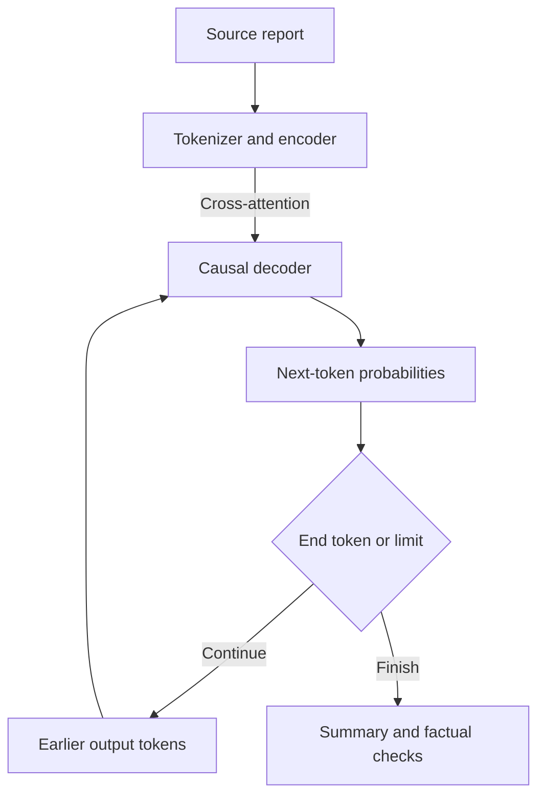

# Additional model build plans

**Concept** — These are complete project plans and design activities. These larger task-specific plans remain design activities. Small runnable language-model variants now appear in Build and retrieve: a recurrent word predictor, masked-token encoder, and recurrent encoder–decoder. Those exercises do not implement every task specified below; diffusion generation remains Concept only. The language-model atlas explains their algorithms; the plans here connect them to practical deliverables. Use the 18 runnable foundation builds to practice the shared engineering workflow first.

## Recurrent networks: forecast a sensor stream

**Problem:** predict the next reading from a recent sequence. A recurrent neural network updates a hidden state at every time step. A long short-term memory network adds gates and a separate cell state; a gated recurrent unit uses a different gated update. Gates control information flow, rather than guaranteeing unlimited memory.

**Start-to-finish build:** collect permitted timestamped sensor readings; resolve missing intervals without using future values; split chronologically before constructing overlapping windows; fit scaling on training measurements; compare with predicting the last observed value; build a small recurrent layer and numeric output head; optimize prediction loss; validate on later time periods; evaluate once on the final period; save weights, architecture, scaling, window length, and time-zone assumptions; reload to predict an unseen sequence; deploy a bounded local endpoint; monitor error, missing readings, and sensor replacement.

**Algorithm exercise:** start a scalar state at zero. Apply `state = 0.5 * state + input` to `[2, 0, 0, 3]`. Obtain `[2, 1, 0.5, 3.25]`. Change the multiplier to 0.9 and explain the longer memory. Run the workbench's state example. This is a memory-mechanism exercise, not trained long short-term memory.

**Assessment:** draw the window/target boundary; demonstrate why adjacent overlapping windows randomly split across datasets leak information; specify expected input shape `[batch, time, features]`; propose a last-value baseline and a failure case. A tiny training extension should fit locally. Rent a graphics processor only for substantially larger sequence workloads.

[Primary reference: PyTorch long short-term memory layer](https://docs.pytorch.org/docs/stable/generated/torch.nn.LSTM.html).

## Encoder models: classify a support request

**Problem:** assign a ticket category using the whole request. An encoder forms contextual representations of the input; a small classification head turns the representation into category scores. Bidirectional context is useful because a word can be interpreted using text on both sides. This is different from predicting future text with a causal mask.

**Start-to-finish build:** define a category guide and collect permitted, independently labeled tickets; group duplicates and related threads; split by thread and time; select a compact pretrained encoder and pin its revision; tokenize with its matching tokenizer; train a classification head or fine-tune selected layers; compare with a keyword or linear baseline; select confidence/rejection rules using validation; test class recall and calibration; save model, tokenizer, label mapping, maximum length, and preprocessing; reload for one new ticket; serve locally; monitor category drift and requests outside the label set.

**Design exercise:** label ten fictional tickets using your category guide, including ambiguous and multi-topic examples. Write the rule for an unknown category and draw where human review occurs. Explain why a similarity embedding objective is not automatically supplied by a classification-trained encoder.

**Assessment:** supply the labeling guide, duplicate-group split, input/output contract, baseline, error-cost table, model version plan, and drift response. Fine-tuning a small encoder can begin locally; larger datasets may justify a graphics processor.

[Primary reference: sequence classification](https://github.com/huggingface/transformers/blob/main/docs/source/en/tasks/sequence_classification.md).

## Encoder–decoder models: summarize a maintenance report

**Problem:** produce a short report summary while preserving dates, actions, and unresolved issues. An encoder reads the source; a decoder generates the summary using previous output tokens and cross-attention to encoded source information.

**Start-to-finish build:** obtain permitted report/summary pairs; remove duplicate reports across splits; write a factuality rubric; choose a compact encoder–decoder checkpoint; tokenize source and target separately; mask padded target positions in the loss; fine-tune on training pairs using teacher forcing; validate generated summaries rather than only teacher-forced loss; compare with extracting the opening sentences; assess factual omissions and invented details on final test; save tokenizer and generation settings with weights; reload and summarize a new report; deploy with source-length and output-length limits; monitor changes in report format and factual-error rates.

**Design exercise:** write a three-sentence maintenance report and a one-sentence reference summary. Mark every summary claim with the source sentence that supports it. Then construct a fluent but incorrect summary and explain why word overlap alone can miss its error. Explain why teacher forcing supplies prior target tokens during training, while generation uses its own earlier outputs.

**Assessment:** paired-data schema, train/validation/test policy, factuality rubric, generated examples, length limits, artifact manifest, and rollback plan. Begin with a small checkpoint and few examples; rent only after measuring memory and runtime.

[Primary reference: summarization workflow](https://huggingface.co/docs/transformers/tasks/summarization).

## Diffusion models: generate small visual patterns

**Problem:** generate diverse, permitted texture patterns for a simulator. A diffusion model learns to reverse a specified corruption process. A common continuous-data setup trains a network to predict added noise at a sampled noise level, then repeatedly applies a compatible reverse update during generation. The sampler and noise schedule are part of the model system.

**Start-to-finish build:** obtain licensed small images and split by source asset; normalize pixels; define a noise schedule; sample a time step and noise for each training example; combine the clean image and noise; supply the corrupted image and time embedding to a small denoiser; train noise prediction; evaluate held-out denoising and generated sample diversity; save weights, normalization, schedule, and sampler configuration; reload; start from noise and generate through reverse steps; inspect duplicates and missing modes; serve locally with bounded resolution and step count; monitor runtime and failure patterns. Larger visual diffusion training often justifies rented graphics hardware, while a tiny numerical corruption exercise does not.

**Numerical exercise:** use the simplified corruption formula `noisy = sqrt(alpha) * clean + sqrt(1-alpha) * noise`. For clean value 2, alpha 0.64, and noise -1, the result is `0.8 * 2 + 0.6 * -1 = 1`. Explain why the denoiser also needs to know the noise level. This arithmetic does not implement a trained reverse sampler.

**Distinction:** a one-pass denoising autoencoder is not automatically a diffusion generator. Discrete text diffusion needs its own token-corruption and generation formulation; do not apply a continuous-image sampler directly to integer token identifiers. The language-model atlas contains a masked-token conceptual algorithm.

**Assessment:** write the corruption and reverse-sampling interfaces, identify which tensors are targets, specify a diversity check, and list every artifact needed to reproduce a sample. Mark the sampler implementation and training as planned work until tested.

[Primary reference: Denoising Diffusion Probabilistic Models](https://arxiv.org/abs/2006.11239).

## Learning strategies that cut across these families

**Concept** — Semi-supervised learning combines labeled and unlabeled examples; self-training can add high-confidence pseudo-labels, but bad pseudo-labels can reinforce errors. Contrastive learning trains representations to distinguish related from unrelated examples; the choice of pairs defines what similarity means. Online learning updates as examples arrive; evaluation must respect time and changing data. Transfer learning starts from learned parameters rather than random initialization. These strategies can use multiple model architectures.

**Design activity:** for the support-ticket project, specify which examples are labeled, how you would prevent held-out tickets from entering pseudo-label training, what makes a valid positive pair, and how an online evaluation would work before accepting an update. No additional strategy is implemented merely because it appears in this plan.
