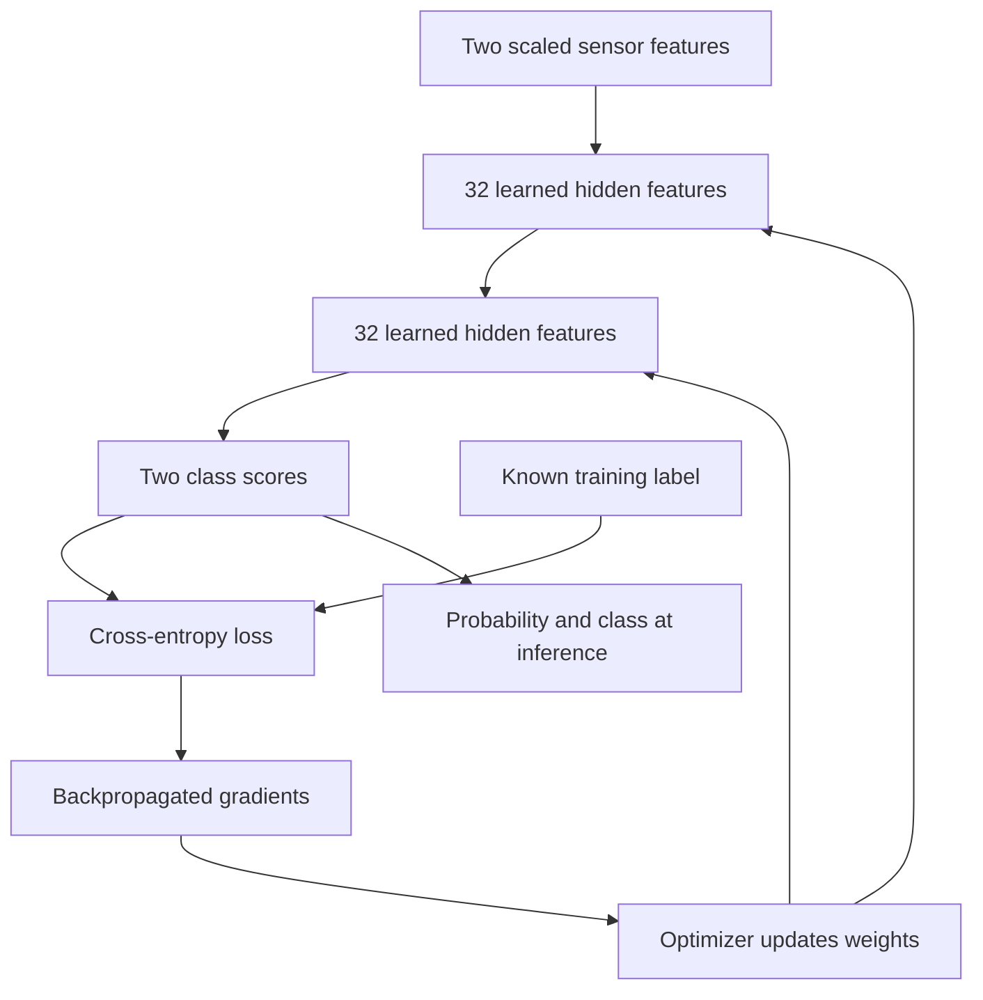

# Deep learning: from a number to a trained network

**Runnable implementation lab — Train a small multilayer perceptron from random weights, inspect gradients, compare it with a linear classifier, save it, and predict new inputs.** Deep learning education also appears in the earlier dense, convolutional, graph, autoencoder, and language-model lessons. This workshop connects their common learning mechanics.

## What makes learning deep?

Machine learning includes trees, regression, counting models, and neural networks. A neural network composes learned transformations. Deep learning uses multiple learned representation layers. It is not synonymous with a language model, a chatbot, or a large parameter count.

For a real-world analogy, consider equipment monitoring: two sensor readings might form a curved boundary between normal and abnormal behavior. A linear classifier draws one straight separation. A hidden network can learn intermediate features that create a more flexible boundary. Our runnable data are two synthetic interlocking curves, not measurements from actual machinery. The experiment tests representation learning, not industrial fault detection.

| Component | Meaning | In this lab |
|---|---|---|
| Tensor | An array of numbers with dimensions | A batch of 24 examples has shape 24 by 2 |
| Weight | A learned numerical coefficient | A matrix maps two inputs to 32 hidden features |
| Bias | A learned offset | Shifts a layer's transformation |
| Activation | A nonlinear function applied within the network | Rectified linear unit keeps positive values and replaces negatives with zero |
| Logit | An unnormalized class score | Two output scores per example |
| Softmax | Converts class scores into a normalized distribution | Used when displaying probabilities |
| Loss | A chosen numerical training objective | Cross-entropy penalizes low probability on the correct class |
| Gradient | Local rate of change of loss with a parameter | Calculated by automatic differentiation |
| Optimizer | Rule for changing parameters from gradients | Adaptive moment estimation in the implementation |
| Batch | Examples processed together for an update | At most 24 sampled training examples |
| Generalization | Performance on examples not used to fit the model | Measured on a held-out split |

Without nonlinear activations, consecutive linear layers collapse into another linear transformation. Merely stacking linear matrices does not create the curved decision boundary we want. More layers also do not guarantee better results; optimization, data, regularization, and task difficulty matter.

## Architecture and learning flow



The two-hidden-layer network has 1,218 trainable parameters. Count them: the first layer has 2 × 32 weights plus 32 biases; the second has 32 × 32 plus 32; the output has 32 × 2 plus 2. The zero-hidden-layer comparison has only a direct mapping from two inputs to two scores. This is a comparison of practical model choices, not a parameter-matched architecture study.

## Work through one gradient by hand

Let a one-weight model predict `prediction = weight × 2`, with target 6. Start with weight 1. The prediction is 2 and squared error is `(2 − 6)² = 16`. The derivative with respect to the weight is `2 × (2 × weight − 6) × 2`, which is −16 at weight 1.

Using a learning rate of 0.1 for this one illustrative update gives `new_weight = 1 − 0.1 × (−16) = 2.6`. The prediction becomes 5.2 and squared error becomes 0.64. The negative gradient meant increasing this weight would locally reduce loss.

The program compares the hand derivative with PyTorch's automatic derivative and a finite-difference estimate obtained by slightly perturbing the weight. Finite differences are an independent numerical check; they are expensive for large networks and sensitive to perturbation size. The training network itself uses cross-entropy and adaptive moment estimation, so the hand example explains a local principle rather than predicting its exact learning curve.

## Build from start to finish

1. Define the prototype: classify two numerical inputs into two synthetic categories and beat a training-majority baseline on validation.
2. Create 600 synthetic examples with a recorded seed. Split 60 percent for training, 20 percent for validation, and 20 percent for a reserved final test. Preserve class proportions.
3. Fit the feature scaler on training inputs only. Save its means and scales. A deployment prediction must use the same transformation.
4. Construct the zero-hidden-layer baseline or a two-hidden-layer network with new random weights. Do not load a checkpoint.
5. Predict training labels, compute cross-entropy, clear old gradients, backpropagate, clip the gradient norm to 1, and update parameters. Repeat for the specified number of optimizer steps.
6. Inspect training loss, gradient norms, parameter count, and held-out accuracy. A step samples a batch; 300 steps does not mean 300 complete dataset passes.
7. Select settings using validation. Use `--split test` only after selection; repeated inspection makes that test part of your selection process.
8. Save weights, architecture, scaling values, example input, split indices, plot, and report. Rebuild the network, load its saved weights, and verify identical outputs on a probe.
9. In Practice, load the saved example, change a sensor value, and choose Predict new input. This performs inference without retraining.
10. Keep the prototype local. For real equipment, collect representative time-separated measurements, investigate false negatives, define a human escalation process, monitor drift, and retain a previous model for rollback. Synthetic accuracy does not justify an operational alarm decision.

## Run the experiment

Use the website's Practice buttons; they supply a fresh output folder automatically. These are the equivalent commands inside the guided terminal, where `python` uses your configured project environment:

```text
python neural_builds.py deep --depth 2 --steps 300 --output outputs/deep-two-NEW
python neural_builds.py deep --depth 0 --steps 300 --output outputs/deep-linear-NEW
```

For **PowerShell**, start in the extracted website folder. If its environment is `.venv`, use its executable explicitly. Substitute your existing configured executable if you reused the older installation:

```powershell
Set-Location .\lab
& ..\.venv\Scripts\python.exe .\neural_builds.py deep --depth 2 --steps 300 --output outputs\deep-two-NEW
```

For **Command Prompt**, from the same extracted website folder:

```bat
cd lab
..\.venv\Scripts\python.exe neural_builds.py deep --depth 2 --steps 300 --output outputs\deep-two-NEW
```

Install the foundation packages through the website if prompted. Do not recreate a working environment. Use a new output name each time; the program intentionally refuses to overwrite experiment evidence. These commands require no Git Bash and no cloud rental.

## Change, predict, measure

Before running the linear comparison, predict which model can represent a curved boundary. Compare actual validation accuracy, parameter count, training loss, and gradient norms. Then repeat with another seed. Explain why one seed is insufficient for a universal claim.

Try `--lr 0.03` in a fresh run. Does a larger learning rate help, oscillate, or destabilize this particular training process? State the observation rather than assuming it must fail. Inspect the numerical gradient check: values should be close to −16, with a very small finite-difference error. In the saved model interface, input must remain an array of rows, each with exactly two finite numbers.

**Assessment evidence:** a hand-worked derivative, tensor-shape trace, baseline comparison, plot, at least one changed setting, untouched-test plan, reload prediction, and explanation of why two linear layers without nonlinearities are still linear.

## Failure diagnosis and next builds

If loss is nonfinite, check numerical inputs and learning rate. If training improves but validation worsens, investigate overfitting or distribution shift. If predictions change after reload, inspect architecture, preprocessing, evaluation mode, and saved weights. If hidden gradients remain zero, inspect activation behavior and whether parameters were frozen. A converged training loss does not prove the task is solved.

Continue with the [recurrent language model](#lesson/scratch-recurrent), [masked-token encoder](#lesson/scratch-encoder), and [encoder–decoder](#lesson/scratch-sequence). Convolutional and graph lessons use the same learning loop with different information-sharing structures. All new builds fit on a central processing unit; use [Vast.ai](#lesson/cloud) only for a measured larger experiment.

Sources: [PyTorch learning workflow](https://docs.pytorch.org/tutorials/beginner/basics/intro.html) and [automatic differentiation](https://docs.pytorch.org/tutorials/beginner/basics/autogradqs_tutorial.html). The data, exercises, architecture size, and evaluation choices here are this lab's teaching design.
