# Machine Learning Super Lab: Expanded Foundations

A companion to the local website. All commands run locally unless explicitly marked remote Linux.

# Learning signals: four ways to create a training objective

**Tag: Concept.** This is a reasoning and design activity. The linked implementation labs provide executable examples.

A model architecture describes the calculation. A learning method describes where the training signal comes from. A task describes what you want to accomplish. Keeping these separate prevents confusing a Transformer with reinforcement learning or a deployment format with a model family.

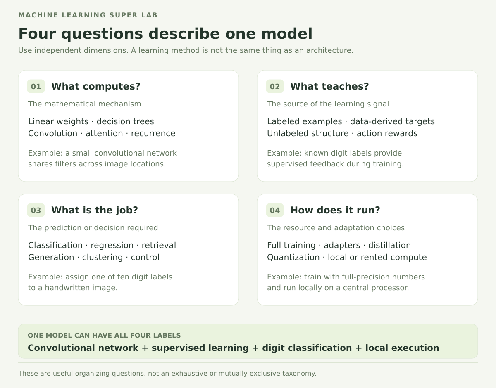

## Supervised learning

A training example includes an input and a supplied target. A classifier might receive sensor measurements and a technician-confirmed condition. Regression predicts a quantity; classification predicts a category. The target’s quality, collection process, and timing determine what can actually be learned. A label obtained after an incident must not accidentally appear as an input available before the incident.

**Activity:** write an input-and-target contract for event triage. Identify when each feature exists and who supplies the target. Then run logistic regression and the decision-tree lab. Explain how the same labels can train different architectures.

## Self-supervised learning

Construct the target from the data itself. In next-token prediction, the input prefix supplies context and the following token supplies the target. In denoising, corrupt an example and reconstruct the original. Human category labels are not required for those targets, but preprocessing, data selection, and objective choices still require engineering.

**Activity:** take the sentence “the server starts safely.” Write every prefix and its next-token target. Then identify which part of the autoencoder lab’s code creates corrupted input and which part retains the clean target. Explain why using next-token prediction during training does not mean a model learns from every conversation after deployment.

## Unsupervised learning

Look for structure without supplied task labels, as in clustering and principal component analysis. There is still an objective: compact clusters or useful directions of variation. Self-supervised learning is often discussed under a broad unsupervised umbrella, but separating explicit target construction is pedagogically useful. The categories are conventions rather than mutually exclusive laws.

**Activity:** propose three possible ways to group support incidents: wording, root cause, and affected product. Explain why distance in one representation may group the first well while failing on the other two. Run clustering and inspect whether a numeric score answers your business question.

## Reinforcement learning

Actions affect future observations and rewards. The learner improves a policy using interaction, rather than receiving a correct label for every possible action. Exploration and delayed consequences matter. The grid lab is a complete tiny implementation; a production control system introduces much more demanding evaluation and operational constraints.

**Activity:** specify states, actions, transitions, reward, and episode termination for a simulated job scheduler. Identify one reward that could encourage an undesirable shortcut. Then trace a terminal Q-learning update by hand.

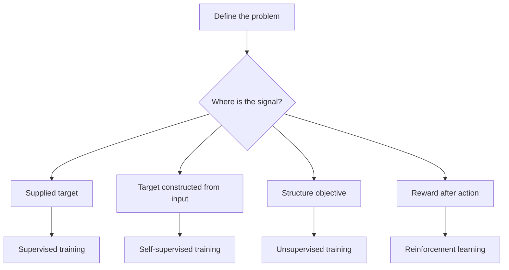

## Assessment evidence

Submit four small problem specifications, one per learning signal. For each, name the model candidate, input, objective, evaluation split, and deployment constraint. Reject the statement “reinforcement learning is a type of Transformer” with a concrete counterexample from the grid lab.


# Choosing a model and building an honest experiment

**Tag: Concept.** Complete the design worksheet before investing in a larger training run.

A useful engineering question is “What is the simplest model that meets a measured requirement?” It is not “Which model name is most impressive?” A model family is a candidate mechanism; representative data and task-specific evaluation decide whether it works.

## A practical selection algorithm

1. State the output: number, category, grouping, representation, generated content, or action.
2. Identify the data structure: rows of measurements, images, sequences, a graph, or interactive observations.
3. State the available learning signal and how it was collected.
4. Create a trivial baseline: training-mean prediction, majority class, random action, or a uniform token distribution.
5. Select one simple candidate and one justified alternative. Use the smallest representative experiment that distinguishes them.
6. Freeze a split strategy that respects time, people, documents, equipment, or organizations when those create dependence.
7. Fit preprocessing and the model using training data. Use validation for settings. Reserve final test data for the decision you will report.
8. Measure quality, latency, memory, and operating cost. Review individual failures.
9. Deploy only after checking the actual operating setting. Monitor drift and define a rollback criterion.

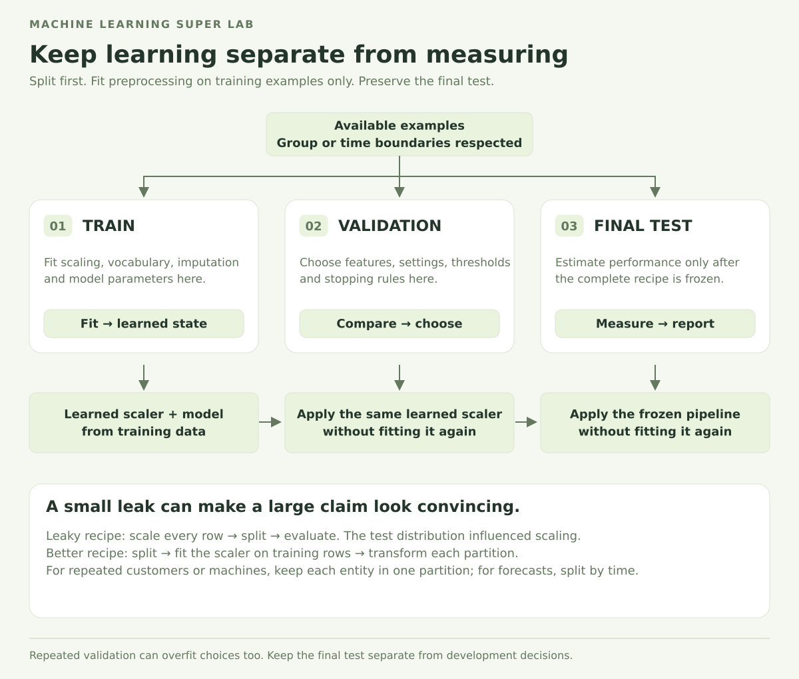

## Match a mechanism to the evidence

| Situation | Useful baseline | Candidate extension | Question that determines the choice |
|---|---|---|---|
| Predict a numeric quantity from a few measurements | Training mean and linear regression | Boosted trees or a neural network | Does nonlinear structure improve held-out error enough to justify complexity? |
| Classify tabular records | Majority class and logistic regression | Tree ensembles or a kernel classifier | What false-positive and false-negative rates are acceptable? |
| Group unlabeled records | Manual sample review | Clustering with a chosen representation | Are the resulting groups operationally useful? |
| Compress measurements | Principal component analysis | Autoencoder | Does the compact representation preserve the downstream task? |
| Classify images | A simple pixel-based classifier | Convolutional network | Does spatial structure help under realistic image variation? |
| Predict using relationships | Features-only classifier | Graph neural network | Are the graph edges available without leakage at prediction time? |
| Generate or transform language | Template or statistical baseline | Small pretrained language model | Is free-form generation needed, and how will correctness be measured? |
| Choose sequential actions | A rule-based or random policy | Reinforcement learning | Can you simulate and evaluate consequences faithfully? |

These are candidate comparisons, not automatic winners. A stronger baseline often reveals that the data contract or evaluation was the real problem.

## An architectural flow for a deployed predictor

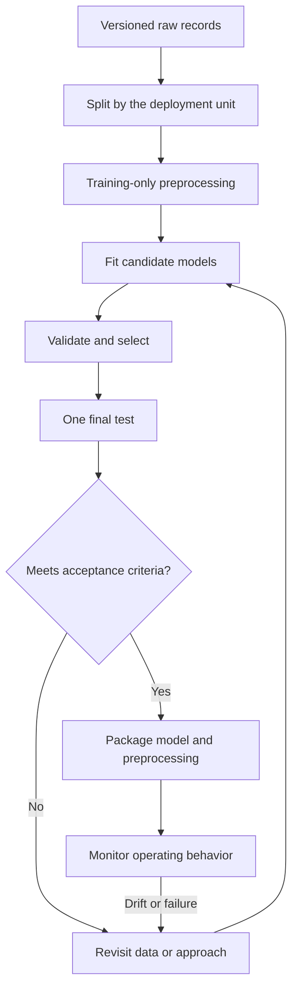

## Real-world example: a service-time predictor

A team wants a duration estimate before a job begins. A record contains input size, requested transformation count, and eventual duration. Including final output size might be leakage if that value is not available when the prediction must be made. Randomly splitting repeated runs of the same customer job might also make validation unrealistically easy. A better deployment-aligned design could hold out later time periods or entire job templates. The correct choice depends on where the model will be used.

## Assessment contract

Before running a model, write: “For this dataset and deployment setting, I will accept the candidate if [quality metric], [latency], and [resource limit] meet [thresholds], with no known leakage.” Choose thresholds for the task, not after seeing the final test score. Include a baseline comparison and three failure cases in the report. A tiny demonstration proves that you can implement and explain a mechanism; it does not certify a production system.


# Linear regression: learn a weighted prediction

**Tag: Runnable implementation lab.** Scope: an inspectable teaching implementation with real fitting, evaluation, and generated artifacts. This is not a production deployment certification.

**Learning outcome:** Predict a number, understand each coefficient, and beat a simple baseline.

## Where this appears in the real world

A service team wants to estimate how long a batch job will take from its record count, number of transformations, and compression setting. An interpretable baseline helps reveal whether a complex model adds value. Our measurements are simulated, not logs from a real company.

## Build the mental model

The prediction is an intercept plus a weighted sum of features. A coefficient answers how the prediction changes when one input rises by one unit while the other inputs stay fixed. Fitting adjusts the coefficients to reduce squared residuals, the differences between predictions and observed values.

### Work through a concrete example

With intercept 5, record-count coefficient 2, transformation coefficient 3, and compression coefficient 8, input [10, 2, 1] gives 5 + 20 + 6 + 8 = 39. If the measured duration is 43, the residual is 4 and its squared error is 16. Real training fits many examples simultaneously.

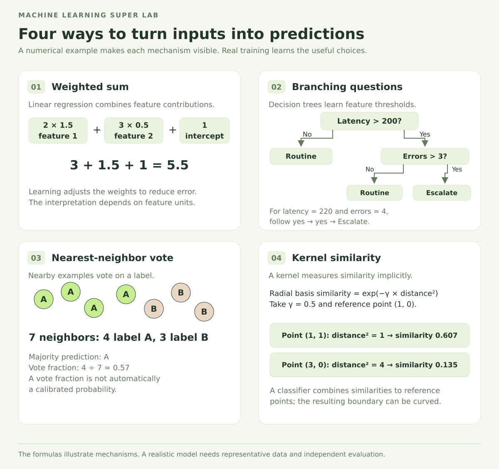

## Follow the algorithm

1. Generate simulated job measurements with known weights.
2. Split examples before fitting: 60 percent training, 20 percent validation, 20 percent final test.
3. Fit a linear model only on training examples.
4. Predict validation durations and compare with always predicting the training mean.
5. Inspect recovered coefficients and the actual-versus-predicted plot.

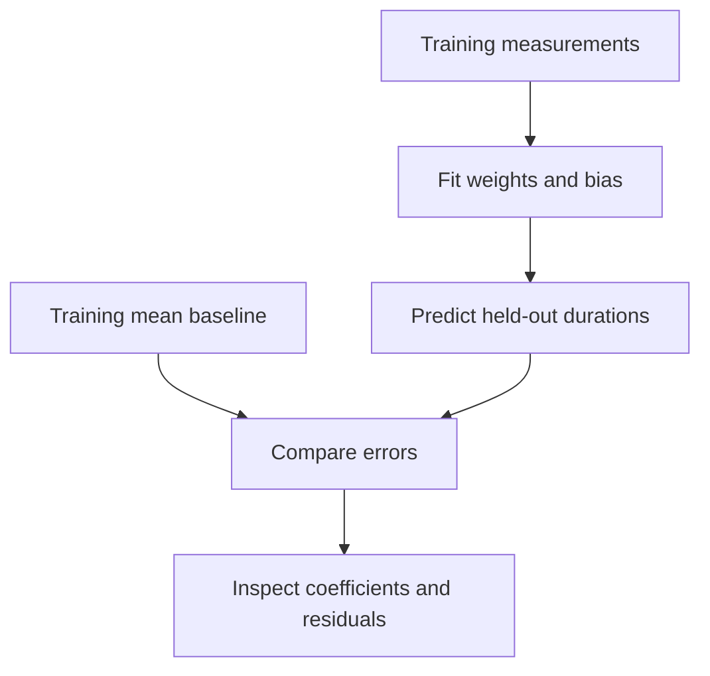

## Go one level deeper

Ordinary least squares minimizes the sum of squared residuals; a numerical solver can fit it without a neural-network training loop. Correlated inputs can make individual coefficients unstable even when predictions are useful. Mean absolute error measures typical absolute mistakes in the target units. Root mean squared error emphasizes larger mistakes. The coefficient of determination compares squared error with a constant prediction and can be negative on held-out data. A fitted coefficient is an association, not proof of causation.

## Run the implementation

Open the Practice tab. Install the foundation packages once if the site requests them. The runner executes the actual program in lab/foundations.py. The commands below are for the website’s guided terminal; it selects your Python environment automatically. For external PowerShell, replace python with & .\.venv\Scripts\python.exe and use .\lab\foundations.py from the website folder. Replace {run} with a unique name when typing commands manually; the website buttons generate it automatically.

```text
python foundations.py linear --noise 8 --output outputs/linear-{run}
```

```text
python foundations.py linear --noise 25 --output outputs/linear-noisy-{run}
```

The random seed controls the generated data, splits, and applicable model initialization. Keep it fixed when investigating one changed parameter. Neural results can still vary across hardware and library implementations.

## Inspect the evidence

Open predictions.png. Points on the diagonal are perfect predictions. In report.json compare mean_absolute_error with baseline_mean_absolute_error and inspect learned_weights near the data generator’s [2, 3, 8]. Exact recovery is not expected with noise.

Every completed run writes report.json with the experiment, split, seed, settings, dataset description, measured metrics, timing, and limitations. Where applicable it also saves a trained parameter dictionary. The Experiment results page shows the measured report and generated plots. Record an explanation of the result instead of copying only the score.

## Change one thing and prove what happened

Predict which metric will increase when measurement noise increases from 8 to 25. Run both commands with seed 42, record the results, and explain why more noise does not necessarily require a deeper network. Then read linear() in foundations.py and change one generating coefficient in a copied experiment.

## Debugging checkpoint

Never estimate preprocessing statistics on the complete dataset before splitting. Do not interpret generated feature names as measured business facts.

If the program reports a missing module, install foundation packages in the runtime shown by the website. If it refuses an existing output directory, choose a new one; this protects earlier evidence. If a numerical result surprises you, inspect data shape, split sizes, and the baseline before changing model complexity.

## Compute plan

For this exact bundled exercise, use your local central processing unit. Renting a graphics processing unit is unnecessary. The implementation uses ordinary processor-based scikit-learn or small tables. Renting a graphics processor will not automatically accelerate this code.

## Build it from start to finish: Batch-job duration estimator

**Runnable implementation lab — local prototype.** This build connects the real-world scenario to an executable teaching model. Simulated data is explicitly identified; a good score on it does not establish business performance.

1. **Write the decision and success criterion.** State who consumes the prediction and which mistake is expensive. Define a measurable baseline before choosing a model. For this project: batch-job duration estimator.
2. **Define and inspect the data.** One completed job per row: record count, transformation count, compression setting, and observed duration. Record units and exclude information available only after the prediction time. Use the bundled dataset first. Before replacing it, document permission, provenance, missing values, units, class coverage, duplicates, and when each feature becomes available.
3. **Create the evaluation boundary.** The program fixes a seed and separates fitting from held-out evaluation where that protocol applies. For real workloads, choose time-based or entity-based separation when random splitting would leak related observations. The graph, adversarial, and reinforcement modules explain their distinct protocols.
4. **Construct the model.** Read the algorithm and the matching function in foundations.py. Trace the input shape through every preprocessing and model stage. The numerical example above lets you check a small part by hand.
5. **Train and compare.** Run the first Practice experiment. Record its baseline, metrics, runtime, and failure cases. Run the changed setting and explain the result. Choose settings using validation; reserve final test evidence for the chosen configuration.
6. **Save a usable artifact.** The program writes a model-manifest.json, an example-input.json, a fitted model or learned counting/action table, and report.json. It reloads the artifact in a separate inference function before declaring success. Learned scaling stays with applicable classical models. A neural state dictionary alone would be insufficient without the matching architecture; this build also exports an executable inference module.
7. **Use it on a new input.** In Practice, select **Load saved example**, edit one value while preserving the documented shape, and select **Predict new input**. This reloads the saved model and runs inference without training again. A nonnegative duration estimate; route out-of-range workloads to a conservative fallback.
8. **Deploy the prototype locally.** The localhost website is the demonstration serving layer: input validation → saved artifact → inference → output. Keep the model's environment and feature contract with the release. Only load artifacts you created or trust; executable model formats are not passive documents.
9. **Plan a production handoff.** Add representative-data evaluation, request limits, authentication, authorization, observability, model versioning, rollback, and a suitable reject/fallback behavior before exposing a service to other users. These are engineering extensions, not completed production features of this local lab.
10. **Monitor and decide when to retrain.** Absolute error by job size; feature-range shifts; late-job rate. Define a threshold and response owner. Track whether the new data resembles the training population, and compare a candidate model with the deployed baseline before replacement.

### The build architecture

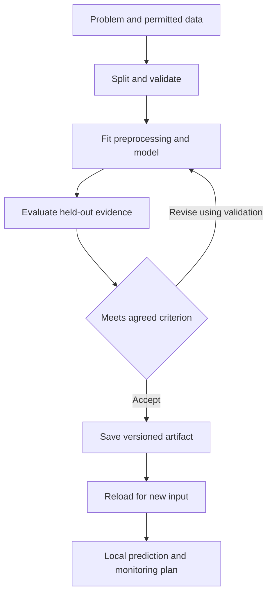

### Command-line inference alternative

The website remembers the last successful model folder for this lesson. In its guided terminal, replace MODEL-FOLDER below with that actual folder name and NEW-RUN with a unique output name. Edit a copy of example-input.json to supply your own values.

```text
python predict_saved.py --model-dir outputs/MODEL-FOLDER --input outputs/MODEL-FOLDER/example-input.json --output outputs/prediction-NEW-RUN.json
```

### Build acceptance evidence

Submit a one-paragraph problem definition, feature/target contract, baseline and selected-model reports, one failure analysis, saved artifact, a changed-input prediction, and a deployment/monitoring decision. Passing a command demonstrates executable code; this evidence explains whether the model is appropriate for its intended use.


## Submit an engineering assessment

Save the two reports, their visual artifacts, a prediction made before the second run, and a paragraph explaining the observed difference. State the dataset’s limits and what additional evidence a real deployment would need. Use validation to choose settings; for a final assessment, rerun the selected settings with --split test and a new output folder. The adversarial and reinforcement labs describe their special evaluation protocols explicitly rather than claiming an ordinary random test split.

## Primary reference

[Read the primary documentation or research](https://scikit-learn.org/1.7/modules/linear_model.html). The lesson’s scenario and simplified implementation are teaching examples.


# Logistic regression: turn scores into probabilities

**Tag: Runnable implementation lab.** Scope: an inspectable teaching implementation with real fitting, evaluation, and generated artifacts. This is not a production deployment certification.

**Learning outcome:** Learn classification, thresholds, class imbalance, and confusion matrices.

## Where this appears in the real world

An operations team may prioritize events for review using measured event features. A predicted probability helps rank the queue. It does not establish that a person or event is malicious. The lab uses generated event vectors so there is no private telemetry.

## Build the mental model

First compute a weighted score. Then use the sigmoid function to map that score into a number between zero and one. Training makes observed labels more probable. A decision threshold converts the probability into a label, and changing that threshold changes the kinds of mistakes.

### Work through a concrete example

A score of 0 maps to probability 0.5. A score of approximately 2.20 maps to approximately 0.90. A review threshold of 0.80 would flag the second example. The probability is not automatically calibrated to real-world frequencies.

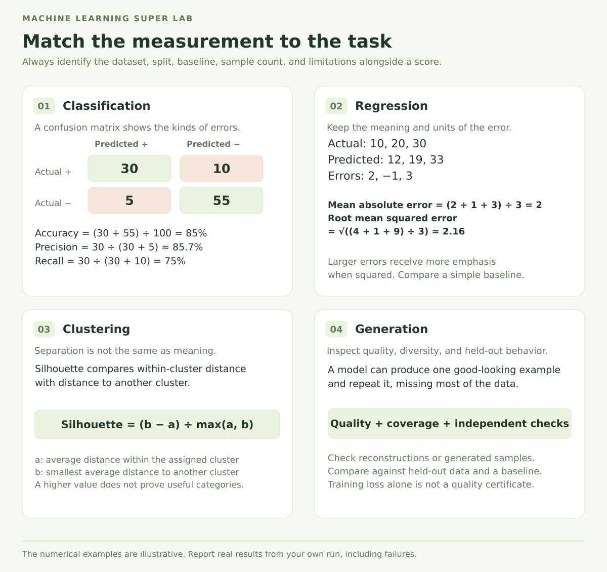

## Follow the algorithm

1. Create a binary dataset with unequal class frequencies.
2. Split while preserving approximately the same class proportions.
3. Fit the feature scaler on training data inside a pipeline.
4. Fit logistic regression with regularization.
5. Predict validation labels and inspect false positives and false negatives.

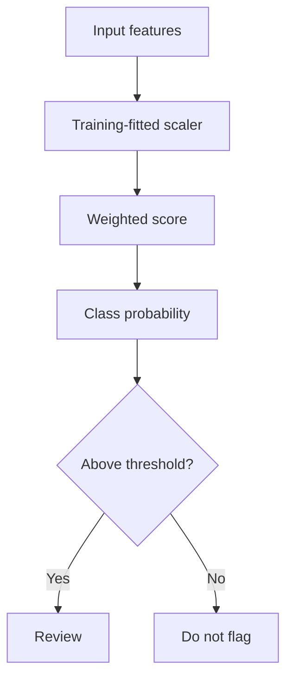

## Go one level deeper

The loss is negative log likelihood, often called binary cross-entropy. Regularization discourages overly large coefficients. In the library used here, the parameter C is inverse regularization strength: smaller C means stronger regularization. Accuracy alone can hide failure on the less common class. Balanced accuracy averages recall across classes; macro F1 averages each class’s harmonic mean of precision and recall. These metrics answer different questions.

## Run the implementation

Open the Practice tab. Install the foundation packages once if the site requests them. The runner executes the actual program in lab/foundations.py. The commands below are for the website’s guided terminal; it selects your Python environment automatically. For external PowerShell, replace python with & .\.venv\Scripts\python.exe and use .\lab\foundations.py from the website folder. Replace {run} with a unique name when typing commands manually; the website buttons generate it automatically.

```text
python foundations.py logistic --strength 1 --output outputs/logistic-{run}
```

```text
python foundations.py logistic --strength 0.01 --output outputs/logistic-regularized-{run}
```

The random seed controls the generated data, splits, and applicable model initialization. Keep it fixed when investigating one changed parameter. Neural results can still vary across hardware and library implementations.

## Inspect the evidence

Compare the confusion matrix with the majority-class baseline. Rows are actual classes and columns are predicted classes. A model can beat the baseline but still produce too many false alerts for an operational review queue.

Every completed run writes report.json with the experiment, split, seed, settings, dataset description, measured metrics, timing, and limitations. Where applicable it also saves a trained parameter dictionary. The Experiment results page shows the measured report and generated plots. Record an explanation of the result instead of copying only the score.

## Change one thing and prove what happened

Compare training accuracy and validation accuracy under the two regularization settings. In a copied workbench experiment, use predict_proba and compare thresholds 0.2, 0.5, and 0.8. Submit the false-positive and false-negative counts, not only a single accuracy score.

## Debugging checkpoint

Choosing a threshold by inspecting final test labels invalidates that test as an independent final check. Select the threshold using validation data.

If the program reports a missing module, install foundation packages in the runtime shown by the website. If it refuses an existing output directory, choose a new one; this protects earlier evidence. If a numerical result surprises you, inspect data shape, split sizes, and the baseline before changing model complexity.

## Compute plan

For this exact bundled exercise, use your local central processing unit. Renting a graphics processing unit is unnecessary. The implementation uses ordinary processor-based scikit-learn or small tables. Renting a graphics processor will not automatically accelerate this code.

## Build it from start to finish: Operations review-queue ranker

**Runnable implementation lab — local prototype.** This build connects the real-world scenario to an executable teaching model. Simulated data is explicitly identified; a good score on it does not establish business performance.

1. **Write the decision and success criterion.** State who consumes the prediction and which mistake is expensive. Define a measurable baseline before choosing a model. For this project: operations review-queue ranker.
2. **Define and inspect the data.** One event per row with features observable at event time and a later reviewed outcome. Split by time and keep related events together in a real dataset. Use the bundled dataset first. Before replacing it, document permission, provenance, missing values, units, class coverage, duplicates, and when each feature becomes available.
3. **Create the evaluation boundary.** The program fixes a seed and separates fitting from held-out evaluation where that protocol applies. For real workloads, choose time-based or entity-based separation when random splitting would leak related observations. The graph, adversarial, and reinforcement modules explain their distinct protocols.
4. **Construct the model.** Read the algorithm and the matching function in foundations.py. Trace the input shape through every preprocessing and model stage. The numerical example above lets you check a small part by hand.
5. **Train and compare.** Run the first Practice experiment. Record its baseline, metrics, runtime, and failure cases. Run the changed setting and explain the result. Choose settings using validation; reserve final test evidence for the chosen configuration.
6. **Save a usable artifact.** The program writes a model-manifest.json, an example-input.json, a fitted model or learned counting/action table, and report.json. It reloads the artifact in a separate inference function before declaring success. Learned scaling stays with applicable classical models. A neural state dictionary alone would be insufficient without the matching architecture; this build also exports an executable inference module.
7. **Use it on a new input.** In Practice, select **Load saved example**, edit one value while preserving the documented shape, and select **Predict new input**. This reloads the saved model and runs inference without training again. A review score with a validation-selected threshold; preserve human review and record false-alert costs.
8. **Deploy the prototype locally.** The localhost website is the demonstration serving layer: input validation → saved artifact → inference → output. Keep the model's environment and feature contract with the release. Only load artifacts you created or trust; executable model formats are not passive documents.
9. **Plan a production handoff.** Add representative-data evaluation, request limits, authentication, authorization, observability, model versioning, rollback, and a suitable reject/fallback behavior before exposing a service to other users. These are engineering extensions, not completed production features of this local lab.
10. **Monitor and decide when to retrain.** Precision, recall, calibration, review volume, and label delay. Define a threshold and response owner. Track whether the new data resembles the training population, and compare a candidate model with the deployed baseline before replacement.

### The build architecture


### Command-line inference alternative

The website remembers the last successful model folder for this lesson. In its guided terminal, replace MODEL-FOLDER below with that actual folder name and NEW-RUN with a unique output name. Edit a copy of example-input.json to supply your own values.

```text
python predict_saved.py --model-dir outputs/MODEL-FOLDER --input outputs/MODEL-FOLDER/example-input.json --output outputs/prediction-NEW-RUN.json
```

### Build acceptance evidence

Submit a one-paragraph problem definition, feature/target contract, baseline and selected-model reports, one failure analysis, saved artifact, a changed-input prediction, and a deployment/monitoring decision. Passing a command demonstrates executable code; this evidence explains whether the model is appropriate for its intended use.


## Submit an engineering assessment

Save the two reports, their visual artifacts, a prediction made before the second run, and a paragraph explaining the observed difference. State the dataset’s limits and what additional evidence a real deployment would need. Use validation to choose settings; for a final assessment, rerun the selected settings with --split test and a new output folder. The adversarial and reinforcement labs describe their special evaluation protocols explicitly rather than claiming an ordinary random test split.

## Primary reference

[Read the primary documentation or research](https://scikit-learn.org/1.7/modules/linear_model.html#logistic-regression). The lesson’s scenario and simplified implementation are teaching examples.


# Decision trees: inspect the questions

**Tag: Runnable implementation lab.** Scope: an inspectable teaching implementation with real fitting, evaluation, and generated artifacts. This is not a production deployment certification.

**Learning outcome:** Build a branching classifier and see the cost of increasing depth.

## Where this appears in the real world

A manufacturing team can investigate combinations of temperature, vibration, and operating state associated with defective output. A shallow tree offers a sequence of inspectable questions. Our generated features represent a teaching analogue, not a validated industrial diagnostic.

## Build the mental model

A tree repeatedly partitions examples using questions such as feature three less than a threshold. The training algorithm searches for splits that make the resulting groups more consistent in their labels. A leaf stores the prediction made after following a path.

### Work through a concrete example

Imagine a node with six normal and four fault examples. A useful split might create one branch with five normal and no faults and another with one normal and four faults. The branches are more informative than the original mixed group.


## Follow the algorithm

1. Start with all training examples at the root.
2. Try feature thresholds and score the resulting label impurity.
3. Choose a useful split and repeat on each child.
4. Stop at the configured depth or another stopping rule.
5. Predict by walking each held-out example from root to leaf.

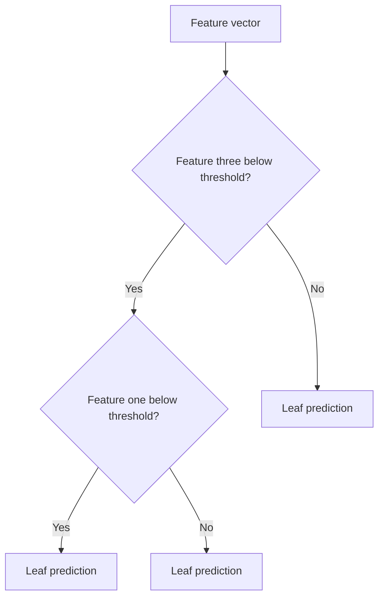

## Go one level deeper

This implementation uses Gini impurity by default. A pure node has impurity zero. Deeper trees can fit small peculiarities in training data, increasing variance. Limiting depth or pruning constrains that flexibility. Trees do not require the same feature scaling as distance-based methods because each split tests one feature against a threshold. Correlated or proxy features can still make a plausible-looking explanation misleading.

## Run the implementation

Open the Practice tab. Install the foundation packages once if the site requests them. The runner executes the actual program in lab/foundations.py. The commands below are for the website’s guided terminal; it selects your Python environment automatically. For external PowerShell, replace python with & .\.venv\Scripts\python.exe and use .\lab\foundations.py from the website folder. Replace {run} with a unique name when typing commands manually; the website buttons generate it automatically.

```text
python foundations.py tree --depth 3 --output outputs/tree-shallow-{run}
```

```text
python foundations.py tree --depth 15 --output outputs/tree-deep-{run}
```

The random seed controls the generated data, splits, and applicable model initialization. Keep it fixed when investigating one changed parameter. Neural results can still vary across hardware and library implementations.

## Inspect the evidence

Open tree.png: only the first three displayed levels are plotted to keep the picture readable. Inspect training_accuracy and validation accuracy in the report. A deep tree can achieve excellent training performance while worsening held-out results.

Every completed run writes report.json with the experiment, split, seed, settings, dataset description, measured metrics, timing, and limitations. Where applicable it also saves a trained parameter dictionary. The Experiment results page shows the measured report and generated plots. Record an explanation of the result instead of copying only the score.

## Change one thing and prove what happened

Walk one example through the displayed thresholds by hand. Then compare depth 3 and depth 15 using the same split. Submit a short explanation of which model you would retain and what evidence could change your decision.

## Debugging checkpoint

A decision path explains this fitted model’s computation. It does not prove that the chosen feature causes the observed outcome.

If the program reports a missing module, install foundation packages in the runtime shown by the website. If it refuses an existing output directory, choose a new one; this protects earlier evidence. If a numerical result surprises you, inspect data shape, split sizes, and the baseline before changing model complexity.

## Compute plan

For this exact bundled exercise, use your local central processing unit. Renting a graphics processing unit is unnecessary. The implementation uses ordinary processor-based scikit-learn or small tables. Renting a graphics processor will not automatically accelerate this code.

## Build it from start to finish: Inspectable equipment-fault triage

**Runnable implementation lab — local prototype.** This build connects the real-world scenario to an executable teaching model. Simulated data is explicitly identified; a good score on it does not establish business performance.

1. **Write the decision and success criterion.** State who consumes the prediction and which mistake is expensive. Define a measurable baseline before choosing a model. For this project: inspectable equipment-fault triage.
2. **Define and inspect the data.** One machine observation per row with sensor values and a confirmed fault label. Split by machine and time to avoid near-duplicate leakage. Use the bundled dataset first. Before replacing it, document permission, provenance, missing values, units, class coverage, duplicates, and when each feature becomes available.
3. **Create the evaluation boundary.** The program fixes a seed and separates fitting from held-out evaluation where that protocol applies. For real workloads, choose time-based or entity-based separation when random splitting would leak related observations. The graph, adversarial, and reinforcement modules explain their distinct protocols.
4. **Construct the model.** Read the algorithm and the matching function in foundations.py. Trace the input shape through every preprocessing and model stage. The numerical example above lets you check a small part by hand.
5. **Train and compare.** Run the first Practice experiment. Record its baseline, metrics, runtime, and failure cases. Run the changed setting and explain the result. Choose settings using validation; reserve final test evidence for the chosen configuration.
6. **Save a usable artifact.** The program writes a model-manifest.json, an example-input.json, a fitted model or learned counting/action table, and report.json. It reloads the artifact in a separate inference function before declaring success. Learned scaling stays with applicable classical models. A neural state dictionary alone would be insufficient without the matching architecture; this build also exports an executable inference module.
7. **Use it on a new input.** In Practice, select **Load saved example**, edit one value while preserving the documented shape, and select **Predict new input**. This reloads the saved model and runs inference without training again. A fault category plus the sequence of thresholds; uncertain cases go to a technician.
8. **Deploy the prototype locally.** The localhost website is the demonstration serving layer: input validation → saved artifact → inference → output. Keep the model's environment and feature contract with the release. Only load artifacts you created or trust; executable model formats are not passive documents.
9. **Plan a production handoff.** Add representative-data evaluation, request limits, authentication, authorization, observability, model versioning, rollback, and a suitable reject/fallback behavior before exposing a service to other users. These are engineering extensions, not completed production features of this local lab.
10. **Monitor and decide when to retrain.** Missed faults, false alarms per machine, and newly appearing operating regimes. Define a threshold and response owner. Track whether the new data resembles the training population, and compare a candidate model with the deployed baseline before replacement.

### The build architecture


### Command-line inference alternative

The website remembers the last successful model folder for this lesson. In its guided terminal, replace MODEL-FOLDER below with that actual folder name and NEW-RUN with a unique output name. Edit a copy of example-input.json to supply your own values.

```text
python predict_saved.py --model-dir outputs/MODEL-FOLDER --input outputs/MODEL-FOLDER/example-input.json --output outputs/prediction-NEW-RUN.json
```

### Build acceptance evidence

Submit a one-paragraph problem definition, feature/target contract, baseline and selected-model reports, one failure analysis, saved artifact, a changed-input prediction, and a deployment/monitoring decision. Passing a command demonstrates executable code; this evidence explains whether the model is appropriate for its intended use.


## Submit an engineering assessment

Save the two reports, their visual artifacts, a prediction made before the second run, and a paragraph explaining the observed difference. State the dataset’s limits and what additional evidence a real deployment would need. Use validation to choose settings; for a final assessment, rerun the selected settings with --split test and a new output folder. The adversarial and reinforcement labs describe their special evaluation protocols explicitly rather than claiming an ordinary random test split.

## Primary reference

[Read the primary documentation or research](https://scikit-learn.org/1.7/modules/tree.html). The lesson’s scenario and simplified implementation are teaching examples.


# Ensembles: compare forests and boosting

**Tag: Runnable implementation lab.** Scope: an inspectable teaching implementation with real fitting, evaluation, and generated artifacts. This is not a production deployment certification.

**Learning outcome:** Combine learners, compare the actual results, and distinguish two different strategies.

## Where this appears in the real world

Tabular prediction appears in inventory planning, service reliability, and transaction review. Tree ensembles are useful candidates when feature interactions matter. The exercise compares three approaches on identical generated event data, rather than claiming one algorithm always wins.

## Build the mental model

A random forest trains many varied trees and aggregates their votes. Gradient boosting builds a sequence of models that improve the current predictive objective. The first strategy reduces dependence on one tree; the second makes successive corrections.

### Work through a concrete example

If five trees vote [normal, fault, normal, normal, fault], the majority prediction is normal. That simple vote explains a forest. A boosting update instead adds a scaled new function to the current prediction; it is not simply another independent vote.


## Follow the algorithm

1. Create one fixed set of training and validation indices.
2. Fit a single tree as a baseline.
3. Fit a random forest with randomized trees.
4. Fit a gradient-boosting classifier on the same training examples.
5. Compare validation metrics, training accuracy, and the saved bar chart.

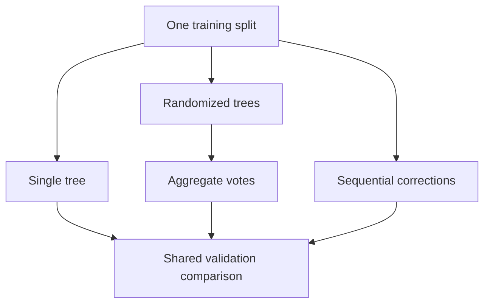

## Go one level deeper

Forests use bootstrap sampling and feature randomness to reduce correlation among trees. Boosting follows the gradient of a loss; the popular description of fitting residuals is exact for some regression objectives and an intuition for other losses. More estimators increase compute and can change fit. Feature-importance rankings require careful interpretation when features are correlated. The ensemble experiment’s --depth option controls the baseline tree and forest; the boosting model separately uses a fixed 15-leaf limit.

## Run the implementation

Open the Practice tab. Install the foundation packages once if the site requests them. The runner executes the actual program in lab/foundations.py. The commands below are for the website’s guided terminal; it selects your Python environment automatically. For external PowerShell, replace python with & .\.venv\Scripts\python.exe and use .\lab\foundations.py from the website folder. Replace {run} with a unique name when typing commands manually; the website buttons generate it automatically.

```text
python foundations.py ensemble --depth 3 --output outputs/ensemble-shallow-{run}
```

```text
python foundations.py ensemble --depth 10 --output outputs/ensemble-deep-{run}
```

The random seed controls the generated data, splits, and applicable model initialization. Keep it fixed when investigating one changed parameter. Neural results can still vary across hardware and library implementations.

## Inspect the evidence

Inspect comparison.png and the nested metrics for single_tree, random_forest, and gradient_boosting. Explain any differences in the training–validation gap. The plotted scores are generated by your run.

Every completed run writes report.json with the experiment, split, seed, settings, dataset description, measured metrics, timing, and limitations. Where applicable it also saves a trained parameter dictionary. The Experiment results page shows the measured report and generated plots. Record an explanation of the result instead of copying only the score.

## Change one thing and prove what happened

Choose the simplest candidate meeting your declared accuracy and false-alert requirements. Record fit time and discuss whether a small gain warrants more complex deployment. For another experiment, change tree counts in a copied function while holding the split fixed.

## Debugging checkpoint

Do not compare one model on validation data with another on test data. Also avoid assuming every boosting update trains only on previously misclassified examples.

If the program reports a missing module, install foundation packages in the runtime shown by the website. If it refuses an existing output directory, choose a new one; this protects earlier evidence. If a numerical result surprises you, inspect data shape, split sizes, and the baseline before changing model complexity.

## Compute plan

For this exact bundled exercise, use your local central processing unit. Renting a graphics processing unit is unnecessary. The implementation uses ordinary processor-based scikit-learn or small tables. Renting a graphics processor will not automatically accelerate this code.

## Build it from start to finish: Robust tabular event classifier

**Runnable implementation lab — local prototype.** This build connects the real-world scenario to an executable teaching model. Simulated data is explicitly identified; a good score on it does not establish business performance.

1. **Write the decision and success criterion.** State who consumes the prediction and which mistake is expensive. Define a measurable baseline before choosing a model. For this project: robust tabular event classifier.
2. **Define and inspect the data.** The same feature and label contract for all candidate models. Freeze train, validation, and test membership before comparing tree ensembles. Use the bundled dataset first. Before replacing it, document permission, provenance, missing values, units, class coverage, duplicates, and when each feature becomes available.
3. **Create the evaluation boundary.** The program fixes a seed and separates fitting from held-out evaluation where that protocol applies. For real workloads, choose time-based or entity-based separation when random splitting would leak related observations. The graph, adversarial, and reinforcement modules explain their distinct protocols.
4. **Construct the model.** Read the algorithm and the matching function in foundations.py. Trace the input shape through every preprocessing and model stage. The numerical example above lets you check a small part by hand.
5. **Train and compare.** Run the first Practice experiment. Record its baseline, metrics, runtime, and failure cases. Run the changed setting and explain the result. Choose settings using validation; reserve final test evidence for the chosen configuration.
6. **Save a usable artifact.** The program writes a model-manifest.json, an example-input.json, a fitted model or learned counting/action table, and report.json. It reloads the artifact in a separate inference function before declaring success. Learned scaling stays with applicable classical models. A neural state dictionary alone would be insufficient without the matching architecture; this build also exports an executable inference module.
7. **Use it on a new input.** In Practice, select **Load saved example**, edit one value while preserving the documented shape, and select **Predict new input**. This reloads the saved model and runs inference without training again. A class prediction from the chosen model; retain the simpler baseline and rollback artifact.
8. **Deploy the prototype locally.** The localhost website is the demonstration serving layer: input validation → saved artifact → inference → output. Keep the model's environment and feature contract with the release. Only load artifacts you created or trust; executable model formats are not passive documents.
9. **Plan a production handoff.** Add representative-data evaluation, request limits, authentication, authorization, observability, model versioning, rollback, and a suitable reject/fallback behavior before exposing a service to other users. These are engineering extensions, not completed production features of this local lab.
10. **Monitor and decide when to retrain.** Held-out class recall, latency, feature availability, and performance under changed event mix. Define a threshold and response owner. Track whether the new data resembles the training population, and compare a candidate model with the deployed baseline before replacement.

### The build architecture


### Command-line inference alternative

The website remembers the last successful model folder for this lesson. In its guided terminal, replace MODEL-FOLDER below with that actual folder name and NEW-RUN with a unique output name. Edit a copy of example-input.json to supply your own values.

```text
python predict_saved.py --model-dir outputs/MODEL-FOLDER --input outputs/MODEL-FOLDER/example-input.json --output outputs/prediction-NEW-RUN.json
```

### Build acceptance evidence

Submit a one-paragraph problem definition, feature/target contract, baseline and selected-model reports, one failure analysis, saved artifact, a changed-input prediction, and a deployment/monitoring decision. Passing a command demonstrates executable code; this evidence explains whether the model is appropriate for its intended use.


## Submit an engineering assessment

Save the two reports, their visual artifacts, a prediction made before the second run, and a paragraph explaining the observed difference. State the dataset’s limits and what additional evidence a real deployment would need. Use validation to choose settings; for a final assessment, rerun the selected settings with --split test and a new output folder. The adversarial and reinforcement labs describe their special evaluation protocols explicitly rather than claiming an ordinary random test split.

## Primary reference

[Read the primary documentation or research](https://scikit-learn.org/1.7/modules/ensemble.html). The lesson’s scenario and simplified implementation are teaching examples.


# Nearest neighbors: classify by similarity

**Tag: Runnable implementation lab.** Scope: an inspectable teaching implementation with real fitting, evaluation, and generated artifacts. This is not a production deployment certification.

**Learning outcome:** Observe how a distance rule and neighbor count reshape a decision boundary.

## Where this appears in the real world

A maintenance application may compare a new sensor reading with previously labeled cases. A nearest-neighbor baseline is useful when similarity has a meaningful definition. The lab’s two-dimensional half-circles make the mechanism visible before applying it to higher-dimensional measurements.

## Build the mental model

Store the training examples. For a new example, measure its distance to those examples, select the nearest k, and aggregate their labels. Most of the work occurs during prediction rather than an iterative parameter-fitting stage.

### Work through a concrete example

For five nearby cases labeled [fault, normal, fault, fault, normal], the majority label is fault. If one feature is measured in thousands and another in tenths, raw Euclidean distance may be dominated by the large-number feature.


## Follow the algorithm

1. Split the generated examples.
2. Learn feature means and scales from training data only.
3. Store standardized training examples and their labels.
4. Find the requested number of nearest training neighbors for each validation example.
5. Vote and draw the resulting decision regions.

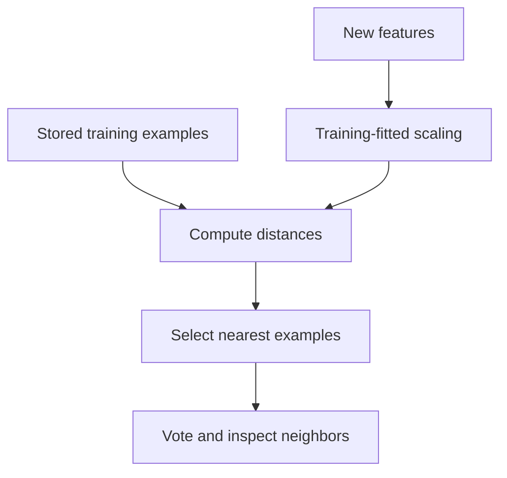

## Go one level deeper

One neighbor can follow noisy local detail; many neighbors smooth the boundary and can erase smaller groups. Scaling is part of the fitted pipeline. In high-dimensional spaces, distances can become less discriminating and search can become expensive. This is a useful bridge to retrieval, but a geometric neighbor vote is different from a language model generating an answer from retrieved documents.

## Run the implementation

Open the Practice tab. Install the foundation packages once if the site requests them. The runner executes the actual program in lab/foundations.py. The commands below are for the website’s guided terminal; it selects your Python environment automatically. For external PowerShell, replace python with & .\.venv\Scripts\python.exe and use .\lab\foundations.py from the website folder. Replace {run} with a unique name when typing commands manually; the website buttons generate it automatically.

```text
python foundations.py neighbors --neighbors 1 --output outputs/neighbors-one-{run}
```

```text
python foundations.py neighbors --neighbors 25 --output outputs/neighbors-many-{run}
```

The random seed controls the generated data, splits, and applicable model initialization. Keep it fixed when investigating one changed parameter. Neural results can still vary across hardware and library implementations.

## Inspect the evidence

Open boundaries.png. Dots are held-out examples; background color is the fitted prediction across a grid. Compare jagged regions with smoothed regions and relate them to the confusion matrix.

Every completed run writes report.json with the experiment, split, seed, settings, dataset description, measured metrics, timing, and limitations. Where applicable it also saves a trained parameter dictionary. The Experiment results page shows the measured report and generated plots. Record an explanation of the result instead of copying only the score.

## Change one thing and prove what happened

Predict which neighbor count will be more sensitive to a mislabeled training point. Run both settings. Then try 5 neighbors while keeping noise and seed fixed, and justify the choice using validation evidence.

## Debugging checkpoint

Similarity is a design decision, not an objective universal property. A representation that groups images well may be poor for semantic document retrieval.

If the program reports a missing module, install foundation packages in the runtime shown by the website. If it refuses an existing output directory, choose a new one; this protects earlier evidence. If a numerical result surprises you, inspect data shape, split sizes, and the baseline before changing model complexity.

## Compute plan

For this exact bundled exercise, use your local central processing unit. Renting a graphics processing unit is unnecessary. The implementation uses ordinary processor-based scikit-learn or small tables. Renting a graphics processor will not automatically accelerate this code.

## Build it from start to finish: Similarity-based sensor-state classification

**Runnable implementation lab — local prototype.** This build connects the real-world scenario to an executable teaching model. Simulated data is explicitly identified; a good score on it does not establish business performance.

1. **Write the decision and success criterion.** State who consumes the prediction and which mistake is expensive. Define a measurable baseline before choosing a model. For this project: similarity-based sensor-state classification.
2. **Define and inspect the data.** Two normalized sensor measurements and an expert state label in the prototype. Production requires representative coverage and a distance policy for unfamiliar inputs. Use the bundled dataset first. Before replacing it, document permission, provenance, missing values, units, class coverage, duplicates, and when each feature becomes available.
3. **Create the evaluation boundary.** The program fixes a seed and separates fitting from held-out evaluation where that protocol applies. For real workloads, choose time-based or entity-based separation when random splitting would leak related observations. The graph, adversarial, and reinforcement modules explain their distinct protocols.
4. **Construct the model.** Read the algorithm and the matching function in foundations.py. Trace the input shape through every preprocessing and model stage. The numerical example above lets you check a small part by hand.
5. **Train and compare.** Run the first Practice experiment. Record its baseline, metrics, runtime, and failure cases. Run the changed setting and explain the result. Choose settings using validation; reserve final test evidence for the chosen configuration.
6. **Save a usable artifact.** The program writes a model-manifest.json, an example-input.json, a fitted model or learned counting/action table, and report.json. It reloads the artifact in a separate inference function before declaring success. Learned scaling stays with applicable classical models. A neural state dictionary alone would be insufficient without the matching architecture; this build also exports an executable inference module.
7. **Use it on a new input.** In Practice, select **Load saved example**, edit one value while preserving the documented shape, and select **Predict new input**. This reloads the saved model and runs inference without training again. A neighbor vote; return an unknown state when the nearest observations are too far away.
8. **Deploy the prototype locally.** The localhost website is the demonstration serving layer: input validation → saved artifact → inference → output. Keep the model's environment and feature contract with the release. Only load artifacts you created or trust; executable model formats are not passive documents.
9. **Plan a production handoff.** Add representative-data evaluation, request limits, authentication, authorization, observability, model versioning, rollback, and a suitable reject/fallback behavior before exposing a service to other users. These are engineering extensions, not completed production features of this local lab.
10. **Monitor and decide when to retrain.** Distance to training examples, rare-state recall, and lookup latency as the reference set grows. Define a threshold and response owner. Track whether the new data resembles the training population, and compare a candidate model with the deployed baseline before replacement.

### The build architecture


### Command-line inference alternative

The website remembers the last successful model folder for this lesson. In its guided terminal, replace MODEL-FOLDER below with that actual folder name and NEW-RUN with a unique output name. Edit a copy of example-input.json to supply your own values.

```text
python predict_saved.py --model-dir outputs/MODEL-FOLDER --input outputs/MODEL-FOLDER/example-input.json --output outputs/prediction-NEW-RUN.json
```

### Build acceptance evidence

Submit a one-paragraph problem definition, feature/target contract, baseline and selected-model reports, one failure analysis, saved artifact, a changed-input prediction, and a deployment/monitoring decision. Passing a command demonstrates executable code; this evidence explains whether the model is appropriate for its intended use.


## Submit an engineering assessment

Save the two reports, their visual artifacts, a prediction made before the second run, and a paragraph explaining the observed difference. State the dataset’s limits and what additional evidence a real deployment would need. Use validation to choose settings; for a final assessment, rerun the selected settings with --split test and a new output folder. The adversarial and reinforcement labs describe their special evaluation protocols explicitly rather than claiming an ordinary random test split.

## Primary reference

[Read the primary documentation or research](https://scikit-learn.org/1.7/modules/neighbors.html). The lesson’s scenario and simplified implementation are teaching examples.


# Kernel methods: learn a curved boundary

**Tag: Runnable implementation lab.** Scope: an inspectable teaching implementation with real fitting, evaluation, and generated artifacts. This is not a production deployment certification.

**Learning outcome:** Compare a linear support vector machine with a nonlinear similarity kernel.

## Where this appears in the real world

Engineers can classify operating regimes whose measurements form nonlinear patterns. A kernel method is a compact candidate for a moderate-size dataset. In this exercise, interleaving half-circles demonstrate why a straight separating line can be insufficient.

## Build the mental model

A support vector classifier seeks a boundary with a useful margin between classes while allowing penalized mistakes. A kernel computes similarities corresponding to an implicit feature representation, allowing a nonlinear boundary in the original coordinates.

### Work through a concrete example

Two classes arranged as nested circles cannot be separated by one straight line in the plane. A radius-related representation can make separation easier. A radial basis function kernel provides a general smooth similarity mechanism without explicitly constructing every transformed coordinate.


## Follow the algorithm

1. Split and standardize the two input features.
2. Fit a linear-kernel classifier on training data.
3. Fit a radial-basis-kernel classifier on the same training data.
4. Evaluate both on the same validation examples.
5. Inspect the two boundary panels and the error counts.

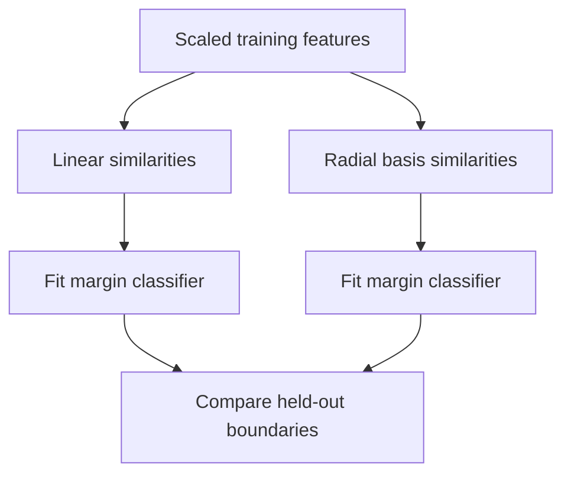

## Go one level deeper

The C parameter controls the tradeoff between margin and penalized training mistakes. A larger value usually permits a more aggressive fit to training data; it does not guarantee better validation results. The radial basis function kernel’s width controls how local similarity is. Our implementation uses the library’s scale-based width rule. Kernel matrices can become expensive as training-set size grows.

## Run the implementation

Open the Practice tab. Install the foundation packages once if the site requests them. The runner executes the actual program in lab/foundations.py. The commands below are for the website’s guided terminal; it selects your Python environment automatically. For external PowerShell, replace python with & .\.venv\Scripts\python.exe and use .\lab\foundations.py from the website folder. Replace {run} with a unique name when typing commands manually; the website buttons generate it automatically.

```text
python foundations.py kernel --strength 1 --output outputs/kernel-{run}
```

```text
python foundations.py kernel --strength 100 --output outputs/kernel-flexible-{run}
```

The random seed controls the generated data, splits, and applicable model initialization. Keep it fixed when investigating one changed parameter. Neural results can still vary across hardware and library implementations.

## Inspect the evidence

Compare linear_kernel and radial_basis_kernel metrics. Open boundaries.png and explain why the curved solution is plausible for this particular data geometry.

Every completed run writes report.json with the experiment, split, seed, settings, dataset description, measured metrics, timing, and limitations. Where applicable it also saves a trained parameter dictionary. The Experiment results page shows the measured report and generated plots. Record an explanation of the result instead of copying only the score.

## Change one thing and prove what happened

Increase observation noise while preserving the random seed. Compare whether increasing C now helps or merely fits noisy detail. Document a case where the nonlinear model’s additional complexity is justified.

## Debugging checkpoint

Kernel methods are not a special kind of graphics processor. A kernel here is a mathematical similarity function; a hardware computation kernel means something different.

If the program reports a missing module, install foundation packages in the runtime shown by the website. If it refuses an existing output directory, choose a new one; this protects earlier evidence. If a numerical result surprises you, inspect data shape, split sizes, and the baseline before changing model complexity.

## Compute plan

For this exact bundled exercise, use your local central processing unit. Renting a graphics processing unit is unnecessary. The implementation uses ordinary processor-based scikit-learn or small tables. Renting a graphics processor will not automatically accelerate this code.

## Build it from start to finish: Nonlinear boundary for two sensor signals

**Runnable implementation lab — local prototype.** This build connects the real-world scenario to an executable teaching model. Simulated data is explicitly identified; a good score on it does not establish business performance.

1. **Write the decision and success criterion.** State who consumes the prediction and which mistake is expensive. Define a measurable baseline before choosing a model. For this project: nonlinear boundary for two sensor signals.
2. **Define and inspect the data.** Two measurements with a binary state label. Fit scaling on training data and compare a linear boundary with the radial-basis boundary. Use the bundled dataset first. Before replacing it, document permission, provenance, missing values, units, class coverage, duplicates, and when each feature becomes available.
3. **Create the evaluation boundary.** The program fixes a seed and separates fitting from held-out evaluation where that protocol applies. For real workloads, choose time-based or entity-based separation when random splitting would leak related observations. The graph, adversarial, and reinforcement modules explain their distinct protocols.
4. **Construct the model.** Read the algorithm and the matching function in foundations.py. Trace the input shape through every preprocessing and model stage. The numerical example above lets you check a small part by hand.
5. **Train and compare.** Run the first Practice experiment. Record its baseline, metrics, runtime, and failure cases. Run the changed setting and explain the result. Choose settings using validation; reserve final test evidence for the chosen configuration.
6. **Save a usable artifact.** The program writes a model-manifest.json, an example-input.json, a fitted model or learned counting/action table, and report.json. It reloads the artifact in a separate inference function before declaring success. Learned scaling stays with applicable classical models. A neural state dictionary alone would be insufficient without the matching architecture; this build also exports an executable inference module.
7. **Use it on a new input.** In Practice, select **Load saved example**, edit one value while preserving the documented shape, and select **Predict new input**. This reloads the saved model and runs inference without training again. A predicted state from the selected support-vector model; a class output is not automatically a calibrated probability.
8. **Deploy the prototype locally.** The localhost website is the demonstration serving layer: input validation → saved artifact → inference → output. Keep the model's environment and feature contract with the release. Only load artifacts you created or trust; executable model formats are not passive documents.
9. **Plan a production handoff.** Add representative-data evaluation, request limits, authentication, authorization, observability, model versioning, rollback, and a suitable reject/fallback behavior before exposing a service to other users. These are engineering extensions, not completed production features of this local lab.
10. **Monitor and decide when to retrain.** Errors near the boundary, input drift, support-vector count, and inference time. Define a threshold and response owner. Track whether the new data resembles the training population, and compare a candidate model with the deployed baseline before replacement.

### The build architecture


### Command-line inference alternative

The website remembers the last successful model folder for this lesson. In its guided terminal, replace MODEL-FOLDER below with that actual folder name and NEW-RUN with a unique output name. Edit a copy of example-input.json to supply your own values.

```text
python predict_saved.py --model-dir outputs/MODEL-FOLDER --input outputs/MODEL-FOLDER/example-input.json --output outputs/prediction-NEW-RUN.json
```

### Build acceptance evidence

Submit a one-paragraph problem definition, feature/target contract, baseline and selected-model reports, one failure analysis, saved artifact, a changed-input prediction, and a deployment/monitoring decision. Passing a command demonstrates executable code; this evidence explains whether the model is appropriate for its intended use.


## Submit an engineering assessment

Save the two reports, their visual artifacts, a prediction made before the second run, and a paragraph explaining the observed difference. State the dataset’s limits and what additional evidence a real deployment would need. Use validation to choose settings; for a final assessment, rerun the selected settings with --split test and a new output folder. The adversarial and reinforcement labs describe their special evaluation protocols explicitly rather than claiming an ordinary random test split.

## Primary reference

[Read the primary documentation or research](https://scikit-learn.org/1.7/modules/svm.html). The lesson’s scenario and simplified implementation are teaching examples.


# Naive Bayes: combine evidence with probabilities

**Tag: Runnable implementation lab.** Scope: an inspectable teaching implementation with real fitting, evaluation, and generated artifacts. This is not a production deployment certification.

**Learning outcome:** Build a probability-based classifier and inspect its independence assumption.

## Where this appears in the real world

A lightweight classifier can triage documents or sensor events when fast fitting and a simple baseline are valuable. Different naive Bayes variants fit different feature types. This lab uses continuous generated measurements and therefore Gaussian naive Bayes; text counts would call for another variant.

## Build the mental model

Estimate how likely each feature value is under each class, combine that evidence with the class prior, then compare class scores. The “naive” assumption treats features as conditionally independent given the class. It is a modeling simplification, not a claim that real features are independent.

### Work through a concrete example

If the prior chance of a fault is 0.1, then a highly unusual measurement under the normal class can increase the posterior fault probability. Multiplying probabilities requires normalization to obtain a probability distribution across classes. Correlated features can cause evidence to be counted more than once.


## Follow the algorithm

1. Estimate training class frequencies.
2. For each class and feature, estimate a mean and variance.
3. Compute class scores for held-out measurements using Gaussian feature likelihoods.
4. Normalize class scores and choose a label.
5. Compare with logistic regression on the identical split.

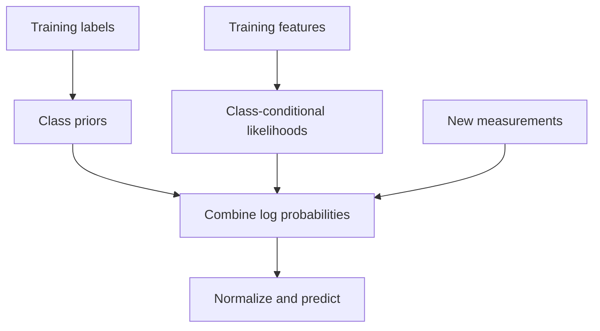

## Go one level deeper

Bayes’ rule connects posterior probability, likelihood, and prior. Implementations usually add log probabilities to avoid numerical underflow from multiplying many small values. Gaussian naive Bayes assumes a Gaussian distribution for each continuous feature within each class. Multinomial naive Bayes is often used for nonnegative counts. The laboratory’s generated features include dependencies, making the simplifying assumption visible rather than automatically favorable.

## Run the implementation

Open the Practice tab. Install the foundation packages once if the site requests them. The runner executes the actual program in lab/foundations.py. The commands below are for the website’s guided terminal; it selects your Python environment automatically. For external PowerShell, replace python with & .\.venv\Scripts\python.exe and use .\lab\foundations.py from the website folder. Replace {run} with a unique name when typing commands manually; the website buttons generate it automatically.

```text
python foundations.py bayes --noise 0.05 --output outputs/bayes-{run}
```

```text
python foundations.py bayes --noise 0.25 --output outputs/bayes-noisy-{run}
```

The random seed controls the generated data, splits, and applicable model initialization. Keep it fixed when investigating one changed parameter. Neural results can still vary across hardware and library implementations.

## Inspect the evidence

Inspect naive_bayes and logistic_comparison in report.json. Which errors differ? Accuracy may remain useful even when the probability estimates are poorly calibrated.

Every completed run writes report.json with the experiment, split, seed, settings, dataset description, measured metrics, timing, and limitations. Where applicable it also saves a trained parameter dictionary. The Experiment results page shows the measured report and generated plots. Record an explanation of the result instead of copying only the score.

## Change one thing and prove what happened

Write down what would change if the inputs were word counts rather than continuous measurements. In a copied experiment, duplicate one input column and assess whether redundant evidence changes predictions or confidence.

## Debugging checkpoint

A confident score from a naive Bayes model is not automatically reliable uncertainty. Evaluate calibration before using probabilities for consequential decisions.

If the program reports a missing module, install foundation packages in the runtime shown by the website. If it refuses an existing output directory, choose a new one; this protects earlier evidence. If a numerical result surprises you, inspect data shape, split sizes, and the baseline before changing model complexity.

## Compute plan

For this exact bundled exercise, use your local central processing unit. Renting a graphics processing unit is unnecessary. The implementation uses ordinary processor-based scikit-learn or small tables. Renting a graphics processor will not automatically accelerate this code.

## Build it from start to finish: Fast event-category baseline

**Runnable implementation lab — local prototype.** This build connects the real-world scenario to an executable teaching model. Simulated data is explicitly identified; a good score on it does not establish business performance.

1. **Write the decision and success criterion.** State who consumes the prediction and which mistake is expensive. Define a measurable baseline before choosing a model. For this project: fast event-category baseline.
2. **Define and inspect the data.** Eight numeric measurements and a reviewed category for the Gaussian naive Bayes prototype. A text spam model would instead need token counts and a suitable multinomial model. Use the bundled dataset first. Before replacing it, document permission, provenance, missing values, units, class coverage, duplicates, and when each feature becomes available.
3. **Create the evaluation boundary.** The program fixes a seed and separates fitting from held-out evaluation where that protocol applies. For real workloads, choose time-based or entity-based separation when random splitting would leak related observations. The graph, adversarial, and reinforcement modules explain their distinct protocols.
4. **Construct the model.** Read the algorithm and the matching function in foundations.py. Trace the input shape through every preprocessing and model stage. The numerical example above lets you check a small part by hand.
5. **Train and compare.** Run the first Practice experiment. Record its baseline, metrics, runtime, and failure cases. Run the changed setting and explain the result. Choose settings using validation; reserve final test evidence for the chosen configuration.
6. **Save a usable artifact.** The program writes a model-manifest.json, an example-input.json, a fitted model or learned counting/action table, and report.json. It reloads the artifact in a separate inference function before declaring success. Learned scaling stays with applicable classical models. A neural state dictionary alone would be insufficient without the matching architecture; this build also exports an executable inference module.
7. **Use it on a new input.** In Practice, select **Load saved example**, edit one value while preserving the documented shape, and select **Predict new input**. This reloads the saved model and runs inference without training again. A category and an explicitly documented conditional-independence assumption.
8. **Deploy the prototype locally.** The localhost website is the demonstration serving layer: input validation → saved artifact → inference → output. Keep the model's environment and feature contract with the release. Only load artifacts you created or trust; executable model formats are not passive documents.
9. **Plan a production handoff.** Add representative-data evaluation, request limits, authentication, authorization, observability, model versioning, rollback, and a suitable reject/fallback behavior before exposing a service to other users. These are engineering extensions, not completed production features of this local lab.
10. **Monitor and decide when to retrain.** Calibration, correlated-feature failures, changing class frequencies, and minority-class recall. Define a threshold and response owner. Track whether the new data resembles the training population, and compare a candidate model with the deployed baseline before replacement.

### The build architecture


### Command-line inference alternative

The website remembers the last successful model folder for this lesson. In its guided terminal, replace MODEL-FOLDER below with that actual folder name and NEW-RUN with a unique output name. Edit a copy of example-input.json to supply your own values.

```text
python predict_saved.py --model-dir outputs/MODEL-FOLDER --input outputs/MODEL-FOLDER/example-input.json --output outputs/prediction-NEW-RUN.json
```

### Build acceptance evidence

Submit a one-paragraph problem definition, feature/target contract, baseline and selected-model reports, one failure analysis, saved artifact, a changed-input prediction, and a deployment/monitoring decision. Passing a command demonstrates executable code; this evidence explains whether the model is appropriate for its intended use.


## Submit an engineering assessment

Save the two reports, their visual artifacts, a prediction made before the second run, and a paragraph explaining the observed difference. State the dataset’s limits and what additional evidence a real deployment would need. Use validation to choose settings; for a final assessment, rerun the selected settings with --split test and a new output folder. The adversarial and reinforcement labs describe their special evaluation protocols explicitly rather than claiming an ordinary random test split.

## Primary reference

[Read the primary documentation or research](https://scikit-learn.org/1.7/modules/naive_bayes.html). The lesson’s scenario and simplified implementation are teaching examples.


# Gaussian processes: predict with uncertainty

**Tag: Runnable implementation lab.** Scope: an inspectable teaching implementation with real fitting, evaluation, and generated artifacts. This is not a production deployment certification.

**Learning outcome:** Fit a smooth function and inspect an uncertainty band beyond observed inputs.

## Where this appears in the real world

A calibration engineer may have a limited number of expensive measurements and need a smooth estimate between them. A Gaussian process can model a distribution over plausible functions. This exercise uses a synthetic noisy sensor curve, not a safety-critical instrument.

## Build the mental model

The model begins with assumptions about how values at nearby inputs relate. Observed examples update those assumptions into a predictive distribution. Predictions include a mean and uncertainty, allowing us to inspect where the model is less constrained by observations.

### Work through a concrete example

If the predictive mean is 10 and predictive standard deviation is 2, a Gaussian interval using 1.96 standard deviations is approximately [6.08, 13.92]. This interval is conditional on the model assumptions; empirical coverage must still be checked.


## Follow the algorithm

1. Generate noisy sine measurements.
2. Hold out validation and final test indices.
3. Choose a smooth covariance function plus a noise component.
4. Fit using training observations.
5. Predict means and standard deviations, then plot the interval and measure coverage.

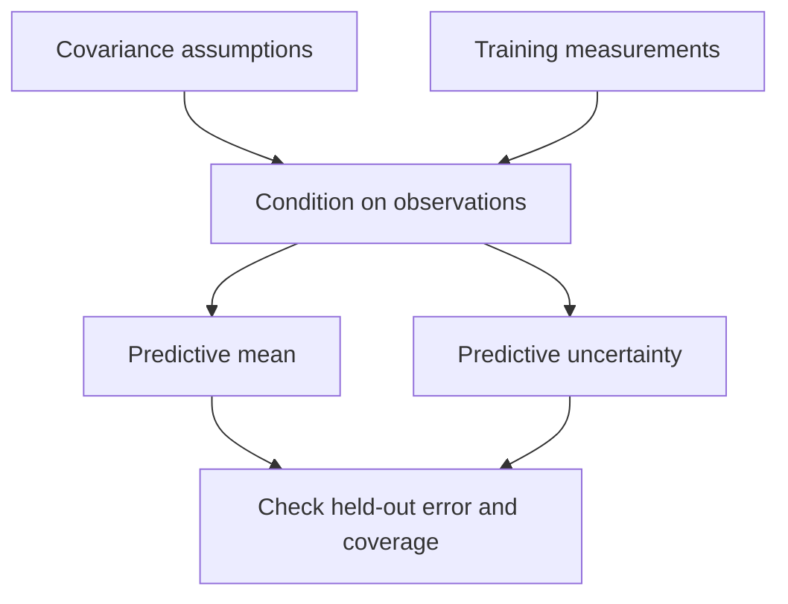

## Go one level deeper

Unlike a fixed-size linear coefficient vector, a standard Gaussian process implementation uses relationships among training examples. Its covariance matrix can require quadratic storage and cubic factorization cost. Kernel choice expresses assumptions such as smoothness. The report’s coverage is the fraction of held-out observations inside the model-based interval, not a universal calibration guarantee. Extrapolation far beyond observed input ranges depends strongly on the prior.

## Run the implementation

Open the Practice tab. Install the foundation packages once if the site requests them. The runner executes the actual program in lab/foundations.py. The commands below are for the website’s guided terminal; it selects your Python environment automatically. For external PowerShell, replace python with & .\.venv\Scripts\python.exe and use .\lab\foundations.py from the website folder. Replace {run} with a unique name when typing commands manually; the website buttons generate it automatically.

```text
python foundations.py gaussian --noise 0.12 --output outputs/gaussian-{run}
```

```text
python foundations.py gaussian --noise 0.5 --output outputs/gaussian-noisy-{run}
```

The random seed controls the generated data, splits, and applicable model initialization. Keep it fixed when investigating one changed parameter. Neural results can still vary across hardware and library implementations.

## Inspect the evidence

Open uncertainty.png. Compare intervals within the observed range and beyond it. Read interval_coverage and mean_predictive_standard_deviation along with prediction error.

Every completed run writes report.json with the experiment, split, seed, settings, dataset description, measured metrics, timing, and limitations. Where applicable it also saves a trained parameter dictionary. The Experiment results page shows the measured report and generated plots. Record an explanation of the result instead of copying only the score.

## Change one thing and prove what happened

Explain why a wider uncertainty interval can be appropriate after increasing measurement noise. Change the smoothness assumption in a copied experiment and compare both error and coverage.

## Debugging checkpoint

Do not equate a narrow interval with truth. Misspecified noise or kernel assumptions can make a model confidently wrong.

If the program reports a missing module, install foundation packages in the runtime shown by the website. If it refuses an existing output directory, choose a new one; this protects earlier evidence. If a numerical result surprises you, inspect data shape, split sizes, and the baseline before changing model complexity.

## Compute plan

For this exact bundled exercise, use your local central processing unit. Renting a graphics processing unit is unnecessary. The implementation uses ordinary processor-based scikit-learn or small tables. Renting a graphics processor will not automatically accelerate this code.

## Build it from start to finish: Sensor calibration with uncertainty

**Runnable implementation lab — local prototype.** This build connects the real-world scenario to an executable teaching model. Simulated data is explicitly identified; a good score on it does not establish business performance.

1. **Write the decision and success criterion.** State who consumes the prediction and which mistake is expensive. Define a measurable baseline before choosing a model. For this project: sensor calibration with uncertainty.
2. **Define and inspect the data.** Measurement position and noisy observed reading. Keep units, calibration provenance, and operating range. A real forecasting task needs a chronological split. Use the bundled dataset first. Before replacing it, document permission, provenance, missing values, units, class coverage, duplicates, and when each feature becomes available.
3. **Create the evaluation boundary.** The program fixes a seed and separates fitting from held-out evaluation where that protocol applies. For real workloads, choose time-based or entity-based separation when random splitting would leak related observations. The graph, adversarial, and reinforcement modules explain their distinct protocols.
4. **Construct the model.** Read the algorithm and the matching function in foundations.py. Trace the input shape through every preprocessing and model stage. The numerical example above lets you check a small part by hand.
5. **Train and compare.** Run the first Practice experiment. Record its baseline, metrics, runtime, and failure cases. Run the changed setting and explain the result. Choose settings using validation; reserve final test evidence for the chosen configuration.
6. **Save a usable artifact.** The program writes a model-manifest.json, an example-input.json, a fitted model or learned counting/action table, and report.json. It reloads the artifact in a separate inference function before declaring success. Learned scaling stays with applicable classical models. A neural state dictionary alone would be insufficient without the matching architecture; this build also exports an executable inference module.
7. **Use it on a new input.** In Practice, select **Load saved example**, edit one value while preserving the documented shape, and select **Predict new input**. This reloads the saved model and runs inference without training again. A predicted mean plus a model-based uncertainty interval; the saved batch helper returns the mean, while the training script demonstrates intervals.
8. **Deploy the prototype locally.** The localhost website is the demonstration serving layer: input validation → saved artifact → inference → output. Keep the model's environment and feature contract with the release. Only load artifacts you created or trust; executable model formats are not passive documents.
9. **Plan a production handoff.** Add representative-data evaluation, request limits, authentication, authorization, observability, model versioning, rollback, and a suitable reject/fallback behavior before exposing a service to other users. These are engineering extensions, not completed production features of this local lab.
10. **Monitor and decide when to retrain.** Empirical interval coverage, absolute error, out-of-range inputs, and increasing fit cost as observations grow. Define a threshold and response owner. Track whether the new data resembles the training population, and compare a candidate model with the deployed baseline before replacement.

### The build architecture


### Command-line inference alternative

The website remembers the last successful model folder for this lesson. In its guided terminal, replace MODEL-FOLDER below with that actual folder name and NEW-RUN with a unique output name. Edit a copy of example-input.json to supply your own values.

```text
python predict_saved.py --model-dir outputs/MODEL-FOLDER --input outputs/MODEL-FOLDER/example-input.json --output outputs/prediction-NEW-RUN.json
```

### Build acceptance evidence

Submit a one-paragraph problem definition, feature/target contract, baseline and selected-model reports, one failure analysis, saved artifact, a changed-input prediction, and a deployment/monitoring decision. Passing a command demonstrates executable code; this evidence explains whether the model is appropriate for its intended use.


## Submit an engineering assessment

Save the two reports, their visual artifacts, a prediction made before the second run, and a paragraph explaining the observed difference. State the dataset’s limits and what additional evidence a real deployment would need. Use validation to choose settings; for a final assessment, rerun the selected settings with --split test and a new output folder. The adversarial and reinforcement labs describe their special evaluation protocols explicitly rather than claiming an ordinary random test split.

## Primary reference

[Read the primary documentation or research](https://scikit-learn.org/1.7/modules/gaussian_process.html). The lesson’s scenario and simplified implementation are teaching examples.


# Clustering: discover groups without supplied labels

**Tag: Runnable implementation lab.** Scope: an inspectable teaching implementation with real fitting, evaluation, and generated artifacts. This is not a production deployment certification.

**Learning outcome:** Compare centroid-based groups with density-based exploration.

## Where this appears in the real world

An engineering team may group incidents by measured behavior to discover recurring patterns before defining categories. Clusters are candidate patterns for investigation; they are not automatically known causes or reliable business segments.

## Build the mental model

K-means alternates between assigning points to nearby centers and moving the centers to their assigned points’ means. Density-based spatial clustering of applications with noise instead grows groups through dense neighborhoods and may leave isolated points unassigned.

### Work through a concrete example

For points [1, 2, 3] assigned to one one-dimensional cluster, its new center is 2. If two nearby clusters overlap heavily, a geometrically tidy grouping may no longer correspond to the hidden groups that generated the observations.


## Follow the algorithm

1. Generate observations with three hidden groups, withholding those labels from fitting.
2. Fit standardization and k-means on training observations.
3. Assign validation observations to the fitted centers.
4. Compute silhouette using geometry and adjusted Rand index using hidden labels only for evaluation.
5. Fit a separate density-based exploratory view on training observations.

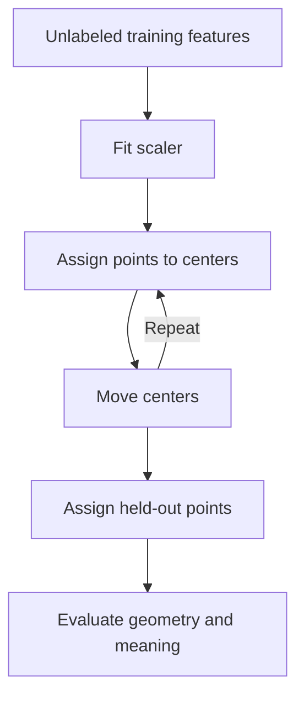

## Go one level deeper

Silhouette compares within-cluster cohesion with separation from other clusters. It can be undefined when only one cluster is represented. Adjusted Rand index compares partitions while adjusting for chance; it requires a reference grouping. The density-based algorithm used here does not expose an ordinary predict method, so its panel is explicitly a training-data exploration. Distances and scaling influence both methods.

## Run the implementation

Open the Practice tab. Install the foundation packages once if the site requests them. The runner executes the actual program in lab/foundations.py. The commands below are for the website’s guided terminal; it selects your Python environment automatically. For external PowerShell, replace python with & .\.venv\Scripts\python.exe and use .\lab\foundations.py from the website folder. Replace {run} with a unique name when typing commands manually; the website buttons generate it automatically.

```text
python foundations.py cluster --clusters 3 --noise 1.2 --output outputs/cluster-three-{run}
```

```text
python foundations.py cluster --clusters 5 --noise 1.2 --output outputs/cluster-five-{run}
```

The random seed controls the generated data, splits, and applicable model initialization. Keep it fixed when investigating one changed parameter. Neural results can still vary across hardware and library implementations.

## Inspect the evidence

Open clusters.png. Compare heldout_silhouette and heldout_adjusted_rand_index. The label identifiers may be permuted between runs without changing the partition’s meaning.

Every completed run writes report.json with the experiment, split, seed, settings, dataset description, measured metrics, timing, and limitations. Where applicable it also saves a trained parameter dictionary. The Experiment results page shows the measured report and generated plots. Record an explanation of the result instead of copying only the score.

## Change one thing and prove what happened

Predict what requesting five clusters does to a dataset generated from three groups. Run both settings. Explain why the best geometric score may not define the most useful operational categories.

## Debugging checkpoint

Unsupervised does not mean assumption-free. The distance measure, cluster count, and density thresholds express strong assumptions about useful structure.

If the program reports a missing module, install foundation packages in the runtime shown by the website. If it refuses an existing output directory, choose a new one; this protects earlier evidence. If a numerical result surprises you, inspect data shape, split sizes, and the baseline before changing model complexity.

## Compute plan

For this exact bundled exercise, use your local central processing unit. Renting a graphics processing unit is unnecessary. The implementation uses ordinary processor-based scikit-learn or small tables. Renting a graphics processor will not automatically accelerate this code.

## Build it from start to finish: Exploratory grouping of operating patterns

**Runnable implementation lab — local prototype.** This build connects the real-world scenario to an executable teaching model. Simulated data is explicitly identified; a good score on it does not establish business performance.

1. **Write the decision and success criterion.** State who consumes the prediction and which mistake is expensive. Define a measurable baseline before choosing a model. For this project: exploratory grouping of operating patterns.
2. **Define and inspect the data.** Unlabeled numeric observations. K-means assigns groups; domain experts must inspect the groups before giving them business names. Use the bundled dataset first. Before replacing it, document permission, provenance, missing values, units, class coverage, duplicates, and when each feature becomes available.
3. **Create the evaluation boundary.** The program fixes a seed and separates fitting from held-out evaluation where that protocol applies. For real workloads, choose time-based or entity-based separation when random splitting would leak related observations. The graph, adversarial, and reinforcement modules explain their distinct protocols.
4. **Construct the model.** Read the algorithm and the matching function in foundations.py. Trace the input shape through every preprocessing and model stage. The numerical example above lets you check a small part by hand.
5. **Train and compare.** Run the first Practice experiment. Record its baseline, metrics, runtime, and failure cases. Run the changed setting and explain the result. Choose settings using validation; reserve final test evidence for the chosen configuration.
6. **Save a usable artifact.** The program writes a model-manifest.json, an example-input.json, a fitted model or learned counting/action table, and report.json. It reloads the artifact in a separate inference function before declaring success. Learned scaling stays with applicable classical models. A neural state dictionary alone would be insufficient without the matching architecture; this build also exports an executable inference module.
7. **Use it on a new input.** In Practice, select **Load saved example**, edit one value while preserving the documented shape, and select **Predict new input**. This reloads the saved model and runs inference without training again. An arbitrary cluster identifier from the saved scaler and K-means model. The density-based exploratory comparison has no out-of-sample predictor here.
8. **Deploy the prototype locally.** The localhost website is the demonstration serving layer: input validation → saved artifact → inference → output. Keep the model's environment and feature contract with the release. Only load artifacts you created or trust; executable model formats are not passive documents.
9. **Plan a production handoff.** Add representative-data evaluation, request limits, authentication, authorization, observability, model versioning, rollback, and a suitable reject/fallback behavior before exposing a service to other users. These are engineering extensions, not completed production features of this local lab.
10. **Monitor and decide when to retrain.** Cluster size, distance to centers, instability after retraining, and unexplained new groups. Define a threshold and response owner. Track whether the new data resembles the training population, and compare a candidate model with the deployed baseline before replacement.

### The build architecture


### Command-line inference alternative

The website remembers the last successful model folder for this lesson. In its guided terminal, replace MODEL-FOLDER below with that actual folder name and NEW-RUN with a unique output name. Edit a copy of example-input.json to supply your own values.

```text
python predict_saved.py --model-dir outputs/MODEL-FOLDER --input outputs/MODEL-FOLDER/example-input.json --output outputs/prediction-NEW-RUN.json
```

### Build acceptance evidence

Submit a one-paragraph problem definition, feature/target contract, baseline and selected-model reports, one failure analysis, saved artifact, a changed-input prediction, and a deployment/monitoring decision. Passing a command demonstrates executable code; this evidence explains whether the model is appropriate for its intended use.


## Submit an engineering assessment

Save the two reports, their visual artifacts, a prediction made before the second run, and a paragraph explaining the observed difference. State the dataset’s limits and what additional evidence a real deployment would need. Use validation to choose settings; for a final assessment, rerun the selected settings with --split test and a new output folder. The adversarial and reinforcement labs describe their special evaluation protocols explicitly rather than claiming an ordinary random test split.

## Primary reference

[Read the primary documentation or research](https://scikit-learn.org/1.7/modules/clustering.html). The lesson’s scenario and simplified implementation are teaching examples.


# Principal component analysis: compress measurements

**Tag: Runnable implementation lab.** Scope: an inspectable teaching implementation with real fitting, evaluation, and generated artifacts. This is not a production deployment certification.

**Learning outcome:** Reduce 64 pixel measurements to fewer coordinates and reconstruct the images.

## Where this appears in the real world

A telemetry team may compress correlated measurements for storage or visualization. Principal component analysis can also provide a simple image-compression baseline. This lab uses small handwritten digits so information loss is visible.

## Build the mental model

Find perpendicular directions that capture large amounts of variation in training data. Express each example using its coordinates along the chosen directions. Reconstructing from only some directions discards the remaining variation.

### Work through a concrete example

If two measurements usually rise together, much of their variation may lie along a diagonal line. One coordinate along that line can preserve more information than simply discarding either measurement. With images, the directions represent patterns across pixels.

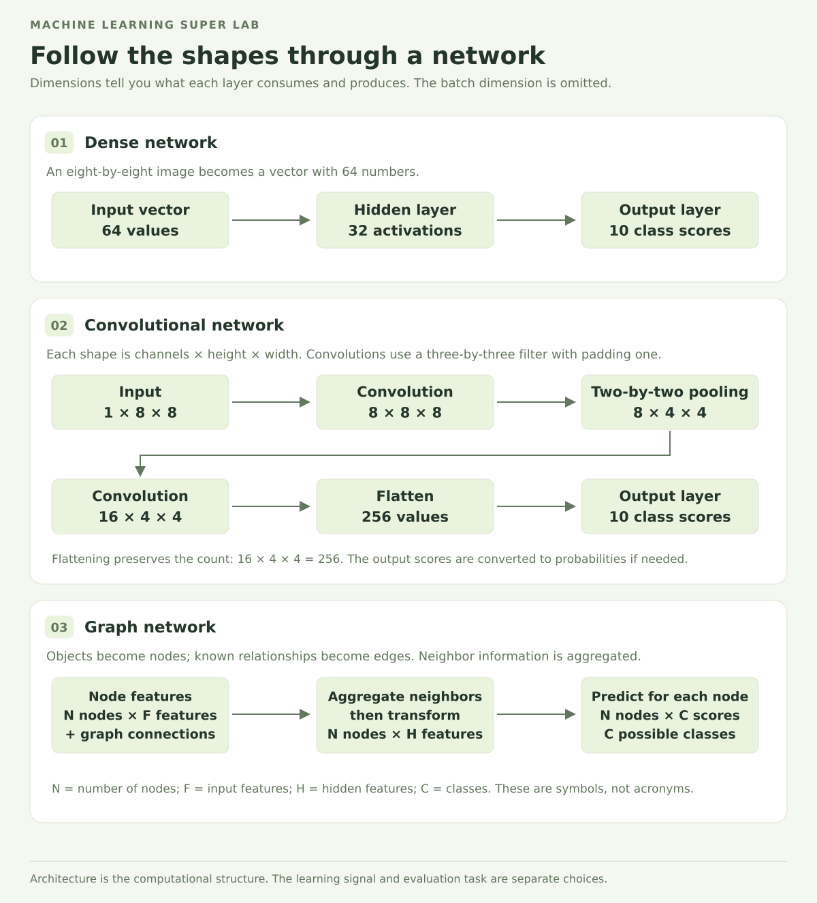

## Follow the algorithm

1. Load the bundled 8-by-8 digit images and normalize their known pixel range.
2. Split before learning principal directions.
3. Fit the requested number of components on training images.
4. Project validation images and reconstruct them.
5. Measure reconstruction error and inspect original/reconstructed pairs.

```mermaid
flowchart TD
 A[Training images] --> B[Fit principal directions]
 B --> C[Keep selected components]
 D[Held-out images] --> E[Project into components]
 C --> E
 E --> F[Reconstruct pixels]
 F --> G[Measure lost information]
```

## Go one level deeper

The implementation centers the training data and uses a numerical decomposition to identify principal directions. Explained-variance ratio measures retained training variation, not recognition accuracy. High-variance directions are not necessarily the directions most useful for predicting a label. Scaling choices alter the result, especially when input features have different units.

## Run the implementation

Open the Practice tab. Install the foundation packages once if the site requests them. The runner executes the actual program in lab/foundations.py. The commands below are for the website’s guided terminal; it selects your Python environment automatically. For external PowerShell, replace python with & .\.venv\Scripts\python.exe and use .\lab\foundations.py from the website folder. Replace {run} with a unique name when typing commands manually; the website buttons generate it automatically.

```text
python foundations.py projection --components 4 --output outputs/projection-four-{run}
```

```text
python foundations.py projection --components 32 --output outputs/projection-thirtytwo-{run}
```

The random seed controls the generated data, splits, and applicable model initialization. Keep it fixed when investigating one changed parameter. Neural results can still vary across hardware and library implementations.

## Inspect the evidence

Compare retained_training_variance with reconstruction_mean_squared_error. In reconstructions.png, original digits are above reconstructions. Use visible details and metrics together.

Every completed run writes report.json with the experiment, split, seed, settings, dataset description, measured metrics, timing, and limitations. Where applicable it also saves a trained parameter dictionary. The Experiment results page shows the measured report and generated plots. Record an explanation of the result instead of copying only the score.

## Change one thing and prove what happened

Choose a compression level and justify it using storage dimensions and reconstruction quality. Explain why you would still need a separate downstream classification test before claiming the compressed representation preserves recognition performance.

## Debugging checkpoint

Fitting the principal directions on the whole dataset before the split leaks validation and test information into the representation.

If the program reports a missing module, install foundation packages in the runtime shown by the website. If it refuses an existing output directory, choose a new one; this protects earlier evidence. If a numerical result surprises you, inspect data shape, split sizes, and the baseline before changing model complexity.

## Compute plan

For this exact bundled exercise, use your local central processing unit. Renting a graphics processing unit is unnecessary. The implementation uses ordinary processor-based scikit-learn or small tables. Renting a graphics processor will not automatically accelerate this code.

## Build it from start to finish: Compact representation of scanned digits

**Runnable implementation lab — local prototype.** This build connects the real-world scenario to an executable teaching model. Simulated data is explicitly identified; a good score on it does not establish business performance.

1. **Write the decision and success criterion.** State who consumes the prediction and which mistake is expensive. Define a measurable baseline before choosing a model. For this project: compact representation of scanned digits.
2. **Define and inspect the data.** Flattened eight-by-eight grayscale images normalized to zero through one. Fit the principal-component basis only on training images. Use the bundled dataset first. Before replacing it, document permission, provenance, missing values, units, class coverage, duplicates, and when each feature becomes available.
3. **Create the evaluation boundary.** The program fixes a seed and separates fitting from held-out evaluation where that protocol applies. For real workloads, choose time-based or entity-based separation when random splitting would leak related observations. The graph, adversarial, and reinforcement modules explain their distinct protocols.
4. **Construct the model.** Read the algorithm and the matching function in foundations.py. Trace the input shape through every preprocessing and model stage. The numerical example above lets you check a small part by hand.
5. **Train and compare.** Run the first Practice experiment. Record its baseline, metrics, runtime, and failure cases. Run the changed setting and explain the result. Choose settings using validation; reserve final test evidence for the chosen configuration.
6. **Save a usable artifact.** The program writes a model-manifest.json, an example-input.json, a fitted model or learned counting/action table, and report.json. It reloads the artifact in a separate inference function before declaring success. Learned scaling stays with applicable classical models. A neural state dictionary alone would be insufficient without the matching architecture; this build also exports an executable inference module.
7. **Use it on a new input.** In Practice, select **Load saved example**, edit one value while preserving the documented shape, and select **Predict new input**. This reloads the saved model and runs inference without training again. A lower-dimensional vector; inverse transformation reconstructs an approximation. This is compression, not digit classification.
8. **Deploy the prototype locally.** The localhost website is the demonstration serving layer: input validation → saved artifact → inference → output. Keep the model's environment and feature contract with the release. Only load artifacts you created or trust; executable model formats are not passive documents.
9. **Plan a production handoff.** Add representative-data evaluation, request limits, authentication, authorization, observability, model versioning, rollback, and a suitable reject/fallback behavior before exposing a service to other users. These are engineering extensions, not completed production features of this local lab.
10. **Monitor and decide when to retrain.** Reconstruction error, retained variance, downstream task quality, and representation version compatibility. Define a threshold and response owner. Track whether the new data resembles the training population, and compare a candidate model with the deployed baseline before replacement.

### The build architecture

```mermaid
flowchart TD
 A[Problem and permitted data] --> B[Split and validate]
 B --> C[Fit preprocessing and model]
 C --> D[Evaluate held-out evidence]
 D --> E{Meets agreed criterion}
 E -->|Revise using validation| C
 E -->|Accept| F[Save versioned artifact]
 F --> G[Reload for new input]
 G --> H[Local prediction and monitoring plan]
```

### Command-line inference alternative

The website remembers the last successful model folder for this lesson. In its guided terminal, replace MODEL-FOLDER below with that actual folder name and NEW-RUN with a unique output name. Edit a copy of example-input.json to supply your own values.

```text
python predict_saved.py --model-dir outputs/MODEL-FOLDER --input outputs/MODEL-FOLDER/example-input.json --output outputs/prediction-NEW-RUN.json
```

### Build acceptance evidence

Submit a one-paragraph problem definition, feature/target contract, baseline and selected-model reports, one failure analysis, saved artifact, a changed-input prediction, and a deployment/monitoring decision. Passing a command demonstrates executable code; this evidence explains whether the model is appropriate for its intended use.


## Submit an engineering assessment

Save the two reports, their visual artifacts, a prediction made before the second run, and a paragraph explaining the observed difference. State the dataset’s limits and what additional evidence a real deployment would need. Use validation to choose settings; for a final assessment, rerun the selected settings with --split test and a new output folder. The adversarial and reinforcement labs describe their special evaluation protocols explicitly rather than claiming an ordinary random test split.

## Primary reference

[Read the primary documentation or research](https://scikit-learn.org/1.7/modules/decomposition.html#pca). The lesson’s scenario and simplified implementation are teaching examples.


# Dense neural networks: train a hidden representation

**Tag: Runnable implementation lab.** Scope: an inspectable teaching implementation with real fitting, evaluation, and generated artifacts. This is not a production deployment certification.

**Learning outcome:** Build a small multilayer perceptron and inspect gradients, shape, and loss.

## Where this appears in the real world

A small neural network can recognize simple visual patterns or combine numerical features when nonlinear relationships matter. Here it recognizes handwritten digits; it is a controlled starting point for understanding a learned representation before language models.

## Build the mental model

A layer computes weighted sums, adds biases, then applies a nonlinear function. Stacking layers allows the model to represent relationships a single linear mapping cannot. Training uses gradients to adjust those parameters according to labeled examples.

### Work through a concrete example

An 8-by-8 image becomes 64 input numbers. The first layer maps 64 inputs to 32 hidden values; the final layer maps 32 values to 10 class scores. One hidden neuron has 64 weights and one bias. Tensor dimensions describe the structure, not the number of training examples.


## Follow the algorithm

1. Load normalized digit pixels and create disjoint splits.
2. Construct a 64-to-32-to-10 network with a rectified linear unit between the layers.
3. Compute class scores for a mini-batch.
4. Compute cross-entropy loss, backpropagate gradients, and take an optimizer step.
5. Repeat over training epochs and evaluate held-out predictions.

```mermaid
flowchart TD
 A[64 pixel inputs] --> B[32 hidden values]
 B --> C[Nonlinear activation]
 C --> D[10 class scores]
 E[Training digit label] --> F[Cross-entropy loss]
 D --> F
 F -->|Gradients update weights| B
```

## Go one level deeper

The final outputs are logits, unnormalized class scores. Cross-entropy combines the necessary normalization with a label-based objective; adding a softmax before this loss would be unnecessary here. The optimizer is adaptive moment estimation. Each epoch visits the training examples, while a step updates parameters for one mini-batch. Input shape is batch size by 64. The saved weights require the same network architecture when reloaded.

## Run the implementation

Open the Practice tab. Install the foundation packages once if the site requests them. The runner executes the actual program in lab/foundations.py. The commands below are for the website’s guided terminal; it selects your Python environment automatically. For external PowerShell, replace python with & .\.venv\Scripts\python.exe and use .\lab\foundations.py from the website folder. Replace {run} with a unique name when typing commands manually; the website buttons generate it automatically.

```text
python foundations.py dense --epochs 5 --output outputs/dense-five-{run}
```

```text
python foundations.py dense --epochs 20 --output outputs/dense-twenty-{run}
```

The random seed controls the generated data, splits, and applicable model initialization. Keep it fixed when investigating one changed parameter. Neural results can still vary across hardware and library implementations.

## Inspect the evidence

Inspect the loss chart and confusion.png. Find digit pairs that are mistaken for one another. Count the trainable parameters and explain the first layer’s contribution.

Every completed run writes report.json with the experiment, split, seed, settings, dataset description, measured metrics, timing, and limitations. Where applicable it also saves a trained parameter dictionary. The Experiment results page shows the measured report and generated plots. Record an explanation of the result instead of copying only the score.

## Change one thing and prove what happened

Predict whether additional epochs improve validation accuracy and test that prediction. Read neural_classifier() and change hidden width in a copied model. Compare parameter count and quality, then preserve one final test run for the selected model.

## Debugging checkpoint

A falling training loss does not guarantee that the model generalizes. More neurons are not automatically more useful than better data or a simpler baseline.

If the program reports a missing module, install foundation packages in the runtime shown by the website. If it refuses an existing output directory, choose a new one; this protects earlier evidence. If a numerical result surprises you, inspect data shape, split sizes, and the baseline before changing model complexity.

## Compute plan

For this exact bundled exercise, use your local central processing unit. Renting a graphics processing unit is unnecessary. For substantially larger images, graphs, or models, first record the local runtime and memory. Use the Vast.ai guide only when the measured limit justifies a rental, and pass --device cuda to use the remote graphics processor. More expensive hardware does not fix a flawed objective or split.

## Build it from start to finish: Small digit-recognition baseline

**Runnable implementation lab — local prototype.** This build connects the real-world scenario to an executable teaching model. Simulated data is explicitly identified; a good score on it does not establish business performance.

1. **Write the decision and success criterion.** State who consumes the prediction and which mistake is expensive. Define a measurable baseline before choosing a model. For this project: small digit-recognition baseline.
2. **Define and inspect the data.** An image becomes 64 normalized pixel values; the target is a digit from zero through nine. The bundled handwritten-digit data provides a reproducible start. Use the bundled dataset first. Before replacing it, document permission, provenance, missing values, units, class coverage, duplicates, and when each feature becomes available.
3. **Create the evaluation boundary.** The program fixes a seed and separates fitting from held-out evaluation where that protocol applies. For real workloads, choose time-based or entity-based separation when random splitting would leak related observations. The graph, adversarial, and reinforcement modules explain their distinct protocols.
4. **Construct the model.** Read the algorithm and the matching function in foundations.py. Trace the input shape through every preprocessing and model stage. The numerical example above lets you check a small part by hand.
5. **Train and compare.** Run the first Practice experiment. Record its baseline, metrics, runtime, and failure cases. Run the changed setting and explain the result. Choose settings using validation; reserve final test evidence for the chosen configuration.
6. **Save a usable artifact.** The program writes a model-manifest.json, an example-input.json, a fitted model or learned counting/action table, and report.json. It reloads the artifact in a separate inference function before declaring success. Learned scaling stays with applicable classical models. A neural state dictionary alone would be insufficient without the matching architecture; this build also exports an executable inference module.
7. **Use it on a new input.** In Practice, select **Load saved example**, edit one value while preserving the documented shape, and select **Predict new input**. This reloads the saved model and runs inference without training again. Ten learned scores reduced to a class index. An unfamiliar document crop requires separate evaluation and possibly rejection.
8. **Deploy the prototype locally.** The localhost website is the demonstration serving layer: input validation → saved artifact → inference → output. Keep the model's environment and feature contract with the release. Only load artifacts you created or trust; executable model formats are not passive documents.
9. **Plan a production handoff.** Add representative-data evaluation, request limits, authentication, authorization, observability, model versioning, rollback, and a suitable reject/fallback behavior before exposing a service to other users. These are engineering extensions, not completed production features of this local lab.
10. **Monitor and decide when to retrain.** Per-digit recall, confusion patterns, crop quality, and input normalization errors. Define a threshold and response owner. Track whether the new data resembles the training population, and compare a candidate model with the deployed baseline before replacement.

### The build architecture

```mermaid
flowchart TD
 A[Problem and permitted data] --> B[Split and validate]
 B --> C[Fit preprocessing and model]
 C --> D[Evaluate held-out evidence]
 D --> E{Meets agreed criterion}
 E -->|Revise using validation| C
 E -->|Accept| F[Save versioned artifact]
 F --> G[Reload for new input]
 G --> H[Local prediction and monitoring plan]
```

### Command-line inference alternative

The website remembers the last successful model folder for this lesson. In its guided terminal, replace MODEL-FOLDER below with that actual folder name and NEW-RUN with a unique output name. Edit a copy of example-input.json to supply your own values.

```text
python predict_saved.py --model-dir outputs/MODEL-FOLDER --input outputs/MODEL-FOLDER/example-input.json --output outputs/prediction-NEW-RUN.json
```

### Build acceptance evidence

Submit a one-paragraph problem definition, feature/target contract, baseline and selected-model reports, one failure analysis, saved artifact, a changed-input prediction, and a deployment/monitoring decision. Passing a command demonstrates executable code; this evidence explains whether the model is appropriate for its intended use.


## Submit an engineering assessment

Save the two reports, their visual artifacts, a prediction made before the second run, and a paragraph explaining the observed difference. State the dataset’s limits and what additional evidence a real deployment would need. Use validation to choose settings; for a final assessment, rerun the selected settings with --split test and a new output folder. The adversarial and reinforcement labs describe their special evaluation protocols explicitly rather than claiming an ordinary random test split.

## Primary reference

[Read the primary documentation or research](https://docs.pytorch.org/tutorials/beginner/basics/buildmodel_tutorial.html). The lesson’s scenario and simplified implementation are teaching examples.


# Convolutional networks: share a visual detector

**Tag: Runnable implementation lab.** Scope: an inspectable teaching implementation with real fitting, evaluation, and generated artifacts. This is not a production deployment certification.

**Learning outcome:** Train spatial filters, follow tensor shapes, and compare with a dense network.

## Where this appears in the real world

Visual inspection systems look for local shapes such as edges, scratches, and symbols. A convolutional network reuses filters across positions. Our handwritten-digit task demonstrates this mechanism without pretending to solve factory inspection or full-page document reading.

## Build the mental model

A small filter slides across an image, combining a local neighborhood at each position. The same filter weights are reused everywhere. Learned channels can detect different local patterns. Later layers combine those patterns into a class prediction.

### Work through a concrete example

For a single-channel 8-by-8 image, eight padded filters produce eight 8-by-8 maps. Pooling reduces them to eight 4-by-4 maps. A second convolution creates sixteen 4-by-4 maps; flattening gives 256 numbers before the ten class scores.


## Follow the algorithm

1. Preserve image dimensions instead of treating pixels as an unordered list.
2. Apply shared convolution filters and a rectified linear activation.
3. Reduce spatial dimensions with max pooling.
4. Apply another convolution, flatten, and produce class scores.
5. Train with cross-entropy and evaluate held-out digits.

```mermaid
flowchart TD
 A[Image tensor] --> B[Shared local filters]
 B --> C[Pooling]
 C --> D[Second filter layer]
 D --> E[Class scores]
 F[Training labels] --> G[Loss and gradients]
 E --> G
 G -->|Update filters| B
```

## Go one level deeper

Weight sharing means a filter is reused at different locations, reducing parameters compared with a separate connection pattern at every location. Padding controls border behavior. Pooling reduces spatial detail and changes sensitivity to small shifts; it does not create perfect translation invariance. The representation still depends on image scale, position, training distribution, and architecture choices.

## Run the implementation

Open the Practice tab. Install the foundation packages once if the site requests them. The runner executes the actual program in lab/foundations.py. The commands below are for the website’s guided terminal; it selects your Python environment automatically. For external PowerShell, replace python with & .\.venv\Scripts\python.exe and use .\lab\foundations.py from the website folder. Replace {run} with a unique name when typing commands manually; the website buttons generate it automatically.

```text
python foundations.py convolution --epochs 5 --output outputs/convolution-five-{run}
```

```text
python foundations.py convolution --epochs 20 --output outputs/convolution-twenty-{run}
```

The random seed controls the generated data, splits, and applicable model initialization. Keep it fixed when investigating one changed parameter. Neural results can still vary across hardware and library implementations.

## Inspect the evidence

Compare the confusion matrix, parameter count, and timing with the dense-network lab using the same data split and epoch count. Different architectures can do different amounts of computation per epoch.

Every completed run writes report.json with the experiment, split, seed, settings, dataset description, measured metrics, timing, and limitations. Where applicable it also saves a trained parameter dictionary. The Experiment results page shows the measured report and generated plots. Record an explanation of the result instead of copying only the score.

## Change one thing and prove what happened

Draw every tensor shape before reading the code. In a copied experiment shift each validation image by one pixel, define the border fill, and measure how performance changes. Explain why a clean validation score alone does not establish robustness.

## Debugging checkpoint

Changing image resolution requires revisiting the flattened layer’s input size. A shape error is often an architectural mismatch rather than a package-installation failure.

If the program reports a missing module, install foundation packages in the runtime shown by the website. If it refuses an existing output directory, choose a new one; this protects earlier evidence. If a numerical result surprises you, inspect data shape, split sizes, and the baseline before changing model complexity.

## Compute plan

For this exact bundled exercise, use your local central processing unit. Renting a graphics processing unit is unnecessary. For substantially larger images, graphs, or models, first record the local runtime and memory. Use the Vast.ai guide only when the measured limit justifies a rental, and pass --device cuda to use the remote graphics processor. More expensive hardware does not fix a flawed objective or split.

## Build it from start to finish: Visual inspection through a digit-recognition prototype

**Runnable implementation lab — local prototype.** This build connects the real-world scenario to an executable teaching model. Simulated data is explicitly identified; a good score on it does not establish business performance.

1. **Write the decision and success criterion.** State who consumes the prediction and which mistake is expensive. Define a measurable baseline before choosing a model. For this project: visual inspection through a digit-recognition prototype.
2. **Define and inspect the data.** Keep the two-dimensional pixel layout while supplying the same 64-value input contract. Moving to defective-part photographs requires licensed images, new labels, new shapes, and retraining. Use the bundled dataset first. Before replacing it, document permission, provenance, missing values, units, class coverage, duplicates, and when each feature becomes available.
3. **Create the evaluation boundary.** The program fixes a seed and separates fitting from held-out evaluation where that protocol applies. For real workloads, choose time-based or entity-based separation when random splitting would leak related observations. The graph, adversarial, and reinforcement modules explain their distinct protocols.
4. **Construct the model.** Read the algorithm and the matching function in foundations.py. Trace the input shape through every preprocessing and model stage. The numerical example above lets you check a small part by hand.
5. **Train and compare.** Run the first Practice experiment. Record its baseline, metrics, runtime, and failure cases. Run the changed setting and explain the result. Choose settings using validation; reserve final test evidence for the chosen configuration.
6. **Save a usable artifact.** The program writes a model-manifest.json, an example-input.json, a fitted model or learned counting/action table, and report.json. It reloads the artifact in a separate inference function before declaring success. Learned scaling stays with applicable classical models. A neural state dictionary alone would be insufficient without the matching architecture; this build also exports an executable inference module.
7. **Use it on a new input.** In Practice, select **Load saved example**, edit one value while preserving the documented shape, and select **Predict new input**. This reloads the saved model and runs inference without training again. A digit class for the teaching build; demonstrate spatial feature extraction without claiming a factory-ready detector.
8. **Deploy the prototype locally.** The localhost website is the demonstration serving layer: input validation → saved artifact → inference → output. Keep the model's environment and feature contract with the release. Only load artifacts you created or trust; executable model formats are not passive documents.
9. **Plan a production handoff.** Add representative-data evaluation, request limits, authentication, authorization, observability, model versioning, rollback, and a suitable reject/fallback behavior before exposing a service to other users. These are engineering extensions, not completed production features of this local lab.
10. **Monitor and decide when to retrain.** Per-class errors, lighting and camera shifts, latency, and false rejection cost. Define a threshold and response owner. Track whether the new data resembles the training population, and compare a candidate model with the deployed baseline before replacement.

### The build architecture

```mermaid
flowchart TD
 A[Problem and permitted data] --> B[Split and validate]
 B --> C[Fit preprocessing and model]
 C --> D[Evaluate held-out evidence]
 D --> E{Meets agreed criterion}
 E -->|Revise using validation| C
 E -->|Accept| F[Save versioned artifact]
 F --> G[Reload for new input]
 G --> H[Local prediction and monitoring plan]
```

### Command-line inference alternative

The website remembers the last successful model folder for this lesson. In its guided terminal, replace MODEL-FOLDER below with that actual folder name and NEW-RUN with a unique output name. Edit a copy of example-input.json to supply your own values.

```text
python predict_saved.py --model-dir outputs/MODEL-FOLDER --input outputs/MODEL-FOLDER/example-input.json --output outputs/prediction-NEW-RUN.json
```

### Build acceptance evidence

Submit a one-paragraph problem definition, feature/target contract, baseline and selected-model reports, one failure analysis, saved artifact, a changed-input prediction, and a deployment/monitoring decision. Passing a command demonstrates executable code; this evidence explains whether the model is appropriate for its intended use.


## Submit an engineering assessment

Save the two reports, their visual artifacts, a prediction made before the second run, and a paragraph explaining the observed difference. State the dataset’s limits and what additional evidence a real deployment would need. Use validation to choose settings; for a final assessment, rerun the selected settings with --split test and a new output folder. The adversarial and reinforcement labs describe their special evaluation protocols explicitly rather than claiming an ordinary random test split.

## Primary reference

[Read the primary documentation or research](https://docs.pytorch.org/tutorials/beginner/blitz/neural_networks_tutorial.html). The lesson’s scenario and simplified implementation are teaching examples.


# Graph neural networks: learn from connections

**Tag: Runnable implementation lab.** Scope: an inspectable teaching implementation with real fitting, evaluation, and generated artifacts. This is not a production deployment certification.

**Learning outcome:** Combine node features with neighborhood information and test an edge-removal ablation.

## Where this appears in the real world

Dependency graphs, communication networks, and molecular structures contain relationships that a flat row of features can miss. A graph model can propagate information along those relationships. A graph prediction remains an inference, not proof that an unobserved real-world relationship exists.

## Build the mental model

Each node begins with measured features. A layer combines information from neighboring nodes and applies a learned transformation. Repeating this process gives a node access to information from a larger neighborhood. The graph determines which information can travel.

### Work through a concrete example

If a service has feature vector [1, 0] and its two neighbors have [0, 1] and [1, 1], a simple unweighted mean is [2/3, 2/3]. Our implementation uses degree-normalized aggregation with self-connections, so its numerical weights follow the graph’s degrees.


## Follow the algorithm

1. Generate a synthetic community graph and noisy node features.
2. Split node labels into training, validation, and test masks.
3. Add self-connections and normalize the adjacency matrix by node degrees.
4. Train two aggregation layers using only training-node labels.
5. Evaluate validation-node predictions and repeat after removing inter-node edges.

```mermaid
flowchart TD
 A[Node features] --> C[Normalized neighbor aggregation]
 B[Edges and self-connections] --> C
 C --> D[Learned transformation]
 D --> E[Second aggregation]
 E --> F[Node class scores]
 G[Training-label mask] --> H[Training loss]
 F --> H
```

## Go one level deeper

This is transductive evaluation: all node features and graph edges are visible during training, but held-out labels are not supplied to the loss. That is a valid declared setting, distinct from predicting on a completely unseen graph. Two layers aggregate information across two steps of connectivity. Dense adjacency is convenient at 180 nodes but scales poorly; large graphs need sparse representations and sampling.

## Run the implementation

Open the Practice tab. Install the foundation packages once if the site requests them. The runner executes the actual program in lab/foundations.py. The commands below are for the website’s guided terminal; it selects your Python environment automatically. For external PowerShell, replace python with & .\.venv\Scripts\python.exe and use .\lab\foundations.py from the website folder. Replace {run} with a unique name when typing commands manually; the website buttons generate it automatically.

```text
python foundations.py graph --epochs 100 --output outputs/graph-{run}
```

```text
python foundations.py graph --epochs 100 --ablate-edges --output outputs/graph-noedges-{run}
```

The random seed controls the generated data, splits, and applicable model initialization. Keep it fixed when investigating one changed parameter. Neural results can still vary across hardware and library implementations.

## Inspect the evidence

Open adjacency.png and inspect blocks of connections. Compare held-out accuracy with and without edges. The generated communities influence both edges and labels; this is an educational benchmark, not independent field evidence.

Every completed run writes report.json with the experiment, split, seed, settings, dataset description, measured metrics, timing, and limitations. Where applicable it also saves a trained parameter dictionary. The Experiment results page shows the measured report and generated plots. Record an explanation of the result instead of copying only the score.

## Change one thing and prove what happened

Explain why the ablation keeps self-connections but removes other links. Submit a diagram identifying which features, edges, and labels are visible to the training procedure. Describe a separate evaluation for unseen organizations or networks.

## Debugging checkpoint

Randomly splitting nodes is not always enough to prevent operational leakage. Time, organizations, shared entities, and how edges were collected can all matter.

If the program reports a missing module, install foundation packages in the runtime shown by the website. If it refuses an existing output directory, choose a new one; this protects earlier evidence. If a numerical result surprises you, inspect data shape, split sizes, and the baseline before changing model complexity.

## Compute plan

For this exact bundled exercise, use your local central processing unit. Renting a graphics processing unit is unnecessary. For substantially larger images, graphs, or models, first record the local runtime and memory. Use the Vast.ai guide only when the measured limit justifies a rental, and pass --device cuda to use the remote graphics processor. More expensive hardware does not fix a flawed objective or split.

## Build it from start to finish: Relationship-aware community classification

**Runnable implementation lab — local prototype.** This build connects the real-world scenario to an executable teaching model. Simulated data is explicitly identified; a good score on it does not establish business performance.

1. **Write the decision and success criterion.** State who consumes the prediction and which mistake is expensive. Define a measurable baseline before choosing a model. For this project: relationship-aware community classification.
2. **Define and inspect the data.** Node features, edge list, and reviewed node labels. The lab generates a graph from hidden communities and evaluates unseen labels on the same visible graph. Use the bundled dataset first. Before replacing it, document permission, provenance, missing values, units, class coverage, duplicates, and when each feature becomes available.
3. **Create the evaluation boundary.** The program fixes a seed and separates fitting from held-out evaluation where that protocol applies. For real workloads, choose time-based or entity-based separation when random splitting would leak related observations. The graph, adversarial, and reinforcement modules explain their distinct protocols.
4. **Construct the model.** Read the algorithm and the matching function in foundations.py. Trace the input shape through every preprocessing and model stage. The numerical example above lets you check a small part by hand.
5. **Train and compare.** Run the first Practice experiment. Record its baseline, metrics, runtime, and failure cases. Run the changed setting and explain the result. Choose settings using validation; reserve final test evidence for the chosen configuration.
6. **Save a usable artifact.** The program writes a model-manifest.json, an example-input.json, a fitted model or learned counting/action table, and report.json. It reloads the artifact in a separate inference function before declaring success. Learned scaling stays with applicable classical models. A neural state dictionary alone would be insufficient without the matching architecture; this build also exports an executable inference module.
7. **Use it on a new input.** In Practice, select **Load saved example**, edit one value while preserving the documented shape, and select **Predict new input**. This reloads the saved model and runs inference without training again. Class indices for the original 180-node ordering. The saved graph is fixed; adding entities requires a new graph workflow and inductive evaluation.
8. **Deploy the prototype locally.** The localhost website is the demonstration serving layer: input validation → saved artifact → inference → output. Keep the model's environment and feature contract with the release. Only load artifacts you created or trust; executable model formats are not passive documents.
9. **Plan a production handoff.** Add representative-data evaluation, request limits, authentication, authorization, observability, model versioning, rollback, and a suitable reject/fallback behavior before exposing a service to other users. These are engineering extensions, not completed production features of this local lab.
10. **Monitor and decide when to retrain.** Label leakage, edge-source quality, community assumptions, and performance on new graphs. Define a threshold and response owner. Track whether the new data resembles the training population, and compare a candidate model with the deployed baseline before replacement.

### The build architecture

```mermaid
flowchart TD
 A[Problem and permitted data] --> B[Split and validate]
 B --> C[Fit preprocessing and model]
 C --> D[Evaluate held-out evidence]
 D --> E{Meets agreed criterion}
 E -->|Revise using validation| C
 E -->|Accept| F[Save versioned artifact]
 F --> G[Reload for new input]
 G --> H[Local prediction and monitoring plan]
```

### Command-line inference alternative

The website remembers the last successful model folder for this lesson. In its guided terminal, replace MODEL-FOLDER below with that actual folder name and NEW-RUN with a unique output name. Edit a copy of example-input.json to supply your own values.

```text
python predict_saved.py --model-dir outputs/MODEL-FOLDER --input outputs/MODEL-FOLDER/example-input.json --output outputs/prediction-NEW-RUN.json
```

### Build acceptance evidence

Submit a one-paragraph problem definition, feature/target contract, baseline and selected-model reports, one failure analysis, saved artifact, a changed-input prediction, and a deployment/monitoring decision. Passing a command demonstrates executable code; this evidence explains whether the model is appropriate for its intended use.


## Submit an engineering assessment

Save the two reports, their visual artifacts, a prediction made before the second run, and a paragraph explaining the observed difference. State the dataset’s limits and what additional evidence a real deployment would need. Use validation to choose settings; for a final assessment, rerun the selected settings with --split test and a new output folder. The adversarial and reinforcement labs describe their special evaluation protocols explicitly rather than claiming an ordinary random test split.

## Primary reference

[Read the primary documentation or research](https://pytorch-geometric.readthedocs.io/en/latest/get_started/introduction.html). The lesson’s scenario and simplified implementation are teaching examples.


# Autoencoders: reconstruct through a bottleneck

**Tag: Runnable implementation lab.** Scope: an inspectable teaching implementation with real fitting, evaluation, and generated artifacts. This is not a production deployment certification.

**Learning outcome:** Learn a compact representation and reconstruct clean inputs from noisy observations.

## Where this appears in the real world

Denoising and representation learning can help process imperfect measurements. An autoencoder can also supply reconstruction-error features for anomaly investigation, but a high or low reconstruction error alone is not a proven anomaly detector.

## Build the mental model

An encoder maps an input into a smaller representation. A decoder maps that representation back to the input shape. Training rewards useful reconstructions. A bottleneck restricts how much information can be carried directly between the two halves.

### Work through a concrete example

A 64-pixel digit is mapped through 32 hidden values into an 8-number representation, then reconstructed into 64 pixels. The target is the original image, not its digit label. In the denoising version the encoder sees a corrupted input but the decoder is scored against the clean original.

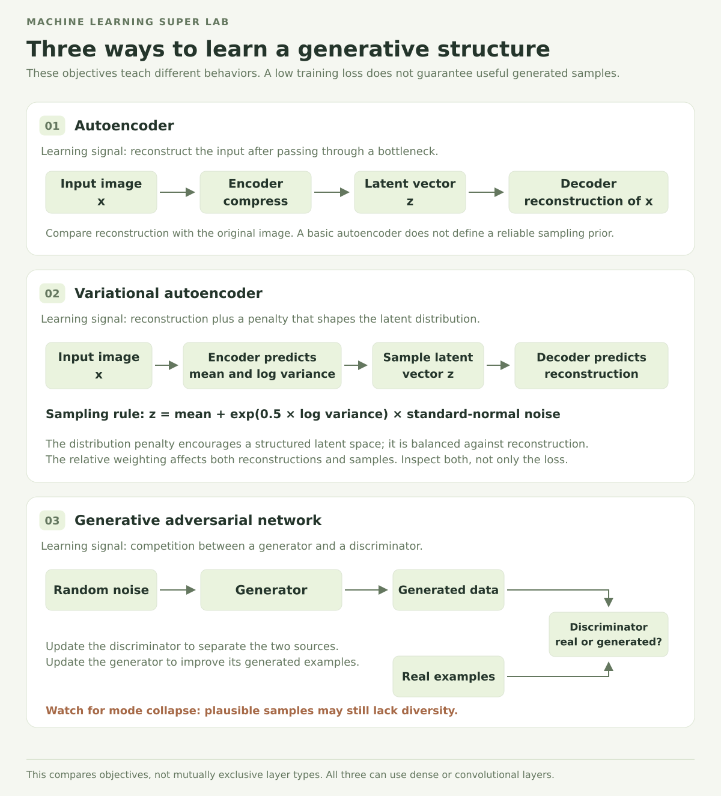

## Follow the algorithm

1. Load digits and split examples.
2. Create an encoder, bottleneck, and decoder.
3. Add controlled noise to training inputs while retaining clean targets.
4. Minimize reconstruction error using gradients.
5. Measure held-out reconstruction and compare with always outputting the training mean image.

```mermaid
flowchart TD
 A[Clean training image] --> B[Add noise]
 B --> C[Encoder]
 C --> D[Small representation]
 D --> E[Decoder]
 E --> F[Reconstruction loss]
 A --> F
 F -->|Update both halves| C
```

## Go one level deeper

This is self-supervised target construction because the clean input supplies the target without requiring human class labels. Reconstruction mean squared error measures pixel differences, not whether a generated image is semantically correct. A large bottleneck can learn an unhelpful near-identity mapping. The training objective is summed pixel error per image; the report’s mean squared error averages across both images and pixels, so their scales differ.

## Run the implementation

Open the Practice tab. Install the foundation packages once if the site requests them. The runner executes the actual program in lab/foundations.py. The commands below are for the website’s guided terminal; it selects your Python environment automatically. For external PowerShell, replace python with & .\.venv\Scripts\python.exe and use .\lab\foundations.py from the website folder. Replace {run} with a unique name when typing commands manually; the website buttons generate it automatically.

```text
python foundations.py autoencoder --latent 4 --noise 0.2 --epochs 25 --output outputs/autoencoder-small-{run}
```

```text
python foundations.py autoencoder --latent 16 --noise 0.2 --epochs 25 --output outputs/autoencoder-wide-{run}
```

The random seed controls the generated data, splits, and applicable model initialization. Keep it fixed when investigating one changed parameter. Neural results can still vary across hardware and library implementations.

## Inspect the evidence

Open representations.png: original, reconstruction, and noisy input appear in separate rows. Compare reconstruction_mean_squared_error with mean_image_baseline_error.

Every completed run writes report.json with the experiment, split, seed, settings, dataset description, measured metrics, timing, and limitations. Where applicable it also saves a trained parameter dictionary. The Experiment results page shows the measured report and generated plots. Record an explanation of the result instead of copying only the score.

## Change one thing and prove what happened

Explain how the bottleneck size changes information capacity. Compare four and sixteen latent dimensions. Propose a genuinely held-out anomaly dataset before attempting to use reconstruction error as an alert score.

## Debugging checkpoint

An ordinary autoencoder does not guarantee that arbitrary random points in its representation space decode into plausible examples.

If the program reports a missing module, install foundation packages in the runtime shown by the website. If it refuses an existing output directory, choose a new one; this protects earlier evidence. If a numerical result surprises you, inspect data shape, split sizes, and the baseline before changing model complexity.

## Compute plan

For this exact bundled exercise, use your local central processing unit. Renting a graphics processing unit is unnecessary. For substantially larger images, graphs, or models, first record the local runtime and memory. Use the Vast.ai guide only when the measured limit justifies a rental, and pass --device cuda to use the remote graphics processor. More expensive hardware does not fix a flawed objective or split.

## Build it from start to finish: Denoising grayscale inputs

**Runnable implementation lab — local prototype.** This build connects the real-world scenario to an executable teaching model. Simulated data is explicitly identified; a good score on it does not establish business performance.

1. **Write the decision and success criterion.** State who consumes the prediction and which mistake is expensive. Define a measurable baseline before choosing a model. For this project: denoising grayscale inputs.
2. **Define and inspect the data.** Clean training images paired with artificially corrupted versions. Production needs a justified noise model and examples from the actual capture process. Use the bundled dataset first. Before replacing it, document permission, provenance, missing values, units, class coverage, duplicates, and when each feature becomes available.
3. **Create the evaluation boundary.** The program fixes a seed and separates fitting from held-out evaluation where that protocol applies. For real workloads, choose time-based or entity-based separation when random splitting would leak related observations. The graph, adversarial, and reinforcement modules explain their distinct protocols.
4. **Construct the model.** Read the algorithm and the matching function in foundations.py. Trace the input shape through every preprocessing and model stage. The numerical example above lets you check a small part by hand.
5. **Train and compare.** Run the first Practice experiment. Record its baseline, metrics, runtime, and failure cases. Run the changed setting and explain the result. Choose settings using validation; reserve final test evidence for the chosen configuration.
6. **Save a usable artifact.** The program writes a model-manifest.json, an example-input.json, a fitted model or learned counting/action table, and report.json. It reloads the artifact in a separate inference function before declaring success. Learned scaling stays with applicable classical models. A neural state dictionary alone would be insufficient without the matching architecture; this build also exports an executable inference module.
7. **Use it on a new input.** In Practice, select **Load saved example**, edit one value while preserving the documented shape, and select **Predict new input**. This reloads the saved model and runs inference without training again. A reconstructed 64-value image from a noisy input, using the saved deterministic encoder and decoder.
8. **Deploy the prototype locally.** The localhost website is the demonstration serving layer: input validation → saved artifact → inference → output. Keep the model's environment and feature contract with the release. Only load artifacts you created or trust; executable model formats are not passive documents.
9. **Plan a production handoff.** Add representative-data evaluation, request limits, authentication, authorization, observability, model versioning, rollback, and a suitable reject/fallback behavior before exposing a service to other users. These are engineering extensions, not completed production features of this local lab.
10. **Monitor and decide when to retrain.** Reconstruction error by corruption type, lost details, and downstream recognition quality. Define a threshold and response owner. Track whether the new data resembles the training population, and compare a candidate model with the deployed baseline before replacement.

### The build architecture

```mermaid
flowchart TD
 A[Problem and permitted data] --> B[Split and validate]
 B --> C[Fit preprocessing and model]
 C --> D[Evaluate held-out evidence]
 D --> E{Meets agreed criterion}
 E -->|Revise using validation| C
 E -->|Accept| F[Save versioned artifact]
 F --> G[Reload for new input]
 G --> H[Local prediction and monitoring plan]
```

### Command-line inference alternative

The website remembers the last successful model folder for this lesson. In its guided terminal, replace MODEL-FOLDER below with that actual folder name and NEW-RUN with a unique output name. Edit a copy of example-input.json to supply your own values.

```text
python predict_saved.py --model-dir outputs/MODEL-FOLDER --input outputs/MODEL-FOLDER/example-input.json --output outputs/prediction-NEW-RUN.json
```

### Build acceptance evidence

Submit a one-paragraph problem definition, feature/target contract, baseline and selected-model reports, one failure analysis, saved artifact, a changed-input prediction, and a deployment/monitoring decision. Passing a command demonstrates executable code; this evidence explains whether the model is appropriate for its intended use.


## Submit an engineering assessment

Save the two reports, their visual artifacts, a prediction made before the second run, and a paragraph explaining the observed difference. State the dataset’s limits and what additional evidence a real deployment would need. Use validation to choose settings; for a final assessment, rerun the selected settings with --split test and a new output folder. The adversarial and reinforcement labs describe their special evaluation protocols explicitly rather than claiming an ordinary random test split.

## Primary reference

[Read the primary documentation or research](https://www.deeplearningbook.org/contents/autoencoders.html). The lesson’s scenario and simplified implementation are teaching examples.


# Variational autoencoders: learn a distribution

**Tag: Runnable implementation lab.** Scope: an inspectable teaching implementation with real fitting, evaluation, and generated artifacts. This is not a production deployment certification.

**Learning outcome:** Add probabilistic latent variables and balance reconstruction with regularization.

## Where this appears in the real world

A generative representation can support controlled exploration of data variation or serve as a component of a larger generative system. This lab generates tiny handwritten-digit-like images. It is not a privacy-preserving synthetic-data guarantee.

## Build the mental model

The encoder predicts parameters of a distribution over latent values rather than only a single code. Training samples from that distribution, reconstructs the input, and adds a penalty that encourages the latent distribution to stay near a chosen prior.

### Work through a concrete example

For one latent coordinate, suppose the mean is 2 and standard deviation is 0.5. A sampled standard-normal noise value of -1 gives a latent value of 2 + 0.5 × -1 = 1.5. This separates random noise from differentiable distribution parameters.


## Follow the algorithm

1. Encode each training image into a latent mean and log variance.
2. Draw noise and form a differentiable latent sample.
3. Decode the sample to reconstruct the input.
4. Combine reconstruction error with Kullback–Leibler divergence to the standard-normal prior.
5. Evaluate reconstruction at the latent mean and decode new samples from the prior.

```mermaid
flowchart TD
 A[Input image] --> B[Encoder mean and variance]
 B --> C[Sample latent representation]
 D[Random noise] --> C
 C --> E[Decode reconstruction]
 E --> F[Reconstruction term]
 B --> G[Prior-divergence term]
 F --> H[Combined training objective]
 G --> H
```

## Go one level deeper

The reparameterization trick lets gradients reach the encoder through the sample construction. Kullback–Leibler divergence measures a directional difference between distributions. The beta parameter here controls the divergence penalty. Our squared reconstruction term corresponds to a simplified Gaussian-likelihood-style objective up to scaling; it is not a full likelihood benchmark. Excess regularization can produce posterior collapse, where latent variables carry little useful input information.

## Run the implementation

Open the Practice tab. Install the foundation packages once if the site requests them. The runner executes the actual program in lab/foundations.py. The commands below are for the website’s guided terminal; it selects your Python environment automatically. For external PowerShell, replace python with & .\.venv\Scripts\python.exe and use .\lab\foundations.py from the website folder. Replace {run} with a unique name when typing commands manually; the website buttons generate it automatically.

```text
python foundations.py variational --latent 8 --beta 0.1 --epochs 25 --output outputs/variational-{run}
```

```text
python foundations.py variational --latent 8 --beta 2 --epochs 25 --output outputs/variational-strong-{run}
```

The random seed controls the generated data, splits, and applicable model initialization. Keep it fixed when investigating one changed parameter. Neural results can still vary across hardware and library implementations.

## Inspect the evidence

Open representations.png: the bottom row contains samples decoded from the prior. Inspect reconstruction quality separately from sample plausibility. Your samples may be blurry or incomplete.

Every completed run writes report.json with the experiment, split, seed, settings, dataset description, measured metrics, timing, and limitations. Where applicable it also saves a trained parameter dictionary. The Experiment results page shows the measured report and generated plots. Record an explanation of the result instead of copying only the score.

## Change one thing and prove what happened

Compare weak and strong divergence penalties. Explain why a better reconstruction score does not necessarily mean better samples from the prior. Record both the numeric error and a written review of sample diversity.

## Debugging checkpoint

Do not call a latent distribution “understanding” without defining a task-based evaluation. Generated examples can preserve undesirable patterns from training data.

If the program reports a missing module, install foundation packages in the runtime shown by the website. If it refuses an existing output directory, choose a new one; this protects earlier evidence. If a numerical result surprises you, inspect data shape, split sizes, and the baseline before changing model complexity.

## Compute plan

For this exact bundled exercise, use your local central processing unit. Renting a graphics processing unit is unnecessary. For substantially larger images, graphs, or models, first record the local runtime and memory. Use the Vast.ai guide only when the measured limit justifies a rental, and pass --device cuda to use the remote graphics processor. More expensive hardware does not fix a flawed objective or split.

## Build it from start to finish: Learn a smooth space of digit variations

**Runnable implementation lab — local prototype.** This build connects the real-world scenario to an executable teaching model. Simulated data is explicitly identified; a good score on it does not establish business performance.

1. **Write the decision and success criterion.** State who consumes the prediction and which mistake is expensive. Define a measurable baseline before choosing a model. For this project: learn a smooth space of digit variations.
2. **Define and inspect the data.** Normalized training images without digit labels as reconstruction targets. The encoder learns distribution parameters; the decoder learns reconstruction. Use the bundled dataset first. Before replacing it, document permission, provenance, missing values, units, class coverage, duplicates, and when each feature becomes available.
3. **Create the evaluation boundary.** The program fixes a seed and separates fitting from held-out evaluation where that protocol applies. For real workloads, choose time-based or entity-based separation when random splitting would leak related observations. The graph, adversarial, and reinforcement modules explain their distinct protocols.
4. **Construct the model.** Read the algorithm and the matching function in foundations.py. Trace the input shape through every preprocessing and model stage. The numerical example above lets you check a small part by hand.
5. **Train and compare.** Run the first Practice experiment. Record its baseline, metrics, runtime, and failure cases. Run the changed setting and explain the result. Choose settings using validation; reserve final test evidence for the chosen configuration.
6. **Save a usable artifact.** The program writes a model-manifest.json, an example-input.json, a fitted model or learned counting/action table, and report.json. It reloads the artifact in a separate inference function before declaring success. Learned scaling stays with applicable classical models. A neural state dictionary alone would be insufficient without the matching architecture; this build also exports an executable inference module.
7. **Use it on a new input.** In Practice, select **Load saved example**, edit one value while preserving the documented shape, and select **Predict new input**. This reloads the saved model and runs inference without training again. The saved helper reconstructs at the latent mean. The training implementation also draws prior samples; inspect both diversity and quality.
8. **Deploy the prototype locally.** The localhost website is the demonstration serving layer: input validation → saved artifact → inference → output. Keep the model's environment and feature contract with the release. Only load artifacts you created or trust; executable model formats are not passive documents.
9. **Plan a production handoff.** Add representative-data evaluation, request limits, authentication, authorization, observability, model versioning, rollback, and a suitable reject/fallback behavior before exposing a service to other users. These are engineering extensions, not completed production features of this local lab.
10. **Monitor and decide when to retrain.** Reconstruction loss, divergence contribution, latent utilization, and sample coverage. Define a threshold and response owner. Track whether the new data resembles the training population, and compare a candidate model with the deployed baseline before replacement.

### The build architecture

```mermaid
flowchart TD
 A[Problem and permitted data] --> B[Split and validate]
 B --> C[Fit preprocessing and model]
 C --> D[Evaluate held-out evidence]
 D --> E{Meets agreed criterion}
 E -->|Revise using validation| C
 E -->|Accept| F[Save versioned artifact]
 F --> G[Reload for new input]
 G --> H[Local prediction and monitoring plan]
```

### Command-line inference alternative

The website remembers the last successful model folder for this lesson. In its guided terminal, replace MODEL-FOLDER below with that actual folder name and NEW-RUN with a unique output name. Edit a copy of example-input.json to supply your own values.

```text
python predict_saved.py --model-dir outputs/MODEL-FOLDER --input outputs/MODEL-FOLDER/example-input.json --output outputs/prediction-NEW-RUN.json
```

### Build acceptance evidence

Submit a one-paragraph problem definition, feature/target contract, baseline and selected-model reports, one failure analysis, saved artifact, a changed-input prediction, and a deployment/monitoring decision. Passing a command demonstrates executable code; this evidence explains whether the model is appropriate for its intended use.


## Submit an engineering assessment

Save the two reports, their visual artifacts, a prediction made before the second run, and a paragraph explaining the observed difference. State the dataset’s limits and what additional evidence a real deployment would need. Use validation to choose settings; for a final assessment, rerun the selected settings with --split test and a new output folder. The adversarial and reinforcement labs describe their special evaluation protocols explicitly rather than claiming an ordinary random test split.

## Primary reference

[Read the primary documentation or research](https://arxiv.org/abs/1312.6114). The lesson’s scenario and simplified implementation are teaching examples.


# Adversarial generation: train two competing models

**Tag: Runnable implementation lab.** Scope: an inspectable teaching implementation with real fitting, evaluation, and generated artifacts. This is not a production deployment certification.

**Learning outcome:** Watch a generator learn a two-mode distribution and diagnose mode collapse.

## Where this appears in the real world

Adversarial training has been used for image synthesis and image-to-image translation. The simplest way to understand its dynamics is a one-dimensional target distribution, where missing modes are obvious. This lab learns numbers around -2 and +2 rather than generating full images.

## Build the mental model

A generator maps random noise into samples. A discriminator learns to distinguish training-like samples from generated samples. The generator is updated to make its outputs harder for the discriminator to reject. The two objectives interact, so neither loss is a complete quality score.

### Work through a concrete example

The target has roughly half its samples near -2 and half near +2. A generator that produces only values near +2 can look locally plausible while completely missing half the target. This is mode collapse, and a histogram makes it easier to see.


## Follow the algorithm

1. Draw independent samples from the synthetic two-mode target.
2. Update the discriminator using real samples and detached generated samples.
3. Freeze discriminator parameters while updating the generator through its scores.
4. Alternate these updates for a bounded number of steps.
5. Draw fresh target and generated samples and compare their distributions.

```mermaid
flowchart TD
 A[Random noise] --> B[Generator]
 B --> C[Generated samples]
 D[Real samples] --> E[Discriminator]
 C --> E
 E --> F[Discriminator update]
 E --> G[Generator update through scores]
 G --> B
```

## Go one level deeper

The discriminator uses binary cross-entropy with logits. Detaching generated samples during its update prevents that loss from changing the generator. Freezing discriminator parameters during the generator update still permits gradients through the discriminator’s computation into the generator. Training can oscillate, collapse, or fail to converge. The saved generator is a tiny demonstration, not an image model.

## Run the implementation

Open the Practice tab. Install the foundation packages once if the site requests them. The runner executes the actual program in lab/foundations.py. The commands below are for the website’s guided terminal; it selects your Python environment automatically. For external PowerShell, replace python with & .\.venv\Scripts\python.exe and use .\lab\foundations.py from the website folder. Replace {run} with a unique name when typing commands manually; the website buttons generate it automatically.

```text
python foundations.py adversarial --steps 200 --output outputs/adversarial-short-{run}
```

```text
python foundations.py adversarial --steps 1200 --output outputs/adversarial-long-{run}
```

The random seed controls the generated data, splits, and applicable model initialization. Keep it fixed when investigating one changed parameter. Neural results can still vary across hardware and library implementations.

## Inspect the evidence

Open distribution.png. Compare both modes, spread, and fraction_generated_below_zero. A value near one-half does not by itself prove a correct distribution; inspect shape and standard deviation too.

Every completed run writes report.json with the experiment, split, seed, settings, dataset description, measured metrics, timing, and limitations. Where applicable it also saves a trained parameter dictionary. The Experiment results page shows the measured report and generated plots. Record an explanation of the result instead of copying only the score.

## Change one thing and prove what happened

Run the longer experiment with a second seed after documenting the first. Explain whether more training improved coverage or caused collapse. Submit a failure analysis even if the generated distribution remains poor.

## Debugging checkpoint

Never mark the lab successful merely because generator loss decreases. A discriminator can become weak, saturated, or uninformative while sample quality remains poor.

If the program reports a missing module, install foundation packages in the runtime shown by the website. If it refuses an existing output directory, choose a new one; this protects earlier evidence. If a numerical result surprises you, inspect data shape, split sizes, and the baseline before changing model complexity.

## Compute plan

For this exact bundled exercise, use your local central processing unit. Renting a graphics processing unit is unnecessary. For substantially larger images, graphs, or models, first record the local runtime and memory. Use the Vast.ai guide only when the measured limit justifies a rental, and pass --device cuda to use the remote graphics processor. More expensive hardware does not fix a flawed objective or split.

## Build it from start to finish: Synthetic scalar generator for simulator experiments

**Runnable implementation lab — local prototype.** This build connects the real-world scenario to an executable teaching model. Simulated data is explicitly identified; a good score on it does not establish business performance.

1. **Write the decision and success criterion.** State who consumes the prediction and which mistake is expensive. Define a measurable baseline before choosing a model. For this project: synthetic scalar generator for simulator experiments.
2. **Define and inspect the data.** Samples from a known two-mode distribution provide a controlled target. Replacing it with business data requires permission, coverage checks, and privacy evaluation. Use the bundled dataset first. Before replacing it, document permission, provenance, missing values, units, class coverage, duplicates, and when each feature becomes available.
3. **Create the evaluation boundary.** The program fixes a seed and separates fitting from held-out evaluation where that protocol applies. For real workloads, choose time-based or entity-based separation when random splitting would leak related observations. The graph, adversarial, and reinforcement modules explain their distinct protocols.
4. **Construct the model.** Read the algorithm and the matching function in foundations.py. Trace the input shape through every preprocessing and model stage. The numerical example above lets you check a small part by hand.
5. **Train and compare.** Run the first Practice experiment. Record its baseline, metrics, runtime, and failure cases. Run the changed setting and explain the result. Choose settings using validation; reserve final test evidence for the chosen configuration.
6. **Save a usable artifact.** The program writes a model-manifest.json, an example-input.json, a fitted model or learned counting/action table, and report.json. It reloads the artifact in a separate inference function before declaring success. Learned scaling stays with applicable classical models. A neural state dictionary alone would be insufficient without the matching architecture; this build also exports an executable inference module.
7. **Use it on a new input.** In Practice, select **Load saved example**, edit one value while preserving the documented shape, and select **Predict new input**. This reloads the saved model and runs inference without training again. Two noise values produce one synthetic scalar. The model is deliberately one-dimensional and is not an image generator.
8. **Deploy the prototype locally.** The localhost website is the demonstration serving layer: input validation → saved artifact → inference → output. Keep the model's environment and feature contract with the release. Only load artifacts you created or trust; executable model formats are not passive documents.
9. **Plan a production handoff.** Add representative-data evaluation, request limits, authentication, authorization, observability, model versioning, rollback, and a suitable reject/fallback behavior before exposing a service to other users. These are engineering extensions, not completed production features of this local lab.
10. **Monitor and decide when to retrain.** Mode coverage, sample distribution, seed sensitivity, and collapse despite plausible training losses. Define a threshold and response owner. Track whether the new data resembles the training population, and compare a candidate model with the deployed baseline before replacement.

### The build architecture

```mermaid
flowchart TD
 A[Problem and permitted data] --> B[Split and validate]
 B --> C[Fit preprocessing and model]
 C --> D[Evaluate held-out evidence]
 D --> E{Meets agreed criterion}
 E -->|Revise using validation| C
 E -->|Accept| F[Save versioned artifact]
 F --> G[Reload for new input]
 G --> H[Local prediction and monitoring plan]
```

### Command-line inference alternative

The website remembers the last successful model folder for this lesson. In its guided terminal, replace MODEL-FOLDER below with that actual folder name and NEW-RUN with a unique output name. Edit a copy of example-input.json to supply your own values.

```text
python predict_saved.py --model-dir outputs/MODEL-FOLDER --input outputs/MODEL-FOLDER/example-input.json --output outputs/prediction-NEW-RUN.json
```

### Build acceptance evidence

Submit a one-paragraph problem definition, feature/target contract, baseline and selected-model reports, one failure analysis, saved artifact, a changed-input prediction, and a deployment/monitoring decision. Passing a command demonstrates executable code; this evidence explains whether the model is appropriate for its intended use.


## Submit an engineering assessment

Save the two reports, their visual artifacts, a prediction made before the second run, and a paragraph explaining the observed difference. State the dataset’s limits and what additional evidence a real deployment would need. Use validation to choose settings; for a final assessment, rerun the selected settings with --split test and a new output folder. The adversarial and reinforcement labs describe their special evaluation protocols explicitly rather than claiming an ordinary random test split.

## Primary reference

[Read the primary documentation or research](https://arxiv.org/abs/1406.2661). The lesson’s scenario and simplified implementation are teaching examples.


# Statistical language models: count before you train a network

**Tag: Runnable implementation lab.** Scope: an inspectable teaching implementation with real fitting, evaluation, and generated artifacts. This is not a production deployment certification.

**Learning outcome:** Build an inspectable word predictor with counts, smoothing, and perplexity.

## Where this appears in the real world

Short-context statistical language models provide useful baselines and make next-token prediction concrete. They help engineers distinguish the definition of a language model from the particular neural architecture used by modern assistants.

## Build the mental model

Count how often a word follows a short context in training text. Convert those counts into a probability distribution. At prediction time, use the most recent context words to score or sample the next word. No neural-network parameters are required.

### Work through a concrete example

If “server” is followed by “starts” three times and “stops” once, the unsmoothed probabilities are 0.75 and 0.25. Add-one smoothing adds one count to every vocabulary option before normalization, reserving probability for events not observed in training.


## Follow the algorithm

1. Create distinct short operations sentences and split them.
2. Build vocabulary and context counts using only training sentences.
3. Apply add-one smoothing to each context distribution.
4. Score held-out tokens using their available context.
5. Compute perplexity and sample a continuation from the learned distribution.

```mermaid
flowchart TD
 A[Training sentences] --> B[Vocabulary and counts]
 B --> C[Smoothed distributions]
 D[Recent context words] --> E[Select context distribution]
 C --> E
 E --> F[Score next word]
 E --> G[Sample next word]
```

## Go one level deeper

An order-two model uses one previous word; an order-three model uses two. Start and end markers define sentence boundaries. Unknown evaluation words map to an explicit unknown symbol. Perplexity is the exponential of average negative log probability, using natural logarithms here. Lower perplexity indicates better probability assignment only under compatible tokenization, vocabulary handling, and evaluation data.

## Run the implementation

Open the Practice tab. Install the foundation packages once if the site requests them. The runner executes the actual program in lab/foundations.py. The commands below are for the website’s guided terminal; it selects your Python environment automatically. For external PowerShell, replace python with & .\.venv\Scripts\python.exe and use .\lab\foundations.py from the website folder. Replace {run} with a unique name when typing commands manually; the website buttons generate it automatically.

```text
python foundations.py ngram --order 1 --output outputs/ngram-one-{run}
```

```text
python foundations.py ngram --order 3 --output outputs/ngram-three-{run}
```

The random seed controls the generated data, splits, and applicable model initialization. Keep it fixed when investigating one changed parameter. Neural results can still vary across hardware and library implementations.

## Inspect the evidence

Inspect token-probabilities.png and compare perplexity with uniform_baseline_perplexity. The generated text is sampled from actual counts; it may be awkward because the corpus is small and smoothing spreads probability widely.

Every completed run writes report.json with the experiment, split, seed, settings, dataset description, measured metrics, timing, and limitations. Where applicable it also saves a trained parameter dictionary. The Experiment results page shows the measured report and generated plots. Record an explanation of the result instead of copying only the score.

## Change one thing and prove what happened

Hand-calculate one context’s smoothed probability from counts. Compare order one with order three and explain why longer context can create data sparsity instead of automatically improving results.

## Debugging checkpoint

Do not compare this word-level perplexity directly with the byte-level perplexity of the scratch neural language model. The prediction units differ.

If the program reports a missing module, install foundation packages in the runtime shown by the website. If it refuses an existing output directory, choose a new one; this protects earlier evidence. If a numerical result surprises you, inspect data shape, split sizes, and the baseline before changing model complexity.

## Compute plan

For this exact bundled exercise, use your local central processing unit. Renting a graphics processing unit is unnecessary. The implementation uses ordinary processor-based scikit-learn or small tables. Renting a graphics processor will not automatically accelerate this code.

## Build it from start to finish: Small operations-text completion model

**Runnable implementation lab — local prototype.** This build connects the real-world scenario to an executable teaching model. Simulated data is explicitly identified; a good score on it does not establish business performance.

1. **Write the decision and success criterion.** State who consumes the prediction and which mistake is expensive. Define a measurable baseline before choosing a model. For this project: small operations-text completion model.
2. **Define and inspect the data.** Training sentences tokenized into words; vocabulary and context counts are learned from the training split. Real logs require removal of secrets and stable tokenization. Use the bundled dataset first. Before replacing it, document permission, provenance, missing values, units, class coverage, duplicates, and when each feature becomes available.
3. **Create the evaluation boundary.** The program fixes a seed and separates fitting from held-out evaluation where that protocol applies. For real workloads, choose time-based or entity-based separation when random splitting would leak related observations. The graph, adversarial, and reinforcement modules explain their distinct protocols.
4. **Construct the model.** Read the algorithm and the matching function in foundations.py. Trace the input shape through every preprocessing and model stage. The numerical example above lets you check a small part by hand.
5. **Train and compare.** Run the first Practice experiment. Record its baseline, metrics, runtime, and failure cases. Run the changed setting and explain the result. Choose settings using validation; reserve final test evidence for the chosen configuration.
6. **Save a usable artifact.** The program writes a model-manifest.json, an example-input.json, a fitted model or learned counting/action table, and report.json. It reloads the artifact in a separate inference function before declaring success. Learned scaling stays with applicable classical models. A neural state dictionary alone would be insufficient without the matching architecture; this build also exports an executable inference module.
7. **Use it on a new input.** In Practice, select **Load saved example**, edit one value while preserving the documented shape, and select **Predict new input**. This reloads the saved model and runs inference without training again. A distribution over the next word for a supplied context. The saved counting model needs no neural framework.
8. **Deploy the prototype locally.** The localhost website is the demonstration serving layer: input validation → saved artifact → inference → output. Keep the model's environment and feature contract with the release. Only load artifacts you created or trust; executable model formats are not passive documents.
9. **Plan a production handoff.** Add representative-data evaluation, request limits, authentication, authorization, observability, model versioning, rollback, and a suitable reject/fallback behavior before exposing a service to other users. These are engineering extensions, not completed production features of this local lab.
10. **Monitor and decide when to retrain.** Held-out perplexity, unknown-word rate, memory growth with context order, and inappropriate memorized text. Define a threshold and response owner. Track whether the new data resembles the training population, and compare a candidate model with the deployed baseline before replacement.

### The build architecture

```mermaid
flowchart TD
 A[Problem and permitted data] --> B[Split and validate]
 B --> C[Fit preprocessing and model]
 C --> D[Evaluate held-out evidence]
 D --> E{Meets agreed criterion}
 E -->|Revise using validation| C
 E -->|Accept| F[Save versioned artifact]
 F --> G[Reload for new input]
 G --> H[Local prediction and monitoring plan]
```

### Command-line inference alternative

The website remembers the last successful model folder for this lesson. In its guided terminal, replace MODEL-FOLDER below with that actual folder name and NEW-RUN with a unique output name. Edit a copy of example-input.json to supply your own values.

```text
python predict_saved.py --model-dir outputs/MODEL-FOLDER --input outputs/MODEL-FOLDER/example-input.json --output outputs/prediction-NEW-RUN.json
```

### Build acceptance evidence

Submit a one-paragraph problem definition, feature/target contract, baseline and selected-model reports, one failure analysis, saved artifact, a changed-input prediction, and a deployment/monitoring decision. Passing a command demonstrates executable code; this evidence explains whether the model is appropriate for its intended use.


## Submit an engineering assessment

Save the two reports, their visual artifacts, a prediction made before the second run, and a paragraph explaining the observed difference. State the dataset’s limits and what additional evidence a real deployment would need. Use validation to choose settings; for a final assessment, rerun the selected settings with --split test and a new output folder. The adversarial and reinforcement labs describe their special evaluation protocols explicitly rather than claiming an ordinary random test split.

## Primary reference

[Read the primary documentation or research](https://www.nltk.org/api/nltk.lm.html). The lesson’s scenario and simplified implementation are teaching examples.


# Reinforcement learning: learn actions from rewards

**Tag: Runnable implementation lab.** Scope: an inspectable teaching implementation with real fitting, evaluation, and generated artifacts. This is not a production deployment certification.

**Learning outcome:** Train a complete small action-value learner and compare it with random behavior.

## Where this appears in the real world

Routing, scheduling, and simulated robot control involve actions whose consequences unfold over time. Reinforcement learning studies how a policy can improve from interaction. Our four-by-four grid is an explicit educational environment, not an autonomous real-world control system.

## Build the mental model

The agent observes a state, chooses an action, receives a reward, and sees a new state. A table estimates the value of each action in each state. Updates combine immediate reward with an estimate of future reward. Exploration allows the agent to discover actions it has not yet learned to prefer.

### Work through a concrete example

If an action currently has value 2, its target is 6, and the learning rate is 0.2, the updated value is 2 + 0.2 × (6 - 2) = 2.8. At the terminal goal, the target uses the immediate reward without adding a future-state value.


## Follow the algorithm

1. Initialize a table for sixteen states and four possible actions.
2. Choose random actions some of the time and otherwise choose the current best action.
3. Move in the grid, receive a step penalty or goal reward, and update the chosen entry.
4. Reduce exploration over training episodes.
5. Evaluate the greedy policy without exploration and compare with random actions.

```mermaid
flowchart TD
 A[Observe state] --> B{Explore?}
 B -->|Yes| C[Random action]
 B -->|No| D[Best table action]
 C --> E[Environment transition]
 D --> E
 E --> F[Reward and next state]
 F --> G[Update action value]
 G --> A
```

## Go one level deeper

The update is tabular Q-learning; Q denotes an action-value function, not an acronym. The discount factor controls how future rewards contribute. An episode ends at the goal or after the step limit. The environment is deterministic and all evaluation episodes begin at the same state, so repeated success does not establish generalization to new maps. A neural value function is an extension, not a requirement for reinforcement learning.

## Run the implementation

Open the Practice tab. Install the foundation packages once if the site requests them. The runner executes the actual program in lab/foundations.py. The commands below are for the website’s guided terminal; it selects your Python environment automatically. For external PowerShell, replace python with & .\.venv\Scripts\python.exe and use .\lab\foundations.py from the website folder. Replace {run} with a unique name when typing commands manually; the website buttons generate it automatically.

```text
python foundations.py reinforcement --episodes 50 --output outputs/reinforcement-short-{run}
```

```text
python foundations.py reinforcement --episodes 500 --output outputs/reinforcement-long-{run}
```

The random seed controls the generated data, splits, and applicable model initialization. Keep it fixed when investigating one changed parameter. Neural results can still vary across hardware and library implementations.

## Inspect the evidence

Open rewards.png. Training rewards include exploration, while greedy_success_rate is measured without it. Interpret greedy_policy using the report’s action_order. Compare greedy_mean_return with random_mean_return.

Every completed run writes report.json with the experiment, split, seed, settings, dataset description, measured metrics, timing, and limitations. Where applicable it also saves a trained parameter dictionary. The Experiment results page shows the measured report and generated plots. Record an explanation of the result instead of copying only the score.

## Change one thing and prove what happened

Trace a greedy path from the upper-left corner to the lower-right goal. Explain the terminal-state update. In a copied environment introduce an obstacle and evaluate the old policy before retraining, documenting what fails.

## Debugging checkpoint

Reward design can encourage unintended behavior. A large reward score is only useful when the environment and reward represent the desired task faithfully.

If the program reports a missing module, install foundation packages in the runtime shown by the website. If it refuses an existing output directory, choose a new one; this protects earlier evidence. If a numerical result surprises you, inspect data shape, split sizes, and the baseline before changing model complexity.

## Compute plan

For this exact bundled exercise, use your local central processing unit. Renting a graphics processing unit is unnecessary. The implementation uses ordinary processor-based scikit-learn or small tables. Renting a graphics processor will not automatically accelerate this code.

## Build it from start to finish: Sequential route decisions in a small simulator

**Runnable implementation lab — local prototype.** This build connects the real-world scenario to an executable teaching model. Simulated data is explicitly identified; a good score on it does not establish business performance.

1. **Write the decision and success criterion.** State who consumes the prediction and which mistake is expensive. Define a measurable baseline before choosing a model. For this project: sequential route decisions in a small simulator.
2. **Define and inspect the data.** States, permitted actions, transition rules, rewards, termination, and episode length define the data-generating environment. Use the bundled dataset first. Before replacing it, document permission, provenance, missing values, units, class coverage, duplicates, and when each feature becomes available.
3. **Create the evaluation boundary.** The program fixes a seed and separates fitting from held-out evaluation where that protocol applies. For real workloads, choose time-based or entity-based separation when random splitting would leak related observations. The graph, adversarial, and reinforcement modules explain their distinct protocols.
4. **Construct the model.** Read the algorithm and the matching function in foundations.py. Trace the input shape through every preprocessing and model stage. The numerical example above lets you check a small part by hand.
5. **Train and compare.** Run the first Practice experiment. Record its baseline, metrics, runtime, and failure cases. Run the changed setting and explain the result. Choose settings using validation; reserve final test evidence for the chosen configuration.
6. **Save a usable artifact.** The program writes a model-manifest.json, an example-input.json, a fitted model or learned counting/action table, and report.json. It reloads the artifact in a separate inference function before declaring success. Learned scaling stays with applicable classical models. A neural state dictionary alone would be insufficient without the matching architecture; this build also exports an executable inference module.
7. **Use it on a new input.** In Practice, select **Load saved example**, edit one value while preserving the documented shape, and select **Predict new input**. This reloads the saved model and runs inference without training again. An action index for an integer state: zero up, one right, two down, three left. Physical deployment is outside this lab.
8. **Deploy the prototype locally.** The localhost website is the demonstration serving layer: input validation → saved artifact → inference → output. Keep the model's environment and feature contract with the release. Only load artifacts you created or trust; executable model formats are not passive documents.
9. **Plan a production handoff.** Add representative-data evaluation, request limits, authentication, authorization, observability, model versioning, rollback, and a suitable reject/fallback behavior before exposing a service to other users. These are engineering extensions, not completed production features of this local lab.
10. **Monitor and decide when to retrain.** Success rate, episode return, unsafe actions, reward exploitation, and transfer failure on changed maps. Define a threshold and response owner. Track whether the new data resembles the training population, and compare a candidate model with the deployed baseline before replacement.

### The build architecture

```mermaid
flowchart TD
 A[Problem and permitted data] --> B[Split and validate]
 B --> C[Fit preprocessing and model]
 C --> D[Evaluate held-out evidence]
 D --> E{Meets agreed criterion}
 E -->|Revise using validation| C
 E -->|Accept| F[Save versioned artifact]
 F --> G[Reload for new input]
 G --> H[Local prediction and monitoring plan]
```

### Command-line inference alternative

The website remembers the last successful model folder for this lesson. In its guided terminal, replace MODEL-FOLDER below with that actual folder name and NEW-RUN with a unique output name. Edit a copy of example-input.json to supply your own values.

```text
python predict_saved.py --model-dir outputs/MODEL-FOLDER --input outputs/MODEL-FOLDER/example-input.json --output outputs/prediction-NEW-RUN.json
```

### Build acceptance evidence

Submit a one-paragraph problem definition, feature/target contract, baseline and selected-model reports, one failure analysis, saved artifact, a changed-input prediction, and a deployment/monitoring decision. Passing a command demonstrates executable code; this evidence explains whether the model is appropriate for its intended use.


## Submit an engineering assessment

Save the two reports, their visual artifacts, a prediction made before the second run, and a paragraph explaining the observed difference. State the dataset’s limits and what additional evidence a real deployment would need. Use validation to choose settings; for a final assessment, rerun the selected settings with --split test and a new output folder. The adversarial and reinforcement labs describe their special evaluation protocols explicitly rather than claiming an ordinary random test split.

## Primary reference

[Read the primary documentation or research](https://docs.pytorch.org/tutorials/intermediate/reinforcement_q_learning.html). The lesson’s scenario and simplified implementation are teaching examples.


# Additional model build plans

**Concept** — These are complete project plans and design activities. These larger task-specific plans remain design activities. Small runnable language-model variants now appear in Build and retrieve: a recurrent word predictor, masked-token encoder, and recurrent encoder–decoder. Those exercises do not implement every task specified below; diffusion generation remains Concept only. The language-model atlas explains their algorithms; the plans here connect them to practical deliverables. Use the 18 runnable foundation builds to practice the shared engineering workflow first.

## Recurrent networks: forecast a sensor stream

**Problem:** predict the next reading from a recent sequence. A recurrent neural network updates a hidden state at every time step. A long short-term memory network adds gates and a separate cell state; a gated recurrent unit uses a different gated update. Gates control information flow, rather than guaranteeing unlimited memory.

**Start-to-finish build:** collect permitted timestamped sensor readings; resolve missing intervals without using future values; split chronologically before constructing overlapping windows; fit scaling on training measurements; compare with predicting the last observed value; build a small recurrent layer and numeric output head; optimize prediction loss; validate on later time periods; evaluate once on the final period; save weights, architecture, scaling, window length, and time-zone assumptions; reload to predict an unseen sequence; deploy a bounded local endpoint; monitor error, missing readings, and sensor replacement.

**Algorithm exercise:** start a scalar state at zero. Apply `state = 0.5 * state + input` to `[2, 0, 0, 3]`. Obtain `[2, 1, 0.5, 3.25]`. Change the multiplier to 0.9 and explain the longer memory. Run the workbench's state example. This is a memory-mechanism exercise, not trained long short-term memory.

**Assessment:** draw the window/target boundary; demonstrate why adjacent overlapping windows randomly split across datasets leak information; specify expected input shape `[batch, time, features]`; propose a last-value baseline and a failure case. A tiny training extension should fit locally. Rent a graphics processor only for substantially larger sequence workloads.

[Primary reference: PyTorch long short-term memory layer](https://docs.pytorch.org/docs/stable/generated/torch.nn.LSTM.html).

## Encoder models: classify a support request

**Problem:** assign a ticket category using the whole request. An encoder forms contextual representations of the input; a small classification head turns the representation into category scores. Bidirectional context is useful because a word can be interpreted using text on both sides. This is different from predicting future text with a causal mask.

**Start-to-finish build:** define a category guide and collect permitted, independently labeled tickets; group duplicates and related threads; split by thread and time; select a compact pretrained encoder and pin its revision; tokenize with its matching tokenizer; train a classification head or fine-tune selected layers; compare with a keyword or linear baseline; select confidence/rejection rules using validation; test class recall and calibration; save model, tokenizer, label mapping, maximum length, and preprocessing; reload for one new ticket; serve locally; monitor category drift and requests outside the label set.

**Design exercise:** label ten fictional tickets using your category guide, including ambiguous and multi-topic examples. Write the rule for an unknown category and draw where human review occurs. Explain why a similarity embedding objective is not automatically supplied by a classification-trained encoder.

**Assessment:** supply the labeling guide, duplicate-group split, input/output contract, baseline, error-cost table, model version plan, and drift response. Fine-tuning a small encoder can begin locally; larger datasets may justify a graphics processor.

[Primary reference: sequence classification](https://github.com/huggingface/transformers/blob/main/docs/source/en/tasks/sequence_classification.md).

## Encoder–decoder models: summarize a maintenance report

**Problem:** produce a short report summary while preserving dates, actions, and unresolved issues. An encoder reads the source; a decoder generates the summary using previous output tokens and cross-attention to encoded source information.

```mermaid
flowchart TD
 A[Source report] --> B[Tokenizer and encoder]
 C[Earlier output tokens] --> D[Causal decoder]
 B -->|Cross-attention| D
 D --> E[Next-token probabilities]
 E --> F{End token or limit}
 F -->|Continue| C
 F -->|Finish| G[Summary and factual checks]
```

**Start-to-finish build:** obtain permitted report/summary pairs; remove duplicate reports across splits; write a factuality rubric; choose a compact encoder–decoder checkpoint; tokenize source and target separately; mask padded target positions in the loss; fine-tune on training pairs using teacher forcing; validate generated summaries rather than only teacher-forced loss; compare with extracting the opening sentences; assess factual omissions and invented details on final test; save tokenizer and generation settings with weights; reload and summarize a new report; deploy with source-length and output-length limits; monitor changes in report format and factual-error rates.

**Design exercise:** write a three-sentence maintenance report and a one-sentence reference summary. Mark every summary claim with the source sentence that supports it. Then construct a fluent but incorrect summary and explain why word overlap alone can miss its error. Explain why teacher forcing supplies prior target tokens during training, while generation uses its own earlier outputs.

**Assessment:** paired-data schema, train/validation/test policy, factuality rubric, generated examples, length limits, artifact manifest, and rollback plan. Begin with a small checkpoint and few examples; rent only after measuring memory and runtime.

[Primary reference: summarization workflow](https://huggingface.co/docs/transformers/tasks/summarization).

## Diffusion models: generate small visual patterns

**Problem:** generate diverse, permitted texture patterns for a simulator. A diffusion model learns to reverse a specified corruption process. A common continuous-data setup trains a network to predict added noise at a sampled noise level, then repeatedly applies a compatible reverse update during generation. The sampler and noise schedule are part of the model system.

**Start-to-finish build:** obtain licensed small images and split by source asset; normalize pixels; define a noise schedule; sample a time step and noise for each training example; combine the clean image and noise; supply the corrupted image and time embedding to a small denoiser; train noise prediction; evaluate held-out denoising and generated sample diversity; save weights, normalization, schedule, and sampler configuration; reload; start from noise and generate through reverse steps; inspect duplicates and missing modes; serve locally with bounded resolution and step count; monitor runtime and failure patterns. Larger visual diffusion training often justifies rented graphics hardware, while a tiny numerical corruption exercise does not.

**Numerical exercise:** use the simplified corruption formula `noisy = sqrt(alpha) * clean + sqrt(1-alpha) * noise`. For clean value 2, alpha 0.64, and noise -1, the result is `0.8 * 2 + 0.6 * -1 = 1`. Explain why the denoiser also needs to know the noise level. This arithmetic does not implement a trained reverse sampler.

**Distinction:** a one-pass denoising autoencoder is not automatically a diffusion generator. Discrete text diffusion needs its own token-corruption and generation formulation; do not apply a continuous-image sampler directly to integer token identifiers. The language-model atlas contains a masked-token conceptual algorithm.

**Assessment:** write the corruption and reverse-sampling interfaces, identify which tensors are targets, specify a diversity check, and list every artifact needed to reproduce a sample. Mark the sampler implementation and training as planned work until tested.

[Primary reference: Denoising Diffusion Probabilistic Models](https://arxiv.org/abs/2006.11239).

## Learning strategies that cut across these families

**Concept** — Semi-supervised learning combines labeled and unlabeled examples; self-training can add high-confidence pseudo-labels, but bad pseudo-labels can reinforce errors. Contrastive learning trains representations to distinguish related from unrelated examples; the choice of pairs defines what similarity means. Online learning updates as examples arrive; evaluation must respect time and changing data. Transfer learning starts from learned parameters rather than random initialization. These strategies can use multiple model architectures.

**Design activity:** for the support-ticket project, specify which examples are labeled, how you would prevent held-out tickets from entering pseudo-label training, what makes a valid positive pair, and how an online evaluation would work before accepting an update. No additional strategy is implemented merely because it appears in this plan.


# Additional terms used in the foundation builds

| Short form or term | Expanded name | Meaning in this lab |
|---|---|---|
| ML | Machine learning | Fitting a prediction or decision procedure from examples or experience. |
| CPU | Central processing unit | The general-purpose processor; sufficient for all 18 foundation builds. |
| GPU | Graphics processing unit | A processor suited to parallel tensor operations; optional for larger neural workloads. |
| MLP | Multilayer perceptron | A feed-forward neural network with dense layers and nonlinear activation functions. |
| CNN | Convolutional neural network | A network that shares learned filters over spatial positions. |
| GNN | Graph neural network | A network that combines node features with information along graph connections. |
| RNN | Recurrent neural network | A network that updates a hidden state across sequence positions. |
| LSTM | Long short-term memory | A recurrent architecture with gated updates and a cell state. |
| GRU | Gated recurrent unit | A recurrent architecture that uses gates to control state updates. |
| AE | Autoencoder | An encoder and decoder trained to reconstruct inputs. |
| VAE | Variational autoencoder | A latent-variable model trained using a reconstruction term and a divergence term. |
| GAN | Generative adversarial network | A generator and discriminator trained through competing objectives. |
| PCA | Principal component analysis | A linear projection onto directions of high training-data variance. |
| SVM | Support vector machine | A margin-based model that can use a kernel to represent nonlinear similarity. |
| SVC | Support vector classification | The classification form of a support vector machine. |
| RBF | Radial basis function | A distance-based similarity function used by the demonstrated kernel methods. |
| DBSCAN | Density-based spatial clustering of applications with noise | Groups dense regions and can label isolated observations as noise. |
| MSE | Mean squared error | The average squared prediction error. |
| MAE | Mean absolute error | The average absolute prediction error, in the target's units. |
| RMSE | Root mean squared error | The square root of mean squared error, emphasizing larger mistakes. |
| KL divergence | Kullback–Leibler divergence | A directional measure of mismatch between probability distributions. |
| F1 score | F-one score; a metric name, not an acronym | The harmonic mean of precision and recall; macro averaging weights each class equally. |
| SSH | Secure Shell | The encrypted remote connection used for the cloud lab. |
| SCP | Secure copy | File transfer over a Secure Shell connection. |
| JSON | JavaScript Object Notation | The structured text format for reports and model inputs. |
| API | Application programming interface | A defined interface for requesting a computation or data. |
| ReLU | Rectified linear unit | An activation that returns zero for a negative input and the input for a positive input. |
| Q value | Action-value estimate; Q is a conventional symbol | Expected discounted return associated with a state and action under the relevant policy assumptions. |
| Epoch | One pass through training examples | Different from one optimizer step; an epoch normally contains several mini-batch updates. |
| Inference | Use of an already fitted model | Generates a prediction without updating learned parameters. |
| Ablation | Controlled removal of a component | Tests what changes when, for example, graph edges are removed. |
| Transductive evaluation | Evaluation on held-out labels within a known dataset or graph | The graph lab can see all node features and edges but not held-out labels during training. |
| Inductive evaluation | Evaluation on previously unseen examples or structures | A new graph requires a separate evaluation beyond the lab's fixed graph. |
| Calibration | Agreement between estimated probabilities and observed frequencies | A score of 0.9 is useful as a probability only if such events occur at a compatible frequency. |
| Data drift | Change in the input distribution | It can undermine a previously useful model and requires investigation. |
| Leakage | Evaluation information entering fitting or model selection improperly | Includes fitting preprocessing on test data or splitting near duplicates across sets. |

scikit-learn, SciPy, Matplotlib, PyTorch, joblib, and Mermaid are software project names. Code keeps their official identifiers. An identifier in a code block is not an instruction to rename the package to its explanation.
