# Modern language-model engineering

This path connects the Super Lab foundations to the techniques in contemporary language-model research. Language models are machine-learning models; modern neural language models are deep-learning models. Architecture, learning objective, parameter-update method, evidence retrieval, evaluation, and deployment are separate decisions.

**Before starting:** complete [the numbers](#lesson/math), [training from scratch](#lesson/scratch), [deep learning](#lesson/deep-network), and [evaluation basics](#lesson/baseline). Use [Tiny AI](https://from-number-boxes-to-tiny-ai.ericazelic.chatgpt.site/) whenever weights, vectors, or gradients feel abstract. For reward-based lessons, also complete [the grid-world learner](#lesson/reinforcement).

The sequence is: build and inspect attention; choose block components; adapt behavior; learn from preferences and rewards; measure independent outcomes; serve and monitor. Each experiment below is deliberately small. Hardware timing and synthetic-data scores are evidence about that experiment, not evidence of production reliability. Expand terms using the [modern terminology reference](#ref/modern-glossary); trace ideas to their original sources in [landmark research](#ref/research-landmarks).

**Running commands:** the website's Practice buttons use the configured project Python and run inside `lab/`. For PowerShell from the project root, replace `python modern_lab.py` with `& .\.venv\Scripts\python.exe .\lab\modern_lab.py`. In Command Prompt use `.venv\Scripts\python.exe lab\modern_lab.py`. On macOS or Linux use `.venv/bin/python lab/modern_lab.py`. Command-line output paths are relative to your terminal's directory; browser outputs are under `lab/outputs/`. Use a new output folder every time. The optional judge model downloads weights on first use; the other new local builds use original generated data without model downloads.

## modern-map | Start with the engineering questions

**Tag: Concept.** Activity: classify the choices in a proposed product; draw and defend its data and learning flows.

Suppose your team needs an offline support assistant. It must route tickets, complete short incident notes, and consult a changing recovery manual. These are three different jobs. Ticket routing may need a classifier. Note completion may need a language model. The changing manual may need retrieval. A new acronym is useful only when it solves a measured problem.

**Connecting the two Stanford slides:** the repeated Transformer picture illustrates a reusable family of computations across domains. It does not mean every system uses identical layers, weights, masks, inputs, or training objectives. The acronym slide then separates choices inside the model from training and evaluation choices. Translation is a language task; reinforcement learning is a learning setup, so the first slide's labels are useful examples rather than mutually exclusive model categories.

| Domain | What enters the network? | What must be designed for that task? |
|---|---|---|
| Language | Text tokens and positions | Causal or bidirectional masks, prediction targets, tokenizer |
| Translation | Source and target token sequences | Cross-attention or a decoder-only task format; target-language evaluation |
| Vision | Image patches or visual encoder features | Spatial information, image resolution, classification or generation heads |
| Speech | Audio frames, features, or audio tokens | Time resolution, transcription/translation targets, audio preprocessing |
| Decision making | Observations, actions, rewards, or trajectory tokens | An environment or offline dataset, action constraints, and return evaluation |
| Graphs and science | Node, edge, structural, or domain-specific features | Relationships, symmetries, domain constraints, and appropriate scientific targets |

The existing vision, graph, encoder–decoder, and reinforcement-learning lessons provide entry points. The research reference adds Vision Transformer, Whisper, Decision Transformer, and Graphormer as **Concept reading bridges**, not claimed new reproductions. Tokenizing an image into patches and splitting documents for retrieval are different operations; both require deliberate information-boundary choices.

| Question | Examples | What changes? |
|---|---|---|
| What computation processes tokens? | Attention, recurrence, expert routing | Architecture and activations |
| What does the model learn to predict? | Next tokens, preferred responses, verified answers | Training objective and data |
| Which parameters can change? | Full tuning, low-rank adapters | Trainable parameter subset |
| Where does current evidence come from? | A retrieved manual passage | Inference context, ordinarily not weights |
| How do we know it works? | Independent tests, judged responses, timing | Evidence and engineering decisions |

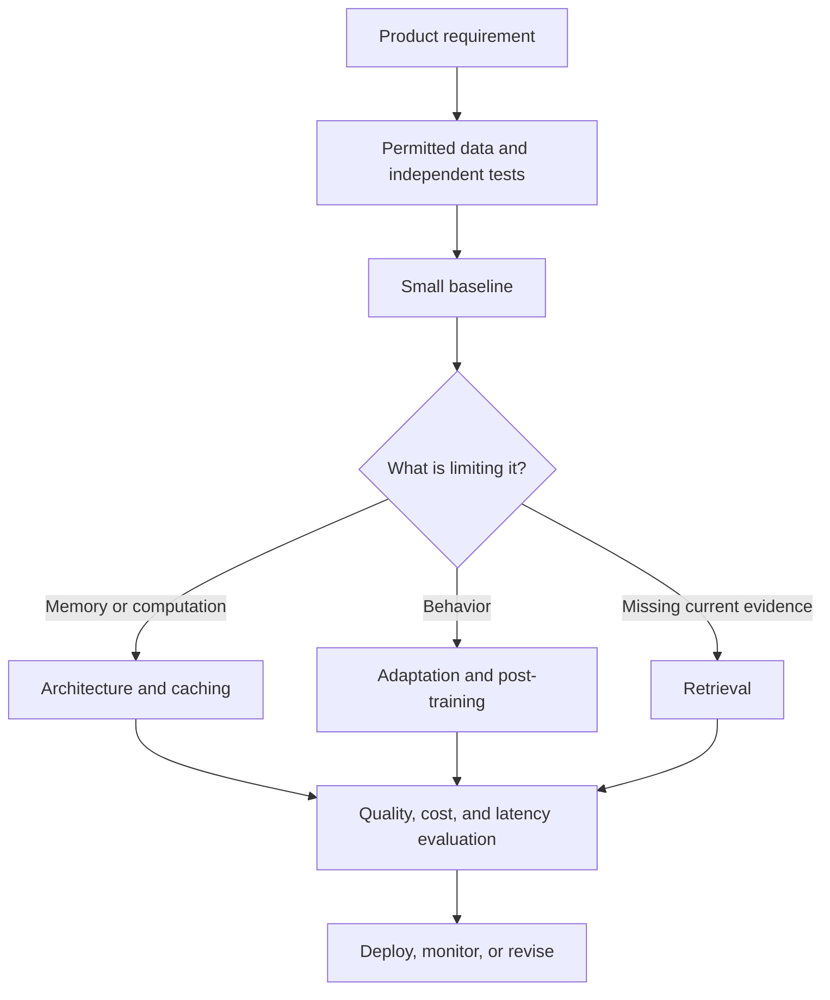

**Worked example:** a model with unchanged weights gives a different answer after a manual passage is supplied. That observation demonstrates context use; it does not demonstrate fine-tuning. Conversely, an adapter saved after optimization contains learned parameter changes even when the base is frozen.

**Build from start to finish:** write a product contract for one of the three jobs. Specify inputs, outputs, permitted data, a train/validation/test split, a baseline, an architecture, a learning objective, saved artifacts, and a local interface. Define an independent quality gate and a resource limit before running. Write which failures trigger rollback. Keep ticket routing, note completion, and manual retrieval as separately measured components.

**Assessment:** classify supervised fine-tuning plus low-rank adaptation as two compatible choices. Explain why a benchmark is not an architecture, and why a reward source is not an optimization algorithm. Submit a diagram and a paragraph describing one failure that an impressive aggregate score could hide.

## attention-cache | Build attention and measure its cache

**Tag: Runnable implementation lab.** Scope: train four small causal language models from random weights and compare their cache behavior. Use case: completing short operations notes on a memory-limited computer.

Read [the scratch build](#lesson/scratch) first. A token representation produces a query, a key, and a value. A query scores permitted keys; softmax turns scores into weights; those weights mix values. A causal mask prevents positions from reading the answer in later positions.

| Design | Query heads | Key/value heads in this build | What students inspect |
|---|---|---|---|
| Multi-head attention | 4 | 4 | Separate key/value projections per head |
| Grouped-query attention | 4 | 2 | Two query heads share each key/value head |
| Multi-query attention | 4 | 1 | All query heads share one key/value head |
| Sliding-window attention | 4 | 4 | Only eight recent positions are directly visible per layer |

**Algorithm:** project queries, keys, and values; append earlier cached keys and values; construct masks using absolute positions; score and normalize; mix values; project back to model width; retain the permitted cache. Sliding windows can pass information indirectly across layers, but do not give every token direct access to all earlier positions.

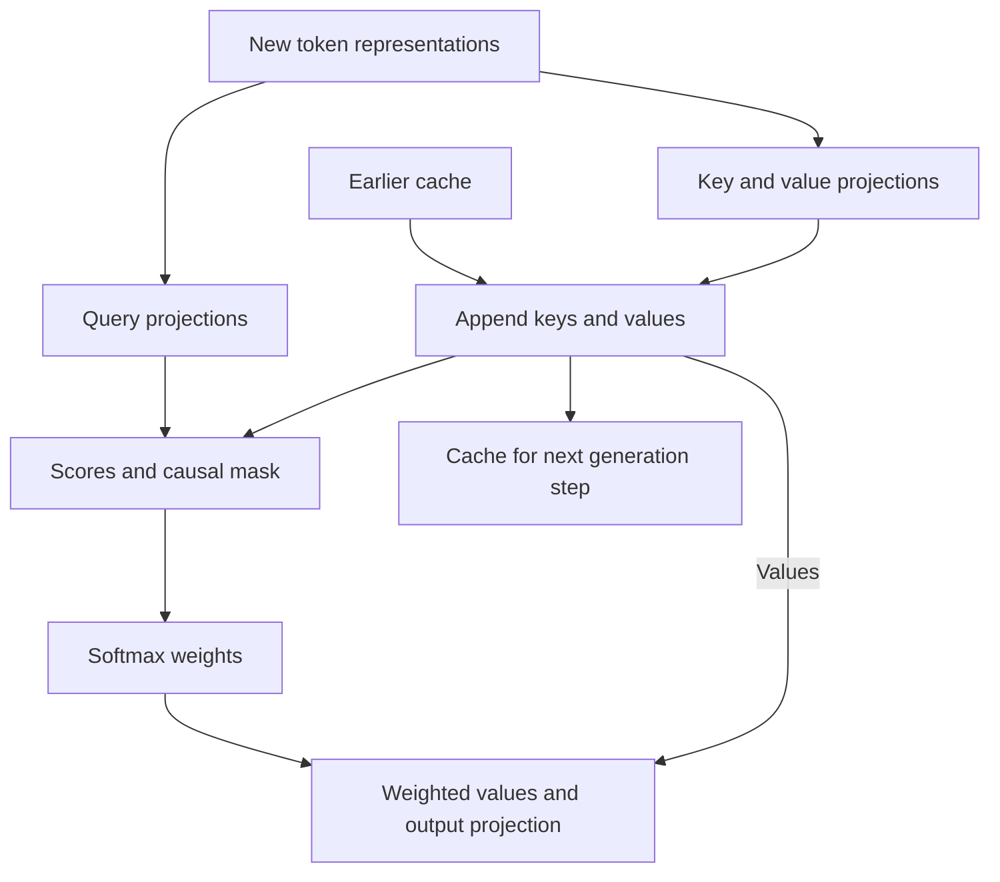

**Numerical example:** key/value cache bytes are approximately `2 × layers × batch × tokens × key_value_heads × head_dimension × bytes_per_element`. With two layers, one sequence, 40 cached tokens, four key/value heads, head dimension eight, and four-byte numbers, the cache occupies 20,480 bytes. Two key/value heads use 10,240 bytes; one uses 5,120. These are cache tensor bytes, not total process memory. A cache does not contain model weights.

**Build from start to finish:** `modern_lab.py attention` generates sixteen distinct event sentences, holds out whole sentences, initializes each model, trains next-byte prediction, records held-out loss, checks cached versus uncached logits, and saves each variant. The final windowed variant is also exported as `model.pt` with a configuration and text-input contract. Practice can reload it and complete an edited prefix. Data are synthetic, with shared vocabulary and rules across splits.

**Inspect:** `comparison.png`, `attention.png`, parameter counts, cache bytes, and `cached_max_logit_error`. The two decoding methods should agree numerically. A speed increase is not promised by these small Python implementations.

**Change one variable:** run 50 versus 100 updates in separate folders. For a deeper source exercise, change only the window from eight to four. Predict memory and long-distance effects before measuring. **Assessment:** derive the cache formula, identify the masked triangle, explain a cache mismatch, and report a failed completion.

**Deployment and monitoring:** use the loopback service in the streaming lesson; reject overlong inputs. Track memory growth, output quality by context length, latency, and invalid completions. Keep the previous checkpoint for rollback. A useful operational completer needs permitted real notes, broader language coverage, representative independent tests, and user review.

## position-normalization | Give the block position, scale, and gates

**Tag: Runnable implementation lab.** Scope: controlled tiny-model component comparisons. Prerequisite: [attention and caching](#lesson/attention-cache).

The original Transformer and many modern decoder models arrange normalization differently. Our teaching model uses normalization before each attention/feed-forward sublayer, followed by a residual addition. A diagram of the original post-normalization design should not be presented as every current model's implementation.

**Position:** learned embeddings add a vector for each position. Rotary position embedding rotates paired query and key coordinates; the dot product then depends on relative position. Attention with linear biases adds a negative score proportional to token distance. These mechanisms do not guarantee reliable extrapolation to arbitrary lengths. This implementation keeps a 96-byte context cap for all variants.

**Scale:** layer normalization subtracts a mean and scales by standard deviation before learned scale and shift. Root mean square normalization scales by the root mean square without mean centering. Query-key normalization normalizes the vectors used in attention scoring. Our query-key experiment uses root mean square normalization; published variants use different normalizers and scaling, so it is not an exact reproduction of the original Query-Key Normalization paper.

**Gates:** a Swish-gated linear unit uses `SiLU(xW_gate) × xW_up`, followed by a down projection. SiLU means sigmoid linear unit; it is also called Swish. The multiplication lets a learned branch control another branch. A gate is not an expert router.

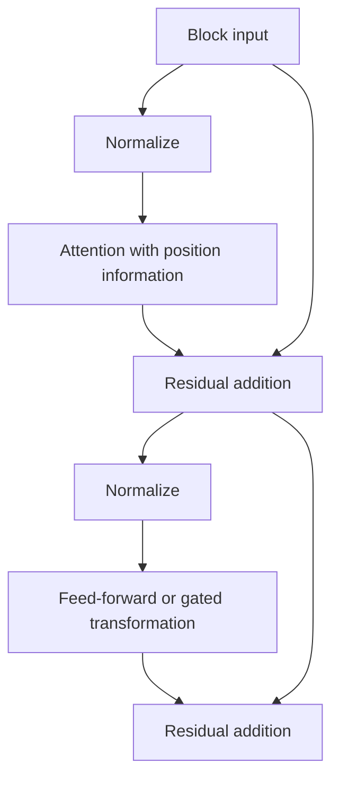

**Worked examples:** a 90-degree rotation takes `(1, 0)` to `(0, 1)`; rotation preserves magnitude but changes alignment with another vector. A linear-bias slope of 0.25 subtracts 0.75 from the attention score for a key three positions away. Normalizing `[3, 4]` by its root mean square divides by approximately 3.536, not by its mean of 3.5.

**Build from start to finish:** run `modern_lab.py components`. It trains a learned-position baseline and five single-change variants: rotary positions, linear biases, root mean square normalization, query-key normalization, and a Swish gate. Each starts from random parameters using the same seed, sentence split and update count. Differently shaped architectures consume random numbers differently: the same seed does not make every shared tensor identical. Parameter counts and training durations are reported. The last gated model is saved, reloaded, and exposed to new-input prediction.

**Assessment and ablation:** explain each transformation in a worked two-coordinate example; inspect held-out loss and causality checks; compare 50 and 100 steps. Do not claim that one seed proves a component universally better. Add multiple seeds before choosing a production architecture.

**Deployment and monitoring:** preserve component configuration with the weights. Loading a rotary checkpoint into a learned-position model is not a valid shortcut. Monitor non-finite values, gradient norms, context-length failures, validation loss and runtime. Establish rollback to the baseline if the change violates the quality or latency gate.

## expert-routing | Route tokens and account for expert costs

**Tag: Runnable implementation lab.** Scope: a dense versus four-expert language-model comparison. Use case: studying conditional computation before planning a larger service.

A mixture of experts has a router and several learned transformations. In this build the router computes probabilities for four experts, chooses one per token, runs the selected expert, and weights its output by the selected probability. All expert weights remain stored. Experts are not automatically named specialists such as a lawyer or programmer; their roles emerge from training and routing.

**Algorithm:** compute router logits; apply softmax; choose the highest-probability expert; group selected tokens; execute each used expert; restore token order; combine with the residual stream. Add a small balancing objective to discourage concentrating every token on the same expert. Production systems also need capacity rules, distributed communication, and overflow behavior, which are absent here.

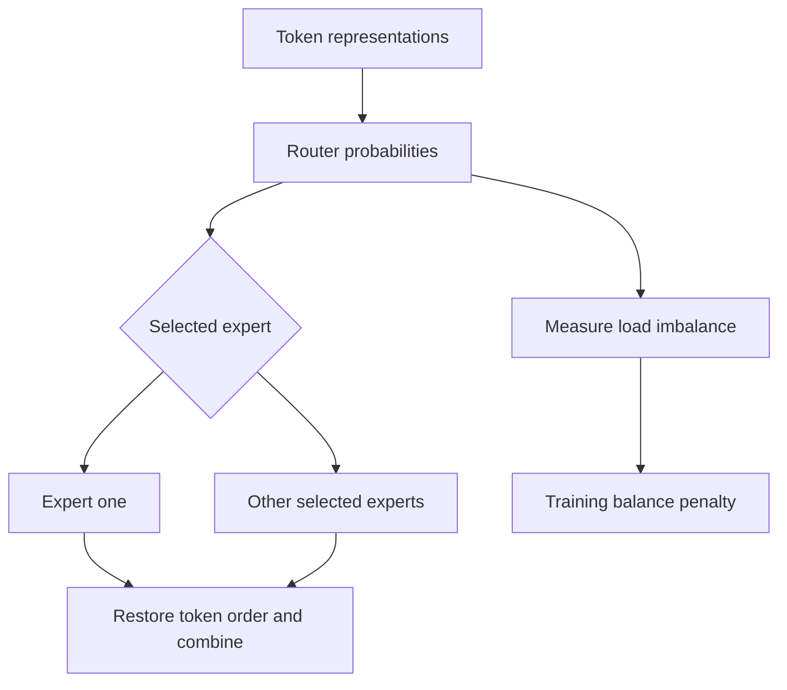

**Worked example:** probabilities `[0.6, 0.2, 0.1, 0.1]` choose the first expert. This top-one implementation multiplies its result by 0.6; it does not renormalize the selected weight to one. If all 32 tokens choose that expert, the others receive no direct task gradient on that batch. The balancing term can still push router probabilities toward better utilization.

**Build from start to finish:** run `modern_lab.py experts`. Both variants use the event-note corpus and matching update counts. Inspect total parameters, held-out loss, and per-layer routing counts. Save all experts and router weights, reload the expert model, and predict a new prefix. The comparison intentionally adds total expert capacity; it is not a parameter-matched dense/sparse scientific experiment.

**Change one variable:** set the `balance` argument in the training helper to zero for an editor experiment and preserve the same seed. Measure routing collapse and quality, rather than assuming more even routing is always better. **Assessment:** explain total versus activated parameters, calculate token fractions, and identify which production costs the local run omits.

**Deployment and monitoring:** track per-expert utilization, overload, latency and quality by input group. A large model can fit its activated computation budget but still exceed weight-storage capacity. Rent cloud hardware only after measuring all stored parameters, optimizer state, activations and expected cache; do not estimate memory from activated parameters alone.

## latent-depth | Explore latent caches and attention across depth

**Tag: Runnable implementation lab.** Scope: simplified research mechanisms. The algorithms below are not replicas of DeepSeek Multi-head Latent Attention or Kimi Attention Residuals.

Two different axes are involved. **Multi-head latent attention** compresses representations used for key/value attention storage. **Attention Residuals** changes how earlier layer outputs contribute across network depth. The slide's attention bucket combines these related but distinct ideas.

**Latent-cache algorithm:** project each token into an eight-number latent vector; cache that vector; reconstruct keys and values; perform causal attention. At width 32 and four heads of eight numbers, ordinary keys plus values store 64 numbers per token per layer. The teaching latent cache stores eight, an eightfold reduction in that cache tensor. Reconstruction work, model parameters and temporary full keys/values still exist. The implementation deliberately reconstructs the whole prefix; it does not implement the absorbed projections or decoupled rotary design of DeepSeek.

**Depth-mixture algorithm:** retain the input and earlier block outputs at the same token position; score each representation using a learned query and normalized features; softmax over depth; combine; apply the next Transformer block. This illustrates content-dependent depth mixing, not the paper's complete sublayer formulation or its block-memory optimization.

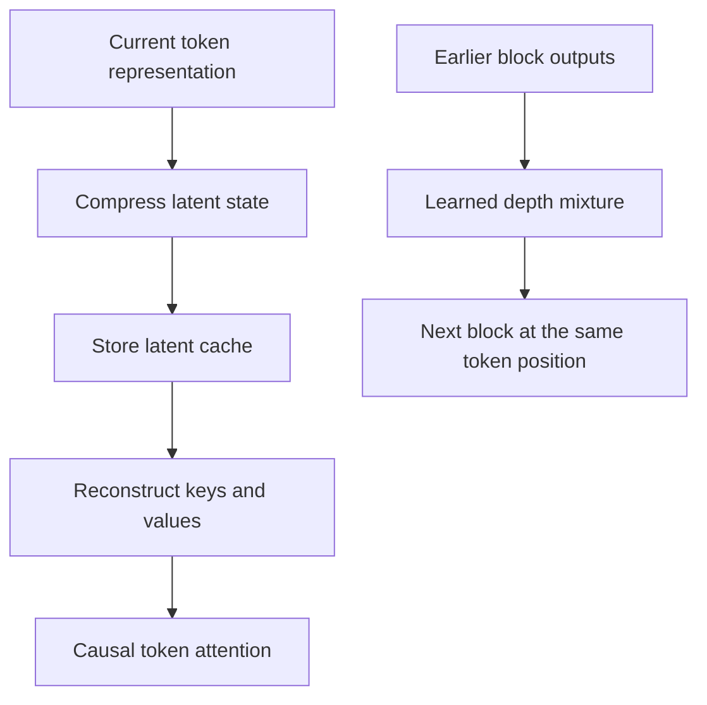

**Build from start to finish:** `modern_lab.py research` trains the ordinary baseline, latent-cache variant, and depth-mixture variant on the event sentences. Compare cache bytes, model size, loss and cached/full equivalence. All variant checkpoints are saved; the final depth-mixture model is reloaded and accepts a new text prefix. Read the corresponding landmark references before claiming a paper reproduction.

**Concept exercise:** draw sequence position horizontally and network depth vertically. Mark which axis each mechanism mixes. Then explain why smaller persistent cache storage can coexist with expensive temporary computations.

**Assessment:** report the eightfold theoretical cache ratio and measured value; identify at least three omitted features of the research models; design a controlled larger experiment. **Deployment:** keep these variants experimental, monitor quality and allocation peaks, and preserve a conventional baseline. No speedup or production recommendation follows from this tiny exercise.

## adaptation-comparison | Compare full tuning and small parameter updates

**Tag: Runnable implementation lab.** Scope: pretrain a tiny model, then adapt a support-ticket response task in three ways.

**Supervised fine-tuning** uses input/desired-response examples. **Parameter-efficient fine-tuning** describes changing relatively few parameters. **Low-rank adaptation** freezes base transformations and learns a small matrix update. These are compatible descriptions of one run. **Quantized low-rank adaptation** combines a quantized frozen base with trainable adapters; the next lesson separates the local teaching approximation from the genuine NormalFloat4 workflow.

For a frozen matrix `W`, the local adapter computes `Wx + B(Ax)` with rank four. The update begins at zero because `B` starts at zero. For a 32-by-32 matrix, the full matrix has 1,024 numbers; rank-four matrices contain 128 + 128 = 256 trainable numbers. This is a trainable-parameter comparison, not a claim that total process memory falls by four.

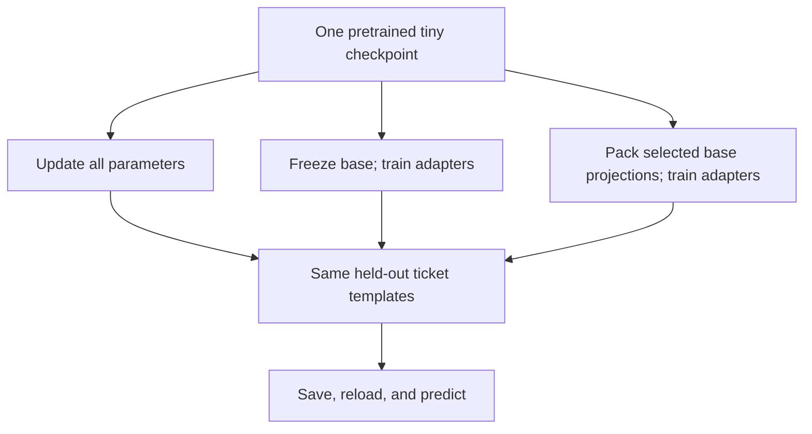

**Build from start to finish:** first train an event-note model from random weights. Copy that same checkpoint into all three branches. Fine-tune on twelve ticket templates mapping to environment, memory, or data labels. Validation and test each contain three different templates. Compute loss only on desired response tokens, so reproducing the prompt does not dominate the objective. Record generated labels, held-out loss, trainable parameters, state bytes, training time, and frozen-buffer integrity. Save every branch; the packed branch is also exported for browser inference.

**The four-bit boundary:** the local code packs two integer codes per byte and stores row scales. It quantizes only selected query/output projections and the vocabulary head. Other frozen parameters remain full precision. Computation unpacks to floating point. This is a real packed-storage/adaptation exercise, but **not** the paper's NormalFloat4 quantizer, whole-model QLoRA, or an optimized low-bit kernel. It must never be presented as measured GPU QLoRA performance.

**Budget comparison:** compare `--steps 75` and `--steps 150`. This option changes both the base-pretraining budget and each method’s adaptation budget, so it is not an isolated adaptation ablation. Within each run, all three methods branch from the same pretrained base. For an isolated adaptation study, save and reuse one identical base while varying only adaptation updates. Check whether lower response loss produces better actual labels on held-out templates. **Assessment:** derive the parameter counts; identify the bytes in scales and remaining full-precision tensors; explain why adapter-only deployment still needs the matching base.

**Deployment and monitoring:** save tokenizer rules, configuration, base identity, adapter mode and labels with the artifact. Reject inputs outside the contract. Track per-class mistakes, format failures and latency. Three held-out examples cannot establish generalization; use independently collected real tickets and review before deploying. Roll back to the matched baseline if adaptation damages required behavior.

## quantized-cloud | Plan the genuine NormalFloat4 extension

**Tag: Concept.** Includes a hardware-specific implementation file, `qlora_gpu.py`, whose graphics-processor training path is not validated in the CPU release environment. The status is explicit so executable source is not confused with verified hardware execution.

The QLoRA paper combines four-bit NormalFloat quantization, double quantization, and memory-management techniques with low-rank adapters. NormalFloat4 uses a nonuniform codebook designed for a normally distributed weight population; it is not the equally spaced signed-integer quantizer in the local lesson. Double quantization compresses quantization constants. Paged optimizers are another mechanism; the provided extension uses ordinary AdamW and does not claim to reproduce every paper component.

**Build from start to finish:** measure your local workload first. If you want to exercise the actual quantization backend, choose a compatible graphics processor, use an isolated environment, load the pinned small instruction checkpoint with NormalFloat4, prepare it for low-bit training, attach adapters, train on the ticket training split, evaluate validation loss, save the adapter, reload it against the exact base revision, and compare logits. Record peak allocated graphics memory and total elapsed cost. See [the cloud procedure](#ref/qlora-cloud) for commands, memory checks and cleanup.

**Worked resource estimate:** four billion four-bit weights contain approximately two billion bytes before scales and unquantized tensors. That does not imply a two-gigabyte training requirement. Activations, gradients for trainable parameters, optimizer state, temporary dequantization buffers, caching and runtime allocations must also fit. The extension intentionally begins with a much smaller model.

**Exercise:** prepare a cost sheet with compute hours, price per hour, retained storage, transfer and a maximum spend. Explain how you will preserve artifacts before destroying the instance. Compare a stopped instance with a destroyed instance using the provider's current billing documentation.

**Assessment:** distinguish uniform integer quantization, NormalFloat4, double quantization and adapter rank. Explain which part of the workflow was executed and which remains a plan. A successful import or CPU rejection is not a validated graphics-processor training run.

**Production gaps:** backend/hardware compatibility, precision stability, larger evaluations, licensing, data access and service behavior need separate evidence. Keep cloud-only packages separate from the working Windows environment. No rental is needed for the rest of this local track.

## preference-learning | Learn from preferred and rejected responses

**Tag: Runnable implementation lab.** Scope: direct preference optimization on original synthetic response pairs. Use case: steering a support assistant toward useful ticket labels instead of an unhelpful unknown response.

Start with a supervised checkpoint. For each prompt, provide a preferred and a rejected response. **Direct preference optimization** increases the policy's relative preference for the preferred response compared with a frozen reference policy. Standard offline direct preference optimization does not require a separately trained reward model or fresh rollouts during each update.

**Algorithm:** compute summed response-token log probabilities for the preferred and rejected responses under the policy; compute the same under the frozen reference; subtract the reference log-probability difference; multiply by beta; minimize negative log sigmoid. Prompt tokens are masked out. The implementation retains sequence sums rather than silently replacing them with a length average.

**Worked example:** policy log probabilities are -4 and -6, while reference values are -5 and -6. The policy preference margin is two, the reference margin is one, and the difference is one. At beta 0.1, the loss is `-log(sigmoid(0.1))`, approximately 0.644. At identical policy and reference parameters the initial loss is about 0.693. Loss is an optimization signal, not a human satisfaction percentage.

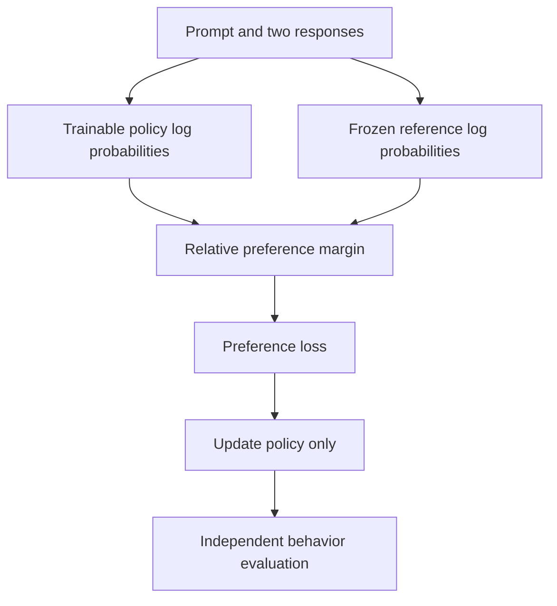

**Build from start to finish:** the command first trains the supervised ticket model, freezes a copy, builds training pairs, and optimizes preferences. Validation uses different templates. Reports include before/after held-out margins, preference win rate, held-out response loss, and a hash check that reference weights did not change. The policy is saved and reloaded for new-input generation.

**Change one variable:** compare beta 0.1 and 0.5 with otherwise matched settings. Do not interpret beta as a simple learning-rate knob; its role comes from the preference objective and reference constraint. Inspect actual generations as well as likelihood margins. **Assessment:** calculate the example loss, explain why the reference stays fixed, and propose a test for regressions on normal ticket routing.

**Deployment and monitoring:** use blinded held-out comparisons, accuracy and format checks, and a record of preference sources. Synthetic label-versus-unknown pairs are not broad human preferences. Preserve the supervised checkpoint so you can roll back if preference learning increases style scores while reducing usefulness or correctness.

## reward-learning | Build and audit a learned reward model

**Tag: Runnable implementation lab.** Scope: a small pairwise style scorer, not a factuality verifier or a complete human-feedback training system.

**Reinforcement learning from human feedback** uses human judgments to guide reward-based policy learning. A **reward model** can learn to score responses from comparisons. The scorer is a separate model with its own errors. A preference-trained language model, a reward scorer, and a judge are related concepts but not identical objects.

This exercise uses four author-written pairs of helpful versus dismissive support responses and two held-out pairs. Characters become embeddings; mean pooling forms a response representation; a small nonlinear network produces one score. The loss is `-log(sigmoid(score_preferred - score_rejected))`.

**Worked example:** scores 1.2 and 0.2 produce a margin of one and loss about 0.313. Adding ten to both scores changes neither the margin nor the loss. Therefore the raw score has no absolute probability interpretation. Repeating a sentence can leave a mean-pooled representation almost unchanged.

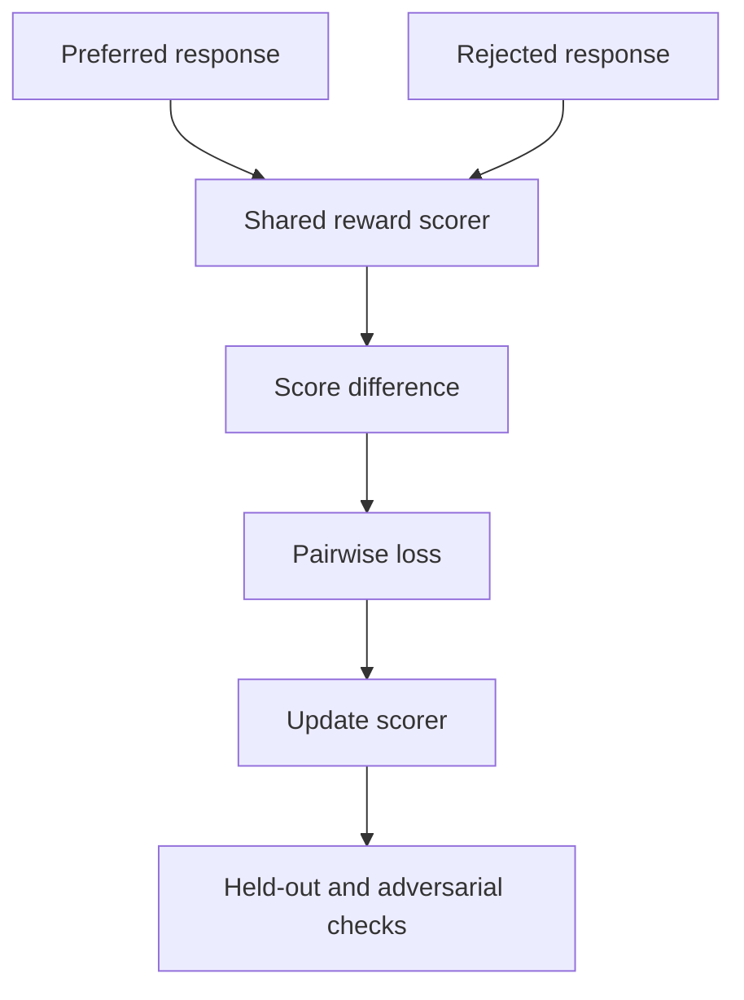

**Evaluation fixtures:** four authored response pairs train the scorer; two separate pairs are used for validation and another two for test. The report and data card identify the selected pair IDs. These are style-preference teaching fixtures, not human ratings or factuality labels.

**Build from start to finish:** train the scorer, evaluate held-out pair ordering, test a repeated response and an unsupported numerical claim, save the weights, reload them, and score edited text in the browser. These are author-specified teaching labels, not results from a human-participant study. The model does not receive a question or evidence and cannot verify a response's factual relation to them.

**Change one variable:** alter one training preference to favor a dismissive answer and rerun in a new directory. Inspect sensitivity to labels and wording. **Assessment:** explain score-offset invariance, show a misleading high score, and design a held-out audit that distinguishes tone from correctness.

**Deployment and monitoring:** never treat this style scorer as an automatic production approval gate. A useful scorer needs representative prompts, consistent rubrics, multiple annotators where appropriate, disagreement analysis, and independent outcome checks. Monitor reward inflation, repetition, length bias and distribution changes. Keep the old scorer and preference dataset version for rollback.

## policy-gradient | From grid-world actions to generated tokens

**Tag: Runnable implementation lab.** Scope: a constrained two-digit arithmetic language policy with actual gradient updates. Prerequisite: [the grid-world reinforcement learner](#lesson/reinforcement) and [reward models](#lesson/reward-learning).

In a language model, the state is a prompt plus the generated prefix; an action is a token; the policy is a distribution over next tokens. A terminal reward can judge the completed response. **Reinforcement learning with verifiable rewards** uses a checkable outcome, such as arithmetic equality. It describes the reward source, not one specific optimizer.

Our prompts use single-digit operands, such as `3+4=`. Responses contain exactly two decimal digits, such as `07`. Generation is constrained to digits; this is much easier and narrower than unrestricted reasoning. Operand pairs are split into training, validation and test. The same simulator rule exists in every split.

**Algorithm:** warm-start a tiny model with supervised examples; sample two-digit responses; compare them with the arithmetic verifier; subtract a reward baseline to form advantages; increase log probability for above-baseline responses; add entropy and reference-divergence regularization; evaluate unseen operand pairs with an independent exact-match check.

**Worked example:** sampled responses earn rewards `[1, 0, 0, 1]`. Their mean is 0.5, giving advantages `[0.5, -0.5, -0.5, 0.5]`. A positive advantage encourages a sampled response; a negative advantage discourages it. The training objective sums the log probabilities of both generated digits.

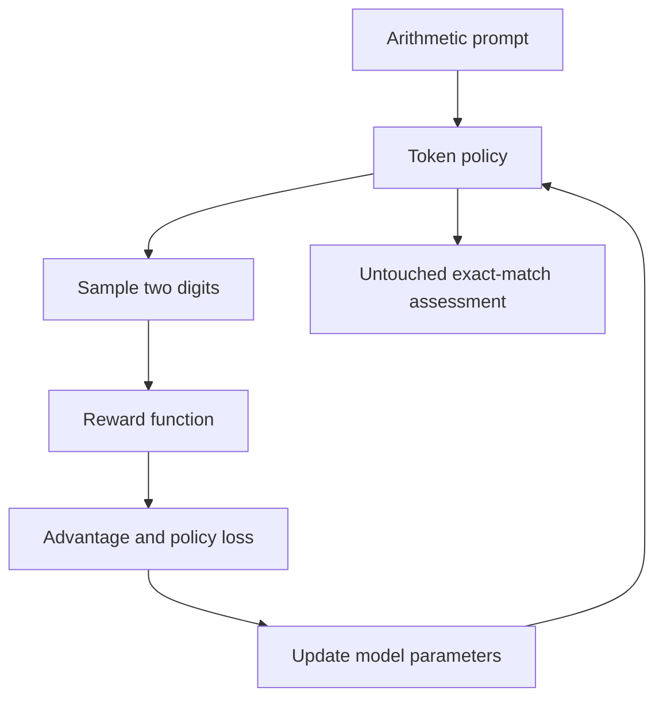

**On-policy update:** REINFORCE takes one optimizer step per sampled rollout, then draws fresh responses. The clipped methods in the next lesson use their declared repeated surrogate updates.

**Build from start to finish:** the normal command uses exact arithmetic reward. The second command rewards any answer starting with zero, including incorrect answers. Both report before/after held-out arithmetic accuracy and training reward separately. The model saves and reloads, and browser prediction accepts a new prompt such as `8+9=`.

**Assessment:** compare correct and flawed reward experiments. A reward curve can improve without improving held-out correctness. A short run may not exhibit dramatic hacking; report the actual outcome rather than inventing an expected failure. Explain the warm-start cost and why this is not reinforcement learning entirely from random weights.

**Deployment and monitoring:** the use case is a teaching verifier-backed answer generator. Real workflows might verify software tests or structured calculations, but a verifier can be incomplete or exploitable. Measure independent task success, unsupported inputs, latency, policy drift and reward saturation. Roll back to the supervised checkpoint if the verified outcome degrades.

## policy-optimization | Compare clipped and group-relative updates

**Tag: Runnable implementation lab.** Scope: inspectable versions of policy-update mechanisms on the same constrained arithmetic task. These are not replacements for production distributed training libraries.

| Method | Expanded name | Teaching implementation |
|---|---|---|
| PPO | Proximal policy optimization | Token likelihood ratios, clipping, and a learned prompt-state value baseline |
| GRPO | Group relative policy optimization | Four responses per prompt, within-group standardized rewards, and token-level ratios |
| GSPO | Group sequence policy optimization | Same groups, but a length-normalized sequence importance ratio and sequence-level clipping |

**Shared algorithm:** collect a rollout under the old policy; keep its sampled log probabilities fixed; compute advantages; perform two updates on that rollout; repeat with fresh samples. A frozen reference provides an approximate sampled divergence penalty. This reference is not the old rollout policy: the old policy changes between rollouts, while the reference stays fixed.

**PPO scope:** this tiny implementation predicts terminal return from the prompt and uses that baseline for both digits. It does not implement a full value function for every generated prefix, generalized advantage estimation, or all production PPO stabilizers. It is a clipping-and-critic demonstration. The group implementations use terminal reward and fixed-length responses, with no separate critic.

**Worked ratios:** if old token probability is 0.2 and new is 0.3, the ratio is 1.5. With positive advantage one and a clipping interval `[0.8, 1.2]`, the clipped surrogate uses 1.2. For sequence ratios 1.5 and 0.8, the length-normalized sequence ratio is `sqrt(1.5 × 0.8)`, about 1.095. It is not simply the unnormalized product. If every response in a group earns the same reward, this implementation's normalized reward advantages are zero.

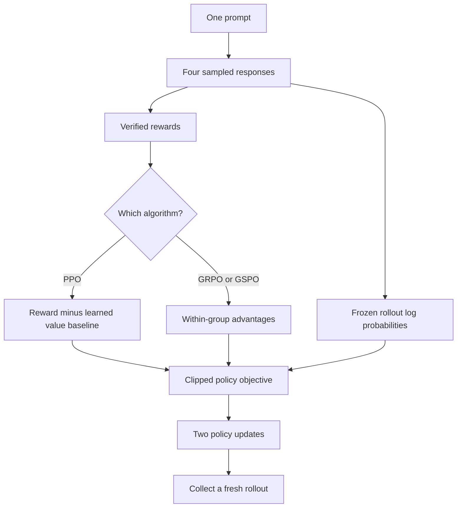

**Build from start to finish:** run all three commands with the same seed and update budget. Each repeats the same supervised warm start, reports independent held-out accuracy before and after, preserves training rewards and losses, exports its checkpoint and supports new arithmetic input. Compare several seeds before drawing conclusions. Equal update counts do not imply equal wall-clock cost.

**Change one variable:** change beta while preserving algorithm, data and seed, or compare the exact versus flawed reward. **Assessment:** calculate both ratios, explain why clipping is not a hard guarantee on parameter movement, separate the reference model from the rollout policy, and identify a zero-variance group in the report.

**Production planning:** longer rollouts multiply generation cost; actor, reference and critic copies can increase memory; reward evaluation can become the bottleneck. Record all models and sampling budgets in a cloud estimate. Preserve the supervised checkpoint and independently assess task quality before any deployment.

## benchmark-literacy | Choose a benchmark that answers your question

**Tag: Concept.** Activity: build a benchmark card and an executable evaluation plan. Prerequisite: independent data splits and [the baseline lesson](#lesson/baseline).

| Benchmark | Expanded name | Measures | Important limitation |
|---|---|---|---|
| AIME | American Invitational Mathematics Examination | Competition mathematics | Exam year, answer extraction and sampling budget matter |
| HLE | Humanity's Last Exam | Difficult academic questions | Dataset versions and evaluation protocol matter; not every workplace task |
| MMLU | Massive Multitask Language Understanding | Broad subject knowledge and problem solving | Multiple-choice success does not demonstrate reliable tool use |
| SWE-bench | Software-engineering benchmark | Resolving repository issues | Agent tools, environment, test harness and benchmark variant affect results |
| GPQA | Graduate-Level Google-Proof Question Answering | Expert-written science questions | Expert difficulty does not make it a universal measure of usefulness |

Names identify particular datasets and protocols. The lab's synthetic arithmetic suite is none of these benchmarks. The original versions and newer variants must not be merged into one score. Read the primary sources in [landmark research](#ref/research-landmarks).

**Worked comparison:** system A solves 7 of 10 selected tasks in one attempt; system B solves 9 of 10 after 32 sampled attempts and external tools. The numbers cannot be treated as a controlled head-to-head comparison. Both the candidate budget and tool access changed. A small handpicked subset is not a full-suite score.

**Algorithm for choosing:** define the product failure; choose a dataset whose task resembles it; inspect rights and access requirements; freeze version and split; document prompts and tools; implement scoring; retain raw outputs; measure uncertainty; inspect failure categories and contamination risk. Data used for adaptation must not quietly reappear in final evaluation.

**Build from start to finish:** for a code-repair assistant, start with a tiny repository you own and independently written issue tests. Specify the allowed files, available tools, time and token limits, and success criterion before generating patches. Run generated code only in an appropriately isolated environment. Then plan an optional official SWE-bench subset using its documented harness; record the exact variant and task identifiers. The local curriculum does not download, execute, or claim to pass that external benchmark.

**Concept assessment:** prepare a benchmark card with dataset version, task IDs, license/access terms, model revision, prompts, seed, decoding settings, tools, sample count, scoring script, cost and known overlap risks. Explain one failure that a high aggregate score hides. Publish only the scope actually executed.

**Monitoring:** after deployment, maintain a separate representative regression set and collect reviewed failures. Keep external benchmark results as one evidence source alongside task-specific quality, latency, cost, and user outcomes.

## evaluation-engineering | Build a reproducible evaluation harness

**Tag: Runnable implementation lab.** Scope: original arithmetic mini-suite with raw samples and uncertainty. It is not a named public benchmark result.

**Algorithm:** train using the training split; freeze the evaluation protocol; generate eight stochastic candidates per held-out prompt under a digit-only sampler; run the exact arithmetic verifier; retain every output; compute per-problem statistics; aggregate; report greedy exact match separately. Test mode is available after settings have been selected using validation.

**Pass at k** asks whether at least one of k sampled candidates is correct. Given n collected samples with c correct, the common estimator is `1 - choose(n-c, k) / choose(n, k)`. It is defined here only for `1 <= k <= n`. With n=8, c=1, and k=4, it is 0.5. This does not mean a deployed system can identify the successful candidate without a verifier.

**Perplexity** is the exponential of mean negative log probability. It summarizes prediction surprise under a particular tokenizer and evaluation set. The byte-model loss uses the full 256-byte vocabulary, while the arithmetic generation sampler permits only digits. Report those distribution choices explicitly. Do not rank this value against a word-tokenized model's perplexity.

**Uncertainty:** a Wilson interval reports uncertainty around greedy problem-level accuracy. Repeated samples for one problem are not eight independent problem instances. The provided interval is not applied to pass-at-k or to a pooled collection of correlated samples.

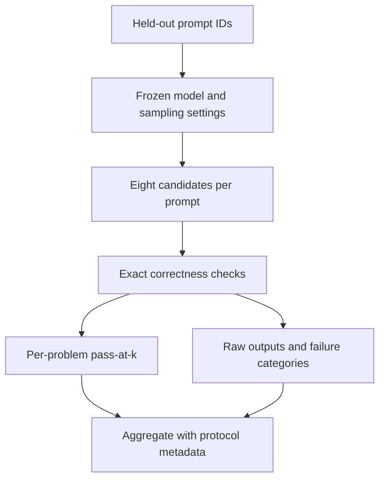

**Build from start to finish:** run the evaluation command, inspect `samples.json`, verify one score manually, and compare greedy exact match with mean pass at one and four. The trained model is saved and reloaded for new arithmetic prompts. Preserve the data card, versioned code, seed, sample budget and report with the checkpoint.

**Change one variable:** change the training step count before viewing final test results, keeping evaluation settings fixed. For a source exercise change samples from eight to sixteen and adjust k within bounds. Predict both the compute cost and estimation stability. **Assessment:** compute the one-correct-of-eight example, explain tokenizer compatibility, and identify why multiple guesses differ from first-attempt reliability.

**Deployment and monitoring:** define whether the real product gets one attempt or several, whether it has a reliable verifier, and what happens when all attempts fail. Log failures by task group and monitor calibration, latency and cost. Avoid repeatedly tuning against the final test.

## judge-audit | Calibrate judges and compare preferences

**Tag: Runnable implementation lab.** Scope: a transparent biased fixture plus a real pretrained local language-model judge. The real judge downloads the pinned small checkpoint on first use.

A **large language model as a judge** receives a task, candidate response or pair, and rubric, then returns an assessment. Its judgment is a measurement produced by another fallible model. Factual correctness, style, safety and usefulness are different rubric dimensions.

**Two modes:** fixture mode deliberately chooses the longer answer. It is a simulated judge, not a language model. Model mode prompts the existing small instruction model to choose exactly A or B based on factual correctness. Both receive six original cases twice, with answer order reversed. Author-specified answer keys are provided; there was no recruited human-rating study.

**Algorithm:** construct correct-concise versus wrong-verbose pairs; judge both orders; parse only exact A/B responses; record malformed outputs as invalid; measure agreement with the answer key and order-swap consistency; inspect raw judgments. Invalid output is not silently repaired into a successful judgment.

**Worked example:** the longer wrong answer can win in both orders. That judge is perfectly order-consistent and factually wrong. Therefore order consistency alone does not establish quality. Agreement and valid-format rate measure different failures.

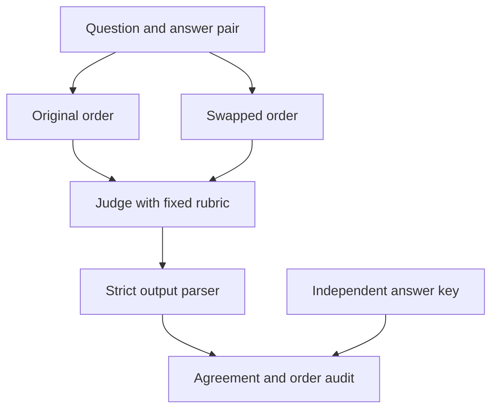

**Elo** is a comparative rating system named after its inventor, not an acronym. For equal ratings, the expected score is 0.5. With an update factor of 16, one win adds eight points to the winner and subtracts eight from the loser. The exercise updates two ratings from valid judge choices. Wrong judgments can produce a confidently misleading ranking. Ratings depend on opponents, presentation order, update rules and the population of comparisons.

**Case banks:** validation and test contain six different authored questions each. The selected bank appears in both answer orders, producing twelve presentations of six cases. IDs and questions are saved with the raw judgments; swapped orders are not independent new examples.

**Build from start to finish:** run fixture mode first, then actual-model mode. Inspect `judge-audit.png`, raw outputs, invalid responses, agreement and Elo. This lab freezes the judge and saves evaluation artifacts rather than training a new checkpoint. For a product, add blinded human review on representative examples and measure disagreement before using a judge to gate releases.

**Assessment:** explain why the biased fixture can be valid and consistent but wrong; identify a malformed actual judge output; propose controls for order, length and self-preference bias. **Monitoring:** version the judge, rubric and prompt; retest when any changes; retain a manual review route and previous scoring configuration.

## streaming-service | Serve a model and measure when tokens arrive

**Tag: Runnable implementation lab.** Scope: real local HTTP streaming, measured from a client. HTTP means Hypertext Transfer Protocol. This is a single-process teaching service, not a production endpoint.

Two phases matter: **prefill** processes the prompt; **decode** generates subsequent tokens. A key-value cache avoids repeating some earlier computation. A longer prompt can increase prefill work even when output length is unchanged. Optimized batching and kernels can change performance; the Python reference implementation measures only its own behavior.

**Time to first token** is elapsed time from request start to the first observed token. **Time per output token** here means `(last_token_time - first_token_time) / (output_tokens - 1)`. A one-token response has no subsequent-token interval, so the value is absent rather than zero. **Inter-token latency** is the gap between successive observed tokens. The report includes its 95th percentile. Whole-request duration includes overhead after the last token as well.

**Worked example:** first token at 0.20 seconds, last token at 0.50 seconds, and four output tokens gives 0.10 seconds per subsequent token. Dividing 0.50 by four instead gives a different quantity, 0.125 seconds per token including initial wait. Always name the measurement boundary.

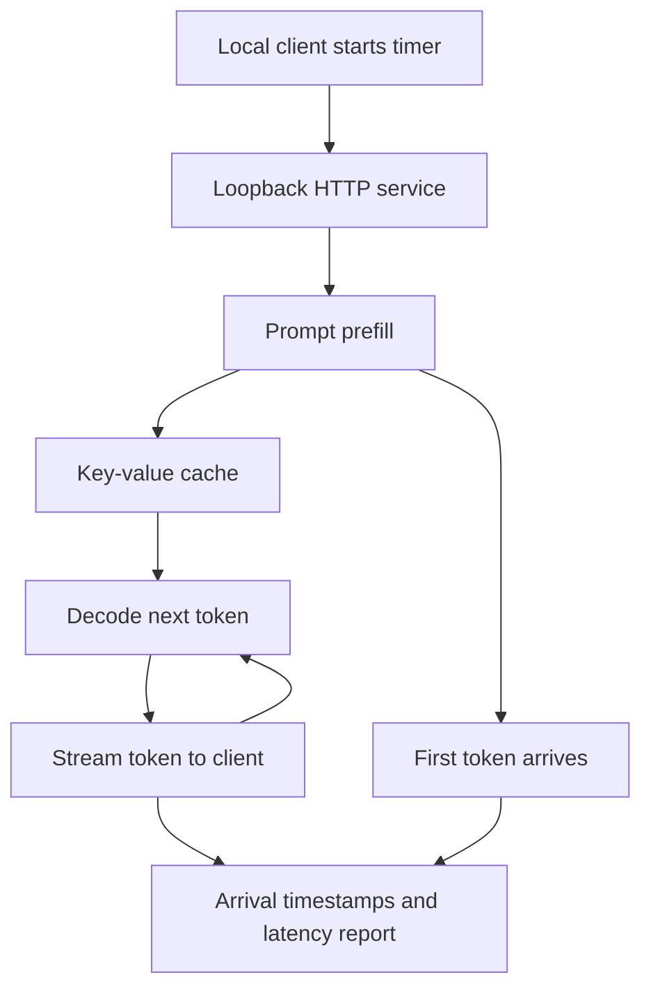

**Evidence boundary:** this is a fixed local systems-timing probe. Its twelve requests do not form a validation/test quality split, and `--split` is not applicable. The data card names training data separately from the two timing prompts.

**Build from start to finish:** the serving experiment trains and saves a small grouped-query model, reload-checks it, starts a private loopback service, sends real streaming requests, and shuts the service down. It tests two prompt lengths with cached and uncached generation and three repeats per condition. Inspect the actual arrival curves in `latency.png`. The service sends token identifiers as newline-delimited JavaScript Object Notation; the client timestamps each line.

For manual use, run `python modern_serving.py --model-dir outputs/your-serving-run` from the `lab/` directory using your environment's Python. It prints a temporary local request token and binds port 8766. The website remains on 8765. Keep the token local and stop the process with Control+C. The source contains `request_tokens` for a sample client.

**Assessment:** calculate the numerical example, explain warm versus cold starts, compare cached outputs, and report variation without claiming a universal speedup. Operating-system scheduling and HTTP buffering can affect observations. This experiment does not test concurrent users or internet transport.

**Deployment and monitoring:** measure peak memory, p50/p95 latency across enough requests, throughput at stated concurrency, timeouts and quality under load. Add authentication, resource limits, logging, isolation and a deployment review before exposing any service beyond your machine. Retain the previous model and serving configuration for rollback.

## modern-capstone | Defend the complete engineering decision

**Tag: Concept.** Assessment project using the tested implementations above. Do not mark complete solely because a process exited successfully.

Choose one product: an offline operations-note completer, a ticket-routing assistant, or a verifier-backed arithmetic demonstrator. Write the intended user, input contract, output contract, success criterion, unacceptable errors and resource limits. The arithmetic demonstration is educational; it does not replace a deterministic calculator.

**Build from start to finish:** gather permitted data or explicitly label synthetic data; preserve document/template/group splits; implement a baseline; choose a model and tokenizer; train from scratch or adapt a checkpoint; record the complete training cost; compare one architecture or training change; freeze settings; run the independent test once; inspect failures; save weights, configuration and data identity; reload and predict new inputs; serve locally; measure latency and memory; write monitoring and rollback instructions.

**Required evidence:** model and data cards; source version; environment; seeds; exact commands; training/validation/test split IDs; raw predictions; saved/reloaded equivalence; quality and uncertainty; memory accounting; timing boundaries; known failed examples; and a reproduction procedure. Include three concise research annotations: the problem each paper addressed, the idea you used, and the part you did not reproduce.

**Compare honestly:** a model with more experts has more stored capacity; a quantized selected projection does not make the whole model four-bit; pass at four spends more generation than one attempt; a learned judge can be biased; and a verifier can reward a loophole. An improvement in one measurement can trade away another.

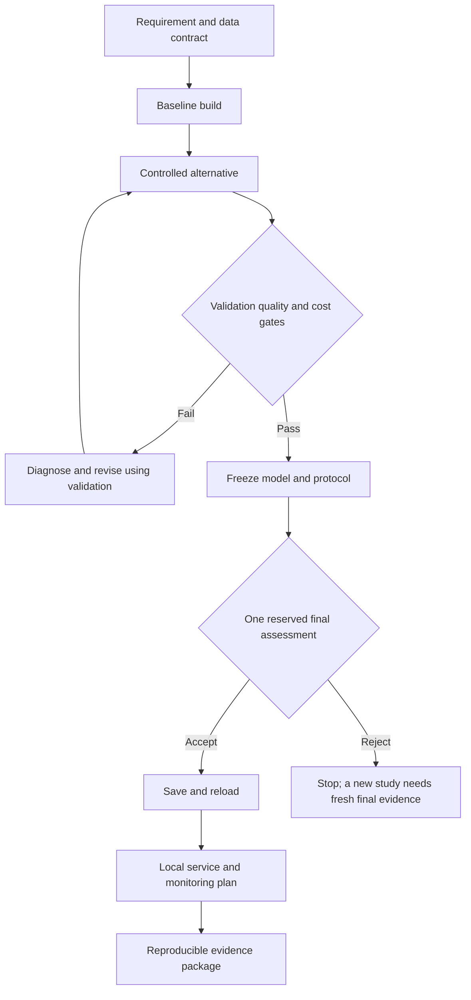

**Assessment rubric:** an engineer should be able to reproduce your result, identify the evidence boundary, inspect one failed example, and explain the next data or system investment. Production readiness requires representative real data, broader reliability and security assessment, and operational ownership beyond this classroom capstone. Keep the foundational machine-learning and retrieval paths available; a language model is one possible component, not the default solution to every problem.
