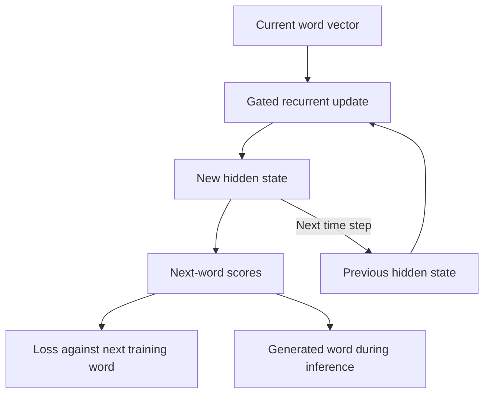
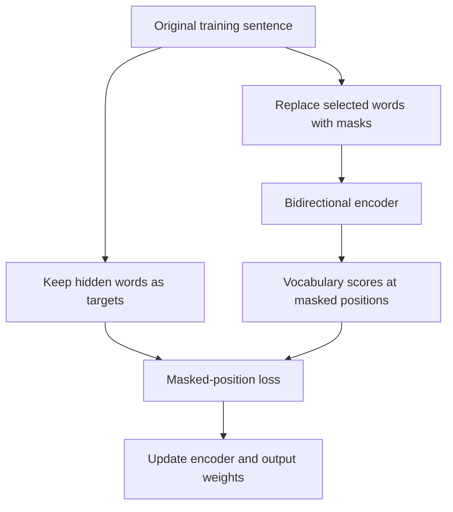
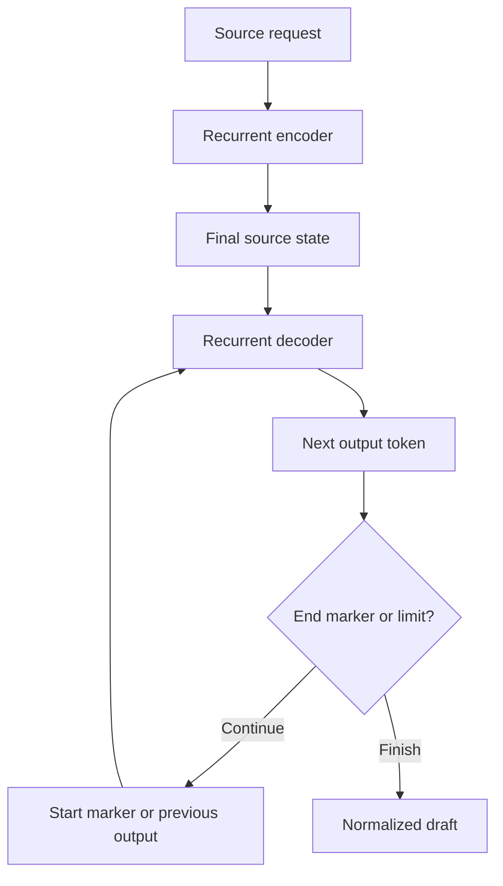

# Build neural models from random weights

These are small executable teaching models. They use PyTorch layers but no downloaded model weights. They are not replicas of a vendor foundation model. Each run writes its data split, weights, configuration, training plot, measured report, example input, and a verified prediction after reload.

## Recurrent language model from scratch

**Runnable implementation lab — Next-word prediction with a gated recurrent unit.** Real-world use case: a compact offline completer for a restricted operations vocabulary. The included corpus is synthetic; a production completer would require permitted representative text and an audit for memorized sensitive content.

### Concept and algorithm

A recurrent neural network keeps a numerical state and updates it for each input token. A **gated recurrent unit** uses learned gates to control how old information and candidate updates combine. The state is a compressed representation, not a literal transcript. Unlike full attention, this model does not reread every earlier token directly.

1. Map each word to a token identifier and then a learned vector.
2. Pass the current vector and previous hidden state through the gated recurrent update.
3. Project the new state into scores for every vocabulary entry.
4. During training, compare each position with the actual next token; ignore padded targets.
5. Backpropagate through the sequence and update trainable weights.
6. During generation, append the predicted word and continue until an end marker or length limit.



### Build from start to finish

Define success as lower held-out next-word loss than a uniform vocabulary predictor, plus inspectable completions and acceptable local latency. Create operations requests with actions, fictional service names, regions, and three paraphrase templates. Split complete action/service/region combinations before vocabulary fitting: 56 groups train, 20 validate, and 20 remain for final test. Paraphrases of the same combination stay together. The task tests novel combinations of familiar words, not unseen language or domains.

Fit the vocabulary only on training text. Reserve padding, start, end, unknown, and mask entries; the shared mask entry is unused by this causal model. Initialize the embedding, one recurrent layer, and output projection randomly. Train using cross-entropy on shifted token targets. Record loss before and after, perplexity, and the uniform baseline. Save the vocabulary and group split with the weights; reconstruct the architecture and verify identical outputs after reload.

In Practice, load a prefix such as `please restart amber`, change the service, and predict without retraining. The result is a text suggestion, not an executed command. Preserve the vocabulary, tokenization, output limit, and model version in a local prototype. Before real deployment, evaluate uncommon vocabulary, unsupported requests, sensitive completions, and distribution shift. Monitor failure rates and keep the previous artifact for rollback. No rented compute is required for this build.

```text
python neural_builds.py recurrent --steps 300 --output outputs/recurrent-NEW
python neural_builds.py recurrent --steps 100 --output outputs/recurrent-short-NEW
```

**Assessment:** predict the effect of fewer updates, compare measured perplexity and completions, identify an unknown token, and explain why training targets must be shifted. Perplexity from this word tokenizer cannot be directly ranked against the original byte-level Transformer. The saved prefix must contain at most ten words.

## Masked-token encoder from scratch

**Runnable implementation lab — Bidirectional masked-language pretraining.** Real-world use case: learn language representations for an eventual request classifier. This is a tiny masked-token encoder, not a faithful reimplementation of Bidirectional Encoder Representations from Transformers.

### Concept and algorithm

A bidirectional encoder can combine context on both sides of a position. It therefore cannot see the correct word at the position it is being asked to predict. We replace selected words with a literal `[MASK]` token and compute loss only at those positions.



### Build from start to finish

Define success as lower masked-token loss than a uniform predictor on held-out groups, and inspect candidate probabilities rather than only a top answer. Use the same synthetic operations corpus and grouped split as the recurrent build. Fit vocabulary on training rows. The randomly initialized network has token and position embeddings, two bidirectional Transformer layers, and a vocabulary head. Its attention can use later words; padding positions are excluded as attention keys.

For each training batch, hide at least one ordinary token per sentence and retain the original as its target. Train with cross-entropy only where targets exist. Evaluation uses a fixed mask pattern so different checkpoints face the same questions. Save weights, vocabulary, positional limits, split, and evaluation report; reconstruct and check predictions. Use the local saved-model interface with exactly one `[MASK]` token, such as `please restart amber in [MASK]`.

Some masks are intrinsically ambiguous. Without additional context, “please [MASK] amber in east” could contain several actions. A distribution over plausible alternatives is more informative than asserting there is one logically determined answer. Masked-token accuracy is not downstream intent-classification accuracy; the next transfer experiment measures the latter separately.

For deployment, expose only the supported fill-mask or adapted classification contract. This encoder is not a chat generator. Broader representations need larger permitted corpora, careful split design, unknown-word handling, evaluation across domains, drift monitoring, and rollback artifacts. The small build runs locally; no Vast.ai instance is required.

```text
python neural_builds.py encoder --steps 300 --output outputs/encoder-NEW
python neural_builds.py encoder --steps 100 --output outputs/encoder-short-NEW
```

**Assessment:** hide a word, state which surrounding positions the encoder may use, inspect its five leading candidates, and explain why leaving the original target visible would invalidate the exercise. Submit the loss comparison, probabilities, save/reload evidence, and one ambiguous case.

## Encoder–decoder model from scratch

**Runnable implementation lab — Normalize a request into a short output sequence.** Real-world use case: convert a constrained human request into a machine-readable draft. Example: `please backup cedar in south` becomes `backup cedar south`. The output is never executed. A deterministic parser is a sensible real-world baseline for such a narrow grammar; neural modeling here teaches sequence-to-sequence mechanics.

### Concept and algorithm

The encoder reads the source sequence into a state. The decoder generates a separate target sequence using that state and earlier output tokens. This implementation uses gated recurrent units for both components and deliberately omits attention. Encoder–decoder describes information flow; it does not require Transformers.



During training, **teacher forcing** supplies the actual preceding target word. The decoder predicts the following target word. During inference it must consume its own predictions. A low teacher-forced loss can coexist with poor generated sequences because earlier mistakes affect later generation.

### Build from start to finish

Define success as exact match of the generated draft to the target on held-out action/service/region combinations. Use permitted synthetic pairs, keep paraphrase groups together, and fit vocabulary on training rows. Store source and target tokenization, beginning/end markers, padding policy, and allowed output actions.

Initialize both recurrent networks, embeddings, and output projection randomly. Encode only the real source length, so padding does not become part of the final state. Train on shifted target sequences with padded targets ignored. Report teacher-forced loss and, separately, free-running generated exact match. The included copy-the-source baseline is intentionally weak; add a grammar parser before judging whether a neural model is useful for a real product.

Save and reconstruct the model, verify identical generated output on reload, and enter a new source in Practice. Examine every incorrect output. Keep this draft generator local; production requires syntax validation, independent authorization, rejection of unsupported requests, a human confirmation policy where needed, monitoring, and rollback. The teaching model neither validates operational safety nor executes actions. Start locally; measure a genuinely larger workload before considering Vast.ai.

```text
python neural_builds.py seq2seq --steps 400 --output outputs/sequence-NEW
python neural_builds.py seq2seq --steps 100 --output outputs/sequence-short-NEW
```

**Assessment:** trace one source and target with start/end markers; identify the shifted training pairs; compare short and longer runs; show a generated error; explain why teacher-forced loss cannot replace free-running evaluation. Submit the data contract, baseline, report, reload output, and deployment boundary.

## Compare pretraining with a fresh start

**Runnable implementation lab — An actual controlled transfer-learning comparison.** Real-world use case: choose how to train a classifier when only a few labeled requests are available. This build pretrains its own tiny encoder and then reuses it; no external pretrained checkpoint is required.

### Three branches, one downstream task

| Branch | Initial representation | What trains during classification? |
|---|---|---|
| Scratch | Fresh random encoder | Encoder and new classification head |
| Pretrained fine-tune | Encoder after masked-token pretraining | Encoder and the same initialized classification head |
| Pretrained frozen | The same pretrained encoder | Only the classification head |

The new head maps a pooled sentence representation to four action categories. Pooling here averages nonpadding token representations. This is a teaching representation choice, not a claim that averaging any encoder gives strong general-purpose embeddings.

### Build from start to finish

Define success as held-out intent accuracy relative to a training-majority baseline, while recording data and total compute. Generate and group-split the same fictional requests. Fit vocabulary on training rows only. Keep evaluation groups out of both pretraining and downstream fitting. Pretrain a randomly initialized masked encoder on training text without using action labels, then save that checkpoint.

Take four labeled training examples per class by default. All three branches see those same 16 examples, start with an identical classification head, and receive the same number of downstream optimizer steps. The fine-tuned and frozen branches share the same pretrained encoder. The random branch begins from the encoder state saved before pretraining. This isolates useful choices while explicitly accounting for the extra pretraining updates.

Measure classification accuracy for each branch and compare with the majority-label baseline. The code checks that every frozen encoder tensor remains unchanged. Save each branch plus the reusable pretrained encoder; the default saved-input interface reloads the pretrained fine-tuned classifier, whose role is stated in the report. Predict a new request, and inspect an out-of-domain request to see that this simple classifier still chooses a category without calibrated abstention.

A production classifier would need representative labels, uncertainty/rejection behavior, broader held-out data, monitoring, and a rollback checkpoint. Repeat seeds and label budgets before choosing an approach. This tiny exercise runs on a central processing unit; renting compute would add cost without being necessary.

```text
python neural_builds.py transfer --steps 300 --adapt-steps 80 --labels-per-class 4 --output outputs/transfer-NEW
python neural_builds.py transfer --steps 300 --adapt-steps 80 --labels-per-class 1 --output outputs/transfer-few-NEW
```

**Interpretation:** scratch may win on this simple grammar. Pretraining might learn features that do not help the target task, while a frozen representation may hide useful distinctions. The experiment is designed to measure these possibilities, not force a preferred answer. Equal downstream steps do not mean equal lifetime compute.

**Assessment:** report the three accuracies, labeled-data budget, pretraining and downstream steps, trainable parameters, frozen-weight check, reload prediction, and one failure. Explain what is pretrained relative to what, why an instruction-tuned model can still be pretrained, and when you would choose retrieval instead of updating weights.

Primary reading: [PyTorch gated recurrent unit](https://docs.pytorch.org/docs/stable/generated/torch.nn.GRU.html), [Transformer encoder layers](https://docs.pytorch.org/docs/stable/generated/torch.nn.TransformerEncoderLayer.html), [encoder pretraining research](https://arxiv.org/abs/1810.04805), and [transfer learning tutorial](https://docs.pytorch.org/tutorials/beginner/transfer_learning_tutorial.html). Architectures, data, and comparisons here are intentionally smaller teaching designs.
