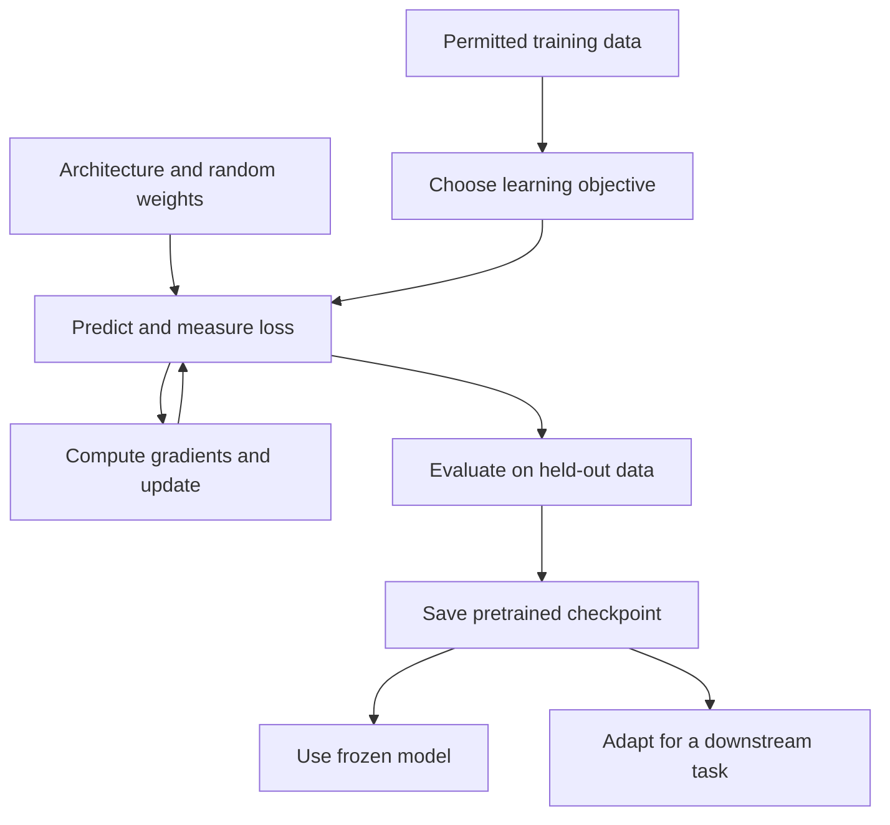
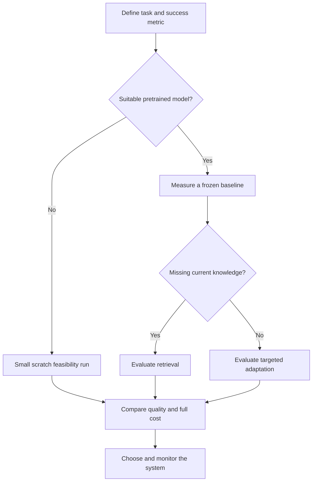

# Pretrained models versus building from scratch

**Concept — Choose what to reuse, what to learn, and how to prove the choice.** Then exercise the decision in [Compare pretraining with a fresh start](#lesson/transfer-compare). This chapter applies to image, language, and other neural models. The [deep learning workshop](#lesson/deep-network) explains the numerical learning loop.

## What a pretrained model actually contains

An **architecture** is the computation you design: layers, connections, dimensions, and information flow. **Parameters** are the numbers learned during training, such as a matrix of weights. A **checkpoint** saves learned parameter values and enough configuration to restore them. A **pretrained model** already has learned parameters before your current use or training stage. It may have been trained by someone else, or by you in an earlier experiment.

For text, you usually also need the exact tokenizer, vocabulary, special-token definitions, and prompt format. Loading weights with a different tokenizer can change what every token identifier means. A useful package therefore includes more than a large weight file.

Think of an architecture as a worksheet with adjustable numbers. Random initialization fills the worksheet with small random values; pretraining adjusts those values using examples. Downloading a checkpoint gives you an already adjusted worksheet. It does not give you a reliable database of every original training document.

**Base and pretrained are not synonyms.** In this language-model context, a base checkpoint usually precedes instruction or preference post-training. An instruction-tuned assistant is also pretrained when you receive it. Pretraining need not use the next-token objective: masked-token prediction, image classification, reconstruction, and other objectives can supply an initial representation.

## Five different engineering choices

| Choice | Starting point | What changes? | Real-world example | Included exercise |
|---|---|---|---|---|
| Pretrained inference | Existing learned weights | Input, activations, and output; weights remain fixed | Run a local drafting assistant | Run your first model |
| Retrieval-augmented generation | Existing generator plus a document collection | Retrieved context and index; ordinary answering does not update generator weights | Answer questions from current operations notes | Retrieval pipeline workshop |
| Fine-tuning | Existing learned weights | Selected original weights or added adapters | Learn a support-triage output format | Teach with a small adapter; transfer comparison |
| Continued pretraining | Existing learned weights | Selected parameters learn from additional domain data | Adapt language representations to a specialized vocabulary | Concept design activity; not a separate production training implementation |
| Training from scratch | New architecture instance with random weights | Trainable parameters learn their initial useful behavior | Build a tiny recurrent word predictor or investigate a new architecture | Deep, recurrent, masked encoder, encoder–decoder, and original causal-model builds |

“From scratch” in these labs means **no pretrained model weights**. We still use PyTorch for tensor mathematics, automatic differentiation, and standard layers. Implementing matrix multiplication, a graphics-processor kernel, or an entire numerical library is a separate engineering exercise. The counted language model is trained from text counts rather than random neural weights.

## How pretraining creates a reusable model

1. Define a useful prediction task and a baseline. A language model may predict a following word; an image model may predict a category.
2. Obtain permitted data, remove sensitive material, and separate training, validation, and test groups before preprocessing. Near-duplicate documents or photos of the same subject can leak information across naive random splits.
3. Choose the representation. For language, define tokenization and fit a vocabulary using the permitted training split. For numerical data, fit scaling only on training examples.
4. Define the architecture and initialize its trainable values. Random does not mean arbitrary magnitude: initialization is chosen to keep computations well behaved.
5. Run a forward pass, measure a loss, calculate gradients, and take an optimizer step. Repeat with training examples.
6. Use validation to choose settings. After selection, evaluate on untouched test examples that did not drive those choices.
7. Save the model, configuration, preprocessing, revision, settings, and metrics. Reconstruct it in a new model instance and verify a prediction.
8. Reuse the checkpoint directly or adapt it for another objective. The first stage is now pretraining relative to the second.

A network starts without useful learned task knowledge, not without structure. Architecture and training data encode choices made by its engineers. A tiny training run demonstrates this process but does not produce the breadth of a general assistant.

## Understand the training target

For next-token prediction, the text supplies its own targets. With “please restart amber,” the input “please restart” has the next-word target “amber.” This is **self-supervised learning**: targets are constructed from the data rather than manually supplied for each prediction. For masked-token prediction, hide a word and predict the original. For supervised intent classification, supply a category such as “restart.”

If the correct token receives probability 0.1, its negative natural logarithm is approximately 2.303. If the probability rises to 0.8, the loss becomes approximately 0.223. A lower loss means better probability assignment under that objective. It does not establish factual accuracy or correct tool execution.

## Choose a route using evidence

Use a pretrained baseline when the checkpoint supports your inputs, output needs, license, and hardware. Consider adaptation when representative failures show a behavior or domain gap. Consider retrieval when answers must refer to a changing document collection. Consider scratch training for teaching, architecture research, unusual input representations, or a justified task/data/compute requirement. Retrieval and adaptation can also be combined.

**Cost comparison:** count pretraining, adaptation, data work, evaluation, serving, and maintenance separately. In the included transfer experiment, the pretrained branch gets 300 extra learning updates before both branches receive the same downstream examples and 80 adaptation updates. It would be misleading to call that equal total training compute. A frozen encoder still performs forward computation and occupies memory.

Start on the central processing unit. Every new build in this release is deliberately tiny and was executed locally. No Vast.ai rental is required. For an expanded experiment, first measure memory and elapsed time, then follow the existing [Vast.ai procedure](#lesson/cloud), set a spending limit, save artifacts, and inspect remaining billable resources. Do not infer a production foundation-model budget from these tiny runs.

## Start-to-finish assessment: an operations assistant

Define the problem as mapping a permitted operations request to a small category set. Write the success criterion before choosing a model: category accuracy, unsupported-input behavior, and inference latency. Describe the input text contract, label definitions, training data rights, and document/group split. Compare a simple baseline, random initialization, pretrained fine-tuning, and a frozen representation. Preserve exactly the same downstream training examples and evaluation set across the neural branches.

Save and reload the selected model with its vocabulary and category order. Submit predictions for new requests and for out-of-domain text. Deploy the prototype only through the local input interface. Production would need broader data, authorization outside the model, calibration, drift monitoring, failure handling, and a versioned rollback artifact. A predicted action must not automatically become an executed operation.

**Evidence to submit:** your decision table, data/split contract, measured branch results, full compute accounting, one failure, saved-model prediction, and a reason to revisit the choice later. A lower score after pretraining is a valid finding. Do not tune away inconvenient results without reporting the changed conditions.

**Explanation checks:** Can you pretrain your own model? Yes. Does fine-tuning create a model with no prior training? No. Does retrieval train the generator during ordinary answering? No. Is deep learning limited to language models? No; the course's image, graph, and reconstruction networks also use neural representations.

## Primary reading

- [PyTorch transfer learning tutorial](https://docs.pytorch.org/tutorials/beginner/transfer_learning_tutorial.html): fine-tuning and frozen feature extraction.
- [Bidirectional Encoder Representations from Transformers](https://arxiv.org/abs/1810.04805): masked-language pretraining and downstream adaptation.
- [Automatic differentiation with PyTorch](https://docs.pytorch.org/tutorials/beginner/basics/autogradqs_tutorial.html): gradients and parameter updates.
