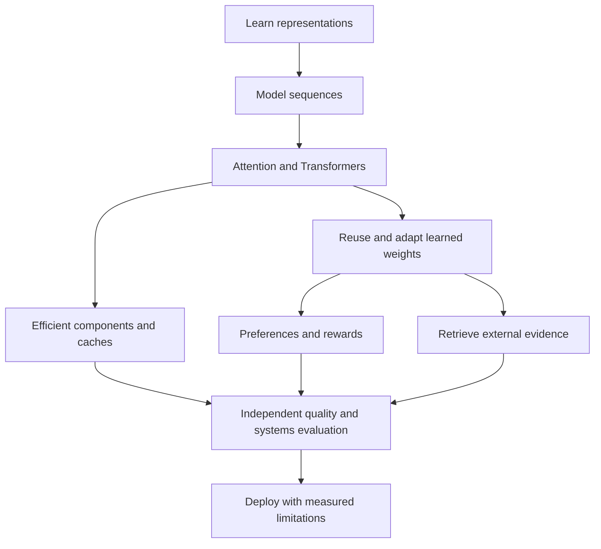

# Landmark research: ideas, evidence, and the path to today's models

Explore [The Transformer turning point](#lesson/transformer-world) for a 3D architecture, a numerical attention activity, and the history behind the 2017 paper.

**Tag: Concept and research-reading workshop.** This is a selected learning history, not a claim that these papers were the first or only contributions to each idea. Dates usually refer to the first public paper or preprint; conference and journal dates can differ. Research is cumulative and branching, not one uninterrupted product lineage.

For each source, read in this order: the problem; the main figure; one worked algorithm; the experimental setup; the limitations. Then connect it to an executable lesson. A teaching mechanism is not a reproduction of the paper's scale, dataset or results. The page links primary papers and official benchmark documentation; some publishers can require access or block automated fetching.

## Foundations that make learning possible

| Year and primary source | Contribution to understand | Super Lab connection and boundary |
|---|---|---|
| 1986 — Rumelhart, Hinton and Williams, [Learning representations by back-propagating errors](https://www.cs.toronto.edu/~hinton/absps/naturebp.pdf) | Propagate error derivatives through multilayer networks to learn internal representations. Backpropagation has earlier mathematical and computational antecedents. | [Deep learning](#lesson/deep-network): trace a gradient and train a nonlinear classifier. Automatic differentiation implements the calculation; it does not choose a good dataset. |
| 1997 — Hochreiter and Schmidhuber, [Long Short-Term Memory](https://doi.org/10.1162/neco.1997.9.8.1735) | Gated recurrent memory addresses learning over extended sequences. | [Recurrent language model](#lesson/scratch-recurrent): compare state and context. The included simple recurrent build is not a long short-term memory implementation. |
| 2001 — Breiman, [Random Forests](https://doi.org/10.1023/A:1010933404324) | Combine randomized trees to improve prediction and reduce instability. | [Ensembles](#lesson/ensemble): compare one tree, forests and boosting. Language models are one part of machine learning, not a replacement for tabular baselines. |
| 2003 — Bengio and colleagues, [A Neural Probabilistic Language Model](https://www.jmlr.org/papers/v3/bengio03a.html) | Learn distributed word representations jointly with a probabilistic language model. | [Language model atlas](#ref/families) and [count-based baseline](#lesson/ngram): contrast counts with learned representations. A useful precursor to embeddings and neural language prediction. |
| 2013/2014 — Kingma and Welling, [Auto-Encoding Variational Bayes](https://arxiv.org/abs/1312.6114) | Learn latent-variable generative models with a tractable variational objective and reparameterized gradients. | [Variational autoencoder](#lesson/variational): inspect reconstruction and divergence tradeoffs. Its divergence term is not a direct accuracy metric. |
| 2014 — Goodfellow and colleagues, [Generative Adversarial Networks](https://arxiv.org/abs/1406.2661) | Train a generator against a discriminator through an adversarial objective. | [Adversarial generation](#lesson/adversarial): inspect samples and coverage. Low training loss alone does not establish high-quality generation. |
| 2014/2015 — Kingma and Ba, [Adam: A Method for Stochastic Optimization](https://arxiv.org/abs/1412.6980) | Use moving estimates of gradient moments to adapt parameter updates. | [Deep learning](#lesson/deep-network) and model builds. The course often uses AdamW, whose decoupled weight decay is a later modification, not simply an alternative spelling of Adam. |

## From sequence models to reusable Transformer representations

| Year and primary source | Contribution to understand | Super Lab connection and boundary |
|---|---|---|
| 2014/2015 — Bahdanau, Cho and Bengio, [Neural Machine Translation by Jointly Learning to Align and Translate](https://arxiv.org/abs/1409.0473) | Learn which source representations to consult while producing a translation. Attention existed before the Transformer. | [Encoder–decoder build](#lesson/scratch-sequence): follow source information into decoder predictions. |
| 2015/2016 — He and colleagues, [Deep Residual Learning for Image Recognition](https://arxiv.org/abs/1512.03385) | Learn residual transformations around identity paths to support deep optimization. | [Block components](#lesson/position-normalization): distinguish adding a residual from attending over earlier depth. |
| 2015 — Hinton, Vinyals and Dean, [Distilling the Knowledge in a Neural Network](https://arxiv.org/abs/1503.02531) | Transfer information from teacher output distributions to a student. | [Distillation](#lesson/distillation): calculate softened distributions and student gradients. The local demonstration is not a full teacher/student production pipeline. |
| 2016 — Ba, Kiros and Hinton, [Layer Normalization](https://arxiv.org/abs/1607.06450) | Normalize a layer's activations within an example, with learned rescaling. | [Block components](#lesson/position-normalization): compare normalization placements and root mean square scaling. |
| 2017 — Vaswani and colleagues, [Attention Is All You Need](https://arxiv.org/abs/1706.03762) | Build an encoder–decoder sequence model from attention and position-wise transformations. | [Attention and cache](#lesson/attention-cache), [scratch model](#lesson/scratch), and [encoder–decoder](#lesson/scratch-sequence). Modern decoder-only models modify this design; the original diagram is not universal. |
| 2017 — Shazeer and colleagues, [Outrageously Large Neural Networks: The Sparsely-Gated Mixture-of-Experts Layer](https://arxiv.org/abs/1701.06538) | Route inputs through selected expert networks to separate total capacity from per-example computation. | [Expert routing](#lesson/expert-routing): inspect load balance and total storage. The local top-one router omits distributed capacity handling. |
| 2018 — Devlin and colleagues, [BERT: Pre-training of Deep Bidirectional Transformers for Language Understanding](https://arxiv.org/abs/1810.04805) | Pretrain bidirectional representations with a masked-language objective and adapt them to tasks. | [Masked encoder](#lesson/scratch-encoder): hide targets and use surrounding context. The tiny build is not a reproduction of the complete original training recipe. |
| 2019/2020 — Raffel and colleagues, [Exploring the Limits of Transfer Learning with a Unified Text-to-Text Transformer](https://arxiv.org/abs/1910.10683) | Study transfer learning through a common text-to-text framework and denoising pretraining. | [Pretrained versus scratch](#lesson/training-route) and [transfer comparison](#lesson/transfer-compare). Reuse and fine-tuning need task-specific evaluation. |

## Across modalities and domains

These papers connect the first Stanford slide's shared Transformer idea to concrete input representations. They are Concept reading bridges; the course's smaller existing builds have different architectures and training budgets.

| Research | Contribution | Connection to the lab |
|---|---|---|
| 2020/2021 — Dosovitskiy and colleagues, [An Image is Worth 16x16 Words](https://arxiv.org/abs/2010.11929) | Process image patches as a sequence for image recognition. | [Vision and language](#lesson/vision): identify the visual representation and its interface to text. The included pretrained vision lesson is not a reproduction of this paper. |
| 2021 — Chen and colleagues, [Decision Transformer](https://arxiv.org/abs/2106.01345) | Condition sequence modeling of actions on desired returns and past trajectory information. | [Reinforcement learning](#lesson/reinforcement): contrast offline conditional sequence learning with value updates and policy gradients. |
| 2021 — Ying and colleagues, [Do Transformers Really Perform Bad for Graph Representation?](https://arxiv.org/abs/2106.05234) | Encode graph structure in the Graphormer Transformer. | [Graph neural networks](#lesson/graph): compare structural attention biases with neighborhood aggregation; the included graph build uses the latter. |
| 2022 — Radford and colleagues, [Robust Speech Recognition via Large-Scale Weak Supervision](https://arxiv.org/abs/2212.04356) | Train Whisper using broad multilingual speech supervision. | [Engineering map](#lesson/modern-map): define audio preprocessing, target tokens, and evaluation. A speech-training implementation is not included. |

## Architecture and inference efficiency

| Year and primary source | Contribution to understand | Super Lab connection and boundary |
|---|---|---|
| 2019 — Shazeer, [Fast Transformer Decoding: One Write-Head is All You Need](https://arxiv.org/abs/1911.02150) | Share keys and values across query heads to reduce inference memory bandwidth requirements. | [Attention and cache](#lesson/attention-cache): measure multi-query storage against multi-head storage. |
| 2019 — Zhang and Sennrich, [Root Mean Square Layer Normalization](https://arxiv.org/abs/1910.07467) | Normalize using root mean square without the mean-centering step. | [Block components](#lesson/position-normalization): compute the numeric normalization and compare trained models. |
| 2020 — Shazeer, [GLU Variants Improve Transformer](https://arxiv.org/abs/2002.05202) | Study gated linear unit variants, including Swish-gated feed-forward layers. | [Block components](#lesson/position-normalization): compare the gated and ordinary branches while disclosing parameter budgets. |
| 2020 — Henry and colleagues, [Query-Key Normalization for Transformers](https://arxiv.org/abs/2010.04245) | Normalize queries and keys and learn attention scaling to address score saturation. | [Block components](#lesson/position-normalization): our root-mean-square variant illustrates normalization, but differs from the paper's Euclidean normalization and learned scaling. |
| 2021 — Su and colleagues, [RoFormer: Enhanced Transformer with Rotary Position Embedding](https://arxiv.org/abs/2104.09864) | Use rotations to encode position and relative relationships in attention. | [Block components](#lesson/position-normalization): inspect coordinate rotations and cache correctness. |
| 2021/2022 — Press, Smith and Lewis, [Train Short, Test Long: Attention with Linear Biases Enables Input Length Extrapolation](https://arxiv.org/abs/2108.12409) | Add distance-dependent attention biases and study length extrapolation. | [Block components](#lesson/position-normalization): the course does not claim arbitrary-length generalization from a small fixed-context test. |
| 2022 — Dao and colleagues, [FlashAttention: Fast and Memory-Efficient Exact Attention with IO-Awareness](https://arxiv.org/abs/2205.14135) | Reorganize exact attention computation to reduce memory traffic and avoid storing the full score matrix. IO means input/output. | [Streaming and serving](#lesson/streaming-service): distinguish an algorithm's mathematical result from an efficient kernel. The Python attention code is not FlashAttention. |
| 2023 — Ainslie and colleagues, [GQA: Training Generalized Multi-Query Transformer Models from Multi-Head Checkpoints](https://arxiv.org/abs/2305.13245) | Group query heads over a smaller number of key/value heads and study conversion from multi-head models. | [Attention and cache](#lesson/attention-cache): the lab trains variants from scratch; it does not implement the paper's uptraining procedure. |
| 2023 — Jiang and colleagues, [Mistral 7B](https://arxiv.org/abs/2310.06825) | Combine efficient attention choices, including grouped queries and sliding windows, in a capable language model. | [Attention and cache](#lesson/attention-cache): study a window mask without claiming to reproduce Mistral's model or runtime. |
| 2023 — Kwon and colleagues, [Efficient Memory Management for Large Language Model Serving with PagedAttention](https://arxiv.org/abs/2309.06180) | Manage key/value cache allocations in blocks to improve serving utilization. | [Streaming and serving](#lesson/streaming-service): distinguish cache representation from memory allocation. No paged allocator is implemented in this course. |
| 2023 — Gu and Dao, [Mamba: Linear-Time Sequence Modeling with Selective State Spaces](https://arxiv.org/abs/2312.00752) | Use input-dependent selective state-space mechanisms for sequence modeling. | [Other families](#lesson/architectures): the existing diagonal recurrence teaches state, not Mamba's full selective architecture. |
| 2024 — DeepSeek-AI, [DeepSeek-V2: A Strong, Economical, and Efficient Mixture-of-Experts Language Model](https://arxiv.org/abs/2405.04434) | Combine multi-head latent attention with an expert architecture to reduce resource costs. | [Latent caches](#lesson/latent-depth): our compressed cache omits projection absorption, decoupled rotary handling and other model details. |
| 2026 — Kimi Team and colleagues, [Attention Residuals](https://arxiv.org/abs/2603.15031) | Replace uniform depth accumulation with learned attention over earlier representations; study a block variant. | [Depth mechanisms](#lesson/latent-depth): our block-output mixture is illustrative, not the full method or its memory/communication implementation. |

## Adaptation, retrieval, preferences, and rewards

| Year and primary source | Contribution to understand | Super Lab connection and boundary |
|---|---|---|
| 2017 — Schulman and colleagues, [Proximal Policy Optimization Algorithms](https://arxiv.org/abs/1707.06347) | Optimize policies using surrogate objectives that constrain changes relative to sampled old-policy behavior. | [Policy optimization](#lesson/policy-optimization): the local terminal-return example has a limited critic and omits generalized advantage estimation. |
| 2020 — Lewis and colleagues, [Retrieval-Augmented Generation for Knowledge-Intensive NLP Tasks](https://arxiv.org/abs/2005.11401) | Combine retrieved non-parametric evidence with neural generation. NLP means natural language processing. | [Retrieval workshop](#lesson/rag-pipeline): the lexical teaching retriever is not the paper's jointly trained retrieval setup. Ordinary retrieval need not update the generator. |
| 2021 — Hu and colleagues, [LoRA: Low-Rank Adaptation of Large Language Models](https://arxiv.org/abs/2106.09685) | Learn low-rank parameter updates while freezing the underlying model. | [Adaptation comparison](#lesson/adaptation-comparison): inspect rank, parameter counts, frozen weights and saved adapter identity. |
| 2022 — Ouyang and colleagues, [Training language models to follow instructions with human feedback](https://arxiv.org/abs/2203.02155) | Combine demonstrations, preference-based reward modeling and policy optimization to improve instruction following. | [Preference learning](#lesson/preference-learning), [reward model](#lesson/reward-learning), and [policy updates](#lesson/policy-optimization). Our synthetic examples are not human-feedback data collection. |
| 2023 — Dettmers and colleagues, [QLoRA: Efficient Finetuning of Quantized LLMs](https://arxiv.org/abs/2305.14314) | Adapt a frozen quantized model with NormalFloat4, double quantization and memory-management techniques. LLM means large language model. | [Optional cloud extension](#lesson/quantized-cloud): the local uniform packed-weight demo is intentionally distinct, and the cloud extension uses ordinary AdamW. |
| 2023 — Rafailov and colleagues, [Direct Preference Optimization: Your Language Model is Secretly a Reward Model](https://arxiv.org/abs/2305.18290) | Optimize a preference objective directly from response comparisons relative to a reference policy. | [Preference learning](#lesson/preference-learning): standard offline direct preference optimization avoids a separate reward-model training and online rollout loop. |
| 2024 — Shao and colleagues, [DeepSeekMath: Pushing the Limits of Mathematical Reasoning in Open Language Models](https://arxiv.org/abs/2402.03300) | Introduce group relative policy optimization in a mathematical-language-model training study. | [Policy optimization](#lesson/policy-optimization): inspect group reward normalization and zero-variance groups. |
| 2025 — DeepSeek-AI, [DeepSeek-R1: Incentivizing Reasoning Capability in LLMs via Reinforcement Learning](https://arxiv.org/abs/2501.12948) | Study reward-driven reasoning behavior, including a reinforcement-learning-first model and a multi-stage pipeline. | [Verifier-backed token policy](#lesson/policy-gradient): the course uses a supervised warm start and constrained two-digit answers, not open-ended reasoning reproduction. |
| 2025 — Zheng and colleagues, [Group Sequence Policy Optimization](https://arxiv.org/abs/2507.18071) | Use sequence-level importance ratios and clipping for language-model reinforcement learning. | [Policy optimization](#lesson/policy-optimization): calculate the length-normalized ratio; do not replace it with an unnormalized likelihood product. |

## Evaluation landmarks and official benchmark homes

| Year and primary source | Contribution to understand | Super Lab connection and boundary |
|---|---|---|
| 2020/2021 — Hendrycks and colleagues, [Measuring Massive Multitask Language Understanding](https://arxiv.org/abs/2009.03300) | Evaluate broad subject knowledge and problem-solving across many tasks. | [Benchmark literacy](#lesson/benchmark-literacy): freeze dataset and prompting protocol, rather than reporting a homemade quiz as this benchmark. |
| 2023 — Zheng and colleagues, [Judging LLM-as-a-Judge with MT-Bench and Chatbot Arena](https://arxiv.org/abs/2306.05685) | Study language-model judging, human preference comparisons and judge biases. | [Judge audit](#lesson/judge-audit): test strict output validity, order swaps, length bias and reference agreement. |
| 2023 — Jimenez and colleagues, [SWE-bench: Can Language Models Resolve Real-World GitHub Issues?](https://arxiv.org/abs/2310.06770) | Evaluate code changes against real repository issues and tests. | [Benchmark literacy](#lesson/benchmark-literacy): tools, repository environments and tests are part of the evaluation system. [Official benchmark variants](https://www.swebench.com/). |
| 2023 — Rein and colleagues, [GPQA: A Graduate-Level Google-Proof Q&A Benchmark](https://arxiv.org/abs/2311.12022) | Create expert-written science questions designed to be difficult even with ordinary information lookup. Q&A means question and answer. | [Benchmark literacy](#lesson/benchmark-literacy): domain difficulty and product relevance are separate considerations. |
| 2025 — Phan and colleagues, [Humanity's Last Exam](https://arxiv.org/abs/2501.14249) | Collect challenging academic questions to measure frontier capabilities. | [Benchmark literacy](#lesson/benchmark-literacy): track exact dataset versions and protocol. [Official project](https://lastexam.ai/). |
| Ongoing — Mathematical Association of America, [American Invitational Mathematics Examination](https://maa.org/maa-invitational-competitions/) | A mathematics competition, not originally a language-model training method. | [Evaluation harness](#lesson/evaluation-engineering): original arithmetic exercises are not examination questions or official scores; record exam year and protocol for any real benchmark use. |

## A map of the questions that connect these ideas

Arrows connect engineering questions for this course, not exclusive historical ancestry. For example, recurrent models, convolutional models, statistical methods and state-space models remain useful; research did not simply replace every earlier family with Transformers.

## Read a paper as an engineer

1. State the specific problem and baseline the authors investigated.
2. Expand each acronym and draw the information flow in your own words.
3. Work through a two-token or two-parameter numerical example.
4. List assumptions, dataset versions, training budget and evaluation protocol.
5. Identify one claim the experiment supports and one broader claim it does not.
6. Run the related Super Lab mechanism, then record differences from the original paper.
7. Propose one controlled follow-up experiment and estimate its resource cost before running it.

**Assessment artifact:** a one-page research card containing title, authors, year/version, primary URL, problem, algorithm, evidence, limitations, related lesson, and your measured reproduction scope. Do not copy an abstract as your explanation. Do not describe a tiny synthetic exercise as reproducing a frontier model's capability.

**Reading order for this expansion:** attention and Transformer; multi-query and grouped-query attention; normalization and rotary positions; low-rank adaptation; direct preference optimization; policy optimization and group methods; judging and serving. Return to the foundational papers when the math or learning assumptions are unclear.
