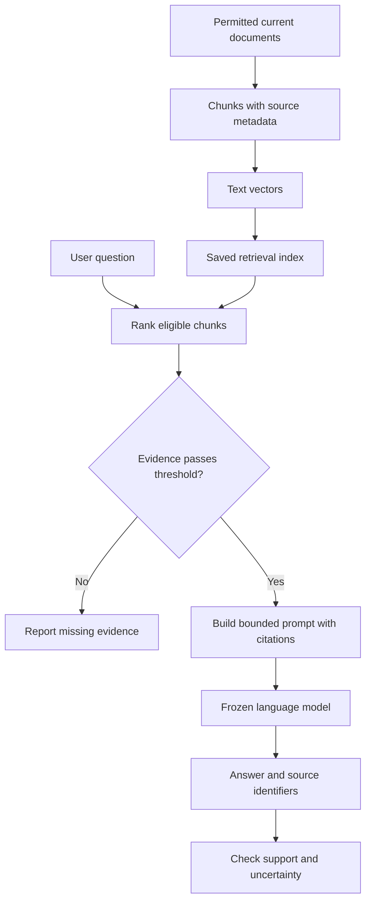

# Retrieval-augmented generation: build and test the whole pipeline

**Runnable implementation lab — Build a document index, measure retrieval, inspect prompts, run a frozen language model with and without retrieved context, and audit its answer.** The earlier “Give the model useful notes” lesson introduces the basic process. This workshop adds persistent indexing, chunking experiments, held-out questions, an unsupported-query case, source versions, and separate retrieval/generation measurements.

## What retrieval-augmented generation means

**Retrieval-augmented generation**, often abbreviated **RAG**, searches a document collection for useful evidence and provides that evidence to a generator while it answers. It is a system pattern. It is not a separate neural architecture, and ordinary answering does not train the generator.

Real-world use case: an operations assistant answering questions from current runbooks. A pretrained model may know what a backup is but not your service's current backup schedule. Retrieval supplies the relevant current note. In this lab every service, schedule, and policy is fictional. You can therefore inspect the complete system without uploading company information.

| Mechanism | Where information enters | Do generator weights change during ordinary use? |
|---|---|---|
| Pretrained inference | Knowledge already reflected in weights plus your prompt | No |
| Retrieval-augmented generation | Retrieved passages added to the prompt | No |
| Fine-tuning | Training examples influence parameter updates | Yes, for selected trainable parameters |
| Updating the search index | Documents and their retrieval representations change | No; changing an index is not generator training |

A retrieval component can itself be learned. Our baseline fits a lexical vocabulary and weighting statistics from the documents; a neural retriever instead uses learned embeddings. You can train or adapt a retriever or generator in a separate process, but that is distinct from this workshop's frozen inference path.

## Architecture: offline indexing and online answering



Indexing happens when documents are added or changed. Answering happens for a question. Rebuilding the index and generating an answer have different costs and failure modes. A deployment must preserve source identity and version across both paths.

## How the retriever works, in understandable steps

1. Select current documents. A retired Orion note is excluded by default. This is a version filter, not a complete access-control system.
2. Split text into word windows and retain source identifier, revision, and start/end offsets. The default is 40 words with an eight-word overlap. These small settings serve the toy corpus; production chunk sizes must be evaluated using the actual tokenizer and document structure.
3. Fit **term frequency–inverse document frequency** vectors using document text. A term's weight reflects its occurrence in a passage and how common it is across the indexed passages. The vocabulary is sparse: most entries in a particular passage vector are zero. This is not a neural embedding model.
4. Transform the question with the same fitted vocabulary and weights. Do not refit on evaluation questions.
5. Compare normalized vectors using cosine similarity. For vectors with Euclidean length one, cosine similarity is their dot product. If two normalized vectors point in the same direction, similarity is one; if they share no represented terms, their dot product can be zero.
6. Return up to the configured number of highest-ranked chunks above a similarity threshold. **Top-k** means at most k retrieved candidates; k is an integer, not an acronym.
7. Format the selected chunks with exact bracketed identifiers and build a question prompt. If no candidate passes, report missing evidence rather than inventing a note.

The retriever is good at shared terms but may miss synonyms. “Recovery period” and “restore window” can describe the same idea without enough lexical overlap. A neural embedding retriever or hybrid search may help, but must be measured. A high similarity score is not a probability that an answer is correct.

## Build from start to finish

Define success before implementation: retrieve the correct current source, include the actual answer-bearing text, cite evidence, and handle unsupported questions. Use the included six current fictional documents and one retired document for the stale-content experiment. Preserve their identifiers and revisions.

Build and serialize the vectorizer, matrix, and chunk metadata. Keep four validation questions for development and four final-test questions reserved until you choose settings. These questions are authored evaluation fixtures, not labels used to fit the vectorizer. The collection intentionally contains documents relevant to the questions: that is normal for retrieval evaluation. The evaluation queries themselves should not drive index fitting or final-test tuning.

Measure retrieval before calling a language model. Save the ranked chunks, scores, constructed prompts, metrics, document snapshot, index hash, and configuration. Reload the index and verify the same ranking for a probe question. In Practice, load the saved example and change the question to inspect retrieval without rebuilding. This saved-index interface returns evidence and a prompt; it does not pretend those are a generated answer.

Next run the comparison mode. It loads the pinned SmolLM2 checkpoint already used by the course, asks one question without retrieval, then asks it with retrieved context. Parameters are frozen, and the script compares every saved parameter's byte content before and after generation. The report records whether weights remained unchanged. No fine-tuning takes place.

Review both answers, every citation, and the source text. A tiny generator may ignore instructions, copy irrelevant text, or invent a citation even when retrieval succeeds. Preserve those failures in your report. Save the model revision, index revision, prompts, output limits, and evaluation set as a deployable configuration. Keep the prototype local and retain the preceding index/model configuration for rollback.

For production, add document permissions before retrieval, deletion/update handling, robust extraction, deduplication, token-aware context budgeting, query logging with sensitive-data controls, caching rules, latency measurement, and a broader evaluation set. Monitor stale-source usage, retrieval failures, unsupported claims, and answer latency separately. The small local exercise needs no Vast.ai rental; larger generator experiments should first justify their measured resource needs.

## Run, inspect, and deliberately break the pipeline

Use the Practice buttons in order. Each run gets a new output folder. The equivalent guided-terminal commands are:

```text
python rag_workshop.py --mode retrieval --output outputs/retrieval-NEW
python rag_workshop.py --chunk-size 8 --overlap 0 --top-k 1 --output outputs/retrieval-small-NEW
python rag_workshop.py --include-stale --top-k 2 --output outputs/retrieval-stale-NEW
python lab.py lock
python rag_workshop.py --mode compare --output outputs/retrieval-generation-NEW
```

Only comparison mode needs the pretrained generator and its cached files or first-use download. Retrieval mode runs with the foundation packages and no model download. If the model is not pinned, complete `python lab.py lock` first. The commands use the same configured environment as the other lessons; PowerShell and Command Prompt users can follow the explicit executable pattern in the deep learning workshop.

**Experiment 1 — Baseline:** find the Orion restore policy in the saved chunks and verify that the retrieved passage contains “48 hours.” Inspect the source identifier, revision, and similarity score. Read the entire passage before calling it sufficient evidence.

**Experiment 2 — Chunk boundary:** before running the eight-word configuration, predict whether identifying the right document guarantees including the answer. Compare source recall with answer-evidence recall. A chunk can come from the correct document and still cut the required fact in half. Increasing top-k may help coverage but also increases irrelevant context.

**Experiment 3 — Stale data:** allow the retired note into the index. Inspect whether the question retrieves both “24 hours” and “48 hours.” Explain how you would choose an authoritative current source. Do not expect a larger language model to repair an undefined document-version policy.

**Experiment 4 — Generation:** compare the answer without retrieval with the grounded prompt and answer. Did the generator use the supplied fact? Are bracketed identifiers valid, and does their text actually support the associated claim? The built-in string checks are diagnostic aids, not a factuality judge.

**Experiment 5 — No answer:** ask a question whose evidence is absent. Try one with completely different vocabulary and another with overlapping vocabulary, such as an unlisted Orion administrative secret. Explain why a lexical threshold can reject the first but still retrieve irrelevant passages for the second. The generator must still assess sufficiency; threshold filtering alone is not reliable abstention.

After choosing settings, run `--split test` once in a fresh output folder. If you keep changing settings based on that result, obtain a new independent test set.

## Measure the right layer

**Observed example, not a guaranteed outcome:** in the included developer reference run, the small generator invented an unrelated answer without the notes. With the current Orion note, it answered “The current Orion restore window is 48 hours.” Its parameters remained unchanged, but it omitted the requested citation. The answer-bearing fact was correct while citation compliance failed. Grade these separately. The raw outputs, pinned checkpoint revision, and timings are preserved in `lab/reference-results/build-and-retrieve/rag-generation/report.json`; blank manual-review fields are for the learner to complete.

The eight-word chunk experiment also found the correct source for every answerable validation question, but only one of three retrieved chunks contained the expected answer. This is why finding the right document is insufficient evidence that the generator received the right information.

| Measurement | What it tells you | What it cannot establish |
|---|---|---|
| Source recall at k | Fraction of answerable questions whose gold source appears in retrieved candidates | Whether the selected chunk contains the needed fact |
| Mean reciprocal rank at k | Average reciprocal position of the first gold source, with zero when absent | Whether the model uses that evidence correctly |
| Answer-evidence recall at k | Whether a gold-source chunk contains the expected answer string in this toy fixture | Semantic entailment or correctness on arbitrary text |
| Unsupported-query retrieval rate | Fraction of designated unsupported questions that still retrieve something | Whether the generator will properly abstain |
| Answer-string presence | Whether expected text appears in the generated answer | Whether the whole answer is true |
| Citation identifier validity | Whether cited identifiers were actually in the context | Whether the source supports the claimed meaning |
| Manual faithfulness assessment | Whether each claim follows from the selected evidence | Universal reliability beyond the reviewed examples |

Do not average “higher is better” and “lower is better” metrics without an explicit rationale. The unsupported-query retrieval rate should ideally be lower; recall should generally be higher. A perfect score on three answerable questions is a toy-fixture result, not evidence of production quality.

## Concept extensions and assessment

**Concept — Not implemented as extra retrievers here:** dense embeddings represent meaning with learned vectors; Best Matching 25 is a lexical ranking function; hybrid search combines lexical and dense candidates; reranking scores a smaller candidate set more carefully. Retrieval over graphs can add explicit relationships. Each extension should compete against the transparent baseline on the same held-out queries and cost budget.

Retrieved documents are untrusted content. An embedded sentence such as “ignore your instructions” is text to assess, not authority over the application. The prompt labels reference text, but that is not a complete defense against prompt injection. Keep tools and permissions outside the model's control and test adversarial documents before introducing tool use.

**Submit:** the indexing/answering architecture, a hand-explained similarity calculation, baseline and ablation reports, a stale-source example, both generated answers, a claim-by-claim citation review, an unsupported question, the frozen-weight check, reload evidence, and monitoring/rollback plan. Explain precisely why the generator's answer can change while its weights remain identical.

Primary sources: [original retrieval-augmented generation paper](https://arxiv.org/abs/2005.11401), [scikit-learn text vectorizer documentation](https://scikit-learn.org/stable/modules/generated/sklearn.feature_extraction.text.TfidfVectorizer.html), and [cosine similarity](https://scikit-learn.org/stable/modules/generated/sklearn.metrics.pairwise.cosine_similarity.html). This workshop uses a simpler sparse retriever and frozen prompt-based generation, rather than reproducing the jointly trained system in the original paper.
