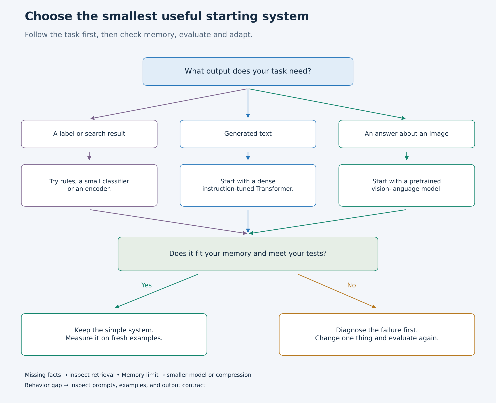
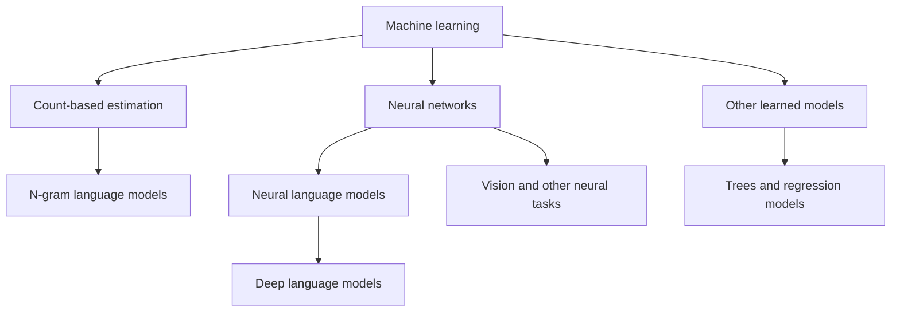
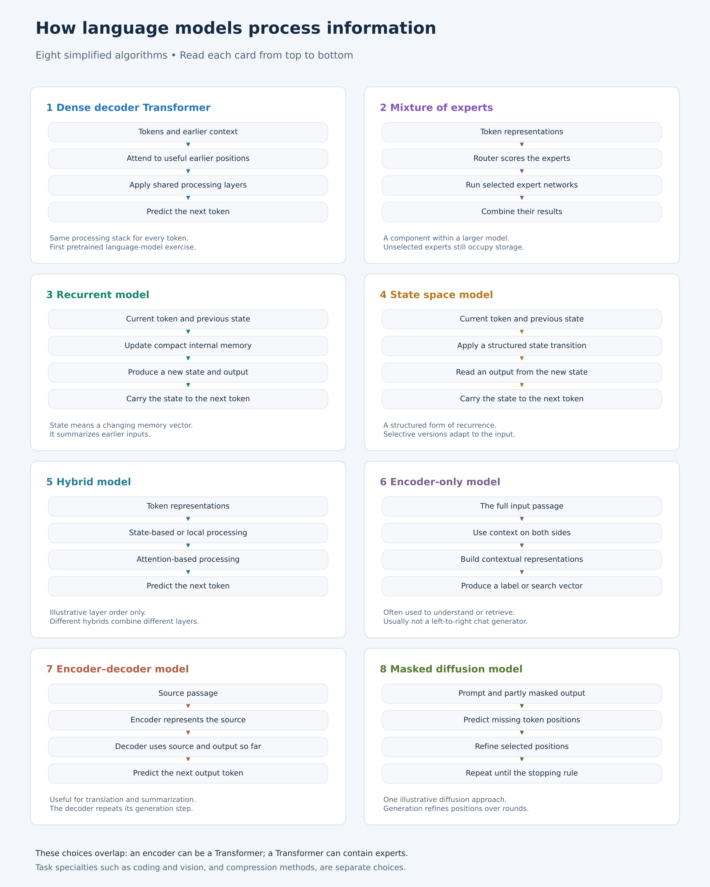
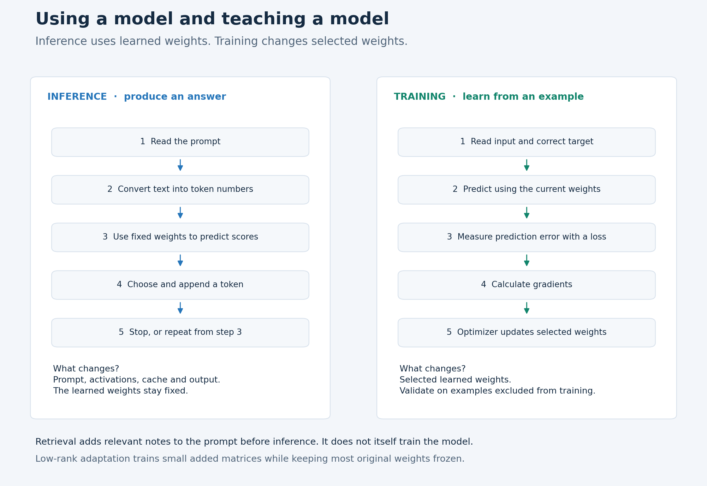
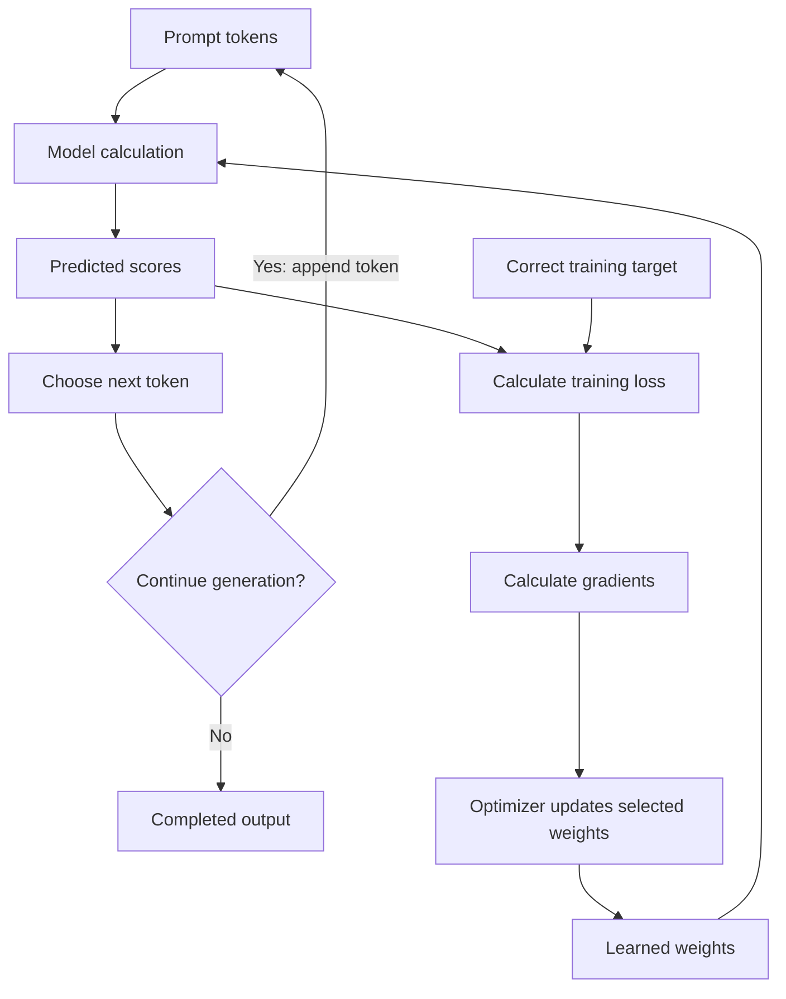

# Small Language Models From First Run to Measured Experiments

Machine Learning Super Lab • Expanded illustrated workbook • Revised November 14, 2026

This edition spells out technical abbreviations in the explanations and adds step-by-step family algorithms, worked examples and visual explanations. Literal commands and model names remain unchanged; the acronym reference explains the shortened forms inside them. Pictures are included in the accompanying compressed archive, in the `images` folder. The text and embedded Mermaid diagrams also describe the flows for readers using a compatible Markdown viewer.

Read in this order: **mental model → machine-learning relationship → model-choice algorithm → design algorithms → learning algorithm → laboratory exercises**. Use the tables and acronym reference as lookup material rather than memorizing every name before running your first model.

Start with **HuggingFaceTB/SmolLM2-135M-Instruct**, a small, dense, decoder-only Transformer. Run it on a central processing unit, understand its inputs and outputs, measure its mistakes, then train a small adapter. After that, build a tiny model from random weights and explore other architectures.

This workbook is for new machine learning engineers. You need basic computer skills; the first labs explain the Python and machine learning ideas as they appear. You do not need to rent a graphics processing unit for the core labs. The objective is to produce evidence that you understand the system: working code, repeatable experiments, honest evaluations and clear explanations.

The code is a teaching implementation. The model with 135 million parameters is deliberately modest, and the ticket dataset is deliberately small. Training a useful modern general-purpose small language model from scratch requires vastly more data and compute than these exercises. Completing the workbook develops the engineering workflow; it does not make a classroom model production-ready.


New learning paths: [Pretrained versus from scratch](#ref/pretrained), [Deep learning workshop](#ref/deep-learning), [Retrieval-augmented generation](#ref/rag), and [Synthetic data](#ref/synthetic-data). The Build and retrieve track adds runnable recurrent, masked-encoder, encoder–decoder, transfer-learning, and synthetic-data experiments. The complete companion is `Building-Models-and-Retrieval.md`.

## How to use this course

Follow the labs in order. Each lab has an explanation, an action, an expected observation, a checkpoint and an extension. Budget roughly 20–35 focused learning hours for the core path, then several additional sessions for each specialization. These are study estimates, not runtime promises. Move forward when you can explain your result, rather than when a timer expires.

If a lab fails, stop at that checkpoint. Send the lab number, exact command, full error and `python lab.py doctor` output in this conversation. We can diagnose the failure, explain the underlying concept and adjust the next exercise. Remove passwords, access tokens and private training data before sharing logs.

| Stage | Main question | Evidence you produce |
|---|---|---|
| 0–2 | Can I run a model and explain the data flow? | Working environment, token inspection and generated answer |
| 3–4 | Can I measure quality and change behavior? | Baseline report, trained adapter and validation comparison |
| 5 | Can I distinguish learned behavior from retrieved knowledge? | Retrieval trace and grounded-answer checks |
| 6 | Do I understand how training begins? | Tiny randomly initialized language model and loss measurements |
| 7–8 | Can I change size and compute requirements? | Quantization and distillation experiments |
| 9–11 | Can I explain and prototype other model families? | Coding evaluation, vision exercise, mixture of experts and state space model experiments |
| 12 | Can I run experiments on rented hardware responsibly? | Graphics processing unit verification, measured runtime and saved outputs |
| 13 | Can I defend an engineering decision? | Reproducible capstone report and model card |

## Before the laboratories build an accurate mental model

An **algorithm** is a sequence of steps for carrying out a task. A **model architecture** specifies how information passes through mathematical operations. A **training algorithm** adjusts the model's learned numbers. A **trained checkpoint** contains the resulting numbers and the information needed to load them. A **software application** connects the model to inputs, retrieval, permissions and outputs. These are related components, but they are not the same object.

For example, a recipe describes a procedure, while the current settings of an adjustable oven describe part of the system's state. In a neural network, the architecture and training procedure are specified by code; training learns many numerical settings. Those settings are called parameters. The analogy helps distinguish the procedure from the learned values, but a language model does not literally store a collection of recipes or reason like a human chef.

### The first ten concepts with concrete examples

| Concept | Plain meaning | Example | What it does not mean |
|---|---|---|---|
| Parameter | A learned number that affects the computation | A value in a matrix that transforms one representation into another | A separate fact or a whole stored sentence |
| Weight | Usually a learned multiplier; often used informally for all model parameters | Multiplying an input feature by 0.3 | A human-written rule such as “always choose memory” |
| Token | One unit of the model's vocabulary | A word fragment, punctuation mark or byte, depending on the tokenizer | Necessarily a full word |
| Vocabulary | The set of tokens a tokenizer recognizes | An indexed list of permitted token pieces | A list of everything the model knows |
| Token identifier | An integer used to look up a token | The integer 17 might refer to a particular token | A quantity whose numerical order measures meaning |
| Embedding | A learned vector associated with an input item | Token 17 is mapped to a list of hundreds of numbers | A simple dictionary definition or an independently labeled “meaning axis” |
| Activation | A temporary computed value during one model run | A representation after the third layer processes this prompt | A permanently changed learned weight |
| Context | Information available to this prediction | The prompt and previously generated tokens | Everything the model has ever seen in previous sessions |
| Logit | A raw score before normalization into probabilities | Scores of 3.0, 1.0 and -2.0 for three candidate tokens | A probability, confidence guarantee or truth score |
| Checkpoint | Saved model state and configuration | A weight file plus architecture settings | A complete reproducible application without its dependencies and tokenizer |

The key contrast is between **learned parameters**, which usually stay fixed during inference, and **activations**, which change as the model processes new input. Inference means using a trained model. Training means calculating a learning signal and updating selected parameters.

### Follow one sentence through a language model

Suppose the prompt is **“The cat sat on the”**. The following numbers are invented to explain the process; they are not measurements from our selected checkpoint.

1. **Tokenize the text.** A hypothetical tokenizer might produce `['The', ' cat', ' sat', ' on', ' the']`. Another tokenizer could split these pieces differently. Leading spaces can be part of a token.
2. **Look up identifiers.** The pieces might become `[12, 48, 305, 27, 9]`. These numbers are vocabulary addresses, not semantic measurements.
3. **Look up embeddings.** Each identifier selects a vector of learned numbers. This is similar to looking up a row in a table, but the row contains learned features rather than prose.
4. **Process the sequence.** Layers transform the vectors. A Transformer uses attention to combine information from permitted positions. Other architectures may update a compact state instead.
5. **Produce scores.** The last position produces one logit for each vocabulary token.
6. **Normalize the scores.** A softmax operation turns the logits into nonnegative probabilities that sum to one across the vocabulary.
7. **Choose a token.** A decoding rule might select the most probable token or sample according to the probabilities.
8. **Append and repeat.** If the chosen token is `' mat'`, the next prediction sees the original prompt plus that token. Generation stops at an end marker, a length limit or another stopping rule.

An illustrative probability table could be:

| Candidate next token | Illustrative probability |
|---|---:|
| ` mat` | 0.55 |
| ` floor` | 0.25 |
| ` chair` | 0.10 |
| All other tokens combined | 0.10 |

Choosing the highest-probability token gives ` mat`. Sampling could produce ` floor`. Neither operation verifies whether a real cat sat anywhere. A language model predicts tokens; an application must add the appropriate evidence and checks for its task.

**Check yourself:** if you ask the same model a new question, which changes: the prompt, the activations or the learned weights? In ordinary inference, the first two change; the weights do not.

### A small model is small in capacity not in conceptual complexity

A model advertised as 135 million parameters contains roughly that many learned numerical values. It does not contain 135 million facts. Parameter count is one resource indicator. Data quality, training methods, architecture, context length and task fit also affect performance.

The core course uses a 135-million-parameter pretrained model for useful experiments and a roughly 137-thousand-parameter toy model for seeing training mechanics. The toy model is much smaller than the approximate small-language-model range used in this course. It is an educational microscope, not a competing assistant.

A larger model can still fail at a task with poor instructions or bad retrieval. A smaller model may perform well on a narrow, clearly defined task. We choose size using measured task quality and resource requirements rather than assuming that every problem needs the largest available model.

### Understand memory before renting a machine

The **central processing unit** is the computer's general-purpose processor. The **graphics processing unit** performs many suitable mathematical operations in parallel. **Random-access memory** is the computer's working memory. A dedicated graphics card has its own device memory, often called **video random-access memory**. Disk storage holds files when the program is not using them.

Imagine a workshop. Disk is the storage cupboard; system memory is a workbench; device memory is the workbench next to a specialized machine. A component in the cupboard does not automatically fit on either workbench. Likewise, successfully downloading a model does not prove it will fit during inference or training.

Use this planning equation:

`total runtime memory = weights + activations + cached context + temporary buffers + framework overhead`

During training, also account for gradients and optimizer state. A gradient is a derivative describing how a change would affect loss. Optimizer state is extra numerical history used by the update algorithm. Compressing the weights reduces one part of the total, not necessarily every part.

## A decision algorithm for choosing a starting model

This is a practical decision procedure, not a claim that the categories are mutually exclusive. First select a task and output contract. Then choose an architecture or checkpoint. Apply training and deployment choices afterward.



1. **Write the required output.** Is it a label, a search ranking, generated text, a code change or an answer about an image?
2. **Try the simplest suitable baseline.** Labels or ranking may need only rules or an encoder. Generated text usually makes a dense instruction-tuned Transformer a reasonable beginner choice. Images require an image-capable model.
3. **Check the input requirements.** A text-only model cannot inspect pixels merely because a filename appears in its prompt.
4. **Estimate and then measure memory.** Include context, activations and runtime overhead, not just the model download size.
5. **Measure the baseline on examples excluded from training.** Define correctness before examining candidate outputs.
6. **Diagnose the dominant failure.** Missing external facts suggest retrieval. Wrong response behavior may suggest better training data. Memory exhaustion suggests a smaller checkpoint, shorter context or a suitable compression approach. Incorrect reasoning may require better data, verification or a more capable model.
7. **Change one thing.** Repeat the evaluation under comparable conditions and keep the change only if the evidence supports it.
8. **Explore advanced architectures when you have a reason.** Study a mixture of experts for routing and capacity tradeoffs, or state space and hybrid models for sequence-processing tradeoffs. Do not assume either is automatically faster or better.

For our first project, the task is to generate a small structured answer classifying a support ticket. We use a dense instruction-tuned Transformer because its tooling is straightforward and its training behavior is easy to inspect. A conventional classifier is also a valid baseline for this task.

## Language models are machine learning

**Concept — Field, task, and architecture are different labels.** Machine learning means fitting a model from examples so it can make predictions or decisions on new inputs. A language model learns patterns that assign probabilities to language: for example, which token might come next or which token belongs in a missing position. A token is a processing unit such as a word, word fragment, or byte. Generating text is one use of those predictions.

**Language models are part of machine learning.** Many modern language models are deep neural networks. However, language modeling also includes count-based models that learn frequencies without a neural network. Deep learning is therefore not the parent of every language model. The Foundations and Language models tracks in this course belong to the same field.



This is a representative relationship map, not a complete partition of machine learning. An n-gram is a sequence of n tokens; n is a number, not an acronym. All these learned language models are statistical in the broad sense. In this course, **count-based** identifies the non-neural baseline more precisely than treating “statistical” and “neural” as opposites. Deep learning uses multiple learned representation layers; not every neural network needs to be deep.

Natural language processing is the application area concerned with human language. A logistic regression spam classifier predicts a message label, so it is machine learning applied to language, but it is not itself a language model. An encoder pretrained to recover masked tokens has a language-modeling objective; after adaptation, its deployed output might instead be a document embedding or a category. A vector is an ordered list of numbers; an embedding is a learned vector representation. Neither an embedding output nor an encoder architecture alone proves language-model pretraining.

### An algorithm for reading any model card

Instead of assigning one exclusive family, build a description by answering these questions:

| Dimension | Question | Example answers |
|---|---|---|
| Task | What does it predict or generate? | Next token, missing token, translation, image-conditioned answer |
| Learning signal | Where do training targets come from? | Text itself, human labels, teacher outputs, preferences, environment rewards |
| Sequence mechanism | How does information move across positions? | Counts, feed-forward window, convolution, recurrence, state space, attention, hybrid |
| Information flow | Which context can a prediction use? | Earlier tokens, bidirectional context, encoded source plus generated prefix |
| Parameter routing | Which processing blocks run? | Dense shared blocks or selected experts |
| Training history | What has already been learned? | Pretrained base, instruction-tuned, domain-adapted, distilled |
| Modality and specialty | What inputs and domain does it support? | Text, images and text, speech, code, mathematics |
| Deployment | How is it stored and executed? | Weight precision, total and active parameters, context budget, local or remote hardware |

For example, one model can simultaneously be a **neural, decoder-only, autoregressive, mixture-of-experts Transformer, instruction-tuned for code, with quantized weights**. Autoregressive means predicting an output using earlier outputs. None of these labels replaces the others. Small and large describe scale, not separate mathematical architectures. A model's learned weights, data, training objective, and evaluation matter alongside its architecture.

### Classify a real use case

**Design activity:** for an offline operations-note assistant, compare a count-based completion baseline, a tiny causal neural language model, and an adapted pretrained assistant. Record the eight dimensions above, which one you would build first, and one measurement that could change your choice. Use the [statistical word-model lab](#lesson/ngram), [training from random weights lab](#lesson/scratch), and [adaptation lab](#lesson/adapt) for the implemented paths. The [broader machine learning atlas](#ref/ml-atlas) shows the surrounding methods.

**Explanation check:** Is a quantized coding model a new architecture? No: coding is a specialty and quantization changes numerical representation. Is a count-based next-word predictor machine learning? Yes: its probabilities are estimated from examples, even though it does not use backpropagation. Is an instruction-tuned model pretrained? Yes: it already has trained parameters when you receive it.

## Model families explained as algorithms

Runnable from-scratch paths now include [causal Transformer](#lesson/scratch), [recurrent language model](#lesson/scratch-recurrent), [masked encoder](#lesson/scratch-encoder), [encoder–decoder](#lesson/scratch-sequence), and [toy state-space, expert, and hybrid designs](#lesson/architectures). The [transfer comparison](#lesson/transfer-compare) reuses a checkpoint you pretrain yourself. Diffusion remains Concept material.

Start with the count-based foundation, then read the picture top to bottom within each card. Its eight cards illustrate selected neural design choices, not an exhaustive family tree. A mixture of experts is often a component inside a Transformer. Encoder and decoder describe information-flow roles; they can also be built with Transformer layers. Recurrent and state space approaches overlap. Diffusion describes a modeling and generation framework that can use a Transformer as its denoising network.

### Foundation: count-based language models

**Concept, with a linked Runnable implementation lab.** Use case: a small operations-note completion baseline that can run on a central processing unit. Historical speech recognition and text entry also used count-based language models; they are useful for learning probability before introducing neural networks. An order-two model estimates the next word from one preceding word. An order-three model uses two preceding words. Increasing the order increases context but also creates more rarely observed combinations.

**Algorithm:** split permitted text into training and evaluation sets; tokenize; count context–next-word combinations using only training text; smooth and normalize the counts; look up a new context; score or sample the next word. Repeating the last two steps generates a continuation. Training here estimates counts and probabilities rather than updating neural weights with gradients.

**Worked example:** after “server,” the training text has “starts” three times and “stops” once. Without smoothing their probabilities are 3/4 and 1/4. In a deliberately two-word output vocabulary, add-one smoothing gives (3+1)/(4+2) = 2/3 and (1+1)/(4+2) = 1/3. With more vocabulary options, the denominator must include every option, including an unknown-word symbol when used. Smoothing reserves probability for unobserved events.

**Build from start to finish:** open the [statistical language-model lab](#lesson/ngram). Define success as improving held-out probability assignment over its uniform baseline; use the included synthetic operations sentences; split before fitting vocabulary and counts; preserve the tokenizer and unknown-word policy; fit a smoothed counting model; choose context order using validation; save and reload the count tables and vocabulary; predict a new context through the local saved-model interface. The included teaching run evaluates validation performance, not production readiness. Before deployment, add an untouched external test set, audit memorized sensitive text, monitor unknown words and drift, and retain the previous artifact for rollback. Submit the report, probability plot, reload output, and one failed completion. This small exercise needs no Vast.ai rental. Its full build guide includes the input contract and deployment limitations.

**Change one variable:** compare context orders one and three on the same split. Explain why more context can worsen results with sparse data. Compare perplexity only when tokenization, vocabulary policy, and evaluation text are compatible. Perplexity summarizes how surprised a model is by the observed tokens; lower is better under those matched conditions.



### Design 1 Dense decoder-only Transformer

**Analogy:** a writer can look back at earlier parts of the current passage, decide which are useful and then choose what to write next. The same editing process is applied at each layer. The mathematical attention process is not human awareness or deliberate reading.

**The algorithm:**

1. Convert the available tokens into vectors and add information about their positions.
2. At each layer, compute attention: score how useful allowed positions are to the current position.
3. Convert those scores into weights and use them to combine information from the allowed positions.
4. Apply a shared feed-forward transformation to each position. This transformation is a small neural network inside the larger model.
5. Repeat these transformations through the layer stack.
6. Convert the last position's final representation into vocabulary scores and choose a next token.
7. Append the token and continue until a stopping rule is met.

**Worked example:** in “The red notebook belongs to Maya. Her notebook is ...”, earlier words can influence the next-token representation. We cannot infer from a convenient explanation that the model used one particular word unless we examine the actual computation. Attention scores are not a guaranteed causal explanation of an answer.

**What dense means:** the model normally uses the same shared processing blocks for each token rather than selecting a small subset of alternative expert blocks. It does not mean every stored scalar participates in every computation; an embedding lookup, for example, selects particular rows.

**Technical detail:** a causal mask prevents a position from attending to later positions. It is crucial during training because the correct next token must not be visible as context for its own prediction. With cached generation, earlier key and value vectors can be reused rather than recomputed from scratch. The cache occupies memory that grows with the retained context.

**Try:** run Lab 1, then inspect the causal-mask test in Lab 6. Change a future input token and check that earlier-position outputs remain unchanged.

### Design 2 Mixture of experts

**Analogy:** a dispatcher sends a job to a small selection of available teams. All teams remain part of the organization, even when only some handle this job. The teams are learned mathematical networks; they need not correspond to human categories such as “math expert” or “history expert.”

**The algorithm for one expert layer:**

1. Receive a token's current vector representation from the surrounding model.
2. A router network assigns a score to each available expert.
3. Select the highest-scoring one or few experts for that token.
4. Send the token representation through the selected expert networks.
5. Weight and combine their output vectors.
6. Pass the result to the next part of the surrounding model.

**Worked example:** suppose four experts receive router probabilities 0.60, 0.25, 0.10 and 0.05. A top-two router selects the first two. A common design renormalizes their weights over the selected pair, producing approximately 0.706 and 0.294. A weighted combination of their vector outputs becomes the layer's output. Exact routing and normalization rules vary by architecture.

**Why use it:** more learned expert capacity can be available than is active for a single token. But all experts still require storage or offloading, and moving work between devices can introduce overhead.

**Technical detail:** routers can collapse toward a few experts. Many implementations introduce balancing losses, capacity constraints or specialized dispatch mechanisms. Top-k selection is discrete; training uses particular gating and gradient conventions. Our toy implementation deliberately omits many production features.

**Try:** run `python mechanisms.py` and count how many tokens reach each expert. Then change one router bias and observe whether routing becomes unbalanced.

### Design 3 Recurrent neural network

**Analogy:** a reader keeps a short working note, updates it after every word, and uses that note when reading the next word. Information may be compressed or forgotten because the note has limited capacity.

**The algorithm:**

1. Initialize an internal state, usually a vector of zeros or a learned starting state.
2. Read the next token vector.
3. Combine the token vector with the previous state using learned transformations.
4. Apply nonlinear operations and, in gated variants, controls that regulate what to keep or overwrite.
5. Use the new state to produce an output representation or prediction.
6. Carry the new state into the next token's update.

**Worked example:** after reading “The delivery address changed to ...”, the state can carry information relevant to completing the address. It is a learned numerical representation, not a literal stored sentence. Details can disappear as more tokens update the state.

**Technical detail:** a basic recurrence can be written `new_state = tanh(input_transform + previous_state_transform + bias)`. The hyperbolic tangent function limits its output to between -1 and 1. A gated recurrent unit adds learned controls to help manage state updates. Training usually propagates gradients through the sequence of state updates; very long chains create their own optimization challenges.

**Try on paper:** let a one-number state start at zero and update as `new_state = 0.5 × old_state + current_input`. Process inputs 2, 0 and 0. The states become 2, 1 and 0.5. This linear example illustrates memory decay; it is not a full recurrent neural network.

### Design 4 State space model

**Analogy:** a compact internal system evolves as new observations arrive, a little like a simulated physical system with a current state. In a language model, the state is learned numerical memory rather than a literal description of a physical object.

**A simplified discrete algorithm:**

1. Start with an internal state.
2. Convert the current token representation into an input contribution.
3. Transform the old state using a structured transition.
4. Combine the transformed old state with the new input contribution.
5. Read an output representation from the updated state.
6. Carry the updated state forward and repeat.

One simplified mathematical form is `state_t = A × state_previous + B × input_t`, followed by `output_t = C × state_t + D × input_t`. Here A, B, C and D denote transformations; they are not acronyms. The actual dimensions and parameterization depend on the architecture.

**Worked example:** if `A = 0.8`, `B = 1`, the old state is 2 and the new scalar input is 3, the next state is `0.8 × 2 + 1 × 3 = 4.6`. This is an arithmetic illustration, not a language model by itself.

**What makes a selective state space model different:** parts of the update depend on the current input. This allows the model to regulate which information affects the state. Mamba is a particular selective architecture with specialized design and implementation choices; our simple diagonal recurrence is not Mamba. [5]

**Technical detail:** a recurrent inference state can have fixed size as processed sequence length grows. Training may still store substantial activations, and a pure Python loop does not demonstrate the speed of an optimized parallel implementation. Compact state also creates a recall tradeoff: retaining a summary is not the same as retaining direct access to every earlier token.

**Try:** process a sequence all at once, then as two chunks while carrying the state between them. The included test checks that the outputs match for our toy recurrence.

### Design 5 Hybrid model

**Analogy:** a worker keeps a compact running note but also consults parts of the original material when necessary. Different mechanisms address different parts of the task.

**One illustrative algorithm:**

1. Convert the tokens into vector representations.
2. Use a recurrent or state-based layer to summarize sequential information.
3. Pass the resulting representations into an attention layer.
4. Allow attention to use the context that this architecture makes available.
5. Continue through the chosen mixture of layers and produce output scores.
6. During generation, maintain whatever states and attention caches those layers need.

**Worked example:** our toy hybrid has a state space sequence-mixing layer and an attention sequence-mixing layer. This demonstrates that mechanisms can coexist. It does not establish that the combination outperforms either mechanism alone.

**Technical detail:** “hybrid” is a broad label. Full attention, local attention, recurrence and expert routing can be combined in different ways. A hybrid containing full attention can still have a growing attention cache. RecurrentGemma combines recurrence and local attention; it should not be described as a renamed Mamba model. [6]

**Try:** train the supplied toy Transformer, state space model and hybrid using the same number of updates. Then explain why differing parameter counts still prevent a fair architecture ranking.

### Design 6 Encoder-only model

**Analogy:** an editor reads the whole sentence before deciding what it means or how to label it. The task is often understanding or representing the input rather than writing a long continuation.

**The algorithm:**

1. Tokenize the complete input passage.
2. Convert the token identifiers into vector representations.
3. Mix information across the allowed input positions; bidirectional encoders can use both earlier and later context.
4. Produce contextual representations for the input tokens.
5. Use an appropriate output component to produce a class label, token labels or a representation for retrieval.

**Worked example:** “I deposited money at the bank” and “I sat beside the river bank” contain the same word, but surrounding words can change its representation. A classifier can then use that context to choose a category.

**Technical detail:** a pooled sentence representation can be used for similarity search when the model and training objective support that task. Arbitrarily averaging any encoder's hidden vectors does not guarantee high-quality retrieval embeddings. Bidirectional Encoder Representations from Transformers is one well-known encoder family. [15]

**Try:** define a three-class ticket classifier that returns a label directly. Compare this simpler output contract with a generator that must learn to produce correctly formatted text.

### Design 7 Encoder–decoder model

**Analogy:** a reader first prepares a representation of a source document; a writer then produces an answer while consulting that representation and the answer written so far.

**The algorithm:**

1. Tokenize the source text.
2. Run the encoder over the source to produce contextual representations.
3. Begin the output sequence with the appropriate starting marker.
4. Let the decoder use earlier output tokens and the encoder's source representations.
5. Predict the next output token.
6. Append it and repeat until the output is complete.

**Worked example:** the source is “Translate to French: Good morning.” The decoder generates the translation while using the encoded source. The source and generated output are separate sequences.

**Technical detail:** in a Transformer encoder–decoder, decoder self-attention processes the output prefix; cross-attention uses representations produced by the encoder. Text-to-Text Transfer Transformer is a familiar family in this category. The five in its shortened name counts the five words beginning with T. [16]

**Try:** compare summarization with a decoder-only prompt and with an encoder–decoder model. Keep the source passages and evaluation criteria the same before comparing quality.

### Design 8 Diffusion language modeling

**Analogy:** an editor fills blanks in a draft, revises uncertain parts and repeats. This differs from committing to one next token at every ordinary left-to-right step.

**One masked-diffusion-style algorithm:**

1. Keep the conditioning prompt available.
2. Initialize an output region containing mask symbols or another prescribed noisy representation.
3. Predict possible tokens for multiple output positions.
4. Choose which predictions to accept, keep masked or revise according to the model's sampling schedule.
5. Repeat the refinement operation for several rounds.
6. Stop according to the prescribed schedule or completion rule.

**Worked example:** a schematic output might move from `[blank] [blank] [blank]` to `the [blank] sleeps` and then `the cat sleeps`. Real subword tokenization, revision rules and training schedules differ from this word-level cartoon.

**Technical detail:** diffusion language models can operate in discrete token space or use other representations. Not every masked language model is a diffusion generator. Bidirectional training alone does not supply the iterative generation algorithm. Speed depends on the number of refinement rounds, implementation and task; predicting several positions at once does not guarantee lower latency.

For a discrete example, Large Language Diffusion with mAsking uses a forward masking process and a learned reverse generation process. Its denoising network is a Transformer. This demonstrates why “diffusion” and “Transformer” can describe the same model. Iterative masked generation is broader than diffusion: repeatedly filling blanks is not sufficient to establish that a model was trained with a diffusion formulation. [24]

**Try on paper:** describe what information is available in a left-to-right next-token prediction and in a masked-position prediction. Then explain why their training objectives and inference procedures need not be identical.

### Additional sequence designs worth recognizing

**Concept — Historical foundations and alternative sequence mechanisms.** These entries broaden the map. The recurrent entry now has a runnable gated-recurrent-unit lab; standalone feed-forward-window, convolutional-language, and linear-attention implementations remain Concept project plans. Use the shared build plan below to turn each into a complete project. The existing convolution lesson classifies images and does not implement a convolutional language model.

| Design | Plain algorithm | Real-world use case and tradeoff |
|---|---|---|
| Feed-forward neural language model | Embed a fixed window of previous words; concatenate the vectors; apply a neural network; predict the next word | Compact short-context completion or a research baseline; cannot see beyond its selected window [22] |
| Causal convolutional language model | Slide learned filters over earlier token representations; stack gated layers; predict the next token | Text completion with parallel training over positions; finite receptive field limits accessible context [23] |
| Gated recurrent language model | Update a running state using gates that control retention and replacement; predict from the state | Streaming text prediction; long short-term memory networks and gated recurrent units are variants, not separate learning paradigms |
| Linear-attention language model | Use a particular attention reformulation, such as kernel feature maps, to aggregate context without ordinary all-pairs softmax attention | Research into longer-context inference; tradeoffs depend on the formulation and kernel, so it is not automatically a drop-in equivalent [25] |

**Build from start to finish:** for each design, propose a small offline operations-note completer. Define a latency and held-out prediction-quality target before training. Use permitted, sanitized text with document-level training, validation, and untouched test splits; build the vocabulary on training text; record tokenization and unknown-word rules. Choose one mechanism from the table, a vocabulary output layer, and a causal information flow. Start with random weights, train next-token cross-entropy, and select settings on validation. Compare with the count-based baseline using identical prediction units; then evaluate final test performance and memory. Save weights, vocabulary, architecture, and generation settings; reload them and complete a new note. Serve only through the local lab interface with input and output limits. Record poor completions and possible memorization; monitor drift and latency, and keep a prior version for rollback. Submit the design, data contract, split manifest, training curves, baseline comparison, reload evidence, and failure analysis. This paragraph specifies the feed-forward-window, convolutional-language, and linear-attention extensions. For the supplied recurrent implementation, use [the recurrent language-model lab](#lesson/scratch-recurrent). Start with tiny local experiments; use the Vast.ai procedure only if measured resource needs justify the cost.

**Design exercise:** draw which input positions can influence one output. For the fixed-window network, change the window from two to four words; for a convolution, calculate the receptive field; for recurrence, explain what must fit in the state; for linear attention, identify the accumulated state in the chosen formulation. Explain how each prevents future-token leakage. Use the [additional build plans](#ref/build-plans) for encoder, recurrent, encoder–decoder, and diffusion project assessments.

### Architecture, objective, and generation are not interchangeable

| Training objective | Training target | Typical examples and boundary |
|---|---|---|
| Causal next-token prediction | Next token from the allowed prefix | Count-based, recurrent, convolutional, state-space, and decoder-only Transformer models can all support this |
| Masked-token prediction | Hidden token from visible context | Used in Bidirectional Encoder Representations from Transformers pretraining; a fill-mask objective alone does not supply a chat-generation procedure |
| Sequence-to-sequence prediction | Target output conditioned on a source | Translation or summarization; often an encoder–decoder, but conditional generation also works with decoder-only models |
| Denoising or diffusion objective | Recover information from a specified corruption process | A diffusion formulation specifies the corruption, training objective, and reverse process; not every denoising model is a diffusion model |

**Teaching boundary:** an embedding model, reranker, reasoning-tuned model, coding model, vision-language model, and on-device model need not define six new architectures. Describe their task, modality, training history, and deployment separately. Retrieval-augmented generation supplies retrieved context to a generation system; it is a system pattern, not a new neural architecture.

## How specialization changes the algorithm

The core architecture does not have to change every time the task changes. Training data, training objective, input representation and output checks can produce different specializations.

The table below mixes tasks, modalities, and a deployment choice for practical comparison. The on-device row is a deployment target, not a specialization or separate model family.

| Specialization | The practical algorithm | What to measure |
|---|---|---|
| Coding | Read a specification and relevant code; generate a proposed program; execute approved tests in an isolated runner; record failures | Tests passed, correctness on unseen tasks, runtime and unsupported operations |
| Reasoning or mathematics | Read a problem; generate an answer or intermediate work; check the final result using suitable rules or independent evidence | Correct final answers and robust behavior under rewording; explanation length is not the score |
| Vision and language | Convert image pixels into features; connect them to text representations; generate text conditioned on both | Grounded answers to questions about the image, including negative and ambiguous cases |
| Audio and language | Convert audio into an appropriate representation; combine it with the language system; produce text or another supported output | Transcription or task correctness, timing and performance under noise |
| Domain adaptation | Collect representative domain examples; train or retrieve as appropriate; evaluate on separately sourced examples | Domain accuracy and whether general capabilities regress |
| On-device deployment | Select a task-suitable model; fit it into the device budget; use supported computation kernels; measure quality and responsiveness | Total memory, latency, energy where measurable and offline operation |

A trained language model alone is not an agent. An agent application adds a control loop, available tools, state and rules for taking actions. A model that writes a shell command has not necessarily executed it. That distinction matters when evaluating a future coding system.

## The learning algorithm explained slowly



### Using the model

Inference takes an input, computes predictions using learned weights and returns an output. A conversation can maintain history in the prompt or application state. That is not the same as updating weights.

### Teaching the model

Training adds a correct target and a method for adjusting selected weights:

1. Read a training example, including the input and desired output.
2. Calculate the model's predictions with the current parameters.
3. Calculate a **loss**, a number that measures a defined aspect of prediction error.
4. Use **backpropagation** to calculate how the loss depends on trainable parameters.
5. Use an **optimizer** to update those parameters.
6. Repeat over training examples and periodically measure performance on validation examples that do not update the weights.
7. After choosing your settings, evaluate on a final test set that was not used for those choices.

For next-token learning, a common loss is the negative natural logarithm of the probability assigned to the correct token. If that probability is 0.1, the loss is about 2.303. If it rises to 0.8, the loss falls to about 0.223. Lower token loss means the correct tokens receive more probability under that measurement; it does not automatically prove factual accuracy, good formatting or application success.

### A numerical gradient update

Consider the toy predictor `prediction = weight × input`. Let input be 2, target be 6 and current weight be 1. The prediction is 2. Define squared-error loss as `(prediction - target)^2`, giving 16.

The derivative of this loss with respect to the weight is `2 × (prediction - target) × input`, which is -16. With a learning rate of 0.1, gradient descent updates the weight to `1 - 0.1 × (-16) = 2.6`. The new prediction is 5.2 and the new loss is 0.64.

The gradient described a local slope. The learning rate controlled the step size. Backpropagation applies the chain rule to compute such derivatives through many connected operations. This one-number exercise explains the mechanism without pretending that a language model has a simple convex optimization landscape.

**Mini exercise:** redo the same update with learning rate 1.0. The weight becomes 17, the prediction becomes 34 and the loss becomes 784. A larger step was worse. This is why changing a learning rate is an engineering experiment rather than a guarantee of faster learning.

### Training words that often get confused

| Word | Exact meaning in this course | Common mistake |
|---|---|---|
| Batch | The examples processed together for a forward/backward calculation | Assuming batch size means context length |
| Sequence length | The number of token positions in an example | Assuming it equals the number of words |
| Optimizer step | One update of trainable parameters | Calling every step an epoch |
| Epoch | One complete pass through the defined training dataset under an epoch-based schedule | Calling 60 randomly sampled updates 60 full passes |
| Learning rate | Scale used by the optimizer's update rule | Treating it as a measure of model intelligence |
| Gradient accumulation | Collecting gradients across multiple smaller batches before an update | Assuming it removes the memory required by one individual example |
| Overfitting | Learning training-specific patterns that fail to generalize | Concluding that low training loss guarantees success |
| Data leakage | Letting information from evaluation influence training or selection improperly | Splitting nearly identical copies into separate sets and calling them independent |
| Hyperparameter | A chosen training or system setting, such as rank or learning rate | Confusing it with a weight learned by the optimizer |
| Random seed | An input controlling a pseudorandom sequence | Assuming the same seed guarantees identical behavior on every device and software version |

### Adaptation changes different parts of the system

| Method | Plain algorithm | Which learned weights change? |
|---|---|---|
| Pretraining from scratch | Initialize a model; learn token patterns from a corpus | The selected model parameters begin without useful pretrained knowledge and are trained |
| Continued pretraining | Start from a checkpoint; continue learning from domain text | The chosen trainable parameters |
| Full supervised fine-tuning | Train on requests and desired answers | All or most chosen original parameters |
| Low-rank adaptation | Add small trainable matrix pairs to selected transformations | Added adapter parameters; most original parameters remain frozen |
| Quantized low-rank adaptation | Keep a compressed base and train added adapters | Adapter parameters; the quantized base remains frozen in the intended setup |
| Distillation | Let a teacher produce training signals; train a student to reproduce useful behavior | Student parameters selected for training |
| Retrieval-augmented generation | Find relevant evidence; insert it into the prompt; generate an answer | None in the ordinary retrieval-and-inference operation |

For low-rank adaptation, a large matrix update is represented using the product of two smaller matrices. If the original transformation maps 576 input features to 576 outputs, a full matrix has 331,776 entries. A rank-eight pair of matrices has `576 × 8 + 8 × 576 = 9,216` entries. This illustrative calculation explains why an adapter can contain fewer trainable parameters. It is not the complete parameter count of our model or all of its adapters.

“Frozen” means excluded from the optimizer's parameter updates. It does not mean the base model disappears, occupies no memory or stops participating in forward computation. The training calculation may still need activations through frozen layers to learn the adapter.


### A self contained picture of generation and learning



The generation loop uses the weights. The branch through a correct target, loss, gradients and optimizer is the training path. Ordinary inference does not take that branch.

## Attention without unexplained shorthand

Attention combines information using learned scores. Imagine the current position needs to resolve a relationship in the preceding text. Each position's representation is transformed into three different kinds of vectors:

- **Query vectors:** representations used to score what information the current position should use.
- **Key vectors:** representations against which queries are compared.
- **Value vectors:** the information combined using the resulting attention weights.

The familiar letters Q, K and V are mathematical symbols for query, key and value matrices. They are not names of three separate databases.

In a common attention calculation, queries are multiplied by transposed keys, the scores are scaled, prohibited positions are masked, and softmax produces weights. A weighted sum of value vectors forms the result. Multiple attention heads perform versions of this operation in parallel representation subspaces.

If three permitted positions receive illustrative weights 0.6, 0.3 and 0.1, the attention result is `0.6 × value_1 + 0.3 × value_2 + 0.1 × value_3`. Those are vectors, so the multiplication and addition apply across their components.

A **key–value cache** stores previously computed key and value representations during supported autoregressive inference. It avoids repeating some earlier computation, but storing more context usually costs more cache memory. The cache is temporary runtime state, not a second set of trained model weights.

**Check yourself:** why can a longer conversation use more memory even though the model's parameter count has not changed? More context can require more cached representations, activations and temporary work.

## Understand evaluation before believing a score

In the support-ticket project, an answer has two requirements: it must obey the requested structured format, and its label must be correct. A correct-looking category embedded in a paragraph fails the strict format contract. A correctly formatted but wrong category fails the classification requirement.

For example, `{"label":"memory"}` could pass both checks for a memory-exhaustion ticket. `It looks like memory.` fails the structured-format check. `{"label":"data"}` may have valid structure but be the wrong classification.

**Accuracy** is the fraction of evaluated examples that meet the defined correctness rule. **Schema validity** measures whether outputs obey the agreed structure. **Latency** is how long a request takes. **Throughput** is work completed per unit of time. A shorter answer can have lower latency even when tokens per second are lower. Report output length when interpreting timing.

Our earlier verified run scored 11 correct labels out of 12 final test examples after adaptation, with valid structure on all 12. That is an observed classroom result, not a broad performance guarantee. One changed result would move this small test's accuracy by about 8.3 percentage points. The example that failed remains included for discussion.

A useful failure investigation asks, in order: Was the input parsed correctly? Was the desired task unambiguous? Was the right evidence retrieved? Did the model produce the right content? Did the output parser accept the contract? Did the environment run the intended model and adapter?

## Guided understanding checks with answers

1. **Does a 135-million-parameter model contain 135 million facts?** No. Parameters are learned numerical values involved in distributed computations.
2. **Does a new prompt train the model?** Not in ordinary inference. It changes the current computation and context.
3. **Why use a causal mask?** To prevent a position from using future tokens when predicting what comes next.
4. **Why can a mixture of experts still need substantial memory?** Inactive experts remain stored somewhere; active computation and total storage are different budgets.
5. **Is a fixed recurrent state a perfect archive of the input?** No. It is a limited numerical representation and can lose information.
6. **Does lower training loss prove improvement on new tickets?** No. Check independently held-out examples and application-specific metrics.
7. **Why might retrieval succeed but the answer fail?** The generator can misunderstand, omit citations or invent unsupported details despite receiving the correct note.
8. **Why preserve exact model names and command flags?** They are software identifiers. Expanding words inside them would change the command rather than explain it.

The rest of the workbook retains the runnable laboratories. Use the explanations above whenever a command begins to feel like a ritual instead of an understandable experiment.


## Reference map of the model design choices

A small language model is a language model small enough for some constrained use case. There is no universal parameter cutoff. The approximate 100 million to 10 billion range is a useful teaching convention, not an industry standard. A model with 500 million parameters can still exceed a particular phone's memory budget, while a workstation can run much larger models.

Describe a model along several separate axes. For example: “a dense Transformer with 135 million parameters, pretrained for next-token prediction, instruction-tuned for text, deployed using 32-bit floating-point precision on a central processing unit.” These labels describe different properties of the same model.

### Architecture describes the computation

The table combines frequently encountered designs for comparison. Read the dimension table above first: routing, information flow, sequence mechanism, and generation framework can overlap within one model. Count-based and additional neural designs are covered in the preceding algorithm sections.

| Design choice | Plain-language picture | Technical idea | Why use it | Main difficulty |
|---|---|---|---|---|
| Dense decoder-only Transformer | Every token passes through the same stack of processing layers | Causal attention mixes previous-token information; feed-forward layers transform each position | Text generation, chat, code, small agents | Attention and cached context consume memory and compute |
| Sparse mixture of experts | A router chooses a few processing teams for each token | Selected expert feed-forward networks execute instead of one shared dense block | More total capacity at a given amount of active computation | All experts still need storage; routing and communication add overhead |
| Recurrent model | A reader updates a running summary after each token | Hidden state is updated sequentially, as in a recurrent neural network or gated recurrent unit | Streaming and compact demonstrations | Compression into a state can lose details; training and hardware tradeoffs |
| State space model | A structured memory evolves as the sequence arrives | A state transition summarizes prior inputs; selective state space models make parts of the transition input-dependent | Long streams and compact inference state | Optimized kernels and precise recall can be challenging |
| Hybrid | Some layers keep a compact state; others use attention | Combines mechanisms such as recurrence, local attention or full attention | Balance recall, speed and memory | Behavior depends on the exact mixture; memory is not automatically constant |
| Encoder-only model | Read the entire passage before representing it | Bidirectional context, often trained with masked-token objectives | Classification, embeddings, search and reranking | Usually not an autoregressive chat generator |
| Encoder–decoder model | Read an input, then produce an output | An encoder represents the input; a decoder generates using that representation | Translation, summarization and other text-to-text tasks | Two interacting components and a different training interface |
| Diffusion language model | Start with missing or noisy information and repeatedly refine it | A specified corruption process and learned reverse generation; the denoiser can be a Transformer | Research into alternative generation schedules | Tooling, quality and speed depend strongly on the implementation; not all masked prediction is diffusion |

This course starts its pretrained generation track with a dense Transformer because the included tooling and exercises support it. Examples include SmolLM2, small Llama, Gemma and Qwen checkpoints. Bidirectional Encoder Representations from Transformers family models illustrate encoder-only approaches; Text-to-Text Transfer Transformer family models illustrate encoder–decoder approaches. The count-based lab is an even simpler starting point for understanding language modeling itself. The architecture alone does not determine quality.

**Mixture of experts correction:** active parameter count is not total parameter count. Qwen1.5-MoE-A2.7B has about 14.3 billion total parameters and 2.7 billion active parameters. DeepSeek-V2-Lite has about 16 billion total and 2.4 billion active. These are useful mixture of experts examples, but they are not tiny memory-footprint models. Do not budget their weight memory as if they contained only the active parameters. [3, 4]

**Attention correction:** ordinary full attention compares token positions in pairs, giving quadratic attention computation with sequence length. Naively storing attention scores is also quadratic, but memory-efficient implementations can avoid materializing that full matrix. During autoregressive inference, a standard Transformer key–value cache grows approximately linearly with context length. A state space model's recurrent state can remain fixed-size with respect to processed length during inference; this does not mean its training memory, input storage or total runtime is constant. [5]

RecurrentGemma uses the Griffin hybrid design, including recurrence and local attention. It should not simply be described as a Mamba model. Hybrid architectures can have very different state and cache behavior. [6]

### Training stage describes how the model learned to behave

| Label | What happened | What it means in practice |
|---|---|---|
| Pretrained | Parameters were already learned before your present use or adaptation | Describes training history; both a base checkpoint and an instruction-tuned checkpoint can be pretrained |
| Base | In this language-model context, a checkpoint before instruction or preference post-training | Often optimized for a pretraining objective such as next-token prediction; not automatically an assistant |
| Instruction-tuned | Trained on requests and desired responses | Better suited to an assistant-style interface |
| Domain-adapted | Continued pretraining or supervised tuning on a domain | May improve on domain tasks; requires domain-specific evaluation |
| Preference-tuned | Learned from preferred versus less preferred outputs or other feedback | Can improve selected behaviors without guaranteeing correctness |
| Reasoning-oriented | Trained to perform better on multi-step tasks, often with additional post-training | Evaluate answer correctness, cost and robustness; a long explanation is not proof of reasoning |
| Distilled | Learned from a teacher's outputs, distributions or intermediate representations | Often transfers useful behavior into a smaller student |

Fine-tuning and pretraining change parameters. Prompting and ordinary retrieval-augmented generation do not. A conversation is not automatically a training run.

These labels are not exclusive. A model may be pretrained, domain-adapted, instruction-tuned, and distilled. Pretraining can use self-supervised targets derived from data, supervised targets, or combinations; it does not always mean next-token prediction or require an internet-scale corpus. Our tiny from-scratch lab learns on a small corpus and has correspondingly limited capability.

### Specialization describes the task or input modality

| Specialization | Typical task | Starting point after the core course |
|---|---|---|
| General text | Short answers, rewriting, classification, summarization | SmolLM2-135M-Instruct, then a larger checkpoint if the task demands it |
| Code | Generate, complete, explain or repair code | Qwen2.5-Coder-0.5B-Instruct (0.5 billion parameters) [7] |
| Mathematical or reasoning tasks | Solve structured problems with verifiable answers | Compare ordinary and reasoning-oriented checkpoints using answer-based tests |
| Vision–language | Answer questions about images or documents | SmolVLM-256M-Instruct [8] |
| Audio or speech–language | Recognize speech or connect audio to language | Add an audio encoder and a suitable pretrained model; not every speech model is a generative language model |
| Domain-specific | Process a narrow vocabulary, style or workflow | Adapt a general model using representative domain examples |
| Embedding or reranking | Retrieve relevant documents or score relevance | Often an encoder model; a useful companion to a generative small language model |

A vision-language model generally needs an image processor, a vision representation and a way to connect it to the language model. Adding image bytes to a text prompt does not create vision capability.

### Optimization and deployment describe how it fits and runs

| Technique or label | What changes | Common misunderstanding |
|---|---|---|
| Quantization | Represent selected tensors with fewer bits, plus scales or other metadata | Four-bit weights do not imply four-bit activations or total runtime memory |
| low-rank adaptation | Train low-rank adapter matrices while freezing most original weights | It does not remove the base model from memory |
| quantized low-rank adaptation | Combine a quantized frozen base with trainable adapters | It is a fine-tuning approach, not a distinct architecture |
| Distillation | Train a student using teacher-provided signals | It is learned imitation, not a literal transfer of a reasoning engine |
| Pruning | Remove or zero selected weights, channels or structures | Zeros do not automatically speed up dense hardware kernels |
| Speculative decoding | Let a small draft model propose tokens for a larger model to verify | It accelerates a generation system; it does not shrink the target model |
| Edge or on-device | Deploy within a device's memory, latency, power and software constraints | It describes a target environment, not a neural-network architecture |

The named `.gguf` format is a model file format that can contain various precisions and quantization types. Activation-aware weight quantization is a quantization approach; ExLlama version 2 quantized format is a quantized representation and associated tooling. They are not interchangeable names for the same mathematical operation. The glossary explains the exact format identifiers without inventing expansions for proper names. Neither mixture of experts nor speculative decoding guarantees a particular speedup on your hardware. [9, 10, 11, 13]

## Why this course starts with SmolLM2 135 million parameters

The selected checkpoint uses about 135 million parameters and supports the standard Transformers causal-language-model interface. Its publisher supplies an instruction-tuned version and an Apache 2.0 license. It is small enough for a learning workflow based on a central processing unit. The model card also documents significant quality limitations. [1]

“Easiest” here means easiest to inspect, run and adapt at low cost. It does not mean best answer quality. Start with this model to learn the workflow; upgrade when measurements show that model capacity is limiting your task.

Weights alone have an approximate storage cost:

`number of parameters × bits per parameter ÷ 8`

| Approximate model size | 32-bit floating-point precision weights | 16-bit floating-point precision or brain floating-point 16-bit precision weights | Ideal four-bit weights |
|---|---:|---:|---:|
| 135 million | 540 megabytes | 270 megabytes | 67.5 megabytes |
| 1 billion | 4 gigabytes | 2 gigabytes | 0.5 gigabytes |
| 7 billion | 28 gigabytes | 14 gigabytes | 3.5 gigabytes |

These are decimal, weight-only estimates. Quantization metadata, unquantized tensors, activations, temporary buffers, caches and the runtime add overhead. A statement such as “a seven-billion-parameter model fits in four gigabytes” is not a safe total-memory guarantee.

For this course, use an x64 Windows, Linux or supported Mac computer with roughly 8 gigabytes of system random-access memory as a practical starting point; 16 gigabytes gives more breathing room. Reserve around 5 gigabytes of disk space for the central processing unit environment, cache and small outputs. These are planning estimates, not measured minimum requirements. The core uses short contexts and small batches. No graphics processing unit is required. On Windows Arm or another unsupported wheel target, use an appropriate native Python/PyTorch build or the Linux cloud path.

## Lab 0 Set up a clean workspace

**Concept:** Python runs the program. PyTorch computes tensor operations and gradients. Transformers loads the model and tokenizer. parameter-efficient fine-tuning adds adapters. A virtual environment gives this project its own installed packages.

Start in the extracted website folder containing `server.py` and `start-lab.cmd`. The exercise programs and requirements live in its `lab` subfolder. Launch the website and use Package setup; keep any working Python environment you already configured. Model weights download separately on first use.

Follow [Windows installation](#ref/windows) for the launcher and interpreter. The [shared experiment workflow](#ref/lab-workflow) shows the correct PowerShell and Command Prompt working directories. Linux and macOS setup is in the repository README. Use Python 3.12 with the pinned teaching dependencies; pinned does not mean newest.

Run these from the website’s guided terminal:

```text
python lab.py doctor
python -m unittest discover -s tests -v
```

**Expected:** the diagnostic identifies the configured interpreter, package versions, and available device. A central-processing-unit installation can correctly report `cuda_available: false`; this does not indicate a failed setup. Compute Unified Device Architecture is NVIDIA’s graphics-processor platform.

**Checkpoint:** explain why the selected interpreter must also install and import the project’s packages. Record its path and versions in your evidence notes. Installation does not train a model.

## Lab 1 Run inference and inspect tokens

**Concept:** inference is using fixed learned parameters to produce an output. A tokenizer turns text into integer identifiers. The model maps identifiers to vectors, processes context and predicts scores for the next token. A decoding rule chooses a token, then repeats.

The bundle includes a model revision lock. The following command preserves the existing pin. If you begin without a lock, it resolves the model repository's current commit and records it. Do not refresh it in the middle of an experiment.

```bash
python lab.py lock
python lab.py tokenize --prompt "A model predicts the next token."
python lab.py infer --prompt "Explain a neural network in one sentence."
```

First use downloads the tokenizer, model configuration and weight file. Later runs reuse the cache. Inference runs on your computer; this code does not send your prompt to a hosted generation application programming interface. The download itself still requires network access.

**Expected:** token identifiers, token pieces, a reconstructed sentence, a chat template and a generated answer. Exact answers may differ across environments. The model can be wrong or repetitive. Seeing output proves the pipeline works; it does not prove answer quality.

The script calls `apply_chat_template` because the checkpoint expects conversation roles in a particular format. The assistant response is still a continuation of a token sequence. `add_generation_prompt=True` marks where the assistant's reply begins. [2]

**Read the code:** in `lab.py`, find `load`, `messages` and `generate`. Explain these operations:

1. `from_pretrained` loads existing learned weights.
2. `.eval()` changes behaviors such as dropout; it does not disable gradients by itself.
3. `torch.inference_mode()` avoids gradient tracking during generation.
4. `max_new_tokens` bounds generated output, not input prompt length.
5. The output is sliced after the input-token count, so the prompt is not printed as part of the answer.

**Experiment:** run the same prompt with `--temperature 0`, then `--temperature 0.8`. Repeat the latter with `--seed 43` and `--seed 44`. The default seed is fixed; a repeated run with the same seed can repeat its sampled output. Temperature rescales scores before sampling. It changes the selection distribution, not the stored knowledge.

**Checkpoint:** explain the difference between a token and a word, between weights and activations, and between model loading time and generation time.

**Extension:** try punctuation, a Python function and a non-English sentence in the tokenizer. Observe token counts rather than assuming a fixed number of characters per token.

## Lab 2 Understand the mathematics one piece at a time

Start with four objects:

| Object | Beginner meaning | Technical meaning |
|---|---|---|
| Scalar | One number | A rank-zero tensor |
| Vector | A list of numbers | A rank-one tensor |
| Matrix | A grid of numbers | A rank-two tensor |
| Tensor | A general array | An array with any number of axes |

For a batch of two sequences of 16 tokens, token identifiers have shape `[2, 16]`. After a 576-dimensional embedding lookup, the representation has shape `[2, 16, 576]`. The chosen checkpoint's hidden width is 576; inspect its configuration instead of assuming every small language model uses that width.

A linear layer computes `y = xW + b` under one common matrix convention. Its weights are learned numbers. An activation function adds nonlinearity. Attention lets a token use information from permitted earlier positions. A feed-forward network transforms its representation. The output head produces one score per vocabulary entry. Those raw scores are called logits.

Softmax converts logits into probabilities. If the correct next token receives probability 0.1, its negative log-likelihood is `-ln(0.1) ≈ 2.303`. At probability 0.8, the loss is approximately 0.223. Lower loss means the model assigns more probability to the correct tokens on that dataset.

A gradient tells us how a small parameter change would affect loss. Gradient descent subtracts a scaled gradient: `new_weight = old_weight - learning_rate × gradient`. Backpropagation computes gradients efficiently through the computation. The optimizer decides how to turn them into parameter updates.

**Hands-on:** run `python mechanisms.py --demo math`. Inspect softmax probabilities and negative log-likelihood. In the one-weight example, prediction is weight × 2 and target is 6. At weight 1, squared error is 16 and its gradient is −16. A step of size 0.1 changes the weight to 2.6, prediction to 5.2, and squared error to 0.64. Explain why subtracting the negative gradient increases the weight.

**Checkpoint:** if training loss improves while validation loss worsens, can you explain why the model may be memorizing its training examples?

**More technical:** next-token training usually uses logits at positions `0...T-2` to predict labels at `1...T-1`. Hugging Face causal-language model classes shift labels internally. Our scratch model constructs shifted targets explicitly. Doing both shifts would train the wrong task.

## Lab 3 Build an honest baseline

**Project:** classify an machine learning support ticket into `environment`, `memory` or `data`, returning exactly `{"label":"memory"}` or the corresponding other label. This is intentionally narrow so that evaluation is understandable.

The supplied original synthetic dataset has 36 training examples, 12 validation examples and 12 final test examples. Each split is balanced. Exact texts are disjoint. Similar concepts occur across splits, so this is a classroom benchmark, not evidence of broad real-world performance.

```bash
python -m unittest discover -s tests -v
python lab.py eval --split validation --output outputs/baseline-validation.json
```

The generated report in JavaScript Object Notation contains every output, the expected label, the parsed prediction, strict schema validity, accuracy and timing. The parser rejects extra prose, extra keys and invalid categories. A semantically plausible answer in the wrong format is a failure for this contract.

**Three different questions:**

1. Is the answer valid JavaScript Object Notation with exactly the permitted schema?
2. Does the selected label match the expected label?
3. Does it arrive within the application's latency and memory budget?

For a memory-exhaustion ticket, `{"label":"memory"}` can satisfy both format and category checks. `It looks like memory.` fails the format contract; `{"label":"data"}` can pass the schema while choosing the wrong category.

Inspect failures in order: input parsing, task/annotation ambiguity, predicted content, output parsing, then the loaded model and adapter. This baseline does not retrieve notes. Record output length with latency: a shorter answer can arrive sooner even when its token rate is lower.

The supplied historical adapted-model run scored 11/12 on the final test, with valid structure on all 12. This is an archived classroom result, not your baseline or a promised outcome. Measure your own run and retain its failures.

Evaluation refuses to overwrite an existing report. On a rerun, choose a fresh filename and use that filename in the comparison command. Preserve the earlier evidence.

**Why splits matter:** training examples update weights; validation guides your design choices; the final test estimates performance after those choices are fixed. Repeatedly examining test failures and adjusting the model turns the test set into another validation set. Create a fresh independent test set if that happens.

**Checkpoint:** explain why a model with perfect training accuracy can still be useless on new tickets. Then identify one limitation of the supplied 12-example test: one example changes accuracy by about 8.3 percentage points.

**Extension:** create a simple keyword classifier as a non-neural baseline. It may be sufficient for a narrow task. Comparing it to a small language model is part of good engineering, not a failure to use advanced technology.

## Lab 4 Fine tune with low-rank adaptation and compare results

**Concept:** supervised fine-tuning teaches a model desired responses to examples. Full fine-tuning updates all chosen parameters. low-rank adaptation freezes the original weights and adds small trainable matrices to selected layers.

For a weight matrix, a common formulation is `W_new = W_frozen + (alpha/r) × BA`. The adapter rank `r` limits the size of the update. Here rank is 8, alpha is 16, and adapters attach to attention query and value projections. Query vectors participate in deciding which context is relevant; value vectors carry the information attention combines. [9]

Start with a five-update smoke test:

```bash
python lab.py train --steps 5 --output outputs/smoke-adapter
```

**Expected:** a trainable-parameter count, finite losses and an adapter directory. A smoke test verifies that data encoding, forward pass, backward pass, optimizer update and saving work. It is not a quality experiment.

Then train a fresh experiment from the same original base:

```bash
python lab.py train --steps 60 --output outputs/adapter-60
python lab.py eval --adapter outputs/adapter-60 --split validation --output outputs/adapter-validation.json
python compare_reports.py outputs/baseline-validation.json outputs/adapter-validation.json
```

The implementation refuses to overwrite a nonempty training output directory. Each run starts from the same base weights. The saved adapter must be loaded with the same base model and revision; it is not a standalone full model.

**Read the code:** `encode_example` builds a complete training conversation, masks prompt positions with `-100`, and supervises the assistant answer. The prompt still affects the answer through context. Masking it out of the loss does not remove it from the input.

`collate` pads sequences to a common batch length. Padding positions get attention mask 0 and label `-100`. Real end-of-sequence tokens remain supervised, even if the padding identifier equals the end-of-sequence identifier. Masking every occurrence of that shared identifier would be an error.

The model's causal loss shifts labels internally. `loss.backward()` computes gradients. Gradient clipping limits their overall norm. `optimizer.step()` updates trainable adapter parameters. `zero_grad()` clears gradients before the next update; otherwise gradients accumulate.

**Memory drill:** in a simple fully 32-bit floating-point adaptive moment estimation training setup, weights, gradients and two optimizer moment buffers alone cost approximately 16 bytes per trained parameter. For 135 million parameters that is about 2.16 gigabytes before activations and other overhead. Low-rank adaptation makes the trainable subset much smaller, but the frozen base and the activations needed for backpropagation still occupy memory. Batch size and sequence length therefore still matter.

**Interpretation:** compare validation accuracy and schema validity with the baseline, and look at the raw answers. Training loss improvement alone is insufficient. The before/after validation loss is answer-token negative log-likelihood, not a general language benchmark. The 60 updates sample training examples with replacement; they are not 60 epochs.

If validation is weak, change only one variable in the next run. Examples: reduce `--lr` from `0.001` to `0.0003`, increase `--steps`, or improve representative training examples. Name each output differently. Do not repeatedly tune on the final test.

After choosing a setting using validation, evaluate both the base and chosen adapter on the final test:

```bash
python lab.py eval --split test --output outputs/base-test.json
python lab.py eval --adapter outputs/adapter-60 --split test --output outputs/adapter-test.json
```

**Checkpoint:** explain what changed on disk, which parameters trained, why the base model remains necessary and what would count as evidence that tuning actually helped.

**Extension:** run seeds 42, 43 and 44, using separate output directories, to observe variance. For a stronger assessment, collect hundreds of reviewed examples, keep source documents or customer threads within one split, include ambiguous/out-of-scope cases and document annotation disagreements.

## Lab 5 Add knowledge using retrieval

**Concept:** Retrieval-augmented generation retrieves relevant information and includes it in the prompt. It changes the model's current evidence without changing its weights. Fine-tuning can teach a format or behavior; retrieval-augmented generation is often better suited to facts that change frequently.

```bash
python lab.py rag --prompt "How do I fix CUDA out of memory?" --retrieve-only
python lab.py rag --prompt "How do I fix CUDA out of memory?"
```

The supplied knowledge base has four short notes. Retrieval uses a transparent word-overlap score. It is intentionally not an embedding model, vector database or Best Matching 25 implementation. The first command shows retrieved notes; the second asks the model to answer from them.

**Expected:** a retrieval trace followed by an answer. Inspect whether the answer is actually supported and whether its citation points to the correct note. The small generator may still invent information. A grounding prompt and a citation-looking string do not guarantee factual grounding.

In our verification run, retrieval selected the appropriate memory note, but the answer repeated advice and omitted its citation. This is a concrete example of successful retrieval with weak generation. Treat fixing and evaluating that behavior as part of the exercise.

Test an unsupported question and a synonym-heavy question. The retriever's no-match branch provides an explicit no-evidence response, but lexical overlap can also retrieve an irrelevant note. Do not treat any match as proof of answerability.

**Measure separately:** retrieval hit rate asks whether the needed source was retrieved; answer correctness asks whether the generated answer is right; citation validity asks whether the cited source supports the claim.

**Checkpoint:** add a new factual note, rerun retrieval and explain why the model weights did not change.

**Extension:** replace overlap retrieval with a text-embedding model and cosine similarity. Store source identifiers, chunk boundaries and document versions. Build 20 question-to-source expectations before adjusting the chunking strategy. Compare retrieval quality before changing the generator.

## Lab 6 Build a small language model from random weights

**Concept:** loading a pretrained model starts with useful learned parameters. Creating a model object from an architecture initializes new parameters; training must teach it patterns from the beginning.

```bash
python scratch_lm.py --steps 300 --output outputs/my-first-pretrained-model
```

This exercise uses a roughly 137,000-parameter byte-level Transformer, much smaller than our working small language model range. It is a microscope for understanding training. Each Unicode Transformation Format with eight-bit code units byte is a token from a vocabulary of 256. The training corpus consists of generated educational sentences with random note numbers; validation uses a separately generated corpus from the same simple grammar.

The architecture has token embeddings, learned position embeddings, two Transformer blocks, layer normalization and a vocabulary output head. A causal mask blocks future-token information. The test suite checks that changing future input tokens cannot change earlier-position outputs.

**Expected:** finite training loss, validation loss measured before and after training; improvement is not guaranteed, generated fragments, a state dictionary and a report in JavaScript Object Notation. Early samples can be nonsense even while loss improves. This is especially visible after only 100 updates. Do not report this as a useful general-language model.

**Read:** `batch` builds shifted input/target pairs. `ce` flattens positions for cross-entropy. The script samples training windows, backpropagates, updates parameters and finally generates tokens one at a time.

**Checkpoint:** explain why the pretrained model with 135 million parameters is useful immediately while the scratch model begins with essentially random predictions. Then explain why a model could reduce loss on this repetitive synthetic grammar without learning general English.

**Extension:** write an original corpus of several thousand sentences and split by source passage. Increase context length, width or layers one at a time. Record parameter counts and runtime. Do not compare perplexity across unrelated tokenizers as if they used the same units; this script reports byte-token perplexity.

To reload your own checkpoint safely, instantiate the same architecture and load its state dictionary with `torch.load(path, map_location="cpu", weights_only=True)`. Keep the architecture, vocabulary and context configuration with the weights.

## Lab 7 Understand quantization and memory

```bash
python mechanisms.py --demo quantization
```

The quantization experiment creates a floating-point weight matrix, chooses a scale, rounds it to signed eight-bit values and reconstructs approximate floating-point weights. It prints stored bytes and mean squared reconstruction error.

The simplified equation is `q = round(w / scale)` and `w_approx = q × scale`. Rounding saves representation space and introduces error. Real schemes may use groups, different scales, zero points, nonlinear codebooks or mixed precision.

**Hands-on modifications:** run `python mechanisms.py --demo quantization --qmax 7` to simulate a signed four-bit numerical range. This changes both the scale divisor and the clamp limit from 127 to 7; changing only the clamp would saturate many values. However, storing those values in an `int8` tensor still consumes eight bits per element: packing two values into one byte is a separate engineering step. Report both numeric precision and actual storage size.

**Checkpoint:** explain why halving weight bytes does not necessarily halve total process random-access memory, and why a quantized model may be slower on hardware without an appropriate kernel.

**Deployment extension:** use a supported inference runtime such as llama.cpp and a checkpoint in the compatible `.gguf` format. Follow its current conversion and quantization instructions for the chosen model; record the runtime commit, quantization type and original model revision. Reuse your saved evaluation prompts and compare accuracy, resident memory, warm latency and tokens per second. [11]

**Quantized low-rank adaptation extension:** on a supported graphics processing unit setup, load a base using a bitsandbytes quantization configuration, prepare it for k-bit training, then attach adapters. This is a separate exercise; the provided low-rank adaptation trainer deliberately uses 32-bit floating-point precision to avoid mixing hardware-specific quantization debugging into the first training lab. Review the current compatibility documentation before changing its loader. [10]

## Lab 8 Distillation and pruning

The distillation demonstration in `mechanisms.py` gives a student logits tensor a gradient toward a teacher probability distribution. Temperature softens the distributions. The example uses Kullback–Leibler divergence and multiplies by temperature squared, a conventional compensation for gradient scaling.

**Checkpoint:** explain how learning from a probability distribution conveys more information than only learning the teacher's single most likely class.

**Practical distillation project:**

1. Define a narrow task and create a validation/test set independently of teacher generation.
2. Select a larger teacher whose outputs you are permitted to use. Run a small quality sample before generating a large dataset.
3. Give the teacher new training prompts and store its answers plus provenance. Do not include final test prompts.
4. Validate formats and manually review a sample. Remove incorrect or ambiguous answers instead of treating the teacher as ground truth.
5. Train the student on the reviewed outputs using the same supervised-training pattern from Lab 4.
6. Compare the student, untuned base, teacher and a simple baseline on the untouched test set. Include latency and cost.

This is sequence-level distillation: teacher text becomes training data. Token-distribution distillation needs compatible vocabularies or an explicit alignment method. Matching probability vector indices from unrelated tokenizers is invalid.

**Pruning activity:** zero the lowest-magnitude 20 percent of weights in a copy of the scratch model. Evaluate loss before and after, then time it. The tensor shapes are unchanged, so a normal dense kernel can do the same amount of work. To obtain practical speedups, investigate structured removal or kernels that exploit the exact sparse pattern. Do not assert a speed gain just because many entries are zero.

**Assessment:** explain the difference between reducing stored precision, reducing parameter structure and teaching a smaller student. Each has different failure modes and measurement requirements.

## Lab 9 Specialize for code and structured outputs

```bash
python lab.py lock --model Qwen/Qwen2.5-Coder-0.5B-Instruct
python lab.py infer --model Qwen/Qwen2.5-Coder-0.5B-Instruct --prompt "Write a Python function that returns the maximum of a nonempty list." --max-new-tokens 128
```

This model switch introduces a code-specialized checkpoint while keeping the inference interface familiar. It needs more memory than the model with 135 million parameters. The command is an extension, not a claim that this model is the best current coding model. [7]

**Build an evaluation:** write ten tiny function specifications and tests before collecting model outputs. Include empty-input behavior, negative values, duplicates and incorrect types where relevant. Manually extract and inspect generated functions, then run tests in a disposable environment with no credentials and no network. A timeout is necessary but is not a complete sandbox.

Measure the fraction of tasks whose first answer passes all tests. Keep sampling settings fixed. A function that looks plausible or explains itself fluently has not demonstrated correctness.

**Fine-tuning activity:** adapt the training row format from tickets to function specifications and approved reference implementations. Preserve assistant-only loss masking and separate tasks by family or repository to reduce leakage. Compare instruction tuning to a prompt-only baseline first.

For a later coding agent, separate proposal, execution and evaluation. The model proposes an edit; a restricted runner executes checks; a verifier records evidence. Model capability and permission to act are independent design decisions. Keep the first agent limited to a disposable exercise repository.

**Checkpoint:** explain why passing three examples is not proof that a generated program is correct, and why a benchmark must define its sampling and execution policy.

## Lab 10 Add images

Use the image-upload form in this lesson’s Practice tab with a simple image you own, such as a photo of a mug. This exercise uses a pretrained vision-language model and an image processor. For an external terminal, place `sample.jpg` inside the `lab/` folder, activate the lab environment and run the command below from that folder.

```bash
python lab.py lock --model HuggingFaceTB/SmolVLM-256M-Instruct
python vision_lab.py sample.jpg --prompt "What objects are visible?"
```

The model card is the reference for the checkpoint and interface. [8] The script uses the Transformers 4.57 teaching environment; a newer major release may expose a different auto-model class. If the optional vision dependency stack is incompatible, report the exact error rather than changing the already-working text environment in place.

**Concept:** the image processor resizes and normalizes pixels. The vision encoder turns image patches into features. A connecting component makes those features usable by the language component. The language decoder generates text conditioned on the image representation and prompt.

**Assessment:** test five images with questions whose answers you can verify. Include counts, colors and an image with no relevant object. Record confident mistakes. Small vision models are not reliable substitutes for specialized optical character recognition or exact measurement tools.

**Build activity:** for a controlled training experiment, create labeled images of simple shapes. Split by rendered scene rather than nearly identical image variants. Begin by freezing a pretrained vision encoder and language model, training only the connecting projection where the architecture supports it. Then compare to tuning additional modules. This requires an image-text dataset and a multimodal loss pipeline; the text-only ticket trainer is not a drop-in vision-language model trainer.

**Checkpoint:** explain which tensors come from text, which come from pixels and where the modalities interact. State what the task evaluates rather than claiming general visual understanding.

## Lab 11 Explore mixture of experts state space and hybrid models

Run the architecture demonstration first:

```bash
python mechanisms.py --demo architectures
```

`ToyMoE` uses a learned router to select one of four feed-forward experts per token. It prints token counts per expert. All experts exist in memory even when only one executes for a token. The implementation omits production features such as capacity limits, expert parallelism and load-balancing losses.

**Experiment:** make one router bias much larger than the others. Observe expert collapse: most tokens go to one expert. Explain why training should monitor routing distribution, not only language-model loss.

`ToySSM` implements a diagonal linear state recurrence: `state_t = decay × state_(t-1) + input_projection(x_t)`. It is a simple state space model illustration, not Mamba. The test suite verifies that processing a sequence in two chunks with carried state matches processing it as one sequence.

Train tiny end-to-end language models using these components:

```bash
python scratch_lm.py --architecture ssm --steps 100 --output outputs/toy-ssm
python scratch_lm.py --architecture moe --steps 100 --output outputs/toy-moe
python scratch_lm.py --architecture hybrid --steps 100 --output outputs/toy-hybrid
```

The mixture of experts version retains causal attention and uses routed feed-forward blocks. The state space model version replaces the sequence-mixing component with recurrence. The hybrid uses a state space model mixer and an attention mixer. All use the same byte vocabulary and synthetic corpus generation. They are teaching prototypes with different parameter counts, not faithful reproductions of vendor models or a fair research benchmark.

**Measure:** parameters, loss, wall-clock time and memory. Then normalize model sizes or compute budgets before making an architectural comparison. Our state space model uses a Python loop and will not demonstrate optimized Mamba throughput. The scratch generator recomputes context windows; it is not a fast state-cached state space model serving implementation.

**Professional extension:** reproduce an official Mamba or hybrid-model example in a separate environment, using its documented graphics processing unit and kernel requirements. Compare at fixed prompt and output lengths, separate prefill from decoding, and test both quality and long-context recall. Do not infer unlimited memory or perfect recall from a fixed-size state. [5, 6]

**Checkpoint:** distinguish total parameters, parameters used per token, arithmetic work, memory bandwidth and actual measured latency.

## Lab 12 Use Vast.ai when local experiments need more compute

Rent only after the central processing unit workflow works. The adapter task using the model with 135 million parameters usually does not justify expensive hardware; a graphics processing unit mainly improves iteration speed. For an initial graphics processing unit exercise, look for one supported NVIDIA graphics processing unit with at least 8–12 gigabytes of video random-access memory and adequate host random-access memory. A graphics processing unit with 16–24 gigabytes of device memory provides more room for larger checkpoints. These are experiment-planning targets, not guarantees for arbitrary models or contexts.

Vast.ai is a marketplace: rates, availability, reliability and bandwidth vary. Use the live offer's full charges. A budget example, **not a current price quote**, is two graphics processing unit-hours at $0.30/hour plus $0.20 storage/transfer, totaling $0.80. Setup and idle time count toward your rental. Establish a session spending limit before renting.

**Setup sequence:**

1. Create and verify an account, review billing, and add the amount you choose. No rental is created by this workbook.
2. Generate a Secure Shell key with `ssh-keygen -t ed25519`. Add only its public `.pub` file to the account's Secure Shell keys. Keep the private key local.
3. Choose a documented PyTorch template. Filter for one graphics processing unit, enough video random-access memory/random-access memory, disk space and acceptable reliability. Inspect graphics processing unit, storage and network charges before selecting Rent.
4. Open the instance's connection panel and copy its actual Secure Shell command. Use the host, port and account shown there rather than guessing them.
5. Upload the compressed archive with secure copy using the same host/account and the secure copy `-P` option for its port, or use the provider's documented file transfer workflow.
6. Extract the compressed archive on the instance and run `nvidia-smi`. This verifies the driver sees the graphics processing unit, but it does not by itself verify PyTorch Compute Unified Device Architecture support.
7. Use a Python 3.12 environment compatible with the template's Compute Unified Device Architecture runtime. The template may already have a working Compute Unified Device Architecture-enabled PyTorch installation; preserve it until you check it. Do not install the central processing unit-only wheel from Lab 0 over that setup.
8. Install the course requirements, run the diagnostic below, and confirm `cuda_available: true`. If you need to install PyTorch, use its official installer selector for the machine's supported configuration. Record the resolved versions.

```bash
python -m pip install -r requirements.txt
python lab.py doctor
python lab.py infer --device cuda --prompt "Explain overfitting briefly."
python lab.py train --device cuda --steps 60 --output outputs/gpu-adapter-60
```

For secure copy, a template is `scp -P PORT SML-Lab-Zero-to-Hero.zip USER@HOST:/workspace/`. Replace all uppercase placeholders using the instance connection information. `ssh` uses lowercase `-p` for its port; `scp` uses uppercase `-P`.

The template's preinstalled Compute Unified Device Architecture stack can differ from our central processing unit verification environment. Diagnose version errors in that environment before spending time on training. Save `doctor` and `pip freeze` output with the run.

**Before ending:** download the adapter, reports, dataset revisions, model lock and environment record. Verify the downloaded files open locally. Then delete/destroy the instance when finished. Stopping an instance can pause graphics processing unit billing while storage continues to accrue charges; separately retained volumes may need their own cleanup. Review the account's remaining billable resources. [12]

**Checkpoint:** explain the differences among graphics processing unit video random-access memory, host random-access memory, disk storage, instance stop and instance destruction. Show the actual billed total in your experiment record.

## Lab 13 Complete a defensible capstone

Build a local machine learning support assistant with a bounded scope. Use a tuned classifier for ticket routing and retrieval for troubleshooting facts. Add an explicit unsupported/uncertain route in the application and gather examples that exercise it; the current three-class dataset does not train an abstention category.

Before running final evaluation, write your acceptance criteria. A possible classroom target is at least 90 percent strict schema validity on a substantially enlarged held-out set, improved task accuracy over the base model, and latency within a budget you set after measuring your hardware. These are project goals, not promised results.

| Deliverable | What it proves |
|---|---|
| Reproducible environment and model revision | Another engineer can reconstruct the setup |
| Dataset description, license/origin and split policy | You know what was learned and what was evaluated |
| Baseline and candidate reports with raw outputs | Improvements are observable and failures remain visible |
| Tests for masks, schemas, retrieval and data boundaries | The surrounding pipeline obeys its contract |
| Memory, latency and cost measurements | The system fits its intended environment |
| Ablation comparison | You know whether tuning, retrieval or model size drove the change |
| Model card with limitations | Users know the intended task and unsupported uses |
| Reload demonstration | Saved artifacts actually reconstruct the intended model behavior |

Suggested ablation: compare untuned/no retrieval, tuned/no retrieval, untuned/retrieval and tuned/retrieval on appropriate separate routing and question-answer tasks. Do not compare classification accuracy directly with freeform question-answering scores as if they measured the same thing.

**Oral assessment:** explain one successful prediction, one failure and one rejected design change. Trace a prompt from text to token identifiers to embeddings to logits to output. Then trace a training example through loss, gradients, optimizer update and saved adapter.

You are ready for a larger small language model project when you can diagnose whether a failure belongs to data, model capability, retrieval, decoding, dependencies or hardware—and show evidence for that diagnosis.

## Troubleshooting reference

| Symptom | First diagnostic | Likely correction |
|---|---|---|
| `python` or `py` not found | Confirm Python installation and open a fresh terminal | Install a supported Python release and use its actual executable |
| Activation blocked in PowerShell | Check shell type | Use Command Prompt activation or call `.venv\Scripts\python.exe` directly |
| `ModuleNotFoundError` | `python -m pip --version` and `doctor` | Install into the same interpreter running the script |
| Model cannot download | Inspect exact Hypertext Transfer Protocol/network error and repository identifier | Resolve connectivity or authentication; this public starter normally needs no access token |
| 401 or 403 for another model | Check its model card and account access | Accept its license or obtain access where required; do not swap unrelated credentials |
| `CUDA unavailable` | `doctor`, then `nvidia-smi` on NVIDIA hardware | Use the central processing unit or fix the driver/PyTorch Compute Unified Device Architecture combination |
| Compute Unified Device Architecture out of memory | Check other processes, batch size and sequence length | Reduce batch to 1, shorten context, restart failed process; then consider quantization/checkpointing |
| System random-access memory exhausted | Inspect process memory and checkpoint size | Close competing programs, use a smaller model or more random-access memory |
| Prompt repeated in output | Inspect token slicing and chat template | Decode generated tokens after the prompt length |
| Strange conversation behavior | Inspect rendered chat template | Use the checkpoint's matching tokenizer/template |
| Output stops midsentence | Inspect `max_new_tokens` and end-of-sequence behavior | Increase output limit within context budget |
| Loss is not-a-number or infinity | Inspect examples, precision, learning rate and gradients | Reduce learning rate, validate data, return to 32-bit floating-point precision for diagnosis |
| Loss improves but task score does not | Read generated failures | Check label masking, decoding, dataset fit and strict schema requirements |
| Adapter produces unexpected behavior | Compare saved base identifier and revision | Reload the exact base and matching tokenizer |
| Output directory already exists | Inspect prior experiment artifacts | Choose a new output directory; avoid overwriting evidence |
| Template boundary assertion fails | Compare full/prefix token identifiers | Adjust supervised-token masking for that model's chat template |
| Sequence exceeds `--max-length` | Inspect encoded example lengths | Increase the bound only after checking memory, or shorten the data deliberately |
| graphics processing unit is slow | Verify tensors/device, warmup and workload size | Tiny workloads can be overhead-bound; measure before scaling |
| A deprecation warning mentions `torch_dtype` | Verify the pinned Transformers version | The tested version accepts it; newer APIs prefer `dtype` |

When requesting help, use: “Lab 4; command …; expected …; observed …; doctor output …; traceback ….” Fix one failure at a time and rerun the smallest relevant command before repeating an expensive experiment.

## Acronyms abbreviations symbols and exact software names

The explanations in this edition use full words wherever practical. Commands, code identifiers, filenames, model repository names and links keep their exact spellings so they remain usable. This reference explains the shortened forms you may see in those literal strings or in software output. A brand or file-format name is not automatically an acronym; a made-up expansion would make the guide less accurate.

### Models architectures and training

| Short form | Expanded wording or exact-name explanation | Meaning here |
|---|---|---|
| AI | Artificial intelligence | The broader field of systems performing tasks associated with intelligence |
| ML | Machine learning | Methods that learn useful patterns or parameters from data |
| SLM and SLMs | Small language model and small language models | Language models that fit the resource constraints of a particular use case |
| LM | Language model | A model of language sequences or representations |
| LLM | Large language model | A language model described as large relative to a relevant scale; no universal boundary |
| VLM | Vision-language model | A model that connects image information and language |
| MoE | Mixture of experts | A model component that routes token representations to selected expert networks |
| RNN | Recurrent neural network | A neural network that updates a state as it processes a sequence |
| GRU | Gated recurrent unit | A recurrent unit with learned gates controlling state updates |
| SSM | State space model | A model with a structured state-transition formulation |
| BERT | Bidirectional Encoder Representations from Transformers | A named encoder-model family |
| T5 | Text-to-Text Transfer Transformer | A named encoder–decoder family; five words start with T |
| LoRA | Low-rank adaptation | Trainable low-rank matrix updates added to selected frozen transformations |
| QLoRA | Quantized low-rank adaptation | An adaptation approach using a quantized frozen base and trainable adapters |
| PEFT | Parameter-efficient fine-tuning | Training methods that update a comparatively small parameter subset; also the name of a library |
| SFT | Supervised fine-tuning | Training on examples of inputs and desired responses |
| DPO | Direct preference optimization | A preference-learning approach using preferred and dispreferred responses |
| RLHF | Reinforcement learning from human feedback | A family of approaches using human feedback to guide reward-based optimization |
| RAG | Retrieval-augmented generation | Retrieve relevant evidence, place it in context and generate an answer |
| KV | Key–value | Attention representations often cached during generation |
| KL | Kullback–Leibler | The names attached to a divergence measuring a relationship between probability distributions |
| OCR | Optical character recognition | Recognizing text from images |
| QA | Question answering | Producing answers to questions; this guide uses the full phrase |
| Adam | Adaptive moment estimation | An optimizer using running estimates of gradients and their squared values |
| AdamW | Adaptive moment estimation with decoupled weight decay | The related optimizer used in the included training scripts |

### Hardware numbers and file formats

| Short form | Expanded wording or exact-name explanation | Meaning here |
|---|---|---|
| CPU | Central processing unit | General-purpose processor |
| GPU | Graphics processing unit | Processor suited to many parallel numerical operations |
| RAM | Random-access memory | System working memory |
| VRAM | Video random-access memory | Common term for dedicated graphics-device memory |
| CUDA | Compute Unified Device Architecture | NVIDIA's named parallel-computing platform and programming model |
| FP32 | 32-bit floating point | A floating-point representation using 32 bits per value |
| FP16 | 16-bit floating point | A commonly used half-precision floating-point representation |
| BF16 or bfloat16 | Brain floating point with 16 bits | A 16-bit floating-point format with a different range/precision tradeoff from the usual half-precision format |
| int8 | Eight-bit integer | A type name for integer values stored in eight bits |
| M in a model size | Million | For example, 135M in a model name indicates a nominal size of about 135 million parameters |
| B in a model size | Billion | For example, 0.5B indicates about half a billion parameters |
| MB | Megabyte | One million bytes in this guide's decimal storage estimates |
| GB | Gigabyte | One billion bytes in this guide's decimal storage estimates |
| JSON | JavaScript Object Notation | A text format for structured values such as objects, arrays, strings and numbers |
| JSONL | JavaScript Object Notation Lines | A file convention with one such structured value per line |
| CSV | Comma-separated values | A common plain-text table format |
| UTF-8 | Unicode Transformation Format with eight-bit code units | A text encoding; a character can occupy more than one byte |
| PNG | Portable Network Graphics | The raster image format used for the illustrated diagrams |
| SVG | Scalable Vector Graphics | The vector image format also included for those diagrams |
| AWQ | Activation-aware weight quantization | A named weight-compression approach informed by activation behavior |
| EXL2 | ExLlama version 2 quantized format | A named representation associated with ExLlama version 2; preserve the format identifier |
| GGUF | The named binary model format specified by the ggml project | The maintained specification names the format; this guide does not invent a letter-by-letter expansion |
| ZIP | A named compressed-archive format, not an acronym needing an invented expansion | The downloadable bundle format |
| .md | Markdown filename extension | A plain-text document format with headings, tables, code blocks and links |

### Tools code and diagnostic messages

| Short form | Expanded wording or exact-name explanation | Meaning here |
|---|---|---|
| API | Application programming interface | A defined software interface used by another program |
| HTTP | Hypertext Transfer Protocol | A web communication protocol; error status codes may appear during downloads |
| SSH | Secure Shell | A protocol and tool for secure remote access |
| SCP or scp | Secure copy | The named file-copy command; its current transport depends on the implementation |
| SMI in nvidia-smi | System Management Interface | Part of the NVIDIA diagnostic command's name |
| ID and IDs | Identifier and identifiers | Names or numbers that identify items |
| EOS | End of sequence | A special token or marker used to indicate sequence completion |
| NaN | Not a number | A special floating-point value associated with undefined or invalid numerical results |
| BM25 | Best Matching 25 | A lexical search-ranking method; our first retriever does not implement it |
| VS Code | Visual Studio Code | An editor's product name |
| pip | “Pip Installs Packages,” a recursive expansion of the tool name | Python's package-installation tool; type `pip` or `python -m pip` literally |
| venv | Virtual environment | Python's environment-creation module and a common local directory name |
| x64 | 64-bit x86 processor architecture | A common desktop architecture; software packages must support the actual machine architecture |
| lr | Learning rate | The short command-line option and code variable used for the optimizer's update scale |
| ce | Cross-entropy | A short function name used for a loss calculation in the toy training script |
| q_proj | Query projection | A literal model-layer identifier used for selecting adapter targets |
| v_proj | Value projection | Another literal model-layer identifier used for selecting adapter targets |
| cpu and cuda | Literal device selectors | Code strings selecting the central processor or the supported NVIDIA device backend |
| moe and ssm | Literal architecture selectors | Code strings selecting the mixture-of-experts or state-space teaching implementation |
| PORT, USER and HOST | Port number, remote account name and machine address placeholders | Substitute real connection details; these are placeholders rather than acronyms |
| Q, K and V in an attention formula | Query, key and value matrices | Mathematical symbols, not command-line options |
| A, B, C and D in a state equation | Named transformation matrices | Their mathematical roles are explained with the equation; they are not acronym expansions |
| B × A in the adapter formula | Matrix B multiplied by matrix A | A matrix product; “BA” is not a new training method |

Names such as Python, PyTorch, Transformers, NumPy, Hugging Face, NVIDIA, Mamba, Gemma, Qwen and Arm are product, library, architecture or family names. Their spelling is retained. SmolLM and SmolVLM are published model-family names; their language-model and vision-language-model components are explained above. Version markers such as V2 mean version 2. Repository identifiers remain literal even when they contain size abbreviations or mixed-case shortened names.

The legacy filename prefix `SML-Lab` is the existing project label for **Machine Learning Super Lab**. It is preserved to keep existing links and commands usable. It is not a standard architecture acronym. Similarly, a compressed-archive filename or a `.py` Python filename must not be rewritten into an English sentence when running a command.


## Sources and further study

These are primary model cards, documentation and research papers. Model cards describe specific checkpoints, not universal guarantees. The workbook's original synthetic dataset, exercises and planning estimates are our own teaching choices.

1. [SmolLM2 model card](https://huggingface.co/HuggingFaceTB/SmolLM2-135M-Instruct)
2. [Hugging Face chat templates](https://huggingface.co/docs/transformers/chat_templating)
3. [Qwen1.5 mixture of experts model card](https://huggingface.co/Qwen/Qwen1.5-MoE-A2.7B)
4. [DeepSeek V2 Lite model card](https://huggingface.co/deepseek-ai/DeepSeek-V2-Lite)
5. Mamba paper and implementation: https://arxiv.org/abs/2312.00752 and https://github.com/state-spaces/mamba
6. [RecurrentGemma paper](https://arxiv.org/abs/2404.07839)
7. [Qwen coding model card](https://huggingface.co/Qwen/Qwen2.5-Coder-0.5B-Instruct)
8. [SmolVLM model card](https://huggingface.co/HuggingFaceTB/SmolVLM-256M-Instruct)
9. [parameter-efficient fine-tuning quicktour](https://huggingface.co/docs/peft/quicktour)
10. [Quantization and hardware support](https://huggingface.co/docs/transformers/quantization/bitsandbytes)
11. [llama.cpp](https://github.com/ggml-org/llama.cpp)
12. [Vast.ai setup and billing behavior](https://docs.vast.ai/guides/get-started/quickstart)
13. [Speculative sampling paper](https://arxiv.org/abs/2302.01318)
14. [NVIDIA explanation of Compute Unified Device Architecture](https://nvidia.custhelp.com/app/answers/detail/a_id/2132/~/what-is-cuda)
15. [Bidirectional Encoder Representations from Transformers paper](https://arxiv.org/abs/1810.04805)
16. [Text-to-Text Transfer Transformer introduction](https://research.google/blog/exploring-transfer-learning-with-t5-the-text-to-text-transfer-transformer/)
17. [Low-rank adaptation paper](https://arxiv.org/abs/2106.09685)
18. [Quantized low-rank adaptation paper](https://arxiv.org/abs/2305.14314)
19. [Activation-aware weight quantization documentation](https://huggingface.co/docs/transformers/quantization/awq)
20. [Maintained ggml model-format specification](https://github.com/ggml-org/ggml/blob/master/docs/gguf.md)
21. [ExLlama version 2 implementation and format](https://github.com/turboderp-org/exllamav2)
22. [A Neural Probabilistic Language Model, original authors](https://www.jmlr.org/papers/v3/bengio03a.html)
23. [Language Modeling with Gated Convolutional Networks, original authors](https://arxiv.org/abs/1612.08083)
24. [Large Language Diffusion Models, original authors](https://arxiv.org/abs/2502.09992)
25. [Transformers are Recurrent Neural Networks: Fast Autoregressive Transformers with Linear Attention, original paper](https://arxiv.org/abs/2006.16236)
26. [Qwen1.5 mixture-of-experts total and active parameter counts, Qwen team](https://qwenlm.github.io/blog/qwen-moe/)
27. [Griffin: gated linear recurrence with local attention, original authors](https://arxiv.org/abs/2402.19427)
