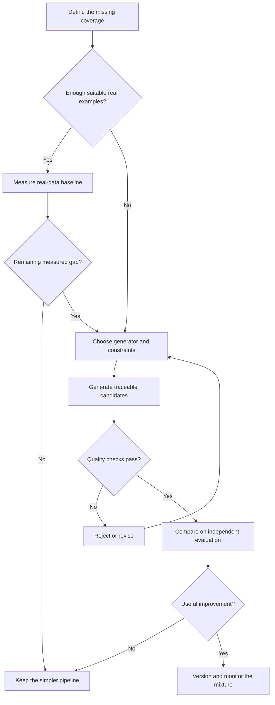
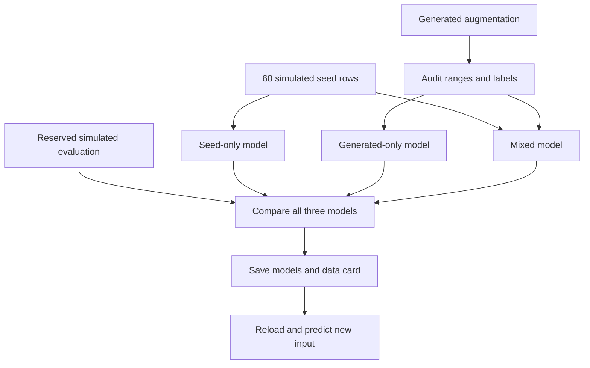

# Synthetic data: create examples, then prove they help

**Concept + Runnable implementation lab** — Learn why engineers generate data, build and audit a small dataset, train three comparison models, and test whether the generated examples improve performance. This workshop runs locally with the existing foundation packages. No paid service, model download, or Vast.ai rental is needed.

## What synthetic data is

**Synthetic data** consists of examples created by a program, simulator, or generative model rather than directly observed from the real process you want to model. It can be a table, sentence, image, sound, sequence of actions, or labeled input/output pair. It does not have to be generated by artificial intelligence. A short Python function can generate it.

Think of a flight simulator: it lets a pilot practice unusual situations without waiting for those situations to occur. Its usefulness depends on how well the simulated situations match what the pilot actually needs to handle. A convincing simulation is still a simulation.

Examples in this course already use synthetic data. The tiny operations language models train on templated fictional requests; the deep classifier uses generated curved clusters; the retrieval workshop uses authored fictional policies. Those exercises teach mechanisms without customer records. They do not prove that the same model will work on real customer language.

**It is useful, not universally required.** If you have enough representative, permitted, well-labeled real examples, a measured real-data baseline may be sufficient. Generate data to address a named gap, then test whether that gap actually closes.

## Why engineers need it in some projects

| Problem | How generated examples can help | Real-world application and required check |
|---|---|---|
| Too few labeled examples | Bootstrap candidate input/output pairs for review | A support-ticket router needs examples for a new product; test on separately collected tickets |
| Rare but important situations | Simulate unusual combinations deliberately | A reliability model needs overload cases; simulated telemetry must match plausible failure mechanisms |
| Expensive or unsafe collection | Recreate conditions in a controlled simulator | A robot practices different object positions and lighting; test with real cameras afterward |
| Confidential source records | Build fictional development fixtures without those records | Engineers test a login-event pipeline with invented users; generators fitted to private records still need privacy evaluation |
| Need precise labels | Obtain labels from rules, a simulator, or an independently checkable solver | Generate arithmetic tasks and verify numerical answers, or coding tasks with independently designed tests |
| Missing task or language coverage | Add targeted instructions, paraphrases, and output formats | A small language model practices a particular support workflow; review meaning, diversity, and correctness |
| Need reproducible failures | Control conditions, seeds, noise, and edge cases | Reproduce a retrieval citation failure or parser error using a fixed test fixture |

More rows do not necessarily mean more information. Ten thousand paraphrases of one example can still represent one underlying situation. Extra data can also increase storage, review, and training cost. Define the gap before choosing a volume.

## Families of synthetic-data methods

These are **data-production methods**, not additional model architectures. One language model can consume examples from several methods.

| Method | Understandable algorithm | Strength | Main failure mode | Scope here |
|---|---|---|---|---|
| Rules and templates | Choose slots, fill a template, compute a rule-based label | Cheap and inspectable | Repetitive wording or incomplete rules | Runnable telemetry generator; existing operations language labs |
| Statistical sampling | Sample values from stated or fitted distributions | Controls frequency, noise, and coverage | Misses relationships or rare tails | Runnable numerical sampling |
| Simulation | Run a model of a process and record its outputs | Produces conditions that are difficult to observe | Simulator assumptions differ from reality | Simple fictional telemetry; complex physics is Concept |
| Data augmentation | Transform a training example while preserving its target when justified | Adds useful variation | Transformation changes meaning or crosses split boundaries | Concept activity; no image augmenter added here |
| Generative models | Train or use a model, sample candidates, then filter and verify | Flexible text, images, or tables | Hallucinations, memorization, and inherited bias | Concept production pipeline; existing generation lessons remain runnable |
| Teacher-generated instruction data | Ask a stronger model for tasks and candidate answers, verify them, train a smaller student | Transfers task supervision | Student inherits wrong answers or narrow teacher habits | Concept link to the existing distillation lesson |

**Distillation** means training a student from teacher signals, which may include probabilities or representations as well as generated answers. Not all synthetic data is distillation, and not all distillation creates a saved text dataset. **Data augmentation** often retains a direct relationship to an original example; keep its parent identifier so relatives stay in the same split. Generating new examples is also different from using a model to attach labels to existing real inputs, although a pipeline can combine both.

Research such as Self-Instruct demonstrates a language-model workflow that generates candidate instructions and examples, filters them, and uses them for adaptation. This is evidence for a particular method and evaluation, not a guarantee that arbitrary model output is useful training material. [1]

## The decision and quality-control algorithm



1. Specify the task, population, labels, and missing cases. “Need more data” is too vague; “no examples of a service with high error rate and moderate queue depth” is testable.
2. Reserve evaluation examples before fitting a generator or designing augmentations. Split by person, document, incident, device, or time when related examples could otherwise leak. Generate training variants only from the training partition. [2]
3. Choose a method whose assumptions are inspectable. For every record, retain source or parent identifier, generator version, seed or model revision, settings, intended label, and review status.
4. Enforce the schema and allowed ranges. Check missing values, impossible combinations, exact and near duplicates, contradictions, label consistency, and category coverage. Passing a schema proves structure, not truth.
5. Verify labels independently where possible. Use domain checks, human review, executable tests, or trusted solvers. A generator agreeing with itself is weak evidence.
6. Train comparable baselines: seed-only, generated-only, and a mixture. Keep model family and evaluation fixed; report differing data counts and training cost. The right mixing ratio is an empirical choice.
7. Measure useful behavior on held-out data, including rare cases and relevant subgroups. Select settings using validation; reserve final tests for the chosen configuration.
8. Version the dataset and model together. Deploy only to the intended scope, monitor incoming coverage and errors, and keep the previous dataset/model pair for rollback.

## Understand the risks before scaling

**Distribution mismatch:** a generator can make realistic-looking rows but the wrong joint relationships. For example, generating CPU load and error rate independently may miss a relationship that matters in real outages. Here CPU means central processing unit. Our own telemetry generator makes explicit simplifying assumptions; it is not a model of an actual service.

**Label noise and shortcuts:** generated answers may be wrong. A classifier can also learn “urgent” rather than the underlying urgency rule if that word occurs only in positive examples. A synthetically balanced class mix changes prevalence; precision and probability calibration on the deployed population may differ even if recall improves.

**Evaluation contamination:** paraphrasing a test question into training makes the test less independent. Exact deduplication alone will not find that relationship. Reserve source groups before producing variations; avoid fitting preprocessing or generators on the held-out data. [2]

**Privacy:** fictional fixtures made without personal records can avoid using those records. A generator trained on sensitive examples can still reveal information about them. Calling its output “synthetic” does not establish anonymity; privacy and utility require separate evidence. This lab does not implement a formal privacy mechanism. [3]

**Recursive degradation:** repeatedly replacing original data with unchecked model outputs can lose diversity and amplify errors, including rare-pattern loss. Research on model collapse studies such failure conditions; it does not mean every use of generated data inevitably collapses. Retain high-quality reference data, validate new batches, and measure coverage over successive versions. The telemetry noise experiment below is not a reproduction of recursive model collapse. [4]

**Provenance:** generation does not erase the origin or usage conditions of source material. Keep records of inputs, generators, and review decisions. This workshop uses wholly fictional records and no purchased books or customer data.

## Runnable lab: a fictional service-incident classifier

**Use case:** predict an incident from queue depth and error percentage. Real reliability teams might use telemetry models to prioritize investigation. Our prototype never controls a service and makes no production claim.

**Input contract:** each row is `[queue_depth, error_percent]`, with queue depth from 0 to 100 and error percentage from 0 to 10. The target is zero for no simulated incident or one for a simulated incident. The model sees only these two features. Identifiers, generator names, original oracle labels, and label-flip markers are audit metadata and must not become features.

The simulator draws numbers and uses this declared rule:

`queue_depth / 100 + 0.7 × error_percent / 10 + small_random_noise > 0.85`

If the inequality is true, label the row one. The noise is sampled from a normal distribution with mean zero and standard deviation 0.04. **Worked example:** a queue of 60 and error percentage of 8 give `0.60 + 0.7 × 0.80 = 1.16` before noise, which exceeds 0.85. The label follows our invented rule; it is not a discovered law of outages.

The generator deliberately creates a small seed dataset of 60 rows with error percentage at most 2.5. Its optional augmentation can cover the full 0–10 range, repeat the narrow range, or inject wrong labels. **All four partitions are simulated**, including the seed and evaluation data. “Seed” means our starting set; it does not mean real observations.



### Build from start to finish

1. **Define success:** improve balanced accuracy on the reserved validation rows, inspect incident recall, and avoid disguising missing coverage. Balanced accuracy is the average of recall for each class. A model that always predicts zero scores 0.5 on this metric when both classes are present.
2. **Create permitted data:** sample the 60 seed rows and, by default, 400 augmentation rows. Separate random streams produce 400 validation and 400 final-test rows. Changing augmentation size, coverage, or label noise leaves both evaluation partitions unchanged. Their shared simulator still limits independence from its assumptions.
3. **Audit:** enforce ranges, binary labels, distinct identifiers, and absence of exact feature duplicates. Record positive-label fraction, high-error coverage, and agreement with the simulator's original label. That original label is available because we wrote the simulator; a real teacher-model dataset does not automatically have such an oracle.
4. **Fit three models:** each is a standardization step followed by logistic regression, trained from scratch without pretrained weights. Each scaler fits only its own training rows. The three branches use 60, 400, and 460 rows respectively; this compares dataset strategies, not equal-compute training.
5. **Evaluate:** inspect balanced accuracy, precision, recall, F1 score, the confusion matrix, and accuracy in the high-error slice. F1 is the harmonic mean of precision and recall; it is a metric name, not an acronym. Confusion-matrix rows are true labels `[0, 1]`; columns are predicted labels `[0, 1]`.
6. **Save:** retain the three models, input contract, dataset card, comma-separated values files, dataset hashes, coverage plot, utility plot, and measured report. A hash helps identify exactly which bytes were used; it does not certify correctness.
7. **Reload and infer:** load the example through Practice, change its feature values, and predict with all three saved models. The same scaling is applied without retraining. Probabilities are model estimates, not certified real-world risks.
8. **Deploy within scope:** use the existing localhost workbench as the teaching interface. Before any real service deployment, gather representative permitted telemetry, validate the labeling process, test on independent real incidents, calibrate thresholds, and measure false alarms and missed incidents.
9. **Monitor and roll back:** track coverage, label quality, class proportions, false-alarm rates, and performance by slice. Preserve dataset and model versions together. Stop adding a batch that harms the selected validation criteria.

### Run and change one variable

Open this lesson's **Practice** tab. The browser runs Python in the included `lab` folder. Each button creates a fresh output folder:

```text
python synthetic_data.py --output outputs/synthetic-full-NEW
python synthetic_data.py --coverage narrow --output outputs/synthetic-narrow-NEW
python synthetic_data.py --label-noise 1 --output outputs/synthetic-wrong-NEW
python synthetic_data.py --samples 2000 --output outputs/synthetic-more-NEW
```

- **Baseline:** compare seed-only, generated-only, and mixed predictions. Explain which new feature region the generated rows cover.
- **Coverage:** keep the count fixed and restrict generated rows to the same narrow region. Inspect the coverage plot even if the aggregate score looks good. A simple model may extrapolate within our invented linear rule; that does not prove missing regions are safe in a real system.
- **Wrong labels:** `--label-noise 1` deliberately flips every generated label. It is a stress test, not a recommendation. The seed labels remain unchanged. Predict what happens when bad generated examples outnumber the seed. Then try `--label-noise 0.4` in the guided terminal to observe partial corruption.
- **Volume:** increase only the generated count from 400 to 2,000. Calculate synthetic share: `400 / 460 ≈ 87%`, then `2000 / 2060 ≈ 97%`. Compare utility rather than assuming five times as many generated rows means five times the benefit. Run time and mix both change.

Repeat selected comparisons with a different `--seed` to examine variability. After choosing settings using validation, run once with `--split test` in a new directory. The test file is inspectable for teaching, but should remain unused while making tuning decisions. Even perfect synthetic test results still require a real-world evaluation before deployment.

### Windows commands

Use PowerShell or Command Prompt in the website folder containing `server.py`. These commands reuse the website's working virtual environment; if you configured a different executable in Windows setup, use that existing executable path instead.

```powershell
Push-Location .\lab
& ..\.venv\Scripts\python.exe .\synthetic_data.py --output outputs\synthetic-full-NEW
Pop-Location
```

```bat
pushd lab
..\.venv\Scripts\python.exe synthetic_data.py --output outputs\synthetic-full-NEW
popd
```

No activation script or Git Bash is needed. The browser's **Add foundation packages** button supplies the existing dependencies if missing. Typical teaching runs are small and use a central processing unit. A larger teacher model or image simulator might justify a graphics processing unit, but first estimate candidates, retained fraction, verification cost, training time, and memory. Use the existing [Vast.ai procedure](#lesson/cloud) only if measured needs justify a rental.

## Apply the concept to language models and retrieval

**Concept activity — language-model data:** design an instruction-data record with `instruction`, `input`, `candidate_answer`, `source_id`, `generator_revision`, and `verification_status`. For a support assistant, start from approved source facts, ask for varied questions, verify answers against those facts, reject contradictions and duplicates, then fine-tune only on accepted training records. This is a design exercise; no teacher service is called by this new lab. Compare it with the runnable [pretraining experiment](#lesson/transfer-compare) and [recurrent language build](#lesson/scratch-recurrent).

**Concept activity — retrieval-augmented generation:** draft five questions grounded in the fictional runbooks and two unsupported questions. Include paraphrases that share few surface words with the source. Have a separate review identify evidence spans and expected abstentions before adding them to evaluation. Documents may legitimately be in the retrieval index; the benchmark questions and answers must not be used to tune the generator or retrieval settings while claiming an independent final test. Continue in the [retrieval workshop](#lesson/rag-pipeline).

**Assessment:** submit the data card, plots, three-branch comparison, noisy-label result, a changed-input prediction, and a paragraph on what the synthetic evaluation cannot establish. Identify one benefit, one failed assumption, a better real-data test, and the conditions under which you would reject generated data. Your conclusion may be “do not use this synthetic batch.”

## Troubleshooting and deeper study

- **Existing output directory:** use a new name. The script refuses to overwrite evidence.
- **Only one label in a very small run:** increase `--samples` or change the seed; logistic regression needs both labels here.
- **Good score despite missing coverage:** inspect the feature plot and subgroup metrics. The model may extrapolate successfully in this simple simulated world; real nonlinear relationships could differ.
- **Generated labels look correct because the file says so:** compare with the audit-only oracle for this exercise. In a real pipeline, independently verify the target rather than trusting the generator's self-rating.
- **High accuracy but low incident recall:** inspect the class mix and confusion matrix. An imbalanced dataset can reward predicting the common class.
- **More data made the result worse:** inspect labels, distribution mismatch, synthetic fraction, and preprocessing. Preserve the result as evidence instead of hiding it.

Primary sources: [1] [Self-Instruct paper](https://aclanthology.org/2023.acl-long.754/); [2] [scikit-learn common pitfalls and data leakage](https://scikit-learn.org/stable/common_pitfalls.html); [3] [Synthetic Data — Anonymisation Groundhog Day](https://www.usenix.org/conference/usenixsecurity22/presentation/stadler); [4] [AI models collapse when trained on recursively generated data](https://www.nature.com/articles/s41586-024-07566-y). The telemetry implementation is an original teaching simulator, not a reproduction of these research systems.
