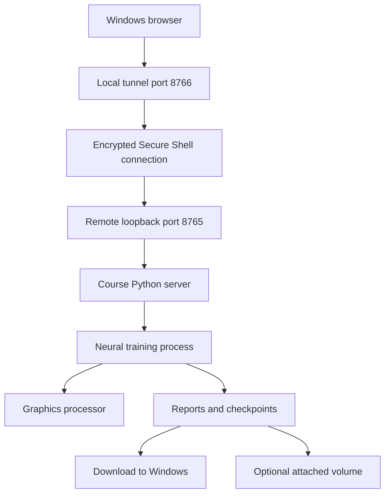

# Rent compute only when an experiment needs it

**Concept** — Cloud architecture, cost planning, and a documented deployment procedure. The commands are intended to run a real lab on a rental, but this release was verified locally; no paid Vast.ai instance was rented during verification.

## The decision before spending money

All 18 foundation experiments use small datasets and run on a central processing unit. Complete them locally first. A graphics processing unit becomes useful when you scale neural-network training, enlarge image batches, or adapt a language model that exceeds your laptop's practical memory or runtime. Renting a graphics processor does not automatically accelerate scikit-learn's ordinary tree or regression implementations.

Measure a local baseline: model, number of examples, batch size, sequence length, memory use, and elapsed time. Decide what would make a rental worthwhile. For example, a larger visual-inspection experiment might require training thousands of high-resolution images. The included convolution lab uses small eight-by-eight images and does not justify a rental by itself.

## Architecture and data flow



The website and training run on the rented machine. Your browser displays the interface through a private tunnel. The course server remains bound to the remote loopback address. A cloud rental is a real computer environment, not a browser simulation.

## 1. Choose a small, compatible rental

Create your Vast.ai account, enable the available account protections, and inspect the live marketplace. Choose a single graphics processor before considering multi-device training. A 24-gigabyte NVIDIA GeForce RTX 3090 or RTX 4090 is a possible starting configuration for larger experiments; it is not a promise that every model will fit. Weight precision, optimizer state, activations, batch size, and context length all affect memory.

Inspect the offered hourly compute price, storage price, upload/download charges, host reliability, available disk, and location. Pick an image with Python 3.12 and Secure Shell access. The pinned PyTorch 2.6.0 environment below targets compatible NVIDIA hardware; a much newer graphics architecture may require a newer, separately tested software environment. Do not choose a card solely by its advertised memory capacity.

## 2. Create a key in Windows PowerShell

Secure Shell is usually abbreviated SSH. It authenticates a remote connection using a private key kept on your computer and a public key supplied to the host. Never upload the private key to the Vast.ai account page.

```powershell
Get-Command ssh, scp, ssh-keygen -ErrorAction SilentlyContinue
New-Item -ItemType Directory -Force "$env:USERPROFILE\.ssh"
ssh-keygen -t ed25519 -f "$env:USERPROFILE\.ssh\vast_lab" -C "machine-learning-lab"
Get-Content "$env:USERPROFILE\.ssh\vast_lab.pub"
```

If the key filename already exists, reuse a suitable key or choose a new name; do not overwrite it. Protect the private key with a passphrase. If these commands are missing, install the Windows OpenSSH Client through Settings → System → Optional features, then reopen PowerShell.

Add the displayed public key to your Vast.ai account **before creating the instance**. Account-key changes are not automatically applied to existing instances. Create the selected instance and wait until it is running. Copy the actual host, port, and username from its Connect instructions.

```powershell
$vastHost = Read-Host "Host from Vast Connect"
$vastPort = [int](Read-Host "Port from Vast Connect")
$vastUser = Read-Host "User from Vast Connect"
$vastKey = "$env:USERPROFILE\.ssh\vast_lab"
ssh -i $vastKey -p $vastPort "${vastUser}@${vastHost}"
```

These are PowerShell variables, not values to guess. Verify the server fingerprint against provider information when available before accepting a first connection. After connection, the terminal is running the remote Linux shell. Linux commands below run there; Git Bash is not involved.

## 3. Verify the remote environment and storage

```bash
python3 --version
nvidia-smi
pwd
df -h
ls -ld /workspace
```

Confirm Python 3.12 and that the expected graphics processor is visible. NVIDIA's diagnostic reports the driver and device; it does not prove that your Python package can use the device. We check that separately after installation.

Do not assume that `/workspace` is a persistent volume. Ordinary container storage survives stopping but is removed when the instance is destroyed. A separately created volume can outlive the instance and continue billing. Vast.ai volumes are tied to the same physical machine; they are not freely attachable to every marketplace host. Inspect the selected template and mount configuration. If you attached a volume at `/data`, verify it with `findmnt -T /data` and `df -h /data` before trusting it.

## 4. Transfer the course archive

In a second **local PowerShell window**, set the same four variables from step 2. Change to the directory containing the downloaded ZIP archive. Secure copy, abbreviated SCP, transfers files over Secure Shell; its port option is uppercase `-P`.

```powershell
scp -i $vastKey -P $vastPort .\SML-Lab-Localhost.zip "${vastUser}@${vastHost}:/workspace/"
```

Back in the **remote Linux shell**, extract into a new directory, create a virtual environment, and install a graphics-enabled PyTorch package:

```bash
python3 -m zipfile -e /workspace/SML-Lab-Localhost.zip /workspace/sml-project
cd /workspace/sml-project/SML-Lab-Localhost
python3 -m venv .venv
.venv/bin/python -m pip install torch==2.6.0 --index-url https://download.pytorch.org/whl/cu124
.venv/bin/python -m pip install -r lab/requirements.txt -r lab/requirements-foundations.txt
.venv/bin/python lab/lab.py doctor
.venv/bin/python -c "import torch; print(torch.cuda.is_available()); print(torch.cuda.get_device_name(0) if torch.cuda.is_available() else 'No graphics processor visible')"
```

CUDA is NVIDIA's parallel-computing platform, historically named Compute Unified Device Architecture. The `cu124` package is built for its 12.4 runtime. A compatible host driver is still required. The final command must print `True` and the expected device name before a graphics-processor training run. If it prints `False`, inspect the driver and package installation rather than starting a long experiment.

Do not click the website's **fresh local installation** option on this prepared cloud environment: that option installs processor-only PyTorch for laptops. The **Add foundation packages** action preserves the installed PyTorch build.

## 5. Start the website and private tunnel

In the **remote shell**:

```bash
.venv/bin/python server.py --no-browser
```

Leave that terminal open. In **local PowerShell**, with the four connection variables set:

```powershell
ssh -i $vastKey -p $vastPort -N -L 127.0.0.1:8766:127.0.0.1:8765 "${vastUser}@${vastHost}"
Start-Process "http://localhost:8766"
```

The tunnel command occupies its terminal while it runs, so open the browser address manually or run `Start-Process` from another local PowerShell window. Port 8766 on Windows forwards to port 8765 on the rented machine. Do not enable the server's development-preview flag or expose the code runner on a public network address.

## 6. Run and compare a neural experiment

In the website's guided terminal:

```text
python foundations.py convolution --device cuda --epochs 20 --output outputs/cloud-convolution-01
```

The explicit device argument selects the graphics processor. Without it, the foundation program defaults to the central processing unit. The tiny included exercise is a connectivity test; overhead can make it slower on a graphics processor. Increase workload only after validating correctness and recording a local comparison. For language-model experiments, use the lesson's actual command with `--device cuda` where supported and a new output path.

Save the report, measured runtime, actual device, package versions, data settings, and at least one plot. Keep seed, split, and settings the same for a hardware comparison. Explain numerical variation; do not equate faster execution with better predictive quality.

## 7. Download evidence before cleanup

Stop the web server with Control+C after saving work. From **local PowerShell**:

```powershell
New-Item -ItemType Directory -Force .\vast-lab-results
scp -i $vastKey -P $vastPort -r "${vastUser}@${vastHost}:/workspace/sml-project/SML-Lab-Localhost/lab/outputs" .\vast-lab-results
```

Open a downloaded report and plot to verify the backup. Then stop or destroy the rental in the Vast.ai console according to your retention needs. Closing the browser or Secure Shell session does not stop billing. Stopping can retain billable storage. Destroying the instance deletes its container data; separately retained volumes may still require separate deletion after backup. Review the console for remaining billable resources.

## Estimate cost and submit the assessment

Estimate **compute hours × compute rate + storage duration × storage rate + transferred data × transfer rate**, using the units displayed in your actual offer. As a fictional example only: two hours at $0.40 per hour, storage at $0.01 per hour for those two hours, and two gigabytes transferred at $0.02 per gigabyte total $0.86. This is arithmetic practice, not a current price quote. Persistent storage kept after the experiment changes the total. Account credit is not a guaranteed spending cap.

Submit your local baseline, the rental decision, estimated and actual cost, device checks, remote report, downloaded backup evidence, and cleanup confirmation. If the local experiment already met your goal, submitting the evidence-based decision **not to rent** satisfies the planning activity.

## Troubleshooting and primary documentation

- Connection refused: compare the running-instance status, address, port, and username with Connect instructions.
- Permission denied: check the chosen private key and whether its public key was attached before instance creation.
- Local port busy: choose another local tunnel port; keep the remote target at the server's actual port.
- Website disconnected: check both the remote server and the local tunnel. Keep their terminals open.
- Memory exhausted: reduce batch size or sequence length, select a smaller model, and measure again before renting a larger device.

[Vast.ai Secure Shell guide](https://docs.vast.ai/guides/instances/connect/ssh), [volume behavior](https://docs.vast.ai/guides/instances/storage/volumes), [billing questions](https://docs.vast.ai/guides/reference/faq/billing), and [PyTorch version-specific installation](https://docs.pytorch.org/get-started/previous-versions/).
